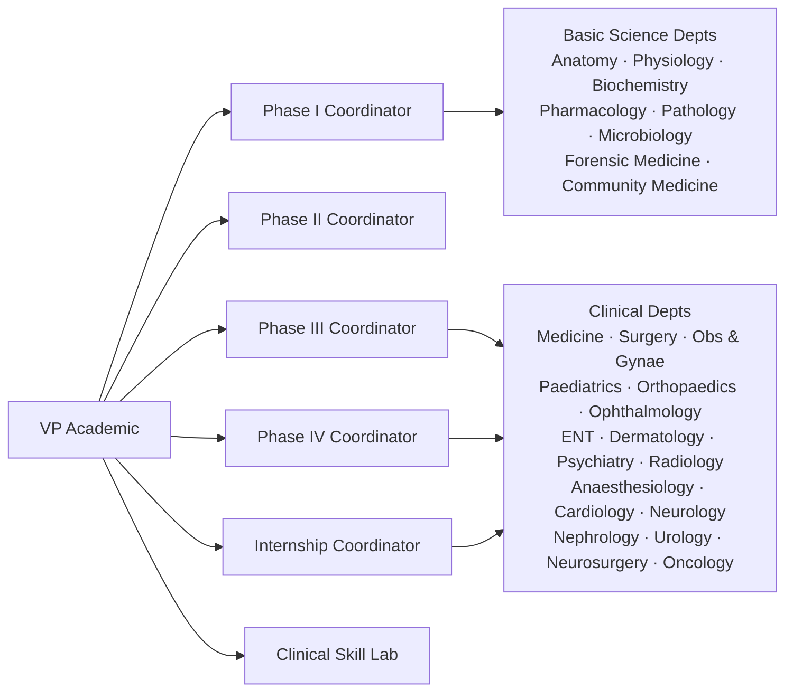
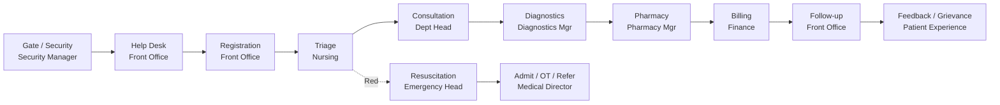

# Organizational Chart — Medical College & Hospital (Bangladesh)

Companion to `Medical_College_Hospital_Organizational_Study_Bangladesh.md`.

## 1. Governance and executive spine

```mermaid
flowchart TD
    GB["General Body / Trustee Board<br/>(owners)"] --> PGB["Governing Body<br/>Parichalana Parshad<br/>Chair + ≥50% entrepreneurs<br/>+ Govt / University / DGME reps"]
    PGB --> AC["Academic Council<br/>Principal (Chair)"]
    PGB --> HMC["Hospital Management Committee<br/>Hospital Director (Chair)"]
    PGB --> FC["Finance Committee"]
    PGB --> MC["Management Committee"]
    PGB --> QC["Quality Control of Education Committee"]
    PGB --> ARC["Audit & Risk Committee"]

    PGB --> PRIN["Principal / CEO<br/>(College)"]
    PGB --> HD["Hospital Director / COO"]
    PGB --> MD["Medical Director / CMO"]
    PGB --> ND["Nursing Director"]
    PGB --> FD["Finance Director / CFO"]
    PGB --> QD["Quality & Patient Safety Director"]

    PRIN --> VPA["Vice-Principal (Academic)"]
    PRIN --> VPA2["Vice-Principal (Administration)"]
    PRIN --> REG["Registrar (Academic)"]
    PRIN --> COE["Controller of Examinations"]
    PRIN --> DOS["Dean of Students"]
    PRIN --> MEU["Medical Education Unit"]
    PRIN --> RES["Research Cell + Ethics Committee"]
    PRIN --> LIB["Library"]

    HD --> FE["Front Office & Patient Experience"]
    HD --> DIAG["Diagnostics"]
    HD --> PHAR["Pharmacy"]
    HD --> SUP["Support Services"]
    HD --> FAC["Facilities & Biomedical Engg."]
    HD --> SEC["Security & Safety"]
    HD --> HIM["Health Information / Records"]
    HD --> IT["IT & Digital Health"]
    HD --> HR["Human Resources"]
    HD --> LEG["Legal & Medico-legal"]

    MD --> DEPT["Clinical Department Heads"]
    MD --> ED["Emergency"]
    MD --> ICU["ICU / CCU / HDU"]
    MD --> OT["OT Complex"]
    MD --> IPC["Infection Prevention & Control"]
    MD --> CQ["Clinical Quality & Audit"]

    ND --> MAT["Matrons"]
    MAT --> WIC["Ward In-charges"]
    WIC --> SN["Staff Nurses"]
```

## 2. Academic departments

## 3. Patient journey ownership

## 4. Committee map

```mermaid
flowchart TD
    GB2["Governing Body"] --> S1["Statutory (2022 Act)"]
    GB2 --> S2["Clinical governance"]
    GB2 --> S3["Academic"]
    GB2 --> S4["Corporate"]

    S1 --> S1a["Management Committee"]
    S1 --> S1b["Finance Committee"]
    S1 --> S1c["Academic Committee"]
    S1 --> S1d["Quality Control of Education Committee"]

    S2 --> S2a["Medical Advisory"]
    S2 --> S2b["Mortality & Morbidity"]
    S2 --> S2c["Infection Prevention & Control"]
    S2 --> S2d["Pharmacy & Therapeutics"]
    S2 --> S2e["Transfusion"]
    S2 --> S2f["Radiation Safety"]
    S2 --> S2g["Patient Safety & Incident Review"]

    S3 --> S3a["Admission Committee"]
    S3 --> S3b["Examination Committee"]
    S3 --> S3c["Research Ethics Committee"]
    S3 --> S3d["Anti-ragging / Discipline"]

    S4 --> S4a["Audit & Risk"]
    S4 --> S4b["Procurement / Tender"]
    S4 --> S4c["Fire & Disaster Management"]
    S4 --> S4d["Grievance Redress"]
    S4 --> S4e["Sexual Harassment Prevention"]
```

