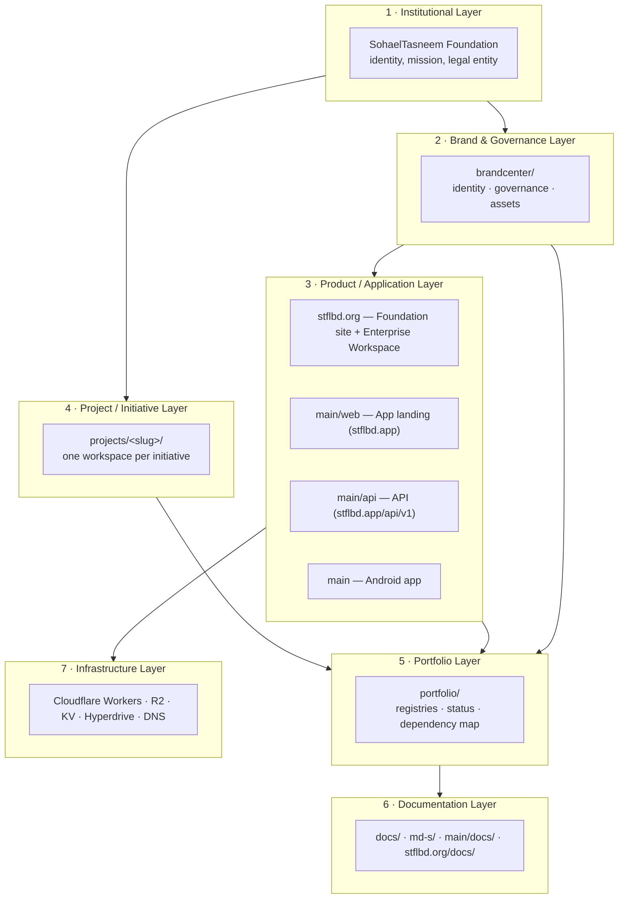

# STFL Architecture

Seven layers. Each layer has exactly one authority. No layer may silently redefine another.



---

## 1 · Institutional Layer

**Authority:** the Foundation itself.

The legal and institutional identity: *SohaelTasneem Foundation*, abbreviation **STFL**, jurisdiction Bangladesh, canonical domain `stflbd.org`.

Recorded in [`portfolio/PORTFOLIO_MASTER.md`](../portfolio/PORTFOLIO_MASTER.md) and `STFL_PROJECT_REGISTRY.json` → `organization`.

This layer is not code. It is the reason the code exists.

---

## 2 · Brand & Governance Layer

**Authority:** [`brandcenter/`](../brandcenter/README.md).

Owns naming, logo usage, colour, typography, iconography, imagery, accessibility, localization, approval workflow and asset lifecycle.

Governing documents:

| Document | Scope |
|---|---|
| [`brandcenter/governance/brand-governance.md`](../brandcenter/governance/brand-governance.md) | Master brand rules |
| [`brandcenter/governance/naming.md`](../brandcenter/governance/naming.md) | Institutional and project naming |
| [`brandcenter/governance/logo-governance.md`](../brandcenter/governance/logo-governance.md) | Logo variants and usage |
| [`brandcenter/governance/color-system.md`](../brandcenter/governance/color-system.md) | Palette and tokens |
| [`brandcenter/governance/typography.md`](../brandcenter/governance/typography.md) | Bilingual type system |
| [`brandcenter/governance/iconography.md`](../brandcenter/governance/iconography.md) | Iconoir-only policy |
| [`brandcenter/governance/imagery.md`](../brandcenter/governance/imagery.md) | Photography and illustration |
| [`brandcenter/governance/accessibility.md`](../brandcenter/governance/accessibility.md) | Contrast, motion, focus |
| [`brandcenter/governance/localization.md`](../brandcenter/governance/localization.md) | Bangla / English rules |
| [`brandcenter/governance/approval-workflow.md`](../brandcenter/governance/approval-workflow.md) | How assets get approved |

**Hard boundary:** the Brand Center holds *canonical copies*. Production code continues to load assets from its own `public/` and `res/` paths. See [`portfolio/DEPENDENCY_MAP.md`](../portfolio/DEPENDENCY_MAP.md).

---

## 3 · Product / Application Layer

**Authority:** each deployable folder owns its own implementation.

| Deployable | Folder | Worker | Domain | Audience |
|---|---|---|---|---|
| Foundation site + Enterprise Workspace | `stflbd.org/` | `stfl-foundation-web` | `stflbd.org` | Public, donors, staff, officers |
| App landing | `main/web/` | `stfl-web` | `stflbd.app` | App users, stores |
| API | `main/api/` | `stfl-api` | `stflbd.app/api/v1` | Android + workspace |
| Android app | `main/` | — | `foundation.sohaeltasneem.app` | Mobile users |

The domain split is constitutional: [`STFL_DOMAIN_SEPARATION_ARCHITECTURE.md`](../STFL_DOMAIN_SEPARATION_ARCHITECTURE.md).

> `stflbd.org` is the organisation. `stflbd.app` is the mobile app — its landing page and its backend. Nothing else.

---

## 4 · Project / Initiative Layer

**Authority:** [`projects/`](../projects/PROJECT_REGISTRY.md).

Each initiative gets one workspace with a fixed shape:

```
projects/<slug>/
├── README.md            What it is
├── PROJECT_PROFILE.md   Identity, ownership, domain, technology
├── STATUS.md            Lifecycle state and last known activity
├── ARCHITECTURE.md      How it is built (only if known)
├── ASSETS/              Project-specific brand assets
├── DOCS/                Project documentation
├── DESIGN/              Design source
├── SOURCE/              Only when actual source belongs to the project
├── INTEGRATIONS/        External systems
└── ARCHIVE/             Retired material
```

`SOURCE/` is created **only** when real source exists. No fabricated code.

---

## 5 · Portfolio Layer

**Authority:** [`portfolio/`](../portfolio/README.md).

Answers *"what does STFL own, operate, build, maintain, archive, or plan?"*

| Registry | Question it answers |
|---|---|
| `PROJECT_REGISTRY.md` | Which initiatives exist and in what state? |
| `BRAND_REGISTRY.md` | Which brand assets are canonical? |
| `DOMAIN_REGISTRY.md` | Which domains exist and who owns them? |
| `DEPLOYMENT_REGISTRY.md` | What is deployed where? |
| `TECHNOLOGY_REGISTRY.md` | What stacks are in use? |
| `DEPENDENCY_MAP.md` | What depends on what? |
| `IMPLEMENTATION_REGISTER.md` | What is actually built? |
| `STATUS_MATRIX.md` | What is live right now? |
| `ROADMAP.md` | What comes next? |

---

## 6 · Documentation Layer

**Authority:** distributed by domain, indexed centrally.

| Location | Content |
|---|---|
| `docs/` | Cross-cutting index and portfolio-level docs |
| `md-s/` | 78 AIO / VI specification documents |
| `main/docs/` | Android, API, database, release, security |
| `stflbd.org/docs/` | Ecosystem, brand, project, web architecture |
| `main/web/docs/` | App landing documentation |
| Root `STFL_*.md` | Canonical governance documents |

Canonical source map: [`STFL_VI_CANONICAL_SOURCE_MAP.md`](../STFL_VI_CANONICAL_SOURCE_MAP.md).

---

## 7 · Infrastructure Layer

**Authority:** Cloudflare account `ffdc985581a586cce38fc03d38bd1e61` and the Play Console.

| Component | Value | Changeable by portfolio work? |
|---|---|---|
| Workers | `stfl-foundation-web`, `stfl-web`, `stfl-api` | **No** |
| Routes | `stflbd.org`, `stflbd.app/*`, `stflbd.app/api/*` | **No** |
| `CONFIG_KV` | `a2f247fbc4914040adc3c78befb6bb7a` | **No** |
| R2 | `stfl-media` | **No** |
| Hyperdrive | binding `HYPERDRIVE` | **No** |
| DNS | Cloudflare zones `stflbd.org`, `stflbd.app` | **No** |
| Signing | `keystore.properties` (gitignored) | **No** |

---

## Layer interaction rules

1. **Brand never overrides production.** A canonical asset copy does not change what production serves.
2. **Portfolio never mutates production.** Registries describe; they do not deploy.
3. **Projects never redefine institutional brand.** A project may have its own logo; it may not redefine STFL's.
4. **Archive is never treated as active.** `ARCHIVED` and `RETIRED` are terminal states until explicitly reopened.
5. **Infrastructure is read-only from the portfolio.** Any infrastructure change is a separate, deliberate, reviewed operation.
