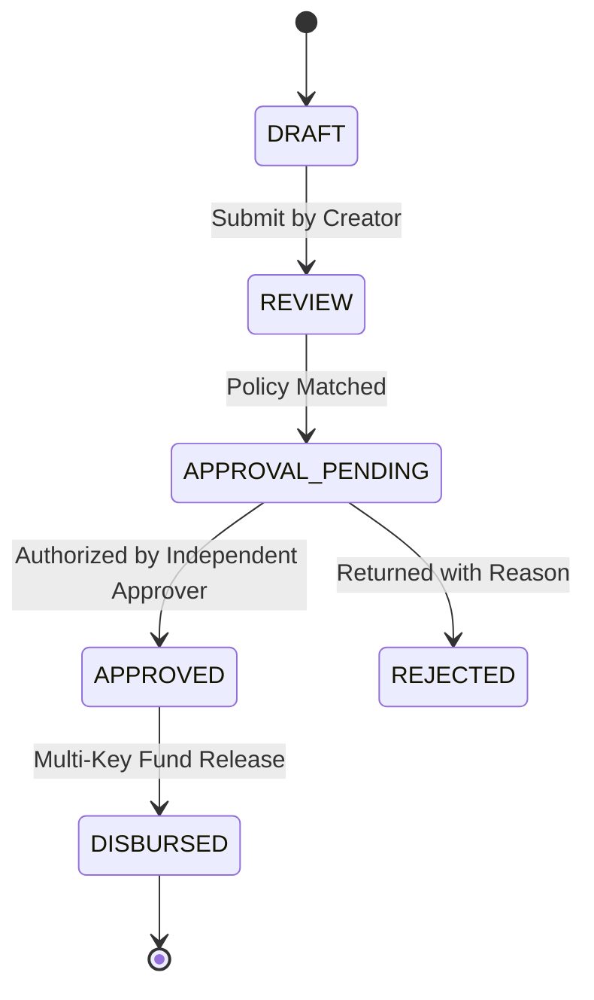

# STFL AIO — Multi-Tier Approval Engine & Anti-Collusion Matrix

**System:** SohaelTasneem Foundation (STFL) Autonomous Enterprise Platform  
**Document Identity:** `STFL-DOC-2026-APPR-V2`  
**Date:** 2026-10-15  
**Attribution:** Made with love from Dhaka, Kuala Lumpur, Wyoming and Varizen Inc.

---

## 1. Approval Modes & Lifecycle

### Approval Modes
1. **SINGLE:** Routine non-financial operations (profile updates, document viewing).
2. **SEQUENTIAL:** Tiered operational tickets (Field Worker -> Officer -> Unit Head).
3. **PARALLEL_THRESHOLD:** Multiple signatories where any M of N authorized officers approve.
4. **DUAL_CONTROL:** Mandatory two independent senior executives (Trustee + Executive) for capital releases > BDT 1,000,000 or compliance hold waivers.

---

## 2. Financial Authority Thresholds

| Approval Tier | Maximum Threshold (BDT) | Required Approver Class | Anti-Collusion Trigger |
| :--- | :--- | :--- | :--- |
| **Tier 1 (Field)** | 10,000 BDT | Class 05 (Field Worker) | Self-approval blocked |
| **Tier 2 (Operational)** | 50,000 BDT | Class 04 (Officer) | Creator != Approver |
| **Tier 3 (Departmental)** | 250,000 BDT | Class 03 (Unit Head) | Creator != Approver |
| **Tier 4 (Executive)** | 1,000,000 BDT | Class 02 (Executive Command) | Multi-signatory review |
| **Tier 5 (Board)** | > 1,000,000 BDT | Class 01 + Class 02 (Dual-Control) | Independent 2FA keys required |
