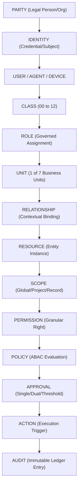
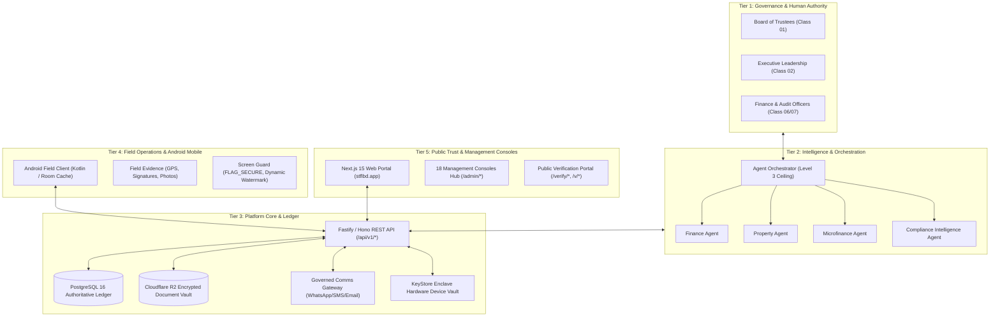

# STFL AIO — Unified Autonomous Enterprise Architecture Specification

**System:** SohaelTasneem Foundation (STFL) Autonomous Enterprise Platform  
**Document Identity:** `STFL-DOC-2026-ARCH-V2`  
**Date:** 2026-10-15  
**Status:** ARCHITECTURAL SPECIFICATION — RATIFIED  
**Security Level:** INTERNAL USE ONLY  
**Attribution:** Made with love from Dhaka, Kuala Lumpur, Wyoming and Varizen Inc.

---

## 1. Constitutional Chain of Authority

The fundamental invariant of the STFL ecosystem is that no action may occur without passing through the complete constitutional chain:

### Architectural Principles
1. **AI Intelligence, Human Authority:** Autonomous AI agents monitor, calculate, detect, and recommend up to **Level 3 Authority Ceiling**. High-risk actions, financial disbursements, and legal hold waivers strictly require human authority.
2. **PostgreSQL Business Truth:** PostgreSQL 16 is the single authoritative source of truth. Numeric values use `NUMERIC(18,2)` exact decimal representation.
3. **Cryptographic Integrity:** Digital documents, certificates, print tokens, and field proofs are cryptographically signed and SHA-256 hashed.
4. **Project Isolation:** Zero cross-project data leakage. Projects enjoy dedicated websites, workflows, and finance while adhering to the STFL constitutional umbrella.

---

## 2. Platform Architecture Tiers

---

## 3. Seven Business Units Architecture

All foundation operations flow through seven standardized, platform-governed business units:
1. **Finance & Accounts:** Chart of accounts, multi-tier vouchers, donor-restricted funds (Zakat, Sadqah, Waqf).
2. **Microfinance & Qard Hasan:** Interest-free micro-credit, borrower scoring, collection routes, zero-usury enforcement.
3. **Property Rental & Waqf Lease:** Real estate units, commercial vs residential tenancy, waqf deed stewardship, utility tracking.
4. **E-Commerce & Impact Shop:** Artisan catalog, warehouse inventory, order routing, social surplus distribution.
5. **HR & Field Workforce:** 13 user classes, volunteer brigades, geofenced mobile check-ins, stipend payroll.
6. **Agency & Humanitarian Projects:** Disaster relief dispatch, flood rehabilitation, donor impact measurement.
7. **Admin, Governance & Assets:** Board resolutions, physical QR/NFC asset tracking, linear depreciation, change control.

---

## 4. Multi-Project / Multi-Tenant Isolation
- Projects operate as first-class governed environments with independent subdomains, custom forms, localized workflows, and isolated accounting.
- **No Cross-Project Data Leakage:** Database row-level security (`tenant_id = project_id`) and API authorization interceptors strictly partition project records.
- Shared global parties retain single unified identities across projects while project-level roles remain strictly scoped.
