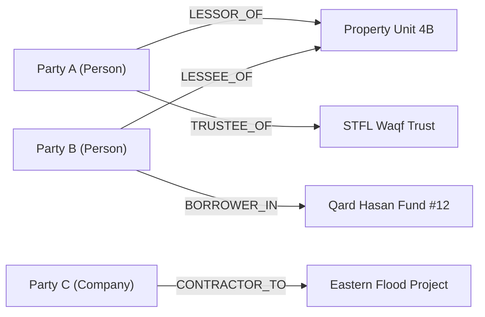

# STFL AIO — Universal Party & Contextual Relationship Model

**System:** SohaelTasneem Foundation (STFL) Autonomous Enterprise Platform  
**Document Identity:** `STFL-DOC-2026-PARTY-V2`  
**Date:** 2026-10-15  
**Attribution:** Made with love from Dhaka, Kuala Lumpur, Wyoming and Varizen Inc.

---

## 1. The Party Abstraction

A `PARTY` represents any legal or social entity that can hold rights, assume obligations, sign contracts, or participate in foundation workflows.

### Party Types
- `PERSON`: Human individual (beneficiary, worker, trustee, tenant, borrower).
- `ORGANIZATION`: Non-governmental organization, civil society body, cooperative.
- `COMPANY`: Commercial corporate entity, contractor, software vendor.
- `GOVERNMENT_ENTITY`: Statutory regulator (NBR, NGOAB, MRA, City Corporation).
- `NGO_FOUNDATION`: Partner foundation, charitable trust.
- `TRUST`: Statutory Waqf or family charitable trust.
- `HOUSEHOLD`: Family socioeconomic unit for poverty alleviation tracking.
- `OTHER_LEGAL_ENTITY`: Ad-hoc consortiums, disaster response committees.

---

## 2. Contextual Relationship Graph



### Relational Schema Representation
```sql
CREATE TABLE parties (
    party_id UUID PRIMARY KEY DEFAULT gen_random_uuid(),
    party_type VARCHAR(32) NOT NULL,
    legal_name VARCHAR(255) NOT NULL,
    bengali_name VARCHAR(255),
    national_id_hash VARCHAR(64),
    tax_id_hash VARCHAR(64),
    created_at TIMESTAMPTZ DEFAULT NOW(),
    updated_at TIMESTAMPTZ DEFAULT NOW()
);

CREATE TABLE party_relationships (
    relationship_id UUID PRIMARY KEY DEFAULT gen_random_uuid(),
    primary_party_id UUID REFERENCES parties(party_id),
    secondary_party_id UUID REFERENCES parties(party_id),
    relationship_type VARCHAR(64) NOT NULL,
    project_id UUID,
    start_date DATE NOT NULL,
    end_date DATE,
    status VARCHAR(32) DEFAULT 'ACTIVE',
    metadata JSONB DEFAULT '{}'::jsonb
);
```
