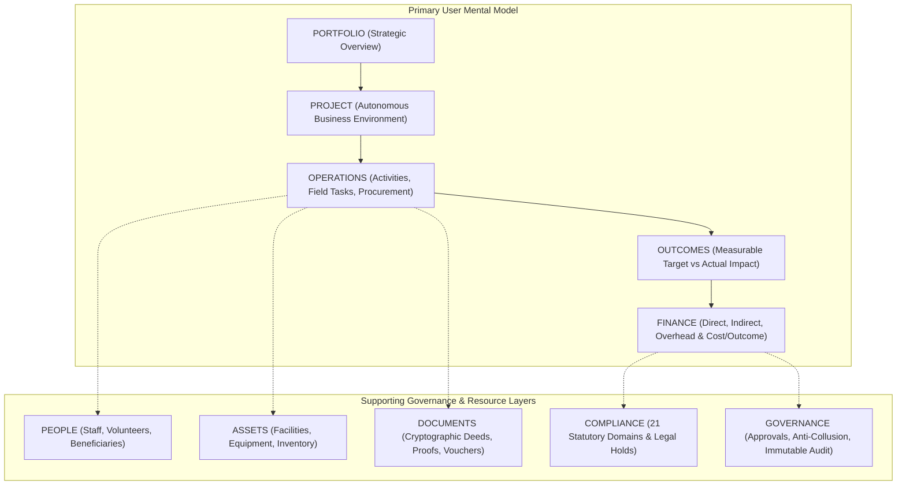

# STFL AIO — Project-Centric UX Architecture & Mental Model

**System:** SohaelTasneem Foundation (STFL) Autonomous Enterprise Platform  
**Document Identity:** `STFL-DOC-2026-UX-ARCH-V1`  
**Phase:** Phase 2 — Architecture & Mental Model Specification  
**Date:** 2026-10-15  
**Attribution:** Made with love from Dhaka, Kuala Lumpur, Wyoming and Varizen Inc.  
*(ঢাকা, কুয়ালালামপুর, ওয়াইওমিং এবং ভ্যারিজেন ইনকর্পোরেটেড থেকে ভালোবাসায় তৈরি)*  

---

## 1. Constitutional UX Principle

> **"STFL AIO is organized around Projects, Operations, Outcomes and Resources.  
> Governance, authorization, security and administrative consoles are supporting control layers, not the primary user mental model."**



---

## 2. The Money → Work → Outcome Model (Section 11)

The platform rejects ambiguous charitable accounting and visualizes the exact causal chain linking money to tangible human impact:

```
FUNDS RECEIVED
      ↓
COMMITTED BUDGET
      ↓
DIRECT EXPENDITURE (vs. Shared & Overhead)
      ↓
FIELD RESOURCES & ACTIVITIES (Operations)
      ↓
VERIFIED PHYSICAL OUTPUTS
      ↓
MEASURABLE OUTCOMES
      ↓
HUMAN DIGNITY & COMMUNITY IMPACT
```

### Exemplary Concrete Trajectory:
- **Funds Received:** ৳12,000,000 (Zakat & Waqf Educational Grant)
- **Committed Budget:** ৳9,300,000 (Allocated to 14 rural learning centers)
- **Direct Project Expenditure:** ৳8,400,000 (Teachers, books, solar learning tablets, classroom rent)
- **Indirect / Shared Operational Cost:** ৳600,000 (Regional supervisory travel, mobile data, logistics)
- **Administrative Overhead:** ৳300,000 (3.2% institutional accounting & legal compliance)
- **Physical Output:** 7,680 students completing academic modules across 120 sessions.
- **Verified Outcome:** 91% grade advancement and functional literacy target achieved.
- **Cost per Verified Outcome:** ৳1,093.75 per student advanced.

---

## 3. Cost Visibility & Financial Ratio Architecture (Section 10)

The system does NOT promote superficial "less expenditure is always better" metrics. It surfaces real programmatic health through rigorous ratios:

$$\text{Total Cost} = \text{Direct Project Cost} + \text{Indirect / Shared Cost} + \text{Administrative Overhead}$$

$$\text{Direct Cost Ratio} = \frac{\text{Direct Project Cost}}{\text{Total Cost}} \times 100\% \quad (\text{Target: } \ge 85\%)$$

$$\text{Overhead Ratio} = \frac{\text{Administrative Overhead}}{\text{Total Cost}} \times 100\% \quad (\text{Target: } \le 7\%)$$

$$\text{Cost per Verified Outcome} = \frac{\text{Total Cost}}{\text{Verified Outcomes Achieved}}$$

$$\text{Cost per Beneficiary} = \frac{\text{Total Direct Expenditure}}{\text{Unique Verified Beneficiaries Reached}}$$

---

## 4. Universal 8-Step Information Hierarchy (Section 28)

Every view in the redesigned operating system answers these eight questions in descending order:

1. **WHERE AM I?** — Breadcrumbs & persistent Project Context (`STFL AIO > Education Access 2026 > Operations`).
2. **WHAT IS THIS?** — Clear editorial heading and concise bilingual Bengali/English narrative.
3. **WHAT MATTERS NOW?** — Priority attention banners (`ACTION REQUIRED`, `APPROVAL REQUIRED`, `OVERDUE`).
4. **WHAT CAN I DO?** — Primary contextual action buttons (`Submit Field Proof`, `Approve Voucher`, `Log Activity`).
5. **WHAT HAPPENED?** — Live activity feeds, completed tasks, disbursed funds, generated proofs.
6. **WHY?** — Traceable linkages connecting activities to specific budgets, policies, and beneficiaries.
7. **WHAT DOES IT COST?** — Explicit direct vs shared costs and budget variance.
8. **WHAT WILL HAPPEN NEXT?** — Milestone schedules, next required approval, upcoming compliance reviews.
