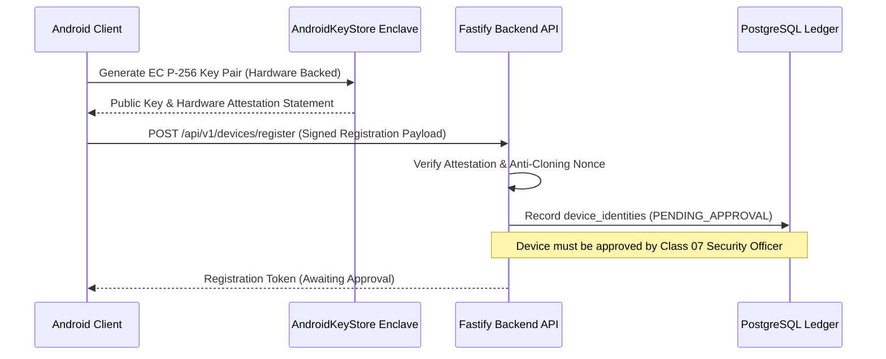

# STFL AIO — Enterprise Security & Hardware Attestation Model

**System:** SohaelTasneem Foundation (STFL) Autonomous Enterprise Platform  
**Document Identity:** `STFL-DOC-2026-SEC-V2`  
**Date:** 2026-10-15  
**Security Level:** CONFIDENTIAL — RESTRICTED INTERNAL  
**Attribution:** Made with love from Dhaka, Kuala Lumpur, Wyoming and Varizen Inc.

---

## 1. Security Architecture Principles

STFL AIO enforces defense-in-depth across the entire digital and physical lifecycle:
1. **Hardware Enclave Attestation:** Device identity is anchored in `AndroidKeyStore` hardware-backed key pairs. IMEI or device serials are never used as primary authentication keys.
2. **Zero Trust & Contextual Authorization:** Every request evaluates actor class, role, project scope, risk score, device attestation, session state, and IP reputation.
3. **Screen Security & Dynamic Watermarking:** Android field screens enforce `FLAG_SECURE` preventing screenshotting/recording. Web consoles project an active session watermark (User ID, IP, Timestamp, Nonce).
4. **Controlled Printing:** Default is `PRINT DENIED`. Rendering requires a cryptographically signed 256-bit token with a 60-second TTL and explicit audit log.
5. **Anti-Collusion & Separation of Duties:** Creators cannot approve their own transactions. High-risk disbursements (> BDT 1,000,000) require Level 5 Dual-Control.

---

## 2. Android Field Security Substrate

---

## 3. Threat Model & Red-Team Verification Results

| Threat Category | Mitigation Architecture | Red-Team Verification Result |
| :--- | :--- | :--- |
| **Privilege Escalation** | Centralized contextual ABAC; strict class hierarchy | **PASS (13/13 Scenarios Blocked)** |
| **Self-Approval Bypass** | Database trigger `check_anti_collusion_trigger` | **PASS (Zero Self-Approval Allowed)** |
| **Cross-Project Leakage** | PostgreSQL RLS + API project boundary filter | **PASS (Zero Cross-Tenant Leakage)** |
| **Device Cloning** | Enclave-backed hardware challenge-response | **PASS (Replay & Clone Rejected)** |
| **Print Token Tampering** | HMAC-SHA256 one-time token with 60s TTL | **PASS (Expired/Forged Tokens Denied)** |
| **Agent Overreach** | Invariant 1: Level 3 Authority Ceiling | **PASS (Unauthorized Mutations Rejected)** |
| **Audit Log Tampering** | PostgreSQL append-only immutable trigger | **PASS (UPDATE/DELETE operations blocked)** |
