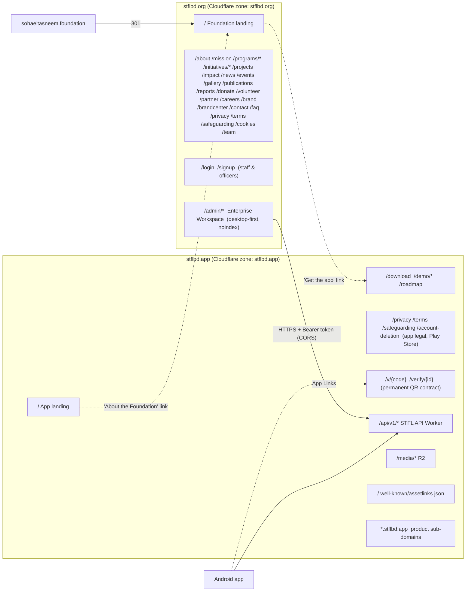
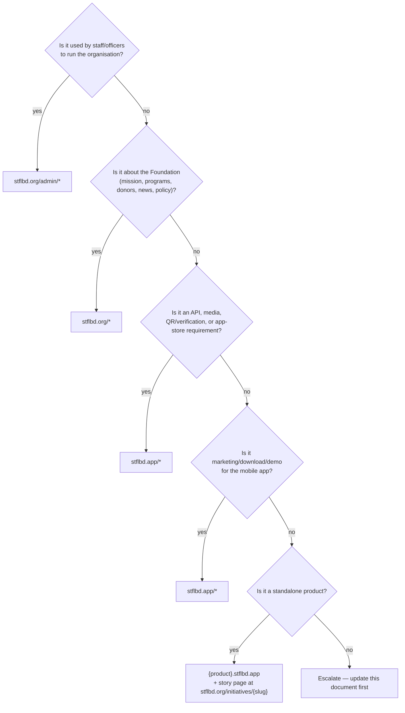

# STFL Domain Separation Architecture — `stflbd.org` vs `stflbd.app`

| Field | Value |
|---|---|
| Status | **CONSTITUTIONAL — binding for all humans and AI agents** |
| Version | 1.0 |
| Date | 2026-10-18 |
| Supersedes | Any doc, config or code that treats `stflbd.app` as the organisation's main website |
| Companion | [STFL_DOMAIN_SEPARATION_EXECUTION_PROMPT.md](./STFL_DOMAIN_SEPARATION_EXECUTION_PROMPT.md) (copy-paste prompt to carry out this spec) |

---

## 1. The rule in one sentence

> **`stflbd.org` is the organisation. `stflbd.app` is the mobile app (its landing page and its backend). Nothing else.**

| Domain | Owns | Audience | Device focus |
|---|---|---|---|
| **`stflbd.org`** | Foundation's public website **and** the Enterprise Workspace (all `/admin/*` consoles: finance, IAM, HR/workforce, property, documents, compliance, governance, etc.) | Public, donors, partners, staff, officers, management | Public site: all devices. **Enterprise Workspace: desktop/PC first (mandatory)**, tablet supported |
| **`stflbd.app`** | Android app landing page, app download, product demo, app-required legal pages, public QR/document verification, **the API backend** (`/api/v1`), media, product sub-domains (`*.stflbd.app`) | App users, app stores, API clients (Android app **and** the `stflbd.org` workspace) | Mobile first |
| `sohaeltasneem.foundation` | Legacy only — 301 to `stflbd.org` | — | — |
| `stflbd.email` | Official email (`hi@stflbd.email`) — not a website | — | — |

---

## 2. Current state (evidence, captured 2026-10-18)

| # | Finding | Evidence | Impact |
|---|---|---|---|
| F1 | **`stflbd.org` is not on Cloudflare.** Nameservers are `launch1/launch2.spaceship.net` (registrar parking). No A/AAAA/CNAME/MX records exist. HTTPS returns nothing. | `Resolve-DnsName stflbd.org -Type NS`; `curl https://stflbd.org` → `000` | **Root cause of "stflbd.org is empty".** The Worker routes in `stflbd.org/wrangler.toml` (`zone_name = "stflbd.org"`) cannot attach to a zone that does not exist in the Cloudflare account. |
| F2 | The whole organisation is served from `stflbd.app`. Worker `stfl-web` (from `main/web`) owns `stflbd.app/*` and contains the app landing (`/`), the foundation (`/foundation`, `/about`, `/programs/*`, `/donate` …) **and** all enterprise consoles (`/admin/*`). | `main/web/wrangler.toml`, `main/web/src/app/page.tsx` → `AppLandingPage`, `main/web/src/app/foundation/page.tsx` | Brand confusion; enterprise back-office exposed on the app domain; SEO for the foundation accrues to the wrong domain. |
| F3 | Three near-identical Next.js copies exist: `main/web` (canonical per `STFL_VI_CANONICAL_SOURCE_MAP.md`), `stflbd.org/` (fork retargeted to `.org`, has 4 extra initiative pages: `aev-developments`, `helpex`, `oiix`, `perlu`), and root `web/` (older, also routes to `stflbd.app/*`). | File diff of `main/web/src` vs `stflbd.org/src` | Drift. Root `web/` would overwrite `stfl-web` on `stflbd.app` if deployed. |
| F4 | Inside `stflbd.org/src`, ~45 files still hard-code `https://stflbd.app/...` as canonical/OG URL for foundation pages (about, mission, team, donate, terms, privacy, brand …). Only `layout.tsx` uses `stflbd.org`. | grep `stflbd\.app` in `stflbd.org/src` | Even after DNS works, every foundation page would declare `.app` as canonical. |
| F5 | API CORS allows only `https://stflbd.app` and `https://www.stflbd.app`. | `main/api/wrangler.toml` `ALLOWED_ORIGINS` | Enterprise Workspace on `stflbd.org` will be blocked by CORS until fixed. |
| F6 | Android `DataModule.DEFAULT_BASE_URL = "https://api.stflbd.app"` but `api.stflbd.app` does not resolve; `build.gradle.kts` correctly uses `https://stflbd.app/api/v1`. | `main/data/.../di/DataModule.kt:112`, `curl https://api.stflbd.app` → `000` | Latent bug if the default is ever used. |
| F7 | Android App Links use host `stflbd.app`; Play listing legal URLs are `stflbd.app/privacy`, `/terms`, `/safeguarding`, `/account-deletion`. QR codes already printed on documents use `stflbd.app/v/{code}` and `stflbd.app/verify/{id}`. | `AndroidManifest.xml`, `AppConfig.kt`, `api/src/grihosti/engine.ts`, `api/src/documents/engine.ts` | These URLs are **permanent contracts** and must keep working on `stflbd.app` forever. |
| F8 | Web auth already uses `Authorization: Bearer` (no cross-site cookies). | `main/web/src/lib/api.ts` | Good: cross-origin workspace → API works with CORS only; no third-party-cookie problems. |

---

## 3. Target architecture

### 3.1 Deployables (one domain = one Worker = one folder)

| Folder | Worker name | Routes | Purpose |
|---|---|---|---|
| `stflbd.org/` | `stfl-foundation-web` (+ `-production`) | `stflbd.org/*`, `www.stflbd.org/*` | Foundation site + Enterprise Workspace |
| `main/web/` | `stfl-web` (+ `-production`, `-staging`) | `stflbd.app/*`, `www.stflbd.app/*`, `staging.stflbd.app/*` | App landing site **only** (after slimming) |
| `main/api/` | `stfl-api` | `stflbd.app/api/*`, `www.stflbd.app/api/*`, `staging.stflbd.app/api/*` | Backend (more specific route wins over `stfl-web`) |
| `main/` (Android) | — | — | Android app, talks only to `https://stflbd.app/api/v1` |
| `web/`, `apk/` | **none — must never deploy** | — | Legacy mirrors → archive to `_old/` after confirming no unique content |

> Rationale for two separate deployables instead of host-based routing in one app: a bug, leak or outage on one domain cannot expose or break the other, and each domain can be audited by looking at one folder.

### 3.2 Route ownership matrix

Legend: **O** = served on `stflbd.org` · **A** = served on `stflbd.app` · `301→` = permanent redirect to the other domain (same path unless stated).

| Route | `stflbd.org` | `stflbd.app` | Notes |
|---|---|---|---|
| `/` | **O** Foundation landing | **A** App landing (`AppLandingPage`) | Each links to the other once (header/footer), never embeds it |
| `/foundation` | 301→ `stflbd.org/` | 301→ `stflbd.org/` | Remove page |
| `/about` `/mission` `/team` `/people`(public) `/programs/*` `/initiatives` `/initiatives/*` `/projects` `/projects/*` `/impact` `/news` `/events` `/gallery` `/publications` `/reports` | **O** | 301→ `.org` | Foundation content |
| `/donate` `/volunteer` `/partner` `/careers` `/contact` `/faq` | **O** | 301→ `.org` | |
| `/brand` `/brandcenter` | **O** | 301→ `.org` | Organisation brand assets |
| `/cookies` | **O** | **A** (app-scoped) | Each domain declares its own cookie policy |
| `/privacy` `/terms` `/safeguarding` | **O** (foundation policies) | **A** (app policies, Play Store) | **Keep both.** `.app` versions are referenced by Play listing & Android `AppConfig` |
| `/account-deletion` | 301→ `.app` | **A** | Play Store requirement |
| `/login` `/signup` | **O** (workspace sign-in) | 301→ `.org` | One identity (API on `.app`), one web front door (`.org`). App users sign up inside the Android app |
| `/admin` `/admin/*` | **O** Enterprise Workspace | 301→ `.org` | Desktop-first, `noindex`, `X-Frame-Options: DENY` |
| `/demo` and demo sub-routes (`/finance` `/operations` `/governance` `/outcomes` `/compliance` `/documents`, demo `/people`, demo `/projects`) | 301→ `.app/demo/*` | **A** under `/demo/*` | Sandbox stays off the production workspace domain. Move the bare demo sub-routes under `/demo/…` on `.app` |
| `/download` `/roadmap` | 301→ `.app` | **A** | Product pages |
| `/v/{code}` `/verify` `/verify/{id}` | 301→ `.app` | **A — PERMANENT** | Printed QR codes. Never rename, never redirect away from `.app` |
| `/api/*` | **never** (no route, no proxy) | **A** `stfl-api` | Single API origin |
| `/media/*` | — | **A** | R2 public base |
| `/.well-known/assetlinks.json` | — | **A** (200, no redirect) | Android App Links |
| `/sitemap.xml` `/robots.txt` | **O** foundation URLs only; disallow `/admin` | **A** app URLs only; disallow `/api`, `/demo/*` sub-pages | One sitemap per domain, no cross-domain URLs |
| `*.stflbd.app` (grihostios, skillconnect, maxremit, proiozon, aev, helpex, perlu, oiix) | — | **A** | Product apps; the *story* page for each lives at `stflbd.org/initiatives/{slug}` |

### 3.3 Cross-domain integration contract

1. **API base** — every client uses exactly `https://stflbd.app/api/v1` (staging: `https://staging.stflbd.app/api/v1`). No `api.stflbd.app`, no `stflbd.org/api`.
2. **CORS** — `ALLOWED_ORIGINS` = `https://stflbd.org,https://www.stflbd.org,https://stflbd.app,https://www.stflbd.app` (production). Staging adds only `https://staging.stflbd.org` (if created) and `https://staging.stflbd.app`.
3. **Auth** — Bearer access token in memory + refresh flow via API; **no cookies shared between domains** (avoids third-party-cookie blocking). Enterprise sessions: idle timeout ≤ 30 min, absolute ≤ 12 h.
4. **CSP** — `stflbd.org`: `connect-src 'self' https://stflbd.app https://*.stflbd.app; img-src 'self' data: blob: https://stflbd.app; frame-ancestors 'none'` for `/admin/*`. `stflbd.app`: no `connect-src` to `stflbd.org` is needed.
5. **Links between domains** — always absolute (`https://stflbd.org/...`), `rel="noopener"`; never iframe one domain inside the other.
6. **Email** — official address stays `hi@stflbd.email`. Do **not** introduce `@stflbd.app` addresses for the organisation (e.g. `brand@stflbd.app` in `/brand` must change).

### 3.4 Single source of domain constants

Hard-coded domain strings are the reason the domains drifted. From now on:

| Codebase | File | Exports |
|---|---|---|
| `stflbd.org/` and `main/web/` | `src/lib/domains.ts` | `FOUNDATION_ORIGIN = "https://stflbd.org"`, `APP_ORIGIN = "https://stflbd.app"`, `API_BASE_URL` (from env, default `https://stflbd.app/api/v1`), `VERIFY_ORIGIN = APP_ORIGIN`, `SITE_ORIGIN` (this deployable's own origin), helper `canonical(path)` |
| `main/api/` | `src/config/domains.ts` | `APP_ORIGIN`, `FOUNDATION_ORIGIN`, `verifyUrl(id)`, `qrUrl(code)` — used by `documents/engine.ts`, `grihosti/engine.ts`, `comms/engine.ts`, `routes/app.ts` |
| Android | `core/.../brand/Brand.kt` | `FOUNDATION_URL`, `APP_URL`, `API_BASE_URL` — `AppConfig.kt`, `AppConfigUi.kt`, `DataModule.kt` read from here / `BuildConfig` |

Rule: **the literal strings `stflbd.org` / `stflbd.app` may appear only in those files, `wrangler.toml`, `.env*`, `vercel.json`, `sitemap.xml`, `robots.txt`, `AndroidManifest.xml`, `build.gradle.kts`, tests and docs.** Enforced by CI (§6).

---

## 4. Infrastructure steps (Cloudflare & registrar)

| Step | Action | Owner | Verification |
|---|---|---|---|
| I1 | Cloudflare dashboard → *Add a site* → `stflbd.org` (same account as `stflbd.app`, id `ffdc9855…`) | Infra | Zone shows "Pending nameserver update" |
| I2 | Spaceship registrar → `stflbd.org` → Nameservers → replace `launch1/2.spaceship.net` with the two Cloudflare NS shown in I1. Disable DNSSEC at Spaceship first if on | Infra | `Resolve-DnsName stflbd.org -Type NS` returns `*.ns.cloudflare.com` (allow up to 24 h) |
| I3 | DNS records: proxied `AAAA @ 100::` and `AAAA www 100::` (Worker-route placeholders), or use Worker **Custom Domains** instead of routes | Infra | Records orange-clouded |
| I4 | SSL/TLS = **Full (strict)**, Always Use HTTPS = on, min TLS 1.2, HSTS only after everything is green (current header uses `preload; includeSubDomains`, so every future `*.stflbd.org` must be HTTPS) | Infra | SSL Labs A |
| I5 | Redirect rule: `www.stflbd.org/*` → `https://stflbd.org/$1` (301) — pick **apex** as canonical for both domains | Infra | `curl -I https://www.stflbd.org` → 301 |
| I6 | Deploy `stflbd.org/` with `npx opennextjs-cloudflare build` then `wrangler deploy --env production` | Web | `curl -I https://stflbd.org` → 200 |
| I7 | Legacy `sohaeltasneem.foundation` → Bulk Redirect 301 → `https://stflbd.org/$path` | Infra | 301 chain length 1 |
| I8 | Email auth for `stflbd.org` even though it sends no mail: `TXT @ "v=spf1 -all"`, `TXT _dmarc "v=DMARC1; p=reject"` (prevents spoofing the org domain). Same for `stflbd.app` if it sends no mail | Infra | `Resolve-DnsName -Type TXT` |
| I9 | Google Search Console: add a `stflbd.org` property and submit its sitemap; resubmit the slimmed `stflbd.app` sitemap. Do **not** use *Change of Address* (this is a partial move) — rely on per-URL 301s | SEO | Coverage report shows foundation URLs indexed on `.org` |

---

## 5. Enterprise Workspace on `stflbd.org` — PC usability requirements

The Enterprise Workspace (`/admin/*`) **must** be fully usable on a desktop/laptop browser. Mobile is the Android app's job.

| Area | Requirement |
|---|---|
| Browsers | Latest 2 versions of Chrome, Edge, Firefox; Safari 17+ on macOS |
| Layout | Desktop-first: designed for 1366×768 and 1920×1080; no horizontal scroll ≥ 1280 px; persistent left navigation for consoles; usable down to 1024 px (tablet landscape). Below 768 px show a "use a PC or the Android app" notice rather than a broken layout |
| Data UI | Tables with sort/filter/pagination, column resize, sticky headers; CSV/XLSX export where permitted by authorization model; print-friendly views (controlled print engine) |
| Input | Full keyboard navigation, visible focus, shortcuts for search (`/`) and save (`Ctrl+S`) where applicable; WCAG 2.2 AA |
| Security | `noindex, nofollow` meta + `X-Robots-Tag`, `X-Frame-Options: DENY`, `Cache-Control: no-store` on authenticated pages, session timeout per §3.3, all data via API with Bearer token |
| Language | Bilingual (bn/en) per `STFL_WEB_BILINGUAL_GOVERNANCE.md` |
| Future-proofing | Workspace base path is configurable (`WORKSPACE_BASE = "/admin"`), so it can later move to `workspace.stflbd.org` by config change only |

---

## 6. Guardrails that keep the domains separate in the future

1. **CI domain-lint** (`scripts/verify-domain-separation.mjs`, run in each web project's `npm run verify`):
   - In `stflbd.org/src`: fail on `stflbd.app` literals except via `domains.ts`; fail if any `canonical`/`openGraph.url` resolves to `.app`; fail if `src/app/download`, `src/app/demo`, `src/app/v`, `src/app/verify`, `src/app/roadmap` exist.
   - In `main/web/src`: fail on `stflbd.org` literals except via `domains.ts`; fail if `src/app/admin`, `src/app/foundation`, `src/app/about`, `src/app/programs`, `src/app/initiatives`, `src/app/donate` … (foundation list in §3.2) exist.
   - Everywhere: fail on `api.stflbd.app`, `stflbd.org/api`, `@stflbd.app` organisation emails.
   - Both `wrangler.toml` files: routes must match §3.1 exactly.
2. **Live smoke test** (`scripts/verify-live-domains.ps1`) — asserts every row of §3.2 (status code and `Location` header) and that `https://stflbd.app/.well-known/assetlinks.json` returns 200 JSON.
3. **Deploy guard** — root `web/` and `apk/` get a `wrangler.toml` removed / `"private": true` + a `predeploy` script that exits 1, then are archived.
4. **PR checklist** (add to every PR template): "Which domain does this change belong to? Does any new URL follow §3.2? No new hard-coded domain literals?"
5. **New-feature decision rule**:

---

## 7. Acceptance criteria (Definition of Done)

- [ ] `stflbd.org` NS = Cloudflare; `https://stflbd.org` → 200 with Foundation landing; `www` → 301 apex.
- [ ] `https://stflbd.org/admin` → login, fully usable at 1366×768 and 1920×1080 in Chrome/Edge/Firefox; API calls succeed (CORS OK).
- [ ] `https://stflbd.app` → 200 App landing; contains no foundation pages and no `/admin`.
- [ ] Every "301→" row in §3.2 verified by `verify-live-domains.ps1` (single hop, correct target).
- [ ] `stflbd.app/v/{code}`, `/verify/{id}`, `/privacy`, `/terms`, `/safeguarding`, `/account-deletion`, `/.well-known/assetlinks.json`, `/api/v1/*` unchanged and 200.
- [ ] No foundation page on `.org` declares a `.app` canonical/OG URL; sitemaps contain only own-domain URLs.
- [ ] CI domain-lint passes in `stflbd.org/`, `main/web/`, `main/api/`, Android.
- [ ] Android `DataModule.DEFAULT_BASE_URL` fixed; `./gradlew test` green; release not required unless URLs in the binary changed.
- [ ] `STFL_VI_CANONICAL_SOURCE_MAP.md`, `STFL_WEB_ROUTES.md`, `STFL_WEB_SEO_MODEL.md`, `STFL_WEB_ARCHITECTURE.md`, `main/docs/API.md`, `main/docs/PLAY_STORE_LISTING.md` updated to reference this document.
- [ ] Root `web/` and `apk/` cannot be deployed.

---

## 8. Rollback

| Failure | Rollback |
|---|---|
| `stflbd.org` deploy broken | `wrangler rollback` on `stfl-foundation-web-production`; `.app` redirects to `.org` are disabled by toggling the Cloudflare redirect rule (keep pages in `main/web` until `.org` has been green for 14 days) |
| CORS/auth breaks workspace | Revert `ALLOWED_ORIGINS` change via `wrangler rollback` on `stfl-api` |
| Wrong redirect | Redirects live in Cloudflare Bulk Redirects / Next `redirects()` — revert list; 301s are cached by browsers, so test with `curl` before enabling |

---

## 9. Decision log (defaults chosen — change here first if you disagree)

| ID | Decision | Default | Alternative |
|---|---|---|---|
| D1 | Codebase for `.org` | `stflbd.org/` folder (already wired to `.org`) after merging newer `main/web` changes into it | Keep `main/web` for `.org` and create a new slim `main/app-site` for `.app` |
| D2 | Demo workspace location | `stflbd.app/demo/*` (sandbox separate from production workspace) | `stflbd.org/demo/*` |
| D3 | Web login/signup | `stflbd.org/login` only; `.app/login` 301 → `.org` | Keep a separate app-user login on `.app` |
| D4 | Canonical host | Apex (`stflbd.org`, `stflbd.app`); `www` 301 → apex | `www` canonical |
| D5 | Workspace location | `stflbd.org/admin/*` now; `workspace.stflbd.org` possible later via `WORKSPACE_BASE` | Sub-domain now |
| D6 | API host | `stflbd.app/api/v1` only | Dedicated `api.stflbd.app` (would need DNS + route + Android release) |
