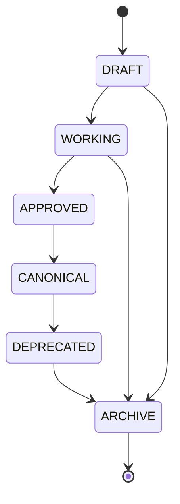

# STFL Brand Center — Master

**Authority:** SohaelTasneem Foundation
**Version:** 1.0 · 2026-10-18
**Scope:** All STFL identity, brand governance and reusable creative assets

---

## 1. Brand hierarchy

```
                    SohaelTasneem Foundation (STFL)
                    Institutional identity · stflbd.org
                                  │
                    ┌─────────────┴─────────────┐
                    │                           │
              STFL VI                     Project brands
        Institutional platform        GrihostiOS · SkillConnect
        stflbd.org · stflbd.app       AEV · MaxRemit · Helpex
                    │                 Proiozon · Perlu · OIIX
                    │                 HakimSarker · QiM-AI
                    │
              STFL Android app
        foundation.sohaeltasneem.app
```

| Level | Identity | May redefine STFL brand? |
|---|---|---|
| Institution | SohaelTasneem Foundation | — (is the brand) |
| Platform | STFL VI | No |
| Application | STFL Android app | No |
| Project | Each initiative | No — may have its own logo only |

---

## 2. Identity essence

| Attribute | Value |
|---|---|
| Essence | Mature, human, institutional, quiet, technologically precise, credible, impact-driven |
| Is | A unified institutional operating platform connecting people, projects, governance, finance, properties, documents, compliance and responsible intelligence |
| Is not | A generic corporate ERP, crypto dashboard, cyber-gaming UI, or basic SaaS utility |

Source: `STFL_VI_BRAND_GUIDELINES.md` §1.

---

## 3. Colour system

### Institutional core palette

| Token | Hex | Usage |
|---|---|---|
| STFL Deep Ink | `#081F2D` | Primary text, terminal anchors, heavy contrast |
| STFL Royal Navy | `#0B2B43` | Primary headers, institutional banners, primary buttons |
| STFL Snow | `#FAFAF8` | Warm daylight surfaces, paper contrast |
| STFL Stone | `#E7E7E2` | Structural dividers, neutral card boundaries |
| STFL Sovereign Gold | `#C5A059` | Archival plaques, honours, ceremonial seals |
| STFL Living Tangerine | `#FF6B35` | Primary human action points, urgent CTAs |
| STFL Black | `#000000` | Absolute contrast |

### Digital signal tokens

| Token | Hex | Usage |
|---|---|---|
| `--stfl-vi-white` | `#FFFFFF` | Ultra-pure white text, high-contrast surfaces |
| `--stfl-vi-bright` | `#F8FAFC` | Luminous elevated surface tint |
| `--stfl-vi-neon` | `#00D4FF` | Cyber cyan precision signal, active focus |

Neon is a **signal**, never decoration.

### Token source of truth

`stflbd.org/stfl-brand-tokens.css` and `main/web/stfl-brand-tokens.css` — both derived from `STFL_VI_BRAND_GUIDELINES.md` §2.

---

## 4. Typography

| Context | Family | Weights | Line height |
|---|---|---|---|
| BN heading (H1–H3) | Hind Siliguri | 600, 700 | 1.25–1.4 |
| BN subheading (H4–H6) | Hind Siliguri | 500, 600 | 1.4–1.5 |
| BN body | Noto Sans Bengali | 400, 500 | 1.7–1.8 |
| BN UI | Noto Sans Bengali / Baloo Da 2 | 500, 600 | 1.5 |
| BN official documents | Noto Sans Bengali / Hind Siliguri | 400, 600, 700 | 1.6–1.75 |
| EN heading | Inter | 600, 700, 800 | 1.15–1.3 |
| EN body and UI | Inter | 400, 500 | 1.5–1.65 |
| Monospace | JetBrains Mono | 400, 500, 700 | 1.5 |

Hind Siliguri is **immutable** for Bengali headings. Source: `STFL_VI_TYPOGRAPHY_SYSTEM.md`.

---

## 5. Iconography

**Iconoir only.** `iconoir-react` ^7.12.1.

No other icon library. No hand-drawn interface icons. No emoji as interface icons.

Source: `stflbd.org/STFL_ICONOGRAPHY_POLICY.md`. Enforced by `scripts/verify-icon-policy.mjs` in both web apps.

---

## 6. Logo inventory

| Asset ID | Name | Variant | Canonical location |
|---|---|---|---|
| `AST-STFL-0001` | STFL mark — dark | Dark navy monochrome | [`identity/monochrome/stfl-mark-dark.png`](./identity/monochrome/stfl-mark-dark.png) |
| `AST-STFL-0002` | STFL mark — white | Pure white monochrome | [`identity/monochrome/stfl-mark-white.png`](./identity/monochrome/stfl-mark-white.png) |
| `AST-STFL-0003` | STFL mark — transparent | Symbol | [`identity/symbol/stfl-mark-transparent.png`](./identity/symbol/stfl-mark-transparent.png) |
| `AST-STFL-0004` | STFL logo — transparent | Master logo | [`identity/master-logo/stfl-logo-transparent.png`](./identity/master-logo/stfl-logo-transparent.png) |
| `AST-STFL-0005` | STFL original logo | Master logo | [`identity/master-logo/stfl-original-logo.png`](./identity/master-logo/stfl-original-logo.png) |
| `AST-STFL-0006` | STFL logo — full (Android) | Master logo | [`identity/master-logo/logo_stfl_full.png`](./identity/master-logo/logo_stfl_full.png) |
| `AST-STFL-0007` | STFL wordmark — cream | Wordmark | [`identity/horizontal/stfl-wordmark-cream.png`](./identity/horizontal/stfl-wordmark-cream.png) |
| `AST-STFL-0008` | STFL wordmark — white | Wordmark | [`identity/horizontal/stfl-wordmark-white.png`](./identity/horizontal/stfl-wordmark-white.png) |
| `AST-STFL-0009` | STFL wordmark — transparent | Wordmark | [`identity/horizontal/stfl-wordmark-transparent.png`](./identity/horizontal/stfl-wordmark-transparent.png) |
| `AST-STFL-0010` | STFL favicon | Favicon | [`identity/favicon/favicon.ico`](./identity/favicon/favicon.ico) |

---

## 7. Project brand relationships

| Project | Brand status | Logo | Relationship |
|---|---|---|---|
| GrihostiOS | `NATIVE_VERIFIED` | `grihostios-logo.svg` | Retains distinct specialised vertical identity |
| SkillConnect | `NATIVE_VERIFIED` | `skillconnect-logo.svg` | STFL initiative |
| AEV Developments | `NATIVE_VERIFIED` | `aev-logo.svg` | Partnership — AEV Developments Ltd. |
| MaxRemit | `NATIVE_VERIFIED` | `maxremit-logo.svg` | STFL-supported |
| Helpex | `NATIVE_VERIFIED` | `helpex-logo.svg` | Partnership |
| Proiozon | `NATIVE_VERIFIED` | `proiozon-logo.png` | STFL-controlled |
| Perlu | `NATIVE_VERIFIED` | `perlu-logo.svg` | Partnership |
| OIIX | `NATIVE_VERIFIED` | `oiix-logo.svg` | STFL-supported |
| HakimSarker.org | `NATIVE_VERIFIED` | `hakimsarker-logo.svg` | Retains distinct academic memorial archive identity |
| QiM-AI 2.1 | `NATIVE_VERIFIED` | `qimai-logo.svg` | Retains sovereign research intelligence identity |
| Hashify | `CONCEPT_ONLY` | — | No approved asset |
| Cikgu Fatimah's Cloud Kitchen | `CONCEPT_ONLY` | — | No approved asset |
| YourGiftCardSupply | `LEGACY` | — | Archived |

---

## 8. Independence preservations

| Entity | Rule |
|---|---|
| GrihostiOS | Retains its distinct specialised vertical product identity |
| HakimSarker.org | Retains its distinct academic memorial archive identity |
| QiM-AI 2.1 | Retains its sovereign research intelligence identity |
| **Varizen Inc.** | Remains an independent external corporate entity. STFL VI never rebrands or implies legal ownership. |

---

## 9. Asset lifecycle



| Transition | Requires |
|---|---|
| `DRAFT` → `WORKING` | Asset is usable |
| `WORKING` → `APPROVED` | Recorded approval |
| `APPROVED` → `CANONICAL` | Designated the single authoritative version |
| `CANONICAL` → `DEPRECATED` | A replacement exists |
| Any → `ARCHIVE` | Explicit retirement |

Nothing is deleted. Deprecated assets stay in [`archive/`](./archive/).

---

## 10. Registry

[`registry/assets.json`](./registry/assets.json) — 50 registered assets, all SHA-256 verified against their production originals.

Human-readable: [`../portfolio/BRAND_REGISTRY.md`](../portfolio/BRAND_REGISTRY.md).
