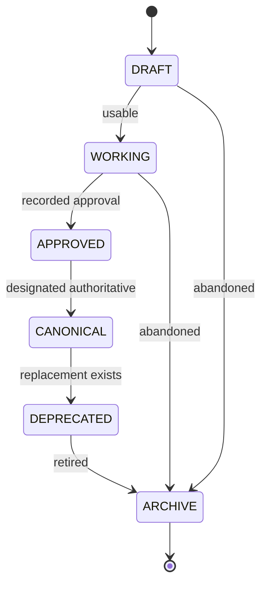

# Approval Workflow

**Authority:** CANONICAL
**Version:** 1.0 · 2026-10-18

---

## 1. States

---

## 2. What each state means

| State | Meaning | May be used in production |
|---|---|---|
| `DRAFT` | In progress | No |
| `WORKING` | In use, not formally approved | Yes, with caution |
| `APPROVED` | Cleared for use | Yes |
| `CANONICAL` | The authoritative version | Yes — preferred |
| `DEPRECATED` | Superseded, still present | No new use |
| `ARCHIVE` | Stored, not in use | No |
| `UNKNOWN` | Evidence insufficient | No |

---

## 3. Approval record

Every approval records:

| Field | Required |
|---|---|
| Asset ID | Yes |
| Approver | Yes |
| Approval date | Yes |
| Scope | Yes — where it may be used |
| Restrictions | Yes |
| Supersedes | If applicable |

**If no approval record exists, the asset is `WORKING` and `Approved By` reads `NOT RECORDED`.** Approval is never inferred.

---

## 4. Current state of the inventory

| Status | Count | Detail |
|---|---|---|
| `APPROVED` | 36 | All institutional identity, project logos, photography, fonts |
| `WORKING` | 14 | `official_doc/templates/*` — UUID-named, no recorded purpose |
| `DRAFT` | 0 | — |
| `CANONICAL` | 0 | No asset has been formally designated canonical over its siblings |
| `DEPRECATED` | 0 | — |
| `ARCHIVE` | 0 | — |

> The 36 `APPROVED` assets are approved by virtue of being in production use. No separate approval record exists in this repository. This is recorded honestly, not invented.

---

## 5. Adding an asset

| Step | Action |
|---|---|
| 1 | Place the file in the correct Brand Center category |
| 2 | Compute the SHA-256 hash |
| 3 | Add a registry entry with all required fields |
| 4 | Record the production path if one exists |
| 5 | Set status — `WORKING` unless an approval record exists |
| 6 | Verify the hash matches the production original |
| 7 | **Do not move the production original** |

---

## 6. Changing an asset

| Step | Action |
|---|---|
| 1 | Create a new version — do not overwrite |
| 2 | Register the new version with a new hash |
| 3 | Set the old version to `DEPRECATED` |
| 4 | Keep the old file |
| 5 | Update the production path only through a separate, reviewed production change |

---

## 7. Deprecating an asset

| Step | Action |
|---|---|
| 1 | Identify the replacement |
| 2 | Set status to `DEPRECATED` |
| 3 | Record the replacement in the registry |
| 4 | Move the file to [`../archive/`](../archive/) |
| 5 | Never delete |

---

## 8. Prohibited

| Prohibited | Reason |
|---|---|
| Inventing an approver | Dishonest record |
| Marking an asset `APPROVED` without evidence | Dishonest record |
| Overwriting an approved asset | Destroys provenance |
| Deleting a deprecated asset | Destroys history |
| Moving a production asset during approval | Breaks production |

---

## 9. Related

- [`brand-governance.md`](./brand-governance.md)
- [`../BRAND_GOVERNANCE_INDEX.md`](../BRAND_GOVERNANCE_INDEX.md)
- [`../../portfolio/BRAND_REGISTRY.md`](../../portfolio/BRAND_REGISTRY.md)