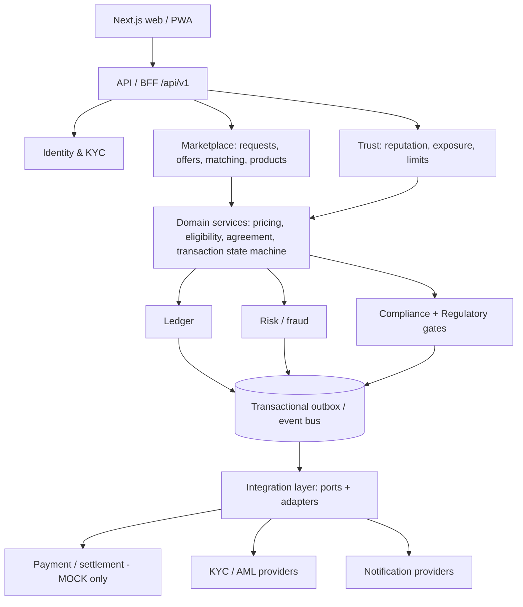

# HAWLAT — Architecture (Phase 1)

> HAWLAT is a neutral, reputation-driven technology marketplace that helps independent parties discover, evaluate, agree and record direct short-term financing transactions; HAWLAT/STFL does not itself provide the financing.

## 1. Invariants (enforced in code, schema and review)

1. HAWLAT is never a party. Every transaction is `Participant A <-> Participant B` (roles `FUNDER`, `RECIPIENT`). No `loan_provider = HAWLAT`.
2. HAWLAT holds no customer funds, takes no deposits, pools nothing, guarantees nothing.
3. Money is `Decimal`/`NUMERIC` + ISO currency. Never float.
4. Every regulated capability passes the Regulatory Gate. Default: `BLOCK`.
5. Ledger and reputation events are append-only.
6. Every state change records `previous_state, new_state, actor, reason, timestamp, event_id`.
7. All limits (min ৳50, max ৳500,000, tenor 50 weeks, exposure, daily volume) are versioned configuration, never constants.
8. Real-money movement is disabled; only the `MOCK` payment adapter exists until a partner is approved.
9. Reputation never auto-approves financing. The 3-completed-transactions threshold only unlocks marketplace privileges; eligibility is evaluated independently every time.
10. Uncertain legal classification is marked `[LEGAL_REVIEW_REQUIRED]`.

## 2. Style: modular monolith, event-driven internals



Each domain is a Python package with a public facade; other domains import only that facade and published events, never another domain's tables or models. Any domain can later be extracted into a service.

## 3. Stack

| Layer | Choice |
|---|---|
| Frontend | Next.js, TypeScript, React, Tailwind, accessible components, PWA-ready |
| Backend | Python 3.12, FastAPI, SQLAlchemy 2, Pydantic v2, Alembic |
| DB | PostgreSQL (UUID keys, constraints, append-only triggers) |
| Async | Transactional outbox + worker (no broker required at MVP) |

## 4. Repository layout

```
hawlat/
  docs/                      deliverables + adr/
  backend/src/hawlat/
    shared/                  money, ids, clock, errors, config
    identity/ participants/ reputation/ marketplace/ matching/
    pricing/ eligibility/ exposure/ agreements/ transactions/
    ledger/ payments/ risk/ compliance/ gates/ disputes/
    notifications/ audit/ admin/ events/ api/
  backend/tests/
  frontend/
```

## 5. Module map (40 modules → packages)

Identity, Authentication, KYC → `identity` · Profiles → `participants` · Reputation, Trust Graph → `reputation` · Requests/Offers/Products/Search/Documents → `marketplace` · Matching → `matching` · Pricing → `pricing` · Eligibility → `eligibility` · Exposure & Limits → `exposure` · Agreement → `agreements` · Ledger → `ledger` · Payment/Settlement/Partner integrations → `payments` · Notifications/Messaging → `notifications` · Disputes → `disputes` · Risk/Fraud/AML adapter → `risk` · Compliance rules → `compliance` · Regulatory gates/Feature flags/Kill switches → `gates` · Audit → `audit` · Admin/Governance/Reporting/Analytics → `admin` · Configuration → `shared.config` · Privacy/Security/Observability/API gateway/Event bus → cross-cutting (`api`, `events`, `shared`).

## 6. Cross-cutting rules

- **Idempotency:** every mutating endpoint requires `Idempotency-Key`; unique `(actor, route, key)`.
- **Outbox:** domain change + outbox row in one DB transaction; worker publishes at-least-once; consumers dedupe by `event_id`.
- **Versioning:** products, agreements, config, rulesets, reputation algorithm are versioned; agreements pin the versions used.
- **No vendor lock-in:** each external provider sits behind a port with a mock and a failure policy (fail closed for compliance, degrade for notifications).
- **No black-box approval:** every eligibility/risk decision stores inputs, rule versions, reason codes.

## 7. Phase status

Phases 1-13 and 15-16 (backend, tests, migration, deployment files) implemented in compact form; domains currently live as single modules under ackend/src/hawlat/. See [PRODUCTION_READINESS.md](PRODUCTION_READINESS.md).

