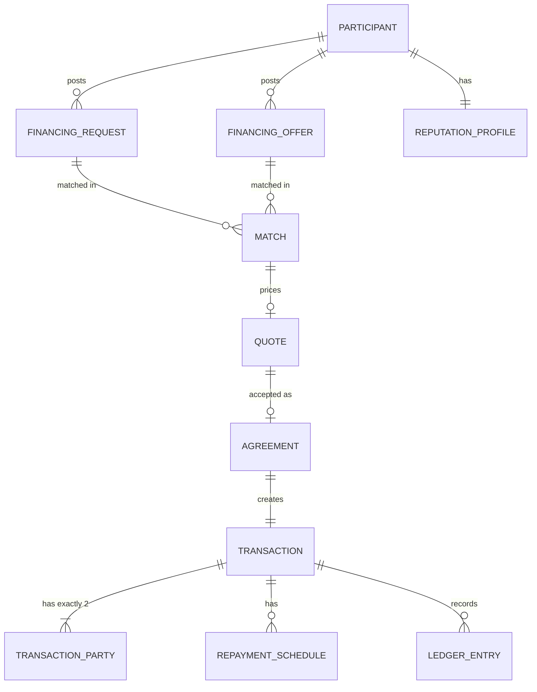

# HAWLAT — Domain Model

## Bounded contexts and aggregates

| Context | Aggregates | Publishes |
|---|---|---|
| Identity | User, IdentityRecord, VerificationRecord, Session, Device | `identity.verified` |
| Participants | Participant, Organization, ParticipantRole | `participant.created` |
| Reputation | ReputationProfile, ReputationEvent, Snapshot | `reputation.changed` |
| Marketplace | FinancingRequest, FinancingOffer, Product, ProductVersion, Match, Quote | `request.published`, `offer.published`, `match.created` |
| Exposure/Limits | ExposurePosition, LimitPolicy | `limit.breached` |
| Agreements | Agreement, Consent | `agreement.signed` |
| Transactions | Transaction, TransactionParty, RepaymentSchedule, RepaymentEvent | `transaction.transitioned` |
| Ledger | LedgerAccount, LedgerEntry (immutable) | `ledger.posted` |
| Payments | PaymentIntent, Settlement (MOCK only) | `payment.*` |
| Risk/Compliance | RiskEvent, ComplianceCase, RegulatoryRule, GateState | `risk.flagged`, `gate.changed` |
| Disputes | Dispute, Evidence | `dispute.*` |
| Audit | AuditLog (append-only) | — |

## Core relationships

## Key rules

- A Transaction has exactly two `TransactionParty` rows (`FUNDER`, `RECIPIENT`) with different participants. HAWLAT is never a party (DB check).
- Platform fee is a separate technology-service fee owed by a participant, never interest on principal. `[LEGAL_REVIEW_REQUIRED]`
- Match ≠ approval. Eligibility, exposure, limit, risk and gate checks run at quote time **and** at agreement time.
- States: `DRAFT → PUBLISHED → MATCHED → OFFERED → ACCEPTED → AGREED → PENDING_SETTLEMENT → ACTIVE → PARTIALLY_REPAID → COMPLETED`; side/terminal: `CANCELLED, EXPIRED, DISPUTED, DEFAULTED, SUSPENDED`. Table in [state_machine.py](../backend/src/hawlat/transactions/state_machine.py).
- Wording: "agreed between parties", never "approved by HAWLAT".
