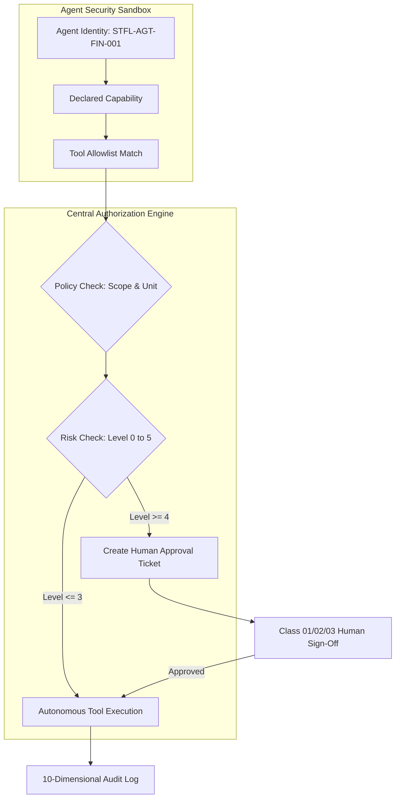
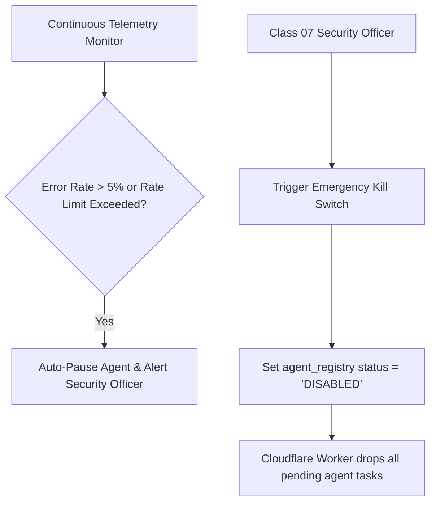

# STFL AIO — Autonomous Agent Authorization & Sandbox Specification

**System:** SohaelTasneem Foundation (STFL) Autonomous Enterprise Platform  
**Document Identity:** `STFL-DOC-2026-AGT-AUTH-V1`  
**Date:** 2026-10-15  
**Status:** SPECIFICATION — RATIFIED (PHASE 0)  
**Security Level:** RESTRICTED

---

## 1. Agent Authorization Invariants

Autonomous AI Agents in STFL AIO are treated as **Class 10 Non-Human Actors**. They are strictly prohibited from bypassing the enterprise authorization pipeline.



### Absolute Constraints:
1. **Never Masquerade**: An AI agent cannot set `actor_type = 'user'` or sign audit logs under a human employee's name. Every action records `agent_id`.
2. **Never Escalate Privileges**: An agent cannot grant permissions to itself, modify its own tool allowlist, or extend its own budget ceilings.
3. **Never Cross Unit Boundaries**: The Finance Agent (`STFL-AGT-FIN-001`) has zero access to the Property or Microfinance toolsets.
4. **Execution Budgets**: If an agent exhausts its hourly or daily tool invocation limit (e.g. 100 calls/hr), subsequent calls fail closed until reset.

---

## 2. Domain Tool Sandboxes & Parameter Schemas

Every tool callable by an agent is defined with strict JSON schemas, risk classifications, and explicit audit requirements:

### 2.1 Finance & Accounts Tools (`STFL-AGT-FIN-001`)

#### Tool: `read_ledger`
* **Authority Level**: Level 0 (Read)
* **Risk Class**: LOW
* **Input Schema**:
  ```json
  {
    "type": "object",
    "properties": {
      "accountCode": { "type": "string" },
      "startDate": { "type": "string", "format": "date" },
      "endDate": { "type": "string", "format": "date" }
    },
    "required": ["accountCode", "startDate", "endDate"]
  }
  ```
* **Output**: Array of immutable ledger transactions.

#### Tool: `prepare_voucher`
* **Authority Level**: Level 2 (Draft)
* **Risk Class**: MEDIUM
* **Input Schema**:
  ```json
  {
    "type": "object",
    "properties": {
      "debitAccount": { "type": "string" },
      "creditAccount": { "type": "string" },
      "amount": { "type": "number", "minimum": 0.01 },
      "description": { "type": "string" },
      "sourceDocumentRef": { "type": "string" }
    },
    "required": ["debitAccount", "creditAccount", "amount", "description"]
  }
  ```
* **Execution Constraint**: Inserts record with `status = 'DRAFT'`. Does not commit debits/credits until human supervisor approval.

---

### 2.2 Property & Tenancy Tools (`STFL-AGT-PROP-001`)

#### Tool: `calculate_due_rent`
* **Authority Level**: Level 1 (Analyze)
* **Risk Class**: LOW
* **Behavior**: Evaluates active lease terms, overdue cycles, and agreed utilities. Returns exact breakdown in `NUMERIC(18,2)`.

#### Tool: `create_inspection_task`
* **Authority Level**: Level 3 (Execute with Policy)
* **Risk Class**: LOW
* **Behavior**: Generates a field task in `agent_tasks` dispatched to the assigned Property Inspector's mobile app queue.

---

### 2.3 Microfinance & Credit Tools (`STFL-AGT-MFI-001`)

#### Tool: `prepare_collection_route`
* **Authority Level**: Level 2 (Draft)
* **Risk Class**: LOW
* **Behavior**: Clusters active borrower installment dues geographically by ward/union to optimize field worker routes.

#### Tool: `flag_delinquency`
* **Authority Level**: Level 3 (Execute with Policy)
* **Risk Class**: MEDIUM
* **Behavior**: Generates internal alert when a borrower account is overdue by $\ge 3$ installments; notifies Unit Head.

---

## 3. Emergency Agent Circuit Breakers

To protect institutional funds and operations against rogue agent loops, prompt injections, or service degradation:



1. **Automated Anomaly Tripwires**:
   * If an agent emits 5 consecutive schema-invalid tool calls, the orchestrator automatically trips the agent's circuit breaker and transitions status to `PAUSED`.
2. **Emergency Revocation API**:
   * `POST /api/v1/agents/:agentId/kill` (Restricted to Class 00 Super Admin and Class 07 Security Officer).
   * Instantly revokes agent session tokens across the entire Worker edge network.
