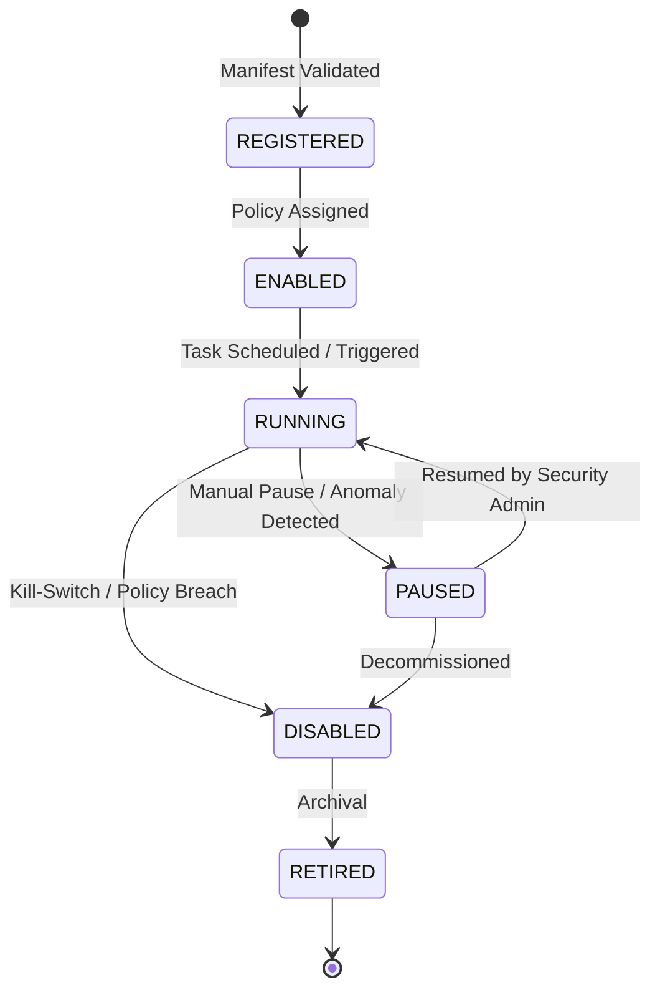
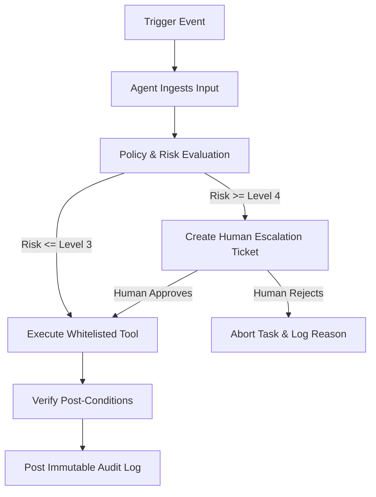

# STFL AIO — Autonomous Agent Orchestration Specification

**System:** SohaelTasneem Foundation (STFL) Autonomous Enterprise Platform  
**Document Identity:** `STFL-DOC-2026-AGT-V1`  
**Date:** 2026-10-15  
**Status:** AGENT MODEL SPECIFICATION — RATIFIED (PHASE 0)  
**Security Level:** INTERNAL USE ONLY

---

## 1. Agent Governance Philosophy

Autonomous Agents within STFL are specialized, state-machine-bound intelligence workers. They are **not** unconstrained generative entities with arbitrary database access. 

### Fundamental Guardrails:
1. **Zero Direct Mutation**: Agents **never** write directly to PostgreSQL tables via open raw SQL queries. They operate exclusively through strongly typed, audited tool interfaces.
2. **Authority Classification Enforcement**: Any action with legal, financial, or property impact (Level 4/5) halts at the `REQUEST AUTHORITY` stage and enters an escalation queue for human sign-off.
3. **No Guessing / No Fabrication**: If data is incomplete, conflicting, or confidence is below 98%, the agent is prohibited from interpolating or guessing. It must halt and escalate.
4. **Deterministic Arithmetic**: Numerical calculations for finance and microfinance are executed through PostgreSQL expressions or deterministic math libraries using `NUMERIC(18,2)`.

---

## 2. Agent Identity & Lifecycle

Every agent operating on the STFL platform is registered as an authoritative system entity:

### 2.1 Agent Entity Specification
* `agent_id`: Institutional identifier (e.g. `STFL-AGT-FIN-001`).
* `agent_type`: Domain designation (`FINANCE`, `MICROFINANCE`, `PROPERTY`, `ECOMMERCE`, `HR`, `AGENCY`, `ADMIN`).
* `version`: Semantic version (e.g. `1.0.0`), pinned to tested model checkpoints and tool sets.
* `capabilities`: Whitelist of approved domain tasks.
* `permissions`: Exact subset of RBAC permissions granted.
* `policy_scope`: Max financial limits, allowed categories, operational thresholds.
* `risk_level`: Baseline operational classification (LOW, MEDIUM, HIGH, CRITICAL).
* `status`: Active lifecycle state.

---

## 3. The Autonomous Task Model

Every action executed by an agent is encapsulated within an immutable `AgentTask` record:

$$\mathbf{TaskContext} = \langle \text{task\_id}, \text{agent\_id}, \text{trigger}, \text{input}, \text{plan}, \text{eval}, \text{tools}, \text{result}, \text{audit} \rangle$$

### Task Schema Invariants:
* `task_id`: `UUID` primary key + institutional reference (`STFL-TSK-2026-000492`).
* `agent_id`: Owning agent identifier.
* `trigger_source`: Event bus message, cron schedule, webhook, or user prompt.
* `input_payload`: Cryptographically hashed JSON input.
* `plan_tree`: Step-by-step reasoning steps and candidate tools.
* `policy_evaluation`: Record of authority check (Level 0 through 5).
* `tool_invocations`: Array of executed tool records with exact inputs and outputs.
* `confidence_score`: Metric from 0.00 to 1.00.
* `risk_score`: 1 to 10 scale.
* `approval_state`: `AUTOMATIC_POLICY`, `PENDING_HUMAN`, `APPROVED`, `REJECTED`.
* `approver_user_id`: Human trustee/manager UUID when Level 4/5 is invoked.

---

## 4. Domain Agent Specifications & Tool Catalogues

### 4.1 Finance & Accounts Agent (`STFL-AGT-FIN-001`)
* **Core Mandate**: Continuous double-entry reconciliation, voucher validation, variance alerts.
* **Tool Whitelist**:
  * `read_ledger`: Read account balances and transaction rows (Level 0, Risk Low).
  * `reconcile_transaction`: Match bank statement item with internal transaction (Level 2, Risk Medium).
  * `prepare_voucher`: Create uncommitted voucher draft for human review (Level 2, Risk Medium).
  * `prepare_financial_report`: Generate balance sheet / cash flow statement (Level 1, Risk Low).
  * `flag_ledger_anomaly`: Alert finance director to balance mismatch (Level 3, Risk Low).
* **Hard Stop (Level 4/5)**: The agent **cannot** disburse funds, modify chart of accounts, or close financial periods.

### 4.2 Microfinance / Qard Hasan Agent (`STFL-AGT-MF-001`)
* **Core Mandate**: Borrowing group monitoring, collection route generation, delinquency prediction.
* **Tool Whitelist**:
  * `read_borrower_account`: Inspect repayment history and active loan balance (Level 0, Risk Low).
  * `calculate_repayment_schedule`: Generate mathematical installment plan (Level 1, Risk Low).
  * `prepare_collection_route`: Group daily field collections geographically (Level 2, Risk Low).
  * `prepare_restructure_proposal`: Propose penalty-free installment extension (Level 2, Risk Medium).
  * `flag_delinquency`: Issue early-warning alert for 3+ missed payments (Level 3, Risk Low).
* **Hard Stop (Level 4)**: The agent **cannot** approve loan disbursements or forgive outstanding debts.

### 4.3 Property, Rental & Waqf Agent (`STFL-AGT-PROP-001`)
* **Core Mandate**: Tenancy tracking, rent billing cycles, preventative maintenance forecasting.
* **Tool Whitelist**:
  * `read_property_record`: Read unit occupancy, deed status, and lease dates (Level 0, Risk Low).
  * `calculate_due_rent`: Compute exact rent and utility share for active cycle (Level 1, Risk Low).
  * `prepare_rent_invoice`: Draft rent notice using official template (Level 2, Risk Low).
  * `create_inspection_task`: Dispatch property inspection to field mobile app (Level 3, Risk Low).
* **Hard Stop (Level 4)**: The agent **cannot** terminate leases, alter monthly rent terms, or approve disposals.

### 4.4 E-Commerce & Impact Shop Agent (`STFL-AGT-ECOMM-001`)
* **Core Mandate**: Inventory optimization, purchase order preparation, order routing.
* **Tool Whitelist**:
  * `read_inventory`: Check stock levels across distribution hubs (Level 0, Risk Low).
  * `prepare_purchase_order`: Draft supplier reorder when stock reaches safety buffer (Level 2, Risk Low).
  * `route_order_dispatch`: Assign order fulfillment to nearest field personnel (Level 3, Risk Low).
* **Hard Stop (Level 4)**: The agent **cannot** issue supplier payments or refund disputed orders without human review.

### 4.5 HR & Field Workforce Agent (`STFL-AGT-HR-001`)
* **Core Mandate**: Shift coordination, automated geofenced attendance audit, stipend calculation.
* **Tool Whitelist**:
  * `read_duty_roster`: Inspect field worker shifts and assignments (Level 0, Risk Low).
  * `calculate_attendance`: Cross-reference mobile check-ins with shift hours (Level 1, Risk Low).
  * `prepare_payroll_draft`: Synthesize monthly hours into stipend proposals (Level 2, Risk Medium).
* **Hard Stop (Level 4)**: The agent **cannot** terminate personnel, grant unpaid leave, or release payroll.

### 4.6 Agency & Humanitarian Projects Agent (`STFL-AGT-AGENCY-001`)
* **Core Mandate**: Disaster relief logistics, volunteer dispatch, milestone verification.
* **Tool Whitelist**:
  * `read_project_status`: Ingest field survey data and relief distribution metrics (Level 0, Risk Low).
  * `prepare_distribution_plan`: Calculate relief pack requirements per union/district (Level 2, Risk Low).
  * `create_field_survey_task`: Dispatch questionnaire to volunteer mobile apps (Level 3, Risk Low).
* **Hard Stop (Level 4)**: The agent **cannot** divert designated disaster relief funds to other programs.

### 4.7 Admin, Governance & Assets Agent (`STFL-AGT-ADMIN-001`)
* **Core Mandate**: Fixed asset register tracking, statutory compliance schedule, resolution preparation.
* **Tool Whitelist**:
  * `read_asset_register`: Ingest QR/NFC asset audit logs (Level 0, Risk Low).
  * `calculate_depreciation`: Compute straight-line asset depreciation (Level 1, Risk Low).
  * `prepare_board_resolution_draft`: Format draft governance resolutions (Level 2, Risk Low).
* **Hard Stop (Level 4/5)**: The agent **cannot** write off missing assets or approve corporate filings.

---

## 5. Circuit Breakers, Kill Switches & Failure Modes

To protect the institution from systemic errors, automated loops, or compromised keys:

1. **Global Kill Switch**: A signed emergency command from any authorized Super-Admin or Security Trustee instantly sets all agents to `DISABLED` state, halting all background agent tasks.
2. **Action Rate Limits**: No agent may execute more than 60 tool calls per minute or generate more than 100 field tasks per day without explicit administrator approval.
3. **Budget Caps**: Cumulative unapproved draft proposals generated by an agent within a 24-hour window are capped at predefined financial limits.
4. **Uncertainty Resolution Rule**:
   $$\text{Confidence} < 0.98 \implies \mathbf{HALT} \text{ and } \mathbf{ESCALATE}$$
   The agent records its partial plan, logs the conflicting parameters, and marks the task as `NEEDS_HUMAN_CLARIFICATION`.
