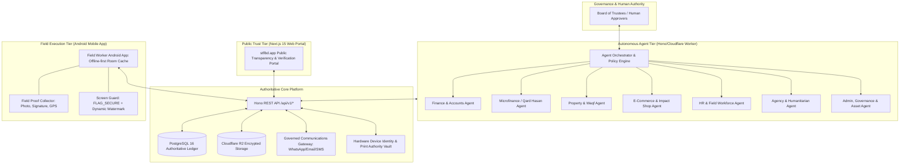
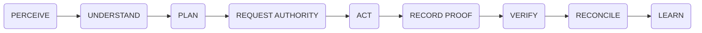
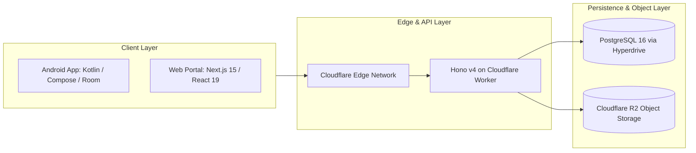

# STFL AIO — Autonomous Enterprise Architecture Specification

**System:** SohaelTasneem Foundation (STFL) Autonomous Enterprise Platform  
**Document Identity:** `STFL-DOC-2026-ARCH-V1`  
**Date:** 2026-10-15  
**Status:** ARCHITECTURAL SPECIFICATION — RATIFIED (PHASE 0)  
**Security Level:** INTERNAL USE ONLY

---

## 1. System Vision & Paradigm

The SohaelTasneem Foundation (STFL) operating platform represents a synthesis of five architectural pillars:
1. **Autonomous Intelligence**: Purpose-built domain agents performing 24/7 monitoring, reconciliation, forecasting, task preparation, and anomaly detection.
2. **Human Execution & Authority**: Humans retain ultimate moral, legal, and operational authority. Field workers serve as physical observers and executors; trustees provide governance.
3. **Auditable Core**: Immutable audit logging, cryptographic document hashing, and strict database constraints in PostgreSQL 16.
4. **Secure Digital Identity**: Hardware-attested device binding, granular RBAC, and unified institutional identifier grammar.
5. **Field Mobile Platform**: Resilient, offline-first Android application allowing field personnel to securely interact with the physical world.

---

## 2. The Autonomous Operating Loop

Every autonomous process in STFL follows a non-negotiable 9-stage loop:

1. **PERCEIVE**: Ingest events (database transaction, bank feed webhook, scheduled cron, field task submission, IoT/meter reading).
2. **UNDERSTAND**: Contextualize the input against authoritative schemas, active contracts, and current state.
3. **PLAN**: Synthesize a deterministic course of action using constrained domain tools.
4. **REQUEST AUTHORITY**: Evaluate policy scope. If required authority exceeds Agent Level 3, construct a pending approval ticket for a designated human authority.
5. **ACT**: Execute authorized tools (e.g. generate voucher draft, reserve inventory, assign field task).
6. **RECORD PROOF**: Generate immutable cryptographic proof (SHA-256 hash, actor/agent ID, input/output payload).
7. **VERIFY**: Check post-execution state against invariants and assertions.
8. **RECONCILE**: Post balanced double-entry accounting records, update task status, and notify field stakeholders.
9. **LEARN**: Update aggregate telemetry, latency metrics, and risk-scoring models without mutating baseline policy rules.

---

## 3. Institutional Identity Grammar

To guarantee global traceability across departments, every significant institutional entity is assigned a canonical identifier matching the STFL Institutional Identity Grammar:

$$\text{Format: } \mathbf{STFL\text{-}[CATEGORY]\text{-}[YEAR/CONTEXT]\text{-}[SEQUENCE]\text{-}[CHECKSUM]}$$

| Entity | Canonical Pattern | Example Institutional ID |
|---|---|---|
| User / Staff | `STFL-USR-{SEQUENCE:5}` | `STFL-USR-00421` |
| Registered Device | `STFL-DVC-{HEX_FINGERPRINT:6}` | `STFL-DVC-8F31A2` |
| Autonomous Agent | `STFL-AGT-{TYPE:3}-{SEQUENCE:3}` | `STFL-AGT-FIN-001` |
| Project / Mission | `STFL-PRJ-{YEAR}-{SEQUENCE:4}` | `STFL-PRJ-2026-0012` |
| Fixed Asset | `STFL-AST-{YEAR}-{SEQUENCE:5}` | `STFL-AST-2026-00481` |
| Financial Transaction | `STFL-TXN-{YEAR}-{SEQUENCE:6}-{CHECK:4}` | `STFL-TXN-2026-000023-R4Q9` |
| Outbound Communication | `STFL-MSG-{YEAR}-{SEQUENCE:6}-{CHECK:4}` | `STFL-MSG-2026-000024-A8P6` |
| Digital Document | `STFL-DOC-{YEAR}-{SEQUENCE:6}-{CHECK:4}` | `STFL-DOC-2026-000001-A7K9` |
| Academic / Skill Certificate | `STFL-CER-{YEAR}-{SEQUENCE:6}-{CHECK:4}` | `STFL-CER-2026-000002-K7M2` |
| Official Letter / Resolution | `STFL-LET-{YEAR}-{SEQUENCE:6}-{CHECK:4}` | `STFL-LET-2026-000003-F4Q8` |
| Physical / Exported Copy | `CP-{SEQUENCE:6}` | `CP-000004` |
| Field Proof Object | `STFL-PRF-{YEAR}-{SEQUENCE:6}` | `STFL-PRF-2026-000182` |

* **Rule of Uniqueness**: Institutional IDs are immutable and strictly non-reusable. Even if a document or transaction is revoked or cancelled, its ID remains archived forever.

---

## 4. The 7 Integrated Conceptual Units

Each unit pairs an Autonomous Intelligence Agent with dedicated Field Human Execution capabilities:

### 4.1 Finance & Accounts Unit
* **Autonomous Agent (`STFL-AGT-FIN-001`)**:
  * Double-entry bookkeeping verification across charts of accounts.
  * Continuous bank statement and payment gateway matching.
  * Restricted fund accounting: separate balance tracking for Zakat, Sadaqah, Waqf, General Charity, and Commercial Operations.
  * Strict constraint: Mathematical calculations use `NUMERIC(18,2)`. **Floating-point arithmetic is prohibited.**
* **Field Human Execution**:
  * Expense voucher capture with receipt photograph and GPS stamp.
  * Cash handoff logs and petty cash reconciliation.

### 4.2 Microfinance & Qard Hasan Unit
* **Autonomous Agent (`STFL-AGT-MF-001`)**:
  * Community risk scoring based on repayment history and economic capacity.
  * Installment schedule generation (daily, weekly, monthly cycles).
  * Automated delinquency early-warning alerts.
  * Restructuring proposal formulation for distressed beneficiaries.
  * Strict constraint: The agent **never** fabricates loan balances. All balances originate directly from authoritative ledger transactions.
* **Field Human Execution**:
  * In-person borrower identity check.
  * Cash installment collection at beneficiary doorstep.
  * Instant digital receipt issuance and counter-signature capture.

### 4.3 Property Rental & Waqf Lease Unit
* **Autonomous Agent (`STFL-AGT-PROP-001`)**:
  * Lease lifecycle tracking (drafting, active tenancy, renewal, termination).
  * Automated rent invoice generation based on agreed billing cycles.
  * Maintenance schedule forecasting and vendor budget allocation.
* **Field Human Execution**:
  * Regular property condition inspections with multi-angle photographic evidence.
  * Physical utility meter readings (electricity, gas, water) recorded on mobile.
  * Key handover verification and tenant intake checklist.

### 4.4 E-Commerce & Impact Shop Unit
* **Autonomous Agent (`STFL-AGT-ECOMM-001`)**:
  * Real-time inventory monitoring for handicrafts, artisan goods, and publications.
  * Low-stock warnings and vendor purchase order preparation.
  * Order dispatch routing to nearest field worker or logistics partner.
* **Field Human Execution**:
  * Barcode scanning during warehouse pick-and-pack.
  * Last-mile delivery handoff with customer OTP verification.

### 4.5 HR & Field Workforce Unit
* **Autonomous Agent (`STFL-AGT-HR-001`)**:
  * Duty shift scheduling across administrative and field staff.
  * Automated attendance calculations from validated mobile check-ins.
  * Monthly stipend and payroll preparation.
  * Privacy constraint: Biometric and selfie processing is isolated behind dedicated security wrappers.
* **Field Human Execution**:
  * Daily check-in/out with geofenced location verification.
  * Real-time duty log and field incident submission.

### 4.6 Agency & Humanitarian Projects Unit
* **Autonomous Agent (`STFL-AGT-AGENCY-001`)**:
  * Disaster relief milestone tracking and emergency supply allocation.
  * Donor fund utilization reports mapping donations directly to ground deliverables.
* **Field Human Execution**:
  * On-site beneficiary surveys.
  * Aid relief distribution verification via token/barcode scanning.

### 4.7 Admin, Governance & Assets Unit
* **Autonomous Agent (`STFL-AGT-ADMIN-001`)**:
  * Fixed asset register maintenance and straight-line depreciation calculations.
  * Board resolution preparation and statutory compliance filing reminders.
* **Field Human Execution**:
  * Periodic physical asset audits using QR-code and NFC scanning.
  * Physical document filing check-ins at foundation headquarters.

---

## 5. Technology Stack Integration & Invariants

### Architectural Invariants (Must Never Be Broken):
1. **Authoritative State Invariant**: PostgreSQL 16 is the sole authoritative record of state. No cache, memory store, or AI memory may override database records.
2. **Monetary Precision Invariant**: All financial calculations must be performed using PostgreSQL `NUMERIC` or Kotlin `BigDecimal`. Never use `float` or `double`.
3. **Additive Invariant**: All schema evolutions must be strictly additive. No table, column, or constraint from `0001_init.sql` may be dropped or destructively modified.
4. **Offline Safety Invariant**: Field operations performed offline store an idempotent client UUID and payload hash. Concurrency conflicts trigger administrative review; they never silently overwrite server records.
5. **Private Data Isolation Invariant**: Sensitive or private data must never be stored under public R2 storage paths or emitted through unauthenticated API endpoints.
