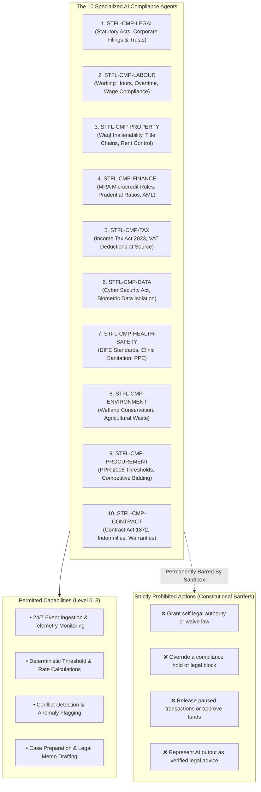
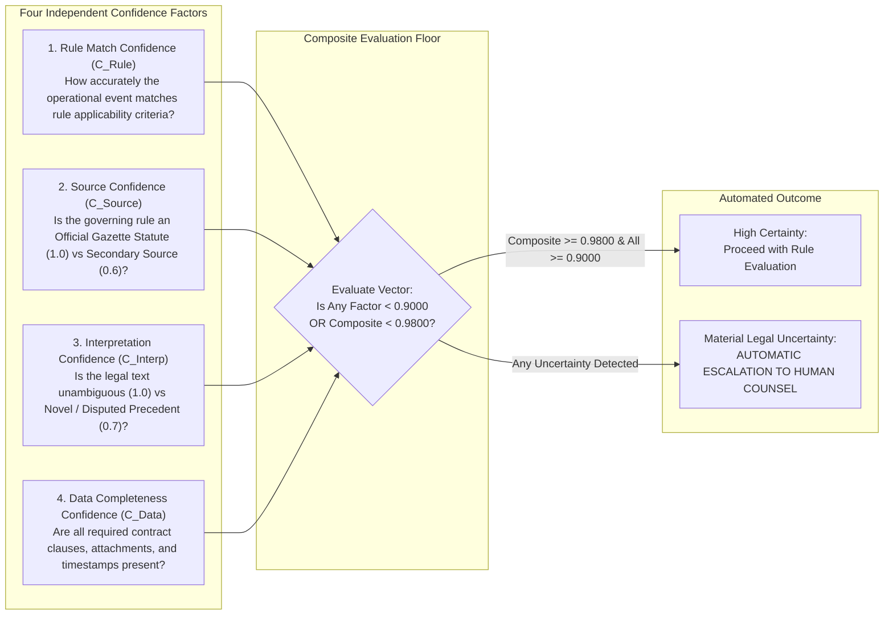

# STFL AIO — Specialized AI Compliance Agents & Authority Bounds
**Document Identity:** `STFL-DOC-2026-CMP-AGT-V1`  
**Phase:** Prompt 12.5 Extension (Compliance, Regulatory & Legal Intelligence Layer)  
**Status:** SPECIFICATION ONLY — RATIFIED (READ-ONLY ARCHITECTURE PHASE)  
**Security Classification:** RESTRICTED ENTERPRISE SPECIFICATION  
**Authoritative Precedent:** Extends `STFL_AIO_AGENT_MODEL.md` and `STFL_AGENT_AUTHORIZATION_MODEL.md`

---

## 1. The Ten Specialized AI Compliance Agents

STFL AIO deploys a dedicated suite of specialized, domain-constrained compliance agents operating within the autonomous intelligence tier:



---

## 2. Permitted vs. Prohibited Capabilities

| Capability Category | Permitted Operational Actions (Levels 0–3) | Strictly Prohibited Actions (Constitutional Barriers) |
|---|---|---|
| **Monitoring & Telemetry** | Scan live payroll batches, lease drafts, procurement tenders, and bank transactions for threshold breaches. | Cannot terminate active employment contracts or lock bank accounts without human sign-off. |
| **Legal Classification** | Categorize transaction documents into relevant legal domains (e.g. `BLA Sec. 108`, `Waqf Sec. 32`). | Cannot declare a statutory law or court precedent unconstitutional or void. |
| **Calculations & Limits** | Compute exact statutory overtime ($2.0\times$), statutory AIT withholding, advance rent limits. | Cannot modify or fudge statutory formulas to make a non-compliant transaction pass. |
| **Case Preparation** | Generate comprehensive `LEGAL_REVIEW_CASE` briefs with citations, evidence, and risk analysis for human counsel. | Cannot sign or close a legal case, nor issue binding legal advice. |
| **Escalation & Holds** | Assert an immediate automated **`HOLD`** on a suspicious or non-compliant transaction. | Cannot **release** or **override** a compliance hold. Releasing a hold requires human legal authority. |
| **Regulatory Tracking** | Crawl official government gazettes, regulatory portals, and circulars; alert counsel of statutory changes. | Cannot automatically update live compliance rules in production without human review and approval. |

---

## 3. Multi-Factor Uncertainty & Confidence Architecture

In legal compliance, an uncalibrated confidence score is catastrophic. STFL AIO decomposes AI confidence into a **Four-Factor Vector**:

$$\mathbf{CompositeConfidence} = w_1 \cdot C_{\text{RuleMatch}} + w_2 \cdot C_{\text{Source}} + w_3 \cdot C_{\text{Interpretation}} + w_4 \cdot C_{\text{Data}}$$



### The Legal Uncertainty Rule:
- A score of `confidence = 0.9700` does **not** mean "97% legally correct." It indicates material uncertainty in the machine's parsing of the statute or data.
- **Any compliance recommendation with $< 0.9800$ confidence must immediately escalate to a Human Legal Officer (`CLASS_08`).**

---

## 4. Proposed Database Schema Specification

```sql
-- ---------------------------------------------------------------------------
-- Specialized Compliance Agents Table
-- ---------------------------------------------------------------------------
CREATE TABLE IF NOT EXISTS compliance_agents (
    id                   UUID PRIMARY KEY DEFAULT gen_random_uuid(),
    agent_id             TEXT NOT NULL UNIQUE,          -- STFL-CMP-LEGAL, STFL-CMP-LABOUR...
    domain               TEXT NOT NULL,                 -- Matching compliance_rules.domain
    display_name         TEXT NOT NULL,
    description          TEXT NOT NULL,
    assigned_jurisdiction_id UUID REFERENCES compliance_jurisdictions(id),
    
    -- Inviolable Guardrails
    max_authority_level  INTEGER NOT NULL DEFAULT 3 CHECK (max_authority_level <= 3),
    min_confidence_floor NUMERIC(5, 4) NOT NULL DEFAULT 0.9800,
    can_assert_holds     BOOLEAN NOT NULL DEFAULT TRUE,
    can_override_holds   BOOLEAN NOT NULL DEFAULT FALSE, -- Constitutionally locked to FALSE
    
    -- Performance Metrics
    rules_evaluated_count BIGINT NOT NULL DEFAULT 0,
    cases_escalated_count BIGINT NOT NULL DEFAULT 0,
    
    status               TEXT NOT NULL DEFAULT 'ACTIVE' CHECK (status IN ('ACTIVE', 'PAUSED', 'TERMINATED')),
    is_active            BOOLEAN NOT NULL DEFAULT TRUE,
    created_at           TIMESTAMPTZ NOT NULL DEFAULT now(),
    updated_at           TIMESTAMPTZ NOT NULL DEFAULT now()
);

CREATE INDEX IF NOT EXISTS idx_cmp_agents_domain ON compliance_agents(domain, status);
```
