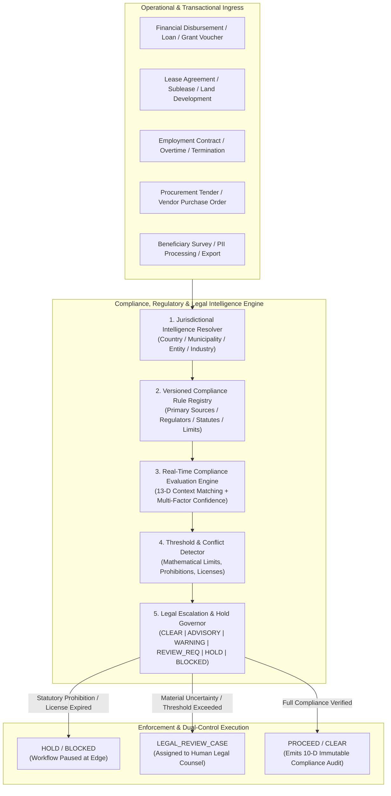

# STFL AIO — Compliance, Regulatory & Legal Intelligence Layer Architecture
**Document Identity:** `STFL-DOC-2026-CMP-ARCH-V1`  
**Phase:** Prompt 12.5 Extension (Compliance, Regulatory & Legal Intelligence Layer)  
**Status:** SPECIFICATION ONLY — RATIFIED (READ-ONLY ARCHITECTURE PHASE)  
**Security Classification:** INTERNAL ENTERPRISE SPECIFICATION  
**Authoritative Precedent:** Bound by `STFL_AIO_CONSTITUTION.md` and `STFL_AIO_MULTI_PROJECT_ARCHITECTURE.md`

---

## 1. Vision & Paradigm: Compliance as a Governed Intelligence Engine

In the SohaelTasneem Foundation (STFL) Autonomous Enterprise Platform, **Compliance, Regulatory & Legal Intelligence is not a passive document repository, an afterthought audit checklist, or an unconstrained LLM chatbot**.

It is a **First-Class, Continuous, Governed Intelligence & Enforcement Substrate** operating at the edge and core of the platform. It automatically and continuously evaluates operational, financial, property, workforce, and procurement activities against applicable:
- Statutory and statutory-amendment laws
- Administrative regulations and executive orders
- Labour and occupational safety mandates
- Land, waqf, zoning, and property ownership tenure laws
- Banking, microfinance, and financial prudential regulations
- Tax statutes, VAT, withholding, and corporate filing mandates
- Data privacy, cyber sovereignty, and electronic signature regulations
- International humanitarian charters and donor/grantor covenants
- Internal STFL constitutional governance and project-specific covenants



---

## 2. Inviolable Constitutional Rules for Legal Intelligence

Section 62 of the STFL Platform Directives permanently ratifies the following constitutional constraints:

```
┌────────────────────────────────────────────────────────────────────────┐
│                   CONSTITUTIONAL LEGAL INTELLIGENCE RULES              │
├────────────────────────────────────────────────────────────────────────┤
│ 1. COMPLIANCE INTELLIGENCE MAY ADVISE.                                 │
│ 2. COMPLIANCE ENGINE MAY DETECT.                                       │
│ 3. COMPLIANCE ENGINE MAY HOLD.                                         │
│ 4. COMPLIANCE ENGINE MAY ESCALATE.                                     │
│ 5. AI MAY PREPARE CASES AND DRAFT COMPLIANCE REPORTS.                  │
│                                                                        │
│ ❌ AI MAY NOT SELF-GRANT LEGAL AUTHORITY.                              │
│ ❌ AI MAY NOT SELF-WAIVE STATUTORY REQUIREMENTS OR LAW.                 │
│ ❌ AI MAY NOT SELF-OVERRIDE A COMPLIANCE HOLD OR LEGAL BLOCK.          │
│ ❌ AI MAY NOT REPRESENT AN AI INTERPRETATION AS VERIFIED LAW.          │
│                                                                        │
│ ⚖️ HUMAN LEGAL AUTHORITY REMAINS PERPETUALLY MANDATORY WHERE LAW,     │
│    REGULATION, POLICY, OR RISK DEMANDS PROFESSIONAL HUMAN JUDGMENT.    │
└────────────────────────────────────────────────────────────────────────┘
```

---

## 3. The 10-Tier Hierarchical Compliance Scope

Compliance rules do not float in isolation; they are evaluated across a ten-tier contextual hierarchy. A rule may originate from international treaties down to specific project donor agreements:

```mermaid
graph TD
    T01["Tier 01: INTERNATIONAL CONVENTIONS & HUMANITARIAN STANDARDS<br/>(e.g. UN Treaties, Anti-Money Laundering FATF, Sphere Standards)"]
    T02["Tier 02: NATIONAL STATUTES & PARLIAMENTARY ACTS<br/>(e.g. Bangladesh Labour Act 2006, Waqf Ordinance, Income Tax Act 2023)"]
    T03["Tier 03: REGULATORY DIRECTIVES & STATUTORY BODIES<br/>(e.g. Bangladesh Bank, Microcredit Regulatory Authority - MRA, BTRC)"]
    T04["Tier 04: SUB-NATIONAL & MUNICIPAL BY-LAWS<br/>(e.g. RAJUK Building Code, Dhaka City Corporation Trade Licensing)"]
    T05["Tier 05: PLATFORM CONSTITUTION & TRUST DEED<br/>(e.g. STFL Platform Constitution, Foundation Deed of Trust 2026)"]
    T06["Tier 06: INSTITUTIONAL STFL POLICIES<br/>(e.g. STFL Anti-Corruption Charter, Child Safeguarding, Procurement Policy)"]
    T07["Tier 07: STRATEGIC PORTFOLIO COVENANTS<br/>(e.g. Commercial Enterprise Portfolio Debt Ceiling, Agricultural Subsidies)"]
    T08["Tier 08: PROJECT-SPECIFIC CHARTERS<br/>(e.g. Agro-Tech Project Environmental Covenant, Maternal Clinic Protocols)"]
    T09["Tier 09: MULTI-LATERAL GRANT & DONOR AGREEMENTS<br/>(e.g. IDB Grant Tranche Conditions, USAID/FCDO Compliance Clauses)"]
    T10["Tier 10: CONTRACTUAL & LEASE COVENANTS<br/>(e.g. Specific Tenancy Restriction, Commercial Supplier SLA)"]

    T01 --> T02 --> T03 --> T04 --> T05 --> T06 --> T07 --> T08 --> T09 --> T10
```



### Stricter Rule Precedence Principle:
- A lower tier (e.g. Project Charter or Donor Agreement) **may enforce stricter rules** than a higher tier (e.g., lower procurement threshold, stricter overtime limits).
- A lower tier **CAN NEVER waive, dilute, or contradict** a higher tier statutory mandate (e.g., a donor contract or project policy cannot waive statutory minimum wage or mandatory tax withholding).

---

## 4. Integration with Contextual Authorization & Workflow Engines

The Compliance Evaluation Engine operates as a synchronous pre-flight filter integrated into the **13-Dimensional Contextual Authorization Pipeline**:

```mermaid
sequenceDiagram
    autonumber
    actor Officer as Field / Project Officer
    participant API as Hono API Gateway (/api/v1/*)
    participant Authz as 13-D Contextual Authorization Engine
    participant CmpEngine as Compliance Evaluation Engine
    participant RuleReg as Compliance Rule Registry (PostgreSQL)
    participant Workflow as Workflow & Approval Engine
    participant Audit as Immutable Audit Engine

    Officer->>API: Submits Action (e.g. High-Value Timber Procurement Voucher)
    API->>Authz: Pre-flight authorization request
    Authz->>CmpEngine: EvaluateCompliance(Action, Project, Jurisdiction, Resource, Amount)
    
    CmpEngine->>RuleReg: Fetch active rules for Jurisdiction (Bangladesh / Forest Dept / Public Procurement)
    RuleReg-->>CmpEngine: Returns: Rule ENV-WOOD-01 (Mandatory FSC / Dept of Forests Permit)
    
    Note over CmpEngine: Threshold check: Amount > 100,000 BDT & Missing Permit Attachment<br/>Calculated Decision: HOLD (Statutory Environmental License Missing)
    
    CmpEngine-->>Authz: Returns { complianceOutcome: "HOLD", ruleId: "ENV-WOOD-01", caseRequired: true }
    Authz-->>Workflow: Pauses workflow instance; Creates LEGAL_REVIEW_CASE
    Authz->>Audit: Emits compliance_hold_asserted (enterprise_audit_logs)
    Authz-->>API: Emits HTTP 423 Locked / 202 Accepted { status: "COMPLIANCE_HOLD", caseId: "CAS-2026-0041" }
    API-->>Officer: Displays "Action Placed on Legal Hold: Missing Forest Department Clearance"
```

---

## 5. Architectural Deliverables for the Compliance Subsystem

The Compliance, Regulatory & Legal Intelligence Layer is formally defined through nine dedicated enterprise specifications:

1. [`STFL_AIO_COMPLIANCE_ARCHITECTURE.md`](file:///c:/Users/ShoebTahseen/Desktop/stfl/STFL_AIO_COMPLIANCE_ARCHITECTURE.md) (This Master System Specification)
2. [`STFL_AIO_REGULATORY_RULE_MODEL.md`](file:///c:/Users/ShoebTahseen/Desktop/stfl/STFL_AIO_REGULATORY_RULE_MODEL.md) (Compliance Rule Registry & Versioning Model)
3. [`STFL_AIO_LEGAL_ESCALATION_MODEL.md`](file:///c:/Users/ShoebTahseen/Desktop/stfl/STFL_AIO_LEGAL_ESCALATION_MODEL.md) (Escalation Engine, Alerts & Legal Review Cases)
4. [`STFL_AIO_LABOUR_COMPLIANCE_MODEL.md`](file:///c:/Users/ShoebTahseen/Desktop/stfl/STFL_AIO_LABOUR_COMPLIANCE_MODEL.md) (Labour, Working Hours & Occupational Safety)
5. [`STFL_AIO_PROPERTY_COMPLIANCE_MODEL.md`](file:///c:/Users/ShoebTahseen/Desktop/stfl/STFL_AIO_PROPERTY_COMPLIANCE_MODEL.md) (Land Tenure, Waqf Restrictions & Leasing Compliance)
6. [`STFL_AIO_COMPLIANCE_AGENT_MODEL.md`](file:///c:/Users/ShoebTahseen/Desktop/stfl/STFL_AIO_COMPLIANCE_AGENT_MODEL.md) (Autonomous Compliance Agents & Authority Bounds)
7. [`STFL_AIO_REGULATORY_CHANGE_MODEL.md`](file:///c:/Users/ShoebTahseen/Desktop/stfl/STFL_AIO_REGULATORY_CHANGE_MODEL.md) (Regulatory Ingestion & Change Management)
8. [`STFL_AIO_COMPLIANCE_SOURCE_PROVENANCE.md`](file:///c:/Users/ShoebTahseen/Desktop/stfl/STFL_AIO_COMPLIANCE_SOURCE_PROVENANCE.md) (Source Provenance & Legal Advice Boundary)
9. [`STFL_AIO_COMPLIANCE_CONSOLE_SPEC.md`](file:///c:/Users/ShoebTahseen/Desktop/stfl/STFL_AIO_COMPLIANCE_CONSOLE_SPEC.md) (Compliance & Regulatory Console Interface)
