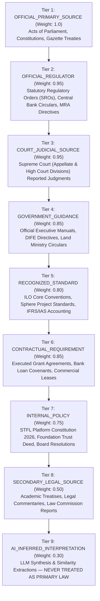

# STFL AIO — Compliance Source Provenance & Legal Advice Boundary
**Document Identity:** `STFL-DOC-2026-CMP-PROV-V1`  
**Phase:** Prompt 12.5 Extension (Compliance, Regulatory & Legal Intelligence Layer)  
**Status:** SPECIFICATION ONLY — RATIFIED (READ-ONLY ARCHITECTURE PHASE)  
**Security Classification:** INTERNAL ENTERPRISE SPECIFICATION  
**Authoritative Precedent:** Extends `STFL_AUDIT_MODEL.md` and `STFL_AIO_CONSTITUTION.md`

---

## 1. Nine-Tier Hierarchy of Legal Sources

The platform records the cryptographic provenance of every compliance assertion. Legal weight is strictly tiered to prevent machine hallucinations from being conflated with authoritative law:



---

## 2. Inviolable Legal Advice Boundary (Section 53)

To ensure strict legal, ethical, and regulatory compliance, the system formalizes six distinct categories of output:

| Category | Definition | Authorized Producer | Legal Standing |
|---|---|---|---|
| **1. LEGAL_INFORMATION** | Factual citation of statutory sections, effective dates, gazette numbers. | AI Agents / System Engine | Factual Reference |
| **2. LEGAL_RISK_DETECTION** | Algorithmic flagging of threshold breaches, expired dates, or missing permits. | Compliance Evaluation Engine | Internal Operational Alert |
| **3. LEGAL_ANALYSIS** | Automated comparison between transaction payload and statutory criteria. | Specialized Compliance Agents | Internal Working Paper |
| **4. LEGAL_RECOMMENDATION** | Proposed operational path (e.g. "Recommend competitive tender"). | AI Compliance Agents | Advisory / Non-Binding |
| **5. ACTUAL_LEGAL_ADVICE** | Formal professional counsel interpreting law applied to specific facts. | **Licensed Human Advocate / Legal Counsel** | Professional Legal Opinion |
| **6. HUMAN_LEGAL_DECISION** | Binding operational determination (Clear, Reject, Override, Sue). | **In-House Counsel / Board of Trustees** | Binding Institutional Decision |

### Mandatory Machine Output Disclaimer:
Every screen, report, memorandum, or API payload generated by AI compliance components must permanently render the disclaimer:
> **"STFL AIO Compliance Intelligence provides automated statutory monitoring, threshold detection, and risk analysis. This system DOES NOT provide formal legal advice. All high-risk decisions, holds, and overrides require review by certified legal counsel or authorized trustees."**

---

## 3. Cryptographic Compliance Audit Trail

Every compliance decision writes an immutable event into `compliance_evaluation_logs` rolling into `enterprise_audit_logs`:

```json
{
  "complianceAuditId": "STFL-CAU-2026-000941",
  "evaluatedAt": "2026-10-15T15:12:08.412Z",
  "actor": {
    "actorId": "STFL-USR-00088",
    "actorType": "USER",
    "userClass": "CLASS_04",
    "deviceId": "STFL-DVC-8F31A2"
  },
  "projectContext": "STFL-PRJ-2026-0001",
  "evaluatedAction": "property.lease.execute",
  "targetResource": "STFL-LSE-2026-000004",
  "governingRules": [
    {
      "ruleId": "STFL-RL-PROP-002",
      "ruleCode": "BD_RENT_CONTROL_ADVANCE_LIMIT",
      "version": 1,
      "sourceType": "OFFICIAL_PRIMARY_SOURCE",
      "statuteReference": "Premises Rent Control Act 1991, Section 10",
      "effectiveDate": "1991-03-30",
      "sourceWeight": 1.00
    }
  ],
  "inputTelemetry": {
    "monthlyRentBDT": 120000.00,
    "securityDepositBDT": 360000.00,
    "advanceRentDemandedBDT": 120000.00
  },
  "decision": {
    "outcome": "CLEAR",
    "thresholdEvaluated": "advanceRent <= monthlyRent * 1",
    "confidenceVector": {
      "ruleMatch": 1.0000,
      "source": 1.0000,
      "interpretation": 0.9950,
      "dataCompleteness": 1.0000,
      "composite": 0.9985
    }
  },
  "cryptographicProof": {
    "algorithm": "SHA-256",
    "payloadHash": "e3b0c44298fc1c149afbf4c8996fb92427ae41e4649b934ca495991b7852b855",
    "immutableAuditLinked": true
  }
}
```

---

## 4. Proposed Database Schema Specification

```sql
-- ---------------------------------------------------------------------------
-- 1. Official Legal Knowledge Sources Registry Table
-- ---------------------------------------------------------------------------
CREATE TABLE IF NOT EXISTS compliance_source_registry (
    id                   UUID PRIMARY KEY DEFAULT gen_random_uuid(),
    source_code          TEXT NOT NULL UNIQUE,          -- e.g. BD_BLA_2006, BD_WAQF_1962
    source_title         TEXT NOT NULL,
    source_type          TEXT NOT NULL CHECK (source_type IN (
                           'OFFICIAL_PRIMARY_SOURCE', 'OFFICIAL_REGULATOR', 'COURT_JUDICIAL_SOURCE', 
                           'GOVERNMENT_GUIDANCE', 'RECOGNIZED_STANDARD', 'CONTRACTUAL_REQUIREMENT', 
                           'INTERNAL_POLICY', 'SECONDARY_LEGAL_SOURCE', 'AI_INFERRED_INTERPRETATION'
                         )),
    issuing_authority    TEXT NOT NULL,
    gazette_reference    TEXT,
    authenticity_url     TEXT,
    document_hash        TEXT,                          -- SHA-256 of official source PDF
    source_weight        NUMERIC(3, 2) NOT NULL DEFAULT 1.00 CHECK (source_weight BETWEEN 0.00 AND 1.00),
    is_verified          BOOLEAN NOT NULL DEFAULT TRUE,
    verified_by_party_id UUID NOT NULL REFERENCES parties(id),
    created_at           TIMESTAMPTZ NOT NULL DEFAULT now()
);

-- ---------------------------------------------------------------------------
-- 2. Compliance Evaluation & Audit Logs Table
-- ---------------------------------------------------------------------------
CREATE TABLE IF NOT EXISTS compliance_evaluation_logs (
    id                   UUID PRIMARY KEY DEFAULT gen_random_uuid(),
    evaluation_id        TEXT NOT NULL UNIQUE,          -- STFL-CAU-2026-000941
    project_id           UUID REFERENCES platform_projects(id),
    actor_party_id       UUID NOT NULL REFERENCES parties(id),
    device_id            TEXT,
    action_verb          TEXT NOT NULL,
    target_resource_id   TEXT NOT NULL,
    rules_applied        TEXT[] NOT NULL,
    outcome              TEXT NOT NULL CHECK (outcome IN ('CLEAR', 'ADVISORY', 'WARNING', 'REVIEW_REQUIRED', 'HOLD', 'BLOCKED')),
    composite_confidence NUMERIC(5, 4) NOT NULL,
    audit_payload_json   JSONB NOT NULL,
    payload_hash         TEXT NOT NULL,                 -- SHA-256 digest
    created_at           TIMESTAMPTZ NOT NULL DEFAULT now()
);

CREATE INDEX IF NOT EXISTS idx_cmp_eval_resource ON compliance_evaluation_logs(target_resource_id, outcome);
CREATE INDEX IF NOT EXISTS idx_cmp_eval_project ON compliance_evaluation_logs(project_id, created_at);
```
