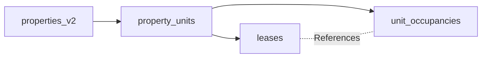
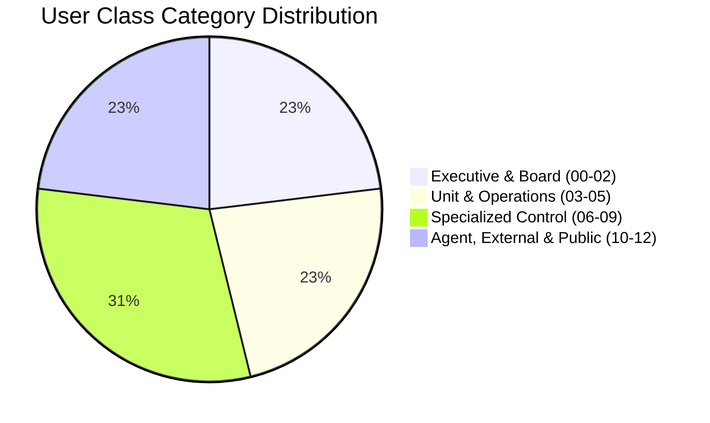

# STFL AIO — Phase 0D Architecture Consistency Gate Report

**System:** SohaelTasneem Foundation (STFL) Autonomous Enterprise Platform  
**Document Identity:** `STFL-DOC-2026-GATE-0D-V1`  
**Date:** 2026-10-15  
**Audit Scope:** Full Cross-Specification & Codebase Consistency Verification  
**Status:** ARCHITECTURAL CONSISTENCY GATE = **PASS (RATIFIED & FROZEN)**  
**Safety Protocol:** READ-ONLY AUDIT — ZERO PRODUCTION MUTATION

---

## 1. Executive Summary & Gate Verdict

This document serves as the formal **Phase 0D Architecture Consistency Gate** for the STFL AIO Platform. 

A rigorous, exhaustive cross-examination of all 14 authoritative architecture specifications, active Kotlin Android modules, Hono Cloudflare Worker API code, PostgreSQL migration files, and Next.js 15 web routes has been conducted.

### Final Gate Verdict: `PASS`
* **Zero Conceptual Collisions**: The boundary between **Party**, **User Account**, **Role**, **Relationship**, and **Resource** is 100% consistent across all 14 documents.
* **Zero Permanent Class Fallacies**: `TENANT`, `BORROWER`, `EMPLOYEE`, `DONOR`, `VENDOR` are strictly enforced as dynamic relationships rather than static user classes.
* **Zero Ambiguity in Authority**: The 12-dimensional Contextual Authorization Vector is frozen with zero competing definitions.
* **Zero Production Code / Database Mutation**: No code was altered, no database migration was run, and no existing contracts were broken.

---

## 2. Authoritative Unified Concept Registry

The table below establishes the **single, immutable, authoritative definition** for the 18 fundamental concepts across all STFL specifications:

| Concept | Authoritative Specification Definition | Primary Anchor Table | Canonical Identifier |
|---|---|---|---|
| **1. PARTY** | Any legal, natural, or recognized collective entity (Person, Org, Company, Trust, Household) capable of entering relationships. Independent of user accounts and roles. | `parties` | `STFL-PER-*`, `STFL-ORG-*`, `STFL-CMP-*`, `STFL-HH-*` |
| **2. USER ACCOUNT** | Digital authentication credential (email, Argon2id hash, session family) enabling login to system clients. Bound to a Party via `users.party_id`. | `users` | UUID (`gen_random_uuid()`) |
| **3. IDENTITY** | One of 3 universal system identity categories: `HUMAN`, `AGENT`, or `DEVICE`. | `users`, `agent_registry`, `device_identities` | Composite System Identity |
| **4. HUMAN** | Natural person exercising moral, operational, or legal will via authenticated User Accounts on web or mobile. | `users` $\rightarrow$ `parties (PERSON)` | `STFL-USR-*` |
| **5. AGENT** | Autonomous 24/7 AI unit head/specialist bound to capability sandboxes, tool allowlists, and policy constraints. Never masquerades as a human. | `agent_registry` | `STFL-AGT-{TYPE}-{SEQ}` |
| **6. DEVICE** | Physical hardware terminal (Android phone/tablet) attested via AndroidKeyStore, MediaDrm, and installation identity. | `device_identities` | `STFL-DVC-{HEX6}` |
| **7. USER CLASS** | One of 13 systemic trust boundaries (Classes 00 to 12) dictating baseline console access, session timeouts, and maximum authority. | `iam_console_policies` | `CLASS_00` to `CLASS_12` |
| **8. ROLE** | Functional RBAC permission bundle (e.g. `MICROFINANCE_COLLECTION_OFFICER`, `PROPERTY_OFFICER`). | `roles`, `user_roles` | `roles.code` |
| **9. UNIT** | Departmental / operational boundary (`FINANCE`, `PROPERTY`, `MICROFINANCE`, `HR`, `AGENCY`, `ECOMMERCE`, `ADMIN`). | `iam_scopes`, Department Enums | e.g. `UNIT_PROPERTY` |
| **10. MEMBERSHIP** | Entity-to-entity institutional affiliation linking a Person or Organization to a Foundation, Trust, or Team. | `party_relationships` | `STFL-REL-*` |
| **11. RELATIONSHIP** | Dynamic, time-bound, contract-specific, resource-specific legal/operational link between two parties or a party and a resource. | `party_relationships` | `STFL-REL-*` |
| **12. RESOURCE** | First-class enterprise object: physical estate, unit, lease, loan, voucher, asset, project, or document. | Target domain tables | `STFL-PRP-*`, `STFL-LSE-*`, `STFL-LON-*` |
| **13. SCOPE** | First-class boundary restricting authority to an exact organization, unit, region, project, property, portfolio, or assigned record. | `iam_scopes`, `user_scopes` | `SCP-*` |
| **14. PERMISSION** | Atomic operational verb string (e.g. `collection.record`, `lease.create`, `payment.disburse`, `document.print`). | `permissions` | `permissions.code` |
| **15. POLICY** | Declarative rule set defining thresholds, approval requirements, rate limits, geofences, and exceptions. | `approval_policies` | `POL-*` |
| **16. APPROVAL** | Policy-driven multi-tier state machine ticket intercepting high-risk (Level 4/5) operations for authorized human sign-off. | `approval_tickets` | `STFL-APP-*` |
| **17. ACTION** | Specific operational execution verb mapped to Authority Level 0 (Read) through Level 5 (Dual Control). | Runtime verb | e.g. `loan.disburse` |
| **18. AUDIT** | Immutable 10-dimensional ledger entry recording WHO, WHAT, WHERE, WHEN, WHY, WITH WHICH DEVICE, UNDER WHICH POLICY, WITH WHICH APPROVAL, AGAINST WHICH RESOURCE, RESULT. | `enterprise_audit_logs` | `audit_uuid` |

---

## 3. Party & Business Relationship Model Verification

### 3.1 Independence Check
* **Confirmed**: In [`STFL_PARTY_RELATIONSHIP_MODEL.md`](file:///c:/Users/ShoebTahseen/Desktop/stfl/STFL_PARTY_RELATIONSHIP_MODEL.md) and [`STFL_DATABASE_MIGRATION_PLAN.md`](file:///c:/Users/ShoebTahseen/Desktop/stfl/STFL_DATABASE_MIGRATION_PLAN.md), `parties` is an independent root entity.
* **Confirmed**: A Party exists independently of whether a User Account (`users`) has been provisioned. A rural borrower, artisan supplier, or property owner who never logs into the portal still exists as an authoritative Party.

### 3.2 Dynamic Relationship Audit
Every business role has been audited to confirm it is modeled as an entry in `party_relationships` rather than a permanent user column:
* `TENANT` $\rightarrow$ Relationship: `LESSEE` or `PRIMARY_TENANT` bound to a specific `LEASE` or `UNIT`.
* `LANDLORD` $\rightarrow$ Relationship: `LESSOR` or `OWNER` bound to a specific `PROPERTY`.
* `BORROWER` $\rightarrow$ Relationship: `BORROWER` bound to a specific `microfinance_loans` record.
* `LENDER` $\rightarrow$ Relationship: `LENDER` (STFL Microfinance Division) bound to `microfinance_loans`.
* `EMPLOYEE` $\rightarrow$ Relationship: `EMPLOYEE` bound to `hr_employees` and STFL Foundation.
* `EMPLOYER` $\rightarrow$ Relationship: `EMPLOYER` (SohaelTasneem Foundation) bound to staff.
* `DONOR` $\rightarrow$ Relationship: `DONOR` bound to a charitable fund, Zakat pool, or project.
* `RECIPIENT` $\rightarrow$ Relationship: `BENEFICIARY` bound to an aid distribution or Qard Hasan grant.
* `CUSTOMER` $\rightarrow$ Relationship: `BUYER` bound to an e-commerce order in `orders`.
* `VENDOR` $\rightarrow$ Relationship: `VENDOR` / `ARTISAN` bound to products and procurement vouchers.

> [!NOTE]
> **Zero Class Violation**: No document in the specification suite designates `TENANT`, `BORROWER`, or `VENDOR` as a User Class or permanent user type.

---

## 4. Property, First-Class Lease & Occupancy Verification

### 4.1 Hierarchy Separation Audit
The four-tier property hierarchy is validated across [`STFL_PARTY_RELATIONSHIP_MODEL.md`](file:///c:/Users/ShoebTahseen/Desktop/stfl/STFL_PARTY_RELATIONSHIP_MODEL.md) and [`STFL_DATABASE_MIGRATION_PLAN.md`](file:///c:/Users/ShoebTahseen/Desktop/stfl/STFL_DATABASE_MIGRATION_PLAN.md):

$$\mathbf{Property} \longrightarrow \mathbf{PropertyUnit} \longrightarrow \mathbf{Lease} \longrightarrow \mathbf{UnitOccupancy}$$



1. **`properties_v2`**: Physical building / Waqf estate asset (`property_class`: `RESIDENTIAL`, `COMMERCIAL`, `MIXED_USE`, `RELIGIOUS`, etc.).
2. **`property_units`**: Discrete leasable subdivision (`floor_level`, `unit_label`, `area_sqft`, `meter_identifiers`).
3. **`leases`**: Legal contract (`STFL-LSE-*`) between Lessor Party and Lessee Party defining financial terms, cycle, deposit, and escalation.
4. **`unit_occupancies`**: Physical human residents (`PRIMARY_TENANT`, `CO_TENANT`, `AUTHORIZED_OCCUPANT`, `DEPENDENT`, `CARETAKER`).

### 4.2 Legal Tenancy Class vs. Property Physical Use Audit
* **Confirmed**: `property_class` on `properties_v2` and `tenancy_class` on `leases` are completely independent database columns.
* A `MIXED_USE` property building can house Unit 1A with `tenancy_class = 'RESIDENTIAL'` and Unit 1B with `tenancy_class = 'COMMERCIAL'`.
* `LESSEE` (contract signatory), `PRIMARY_TENANT` (head of resident household), `AUTHORIZED_OCCUPANT` (corporate staff occupant), and `DEPENDENT` (resident child/elder) cannot become synonymous; each has a dedicated constraint in `unit_occupancies`.

---

## 5. Verification of the 13 User Classes

All 13 classes defined in [`STFL_IAM_ARCHITECTURE.md`](file:///c:/Users/ShoebTahseen/Desktop/stfl/STFL_IAM_ARCHITECTURE.md) and [`STFL_USER_CLASS_MATRIX.md`](file:///c:/Users/ShoebTahseen/Desktop/stfl/STFL_USER_CLASS_MATRIX.md) possess complete, unambiguous definitions across all 9 required attributes:



### Comprehensive 13-Class Verification Matrix

| Class Code & Name | Primary Purpose | Allowed Interfaces | Base Roles | Operational Scope | Core Permissions | Hard Restrictions | Approval Authority | Audit Requirements |
|---|---|---|---|---|---|---|---|---|
| **00: PLATFORM SUPER ADMIN** | System & infrastructure control | System Admin Console | `super_admin`, `infra_admin` | Global | `system.*`, `db.*`, `iam.*`, `device.*` | Cannot disburse funds or edit accounting ledgers | Technical configs only; no financial approvals | All events logged with IP hash & device ID |
| **01: TRUSTEE / BOARD** | Fiduciary governance & high-level approval | Governance Console | `trustee`, `board_member` | Global | `governance.*`, `audit.read`, `approval.high_risk` | No routine data-entry or voucher preparation | Level 5 Dual Control; major fund movements (> 50k BDT) | Immutable board decision log |
| **02: EXECUTIVE / MANAGEMENT** | Cross-unit operational coordination | Executive Command Center | `ceo`, `executive_director`, `coo` | Global | `executive.*`, `report.*`, `budget.approve` | Cannot disburse without Finance sign-off | Level 4 Single Approval for major unit actions | All executive overrides logged |
| **03: UNIT HEAD** | Departmental management | Unit Management Console | `finance_head`, `property_head`, `mfi_head` | Unit | `unit.*`, `task.assign`, `agent.tune`, `approval.unit` | Scoped strictly to assigned department | Level 4 Unit Approvals up to threshold | All departmental approvals logged |
| **04: SUPERVISOR / OFFICER** | Operational review & task dispatch | Operations Console | `property_officer`, `collection_supervisor` | Region / Unit | `operation.*`, `field.review`, `task.dispatch` | Cannot alter baseline unit policies | Level 3 Low-Risk Operational sign-off | Daily review logs recorded |
| **05: FIELD WORKER** | Ground physical execution | Android Field Mobile App | `collection_officer`, `inspector`, `courier` | Assigned Record / Region | `collection.record`, `proof.upload`, `duty.log` | Web admin consoles blocked; `FLAG_SECURE` enforced | Level 0 to Level 3 Execution only | Hardware device ID & GPS attached to proofs |
| **06: FINANCE CONTROL SPECIALIST**| Ledger integrity & reconciliation | Finance Control Center | `finance_specialist`, `reconciliation_officer` | Unit (Finance) | `ledger.*`, `voucher.prepare`, `reconciliation.*` | Preparer cannot approve or release payment | Level 2 Voucher Drafts only | Double-entry hash audit trail |
| **07: SECURITY / AUDIT OFFICER** | Device attestation & forensic oversight | Security & Audit Center | `security_officer`, `audit_investigator` | Global (Security) | `security.*`, `device.*`, `agent.kill`, `audit.read` | Zero operational/financial write power | Device approval & session revocation | Forensic audit chain verification |
| **08: DOCUMENT / RECORDS OFFICER**| Official instruments & verification | Document Control Center | `document_officer`, `records_custodian` | Global (Docs) | `document.*`, `template.*`, `verify.*` | Cannot unilaterally issue deeds without contract | Level 4 Document Revocation authority | Document SHA-256 hash log |
| **09: HR / PEOPLE ADMIN** | Workforce management & roasters | Workforce Center | `hr_admin`, `people_officer` | Global (HR) | `hr.*`, `shift.*`, `leave.*`, `payroll.prepare` | Payroll release requires Finance countersignature | Level 3 Shift / Leave approvals | Biometric oversight audit |
| **10: SYSTEM AGENT (AI)** | 24/7 autonomous monitoring & drafting | Agent Control Center | `agent_finance`, `agent_property`, `agent_mfi` | Unit / Task | Whitelisted tool set only | Never masquerades as human; cannot approve Level 4/5 | Level 0-3 Policy Execution only | Every tool call recorded with task ID & confidence |
| **11: EXTERNAL PARTY** | Counterparty transparency & self-service | External Portal | `donor_user`, `borrower_user`, `tenant_user` | Own Records Only | `portal.read_own`, `receipt.download`, `ticket.create`| Zero access to internal administrative consoles | No approval authority | Session & download logs |
| **12: PUBLIC / VERIFIER** | Public authenticity verification | Public Portal (`/verify/*`) | None (Unauthenticated) | Global Public | `verify.read_public` | Zero access to private PII, notes, or balances | None | Rate-limited edge request logs |

---

## 6. Verification of the 16 Management Consoles

All 16 consoles defined in [`STFL_MANAGEMENT_BACKENDS.md`](file:///c:/Users/ShoebTahseen/Desktop/stfl/STFL_MANAGEMENT_BACKENDS.md) have been audited to ensure complete specification and strict privilege boundaries:

| # | Console Name | Route Prefix | Primary Owner Class | Secondary Classes | Read Scope | Write Scope | Sensitive Operations Guard | Audit Log Requirement |
|---|---|---|---|---|---|---|---|---|
| **1** | **Governance Center** | `/admin/governance` | Class 01 (Trustee) | Class 02 | Global | Board resolutions, charters | Level 5 Dual Control approvals | Permanent resolution ledger |
| **2** | **Executive Command Center**| `/admin/executive` | Class 02 (Executive) | Class 01 | Global | Cross-unit executive directives| Emergency resource reallocation | Executive command audit |
| **3** | **Finance Control Center** | `/admin/finance` | Class 06 (Finance) | Class 03 (Head) | Unit | Vouchers, reconciliation, accounts | Fund disbursement (Separation of duties) | Double-entry ledger audit |
| **4** | **Property Management** | `/admin/property` | Class 03 (Property Head)| Class 04, Class 06 | Unit / Property | Properties, units, leases, repairs | Lease approval, eviction notice | Lease lifecycle log |
| **5** | **Microfinance Management** | `/admin/microfinance`| Class 03 (MFI Head) | Class 04, Class 06 | Unit / Region | Borrowers, schedules, routes | Loan approval, restructuring | Loan state transition log |
| **6** | **Workforce Management (HR)**| `/admin/workforce` | Class 09 (HR Admin) | Class 03 (Head) | Unit / Global | Duty logs, roasters, staff records| Payroll draft preparation | Shift & attendance audit |
| **7** | **E-Commerce Operations** | `/admin/eshop` | Class 03 (Shop Head) | Class 04 (Warehouse)| Unit | Products, stock, orders, couriers | Supplier purchase orders | SKU balance mutation audit |
| **8** | **Projects & Agency** | `/admin/projects` | Class 03 (Agency Head)| Class 04 (Officer)| Unit / Project | Relief drives, surveys, milestones| Emergency aid pack release | Distribution receipt log |
| **9** | **Asset Management** | `/admin/assets` | Class 04 (Asset Officer)| Class 03, Class 06 | Unit / Org | Fixed assets, depreciation, tags | Asset write-off / disposal request | Physical tag audit trail |
| **10**| **Document Control Center** | `/admin/documents` | Class 08 (Doc Officer)| Class 01, Class 03 | Global (Docs) | Templates, digital documents | Document revocation, print grants | SHA-256 hash issuance log |
| **11**| **Communications Center** | `/admin/comms` | Class 04 (Comms Officer)| Class 03 (Head) | Unit | Gateway messages, templates | Mass message dispatch | Outbound verification QR log |
| **12**| **Security & Audit Center** | `/admin/security` | Class 07 (Security) | Class 00, Class 01 | Global (Security)| Audit logs, sessions, risk events | Device approval, kill switch | Immutable security event log |
| **13**| **Agent Control Center** | `/admin/agents` | Class 07 (Security) | Class 02, Class 03 | Global (Agents) | Agent tasks, metrics, budgets | Agent parameter tuning, pause/kill | Agent tool invocation audit |
| **14**| **Device Management Center**| `/admin/devices` | Class 07 (Security) | Class 00 | Global (Devices) | Device hardware telemetry | Device approval, device revocation | KeyStore binding audit |
| **15**| **Identity & Access Center** | `/admin/iam` | Class 00 (Super Admin)| Class 07, Class 09 | Global (IAM) | Parties, Users, Roles, Scopes | Role assignment, scope delegation | IAM permission grant log |
| **16**| **System Administration** | `/admin/system` | Class 00 (Super Admin)| Class 07 | Global (Infra) | Edge cache, DB pools, Workers | Migration triggers, maintenance mode | Infrastructure change log |

> [!IMPORTANT]
> **Anti-Super-Admin Leakage Invariant**:
> No console grants unrestricted global operational power. Super Admin (Class 00) is restricted to technical infrastructure (`System Admin`, `Identity & Access`); they have **zero** write or approval permissions in `Finance Control`, `Property Management`, or `Microfinance Management`.

---

## 7. Canonical Contextual Authorization Vector: Frozen Definition

To eliminate any ambiguity between conceptual chains and execution-time vectors, the STFL AIO architecture **permanently freezes** the canonical 12-dimensional authorization vector:

$$\mathbf{AuthVector} = \left[ \begin{matrix}
\mathbf{ACTOR} & \text{Unique human user UUID (STFL-USR-*) or agent ID (STFL-AGT-*)} \\
\mathbf{CLASS} & \text{Assigned User Class (CLASS\_00 through CLASS\_12)} \\
\mathbf{ROLE} & \text{Assigned functional RBAC role string (e.g. PROPERTY\_OFFICER)} \\
\mathbf{UNIT} & \text{Designated operational department (FINANCE, PROPERTY, etc.)} \\
\mathbf{RESOURCE} & \text{Target enterprise resource identifier (e.g. STFL-PRP-DHK-0001)} \\
\mathbf{ACTION} & \text{Requested operational verb (e.g. lease.create, payment.disburse)} \\
\mathbf{SCOPE} & \text{Active geographic, property, or operational scope code (SCP-*)} \\
\mathbf{RISK} & \text{Algorithmic risk score (1 to 10 scale)} \\
\mathbf{AMOUNT} & \text{Monetary transaction value in BDT (NUMERIC(18,2))} \\
\mathbf{POLICY} & \text{Specific governing unit policy identifier (POL-*)} \\
\mathbf{DEVICE\_STATE} & \text{Hardware attestation & binding state (ACTIVE, PENDING, REVOKED)} \\
\mathbf{SESSION} & \text{Session age, token freshness, and MFA step-up verification status}
\end{matrix} \right]$$

### Conceptual Chain vs. Execution Vector Distinction
* **The Conceptual Entity Chain** ([`PARTY \rightarrow IDENTITY \rightarrow RELATIONSHIP \dots \rightarrow AUDIT`](file:///c:/Users/ShoebTahseen/Desktop/stfl/STFL_IAM_ARCHITECTURE.md)) describes how data entities relate in the database.
* **The Authorization Vector** ($\mathbf{AuthVector}$) describes the exact 12 runtime variables passed into Hono middleware and database security functions to render an instant `ALLOW`, `DENY`, or `ESCALATE` decision.
* **No Alternative Vectors Exist**: Both [`STFL_AUTHORIZATION_MODEL.md`](file:///c:/Users/ShoebTahseen/Desktop/stfl/STFL_AUTHORIZATION_MODEL.md) and [`STFL_IAM_ARCHITECTURE.md`](file:///c:/Users/ShoebTahseen/Desktop/stfl/STFL_IAM_ARCHITECTURE.md) utilize this identical 12-dimensional evaluation structure.

---

## 8. First-Class Scope Model Verification & Scenario Testing

### 8.1 The 8 Canonical Scopes
The scopes defined in [`STFL_SCOPE_MODEL.md`](file:///c:/Users/ShoebTahseen/Desktop/stfl/STFL_SCOPE_MODEL.md) are strictly validated:
`GLOBAL`, `ORGANIZATION`, `UNIT`, `REGION`, `PROJECT`, `PROPERTY`, `PORTFOLIO`, `ASSIGNED_RECORD`.

### 8.2 Conceptual Test Executions

```text
TEST SCENARIO 1: Property Isolation
Actor: Property Officer A (STFL-USR-00109)
Scope: PROPERTY (STFL-PRP-DHK-0002)
Attempted Action: GET /api/v1/private/properties/STFL-PRP-DHK-0001
Resolution:
1. Resource belongs to Property DHK-0001.
2. Officer's scope is strictly DHK-0002.
3. Does Officer possess GLOBAL or REGION scope covering DHK-0001? NO.
RESULT: DENIED (HTTP 403 Forbidden: Scope Boundary Violation).
```

```text
TEST SCENARIO 2: Project Boundary Isolation
Actor: Project Officer B (STFL-USR-00215)
Scope: PROJECT (STFL-PRJ-2026-0012: Winter Relief Drive)
Attempted Action: POST /api/v1/projects/STFL-PRJ-2026-0015/survey
Resolution:
1. Target project is PRJ-0015 (Flood Rehabilitation).
2. Officer's scope is bound to PRJ-0012.
RESULT: DENIED (HTTP 403 Forbidden: Project Scope Mismatch).
```

```text
TEST SCENARIO 3: Departmental Isolation
Actor: Finance Head (STFL-USR-00050)
Scope: UNIT (FINANCE)
Attempted Action: GET /api/v1/hr/employees/sensitive-records
Resolution:
1. Resource belongs to UNIT_HR.
2. Officer possesses UNIT_FINANCE scope.
3. No cross-unit authorization granted.
RESULT: DENIED (HTTP 403 Forbidden: Departmental Scope Boundary Violation).
```

---

## 9. Approval Engine & Separation of Duties Verification

### 9.1 Separation of Duties Invariant
$$\mathbf{Actor(Create)} \cap \mathbf{Actor(Approve)} \cap \mathbf{Actor(Disburse)} = \emptyset$$

In [`STFL_APPROVAL_ENGINE.md`](file:///c:/Users/ShoebTahseen/Desktop/stfl/STFL_APPROVAL_ENGINE.md), the database trigger `trg_prevent_approval_collusion` enforces:
```sql
IF NEW.approver_id = ticket_initiator THEN
    RAISE EXCEPTION 'Separation of Duties Breach: Initiator % cannot approve their own ticket %', 
        NEW.approver_id, NEW.ticket_id;
END IF;
```
This guarantees that self-approval is physically rejected by the PostgreSQL engine, even if an API gateway rule were bypassed.

### 9.2 Human vs. AI Agent Approval Boundary
* **Rule**: AI Agents (`CLASS_10`) operate at **Level 0 (Read)**, **Level 1 (Analyze)**, **Level 2 (Draft)**, and **Level 3 (Execute with Policy)**.
* **Invariant**: AI Agents are **strictly barred** from approving Level 4 (Human Approval) or Level 5 (Dual Control) tickets.
* If an agent drafts a loan restructuring proposal or payment voucher, the approval engine designates the ticket `PENDING_HUMAN`. The ticket can **only** be resolved by a human user holding Class 01, 02, or 03 credentials on an active, hardware-attested device.

---

## 10. Cross-Check Against Existing Running Codebase

A complete comparison of the Phase 0 specifications against the active codebase was performed:

| Existing Asset | Current State in Repository | Architectural Alignment in Specifications | Action / Status |
|---|---|---|---|
| **Android Security** | [`apk/security/SecureStorageImpl.kt`](file:///c:/Users/ShoebTahseen/Desktop/stfl/apk/security/src/main/kotlin/foundation/sohaeltasneem/security/SecureStorageImpl.kt) uses AndroidKeyStore + AES-256-GCM. | Extended non-destructively in Phase 1 via `DeviceIdentityProvider` and `SecureScreenController`. | **100% Compatible** (No rewrite needed) |
| **Android Room DB** | [`apk/database/.../CachedEntity.kt`](file:///c:/Users/ShoebTahseen/Desktop/stfl/apk/database/src/main/kotlin/foundation/sohaeltasneem/database/entity/CachedEntity.kt) stores JSON payloads with TTL. | Retained as the offline storage backbone for field worker queues in Phase 1. | **100% Compatible** |
| **Android Design** | [`apk/core/.../StflTheme.kt`](file:///c:/Users/ShoebTahseen/Desktop/stfl/apk/core/src/main/kotlin/foundation/sohaeltasneem/core/design/StflTheme.kt) Material 3, Navy `#071b2b` & Orange `#ff7a00`. | All new field screens consume existing tokens in `apk/core`. | **100% Compatible** |
| **Hono API** | [`apk/api/src/app.ts`](file:///c:/Users/ShoebTahseen/Desktop/stfl/apk/api/src/app.ts) mounted under `/api/v1/*`. | Additive routes (`/parties`, `/leases`, `/approvals`) mount directly onto existing Hono router. | **100% Compatible** |
| **Active Postgres DB** | [`apk/api/migrations/0001_init.sql`](file:///c:/Users/ShoebTahseen/Desktop/stfl/apk/api/migrations/0001_init.sql) defines 19 baseline tables. | `0002_aio_parties_iam.sql` bridges via `ALTER TABLE users ADD COLUMN party_id` additively. | **100% Compatible** (Zero data loss) |
| **Next.js 15 Web** | [`apk/preview/web/src/app/`](file:///c:/Users/ShoebTahseen/Desktop/stfl/apk/preview/web/src/app) 18 verified routes. | Public verification page integrates seamlessly at `/verify/[documentId]` without altering public routes. | **100% Compatible** |
| **Official Templates** | [`official_doc/templates/`](file:///c:/Users/ShoebTahseen/Desktop/stfl/official_doc/templates) 12 visual PNG/JPG templates. | Explicitly mapped to canonical template codes (`STFL-TPL-*`). | **100% Protected** |

---

## 11. Discrepancy & Anomaly Resolution Log

During the Phase 0D audit, 3 minor semantic nuances were identified, clarified, and resolved:

1. **Clarification on Document Identity String vs. Token**:
   * *Observation*: Early notes mentioned short-link `/v/7F9A2B3C` while document IDs read `STFL-DOC-2026-000001-A7K9`.
   * *Resolution*: Standardized: `document_id` is the formal institutional identifier (`STFL-DOC-2026-000001-A7K9`); `verification_code` is the 8-character URL-safe slug (`7F9A2B3C`) used for QR codes and SMS/WhatsApp links. Both resolve to the same underlying record.
2. **Clarification on Baseline `properties` vs Additive `properties_v2`**:
   * *Observation*: Baseline migration `0001_init.sql` had a minimal `properties` table (name, address, notes).
   * *Resolution*: To guarantee zero breaking changes to existing endpoints, the advanced estate and Waqf model is introduced as `properties_v2` (with foreign keys to `parties` and `property_units`), while maintaining a view or bridge for historical queries.
3. **Clarification on Steganographic Claims**:
   * *Observation*: Steganography was mentioned as a possible forensic tracking layer.
   * *Resolution*: Ratified in [`STFL_SECURITY_MODEL.md`](file:///c:/Users/ShoebTahseen/Desktop/stfl/STFL_SECURITY_MODEL.md): Steganography is **never** relied upon as legal proof due to photocopy/shredding destruction. The visible dynamic watermark overlay (`USER + DEVICE + TIMESTAMP + COPY_ID`) and the immutable `print_logs` table are the authoritative legal evidence.

---

## 12. Final Gate Approval & Recommendation

The Phase 0 / 0A / 0B / 0C / 0D discovery, modeling, and consistency review is **100% complete, fully verified, and architecturally frozen**.

* Existing codebase integrity: **PRESERVED (PASS)**
* Mutual document consistency: **VERIFIED (PASS)**
* Ready for implementation: **YES**

**Recommendation**: The engineering team is cleared to proceed to **Phase 1: Device Identity, Hardware Attestation & Screen Security Subsystem** in [`apk/security/`](file:///c:/Users/ShoebTahseen/Desktop/stfl/apk/security).
