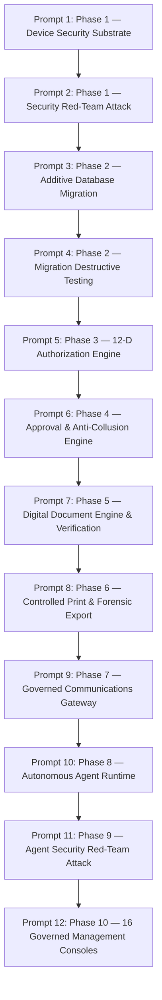

# STFL AIO — ARCHITECTURE CONSTITUTION
**Permanent Governance Directive for the SohaelTasneem Foundation Platform**

**Document Identity:** `STFL-CONST-2026-V1`  
**Effective Date:** 2026-10-15  
**Jurisdiction:** Universal across all AI Agents, Subagents, Engineers, and Systems  
**Status:** PERMANENTLY RATIFIED & INVIOLABLE

---

## 1. The Core Constitutional Invariant

The **Phase 0 / 0A / 0B / 0C / 0D Architecture** is permanently frozen and ratified. 

No implementation agent, subagent, developer, or automated workflow may redefine, duplicate, weaken, bypass, or silently reinterpret the canonical architecture:

$$\mathbf{PARTY} \longrightarrow \mathbf{IDENTITY} \longrightarrow \mathbf{USER/AGENT/DEVICE} \longrightarrow \mathbf{CLASS} \longrightarrow \mathbf{ROLE} \longrightarrow \mathbf{UNIT} \longrightarrow \mathbf{RELATIONSHIP} \longrightarrow \mathbf{RESOURCE} \longrightarrow \mathbf{SCOPE} \longrightarrow \mathbf{PERMISSION} \longrightarrow \mathbf{POLICY} \longrightarrow \mathbf{APPROVAL} \longrightarrow \mathbf{ACTION} \longrightarrow \mathbf{AUDIT}$$

No business module (Finance, Microfinance, Property, HR, E-Commerce, Agency, Admin) may create its own independent identity, RBAC, authorization, approval, audit, device trust, document identity, or communication-security mechanism. Every implementation must strictly consume this canonical architecture.

---

## 2. Immutable Operational Directives

1. **Change Protocol**: Every architectural amendment requires the formal change gate:
   $$\mathbf{CHANGE\ PROPOSAL} \longrightarrow \mathbf{IMPACT\ ANALYSIS} \longrightarrow \mathbf{CONSISTENCY\ CHECK} \longrightarrow \mathbf{SECURITY\ REVIEW} \longrightarrow \mathbf{EXPLICIT\ APPROVAL} \longrightarrow \mathbf{VERSIONED\ SPECIFICATION} \longrightarrow \mathbf{IMPLEMENTATION}$$
2. **Honesty in Reporting**:
   * Never claim **IMPLEMENTED** when only *SPECIFIED*.
   * Never claim **VERIFIED** when only *TEST-DESIGNED*.
   * Never claim **PRODUCTION VERIFIED** without *ACTUAL PRODUCTION EVIDENCE*.
3. **Asset Protection**: Preserve all existing protected assets across `apk/`, `official_doc/`, `files/`, `migrations/`, and `preview/` unless an explicit migration instruction authorizes modification.
4. **Non-Destructive Persistence**:
   * Prefer strictly additive database migrations.
   * Never destroy or overwrite existing production data.
   * Floating-point numbers (`FLOAT`, `DOUBLE PRECISION`) are prohibited for monetary data. `NUMERIC(18, 2)` is mandatory.
5. **Agent Authority Limits**:
   * Never allow an AI agent to grant itself authority or alter its own tool allowlist.
   * Never allow an AI agent to approve an action it initiated.
   * AI agents are strictly bounded to Level 0 (Read), Level 1 (Analyze), Level 2 (Draft), and Level 3 (Execute with Policy). Levels 4 (Human Approval) and 5 (Dual Control) require physical human authorization.
6. **Zero Client-Side Trust**:
   * Never trust client-side (Android/Web) authorization decisions.
   * PostgreSQL and server-side middleware policies are authoritative.
   * Human authority remains perpetually superior to autonomous agent authority.
7. **Comprehensive Accountability**:
   * All security-sensitive and operational actions must write an immutable 10-dimensional audit event (`enterprise_audit_logs`).
8. **Halt on Conflict**: If an implementation prompt or user requirement conflicts with this frozen architecture, **STOP AND REPORT THE CONFLICT IMMEDIATELY**. Do not guess. Do not improvise. Do not silently mutate the architecture.

---

## 3. Enforcement Order of Execution Prompts

Implementation must strictly follow the 12-stage sequential prompt pipeline:

This constitution is binding upon all subsequent phases and implementation runs.
