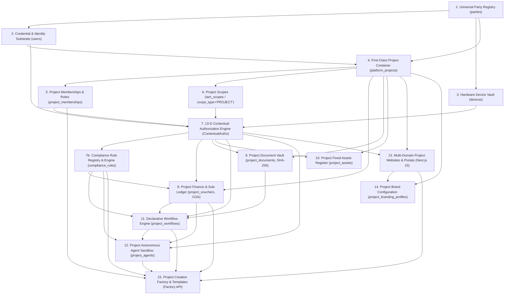
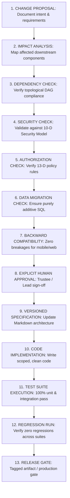

# STFL AIO — Development Dependency Graph & Change Governance
**Document Identity:** `STFL-DOC-2026-DEP-GRAPH-V1`  
**Phase:** Prompt 12.5 (Multi-Project Architecture & Feature Control Map)  
**Status:** SPECIFICATION ONLY — RATIFIED (READ-ONLY ARCHITECTURE PHASE)  
**Security Classification:** INTERNAL ENTERPRISE SPECIFICATION  
**Authoritative Precedent:** Bound by `STFL_AIO_CONSTITUTION.md`

---

## 1. Topological Architecture Dependency Graph

Every enterprise capability in STFL AIO is strictly ordered in an acyclic directed graph (DAG). No component can be instantiated or invoked before its prerequisites are fully verified:

---

## 2. Circular Dependency Analysis & Resolution

To maintain clean compilation, deterministic startup, and error-free database migrations, three potential circular traps were identified and resolved:

### Trap A: Project Finance vs. Workflow Engine
- *Potential Hazard:* Does `project_vouchers` depend on `project_workflows`, or does `project_workflows` depend on `project_vouchers`?
- *Resolution:* **Linear Decoupling.** `project_vouchers` is an authoritative, independent financial double-entry ledger. Workflows simply emit transition events that invoke voucher state updates (`SUBMITTED ➔ APPROVED ➔ DISBURSED`). The ledger has zero hard foreign keys pointing to workflow definitions.

### Trap B: Project Identity vs. Project Container
- *Potential Hazard:* A project needs an `owner_party_id` (a Party), but project memberships require a `project_id`.
- *Resolution:* **Party Exists First.** The human legal sponsor exists in the global `parties` table before the project is conceived. Once the project container is inserted, memberships link existing parties to the newly created project container.

### Trap C: Project Website vs. Context Resolution
- *Potential Hazard:* A website URL must resolve the project, but the project record defines the custom domain.
- *Resolution:* **Lookup Pre-Routing.** The edge middleware queries a high-speed cached reverse-lookup index (`domain ➔ project_id`) before entering the Next.js page renderer. The page renderer receives an explicit `X-Project-Context` header.

---

## 3. Strict Feature Change Governance Protocol

Developers, automated AI agents, and engineering teams must strictly execute the formal 13-stage change gate before altering any codebase component:

### Inviolable Rules for AI Implementation Agents:
- **Zero Improvised Architecture:** If a prompt asks an AI agent to build a feature that contradicts the ratified dependency graph, the agent must **HALT AND REPORT THE CONFLICT**.
- **No Mock Production Code:** No agent may insert mock bypasses or hardcoded passwords into production branches.
- **Truthful Status Reporting:** A feature is never marked `IMPLEMENTED` merely because code compiled without errors.
