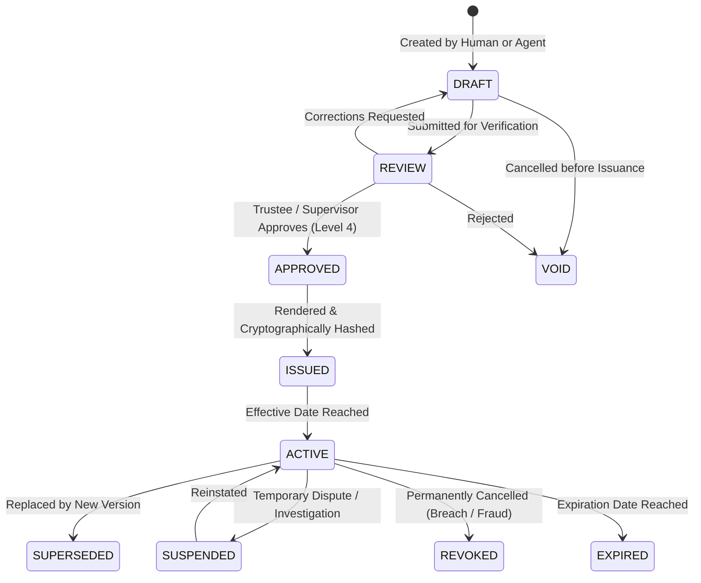

# STFL AIO — Digital Document Identity & Verification Specification

**System:** SohaelTasneem Foundation (STFL) Autonomous Enterprise Platform  
**Document Identity:** `STFL-DOC-2026-DOCID-V1`  
**Date:** 2026-10-15  
**Status:** CANONICAL DOCUMENT SPECIFICATION — RATIFIED (PHASE 0)  
**Security Level:** INTERNAL USE ONLY

---

## 1. Document Identity Composite

Every official instrument issued by the SohaelTasneem Foundation (certificate, lease deed, notice, voucher, acceptance letter, resolution) is governed by a 6-tuple cryptographic composite:

$$\mathbf{DocumentIdentity} = \langle \text{UUID}, \text{InstitutionalID}, \text{Version}, \text{Status}, \text{SHA-256}, \text{VerificationCode} \rangle$$

* **UUID**: Immutable machine identifier (`gen_random_uuid()`).
* **Institutional ID**: Human-readable canonical ID (e.g. `STFL-DOC-2026-000001-A7K9`).
* **Version**: Integer sequence (`v1`, `v2`, ...).
* **Status**: Lifecycle state (e.g. `ACTIVE`, `REVOKED`).
* **SHA-256**: Cryptographic digest of the exact rendered artifact bytes.
* **Verification Code**: URL-safe high-entropy token (e.g. `K7M2R4Q9`) for public authenticity verification.

---

## 2. Canonical `digital_documents` Model

The authoritative schema extension introduces the central digital document ledger in PostgreSQL 16:

```sql
CREATE TABLE IF NOT EXISTS digital_documents (
    document_uuid        UUID PRIMARY KEY DEFAULT gen_random_uuid(),
    document_id          TEXT NOT NULL UNIQUE,          -- STFL-DOC-2026-000001-A7K9
    document_type        TEXT NOT NULL,                 -- certificate, letter, lease, voucher, notice
    document_category    TEXT NOT NULL,                 -- public, private, confidential, restricted
    title                TEXT NOT NULL,
    issuer               TEXT NOT NULL DEFAULT 'SohaelTasneem Foundation',
    issuer_user_id       UUID REFERENCES users(id) ON DELETE SET NULL,
    owner_entity_type    TEXT,                          -- user, property, project, borrower
    owner_entity_id      TEXT,
    serial_year          SMALLINT NOT NULL,
    serial_number        INTEGER NOT NULL,
    verification_code    TEXT NOT NULL UNIQUE,          -- URL-safe verification slug
    version              INTEGER NOT NULL DEFAULT 1,
    status               TEXT NOT NULL DEFAULT 'DRAFT'
                         CHECK (status IN (
                           'DRAFT', 'REVIEW', 'APPROVED', 'ISSUED', 
                           'ACTIVE', 'SUSPENDED', 'SUPERSEDED', 
                           'REVOKED', 'EXPIRED', 'VOID'
                         )),
    issued_at            TIMESTAMPTZ,
    effective_at         TIMESTAMPTZ,
    expires_at           TIMESTAMPTZ,
    storage_object_key   TEXT NOT NULL,                 -- /private/documents/... or /public/...
    mime_type            TEXT NOT NULL DEFAULT 'application/pdf',
    file_size            BIGINT NOT NULL,
    sha256               TEXT NOT NULL,                 -- SHA-256 hash of file content
    parent_document_uuid UUID REFERENCES digital_documents(document_uuid) ON DELETE SET NULL,
    supersedes_uuid      UUID REFERENCES digital_documents(document_uuid) ON DELETE SET NULL,
    created_at           TIMESTAMPTZ NOT NULL DEFAULT now(),
    updated_at           TIMESTAMPTZ NOT NULL DEFAULT now(),
    CONSTRAINT doc_serial_unique UNIQUE (document_type, serial_year, serial_number, version)
);

CREATE INDEX IF NOT EXISTS idx_digital_docs_type_status ON digital_documents (document_type, status);
CREATE INDEX IF NOT EXISTS idx_digital_docs_verification ON digital_documents (verification_code);
CREATE INDEX IF NOT EXISTS idx_digital_docs_sha256 ON digital_documents (sha256);
```

---

## 3. Document Lifecycle State Machine



### Invariant Rules:
1. **Absolute Immutability**: Once a document reaches status `ISSUED` or `ACTIVE`, its content, metadata, and hash are **permanently frozen**.
2. **Never Overwrite**: Any modification, correction, or update generates a **new document record** with an incremented version number, pointing to the prior document via `supersedes_uuid`.
3. **Audit Trail**: Every status transition generates an immutable record in `audit_logs` capturing the previous state, new state, actor ID, and cryptographic document hash.

---

## 4. Public Authenticity Verification Endpoint

The platform exposes an authoritative, lightweight verification gateway on the canonical domain:  
`https://stflbd.app/verify/{document_id}` (or short-link `https://stflbd.app/v/{verification_code}`)

### 4.1 Strict Minimalist Public Payload
To comply with the foundation's privacy safeguards, the public verification page reveals **only** non-confidential authenticity attributes:

```json
{
  "success": true,
  "data": {
    "verificationStatus": "VERIFIED_AUTHENTIC",
    "organization": "SohaelTasneem Foundation (সহায়েল তাসনিম ফাউন্ডেশন)",
    "documentId": "STFL-CER-2026-000002-K7M2",
    "documentType": "Digital Certificate",
    "title": "Vocational Training Completion",
    "issuedDate": "2026-10-15",
    "status": "ACTIVE",
    "integrityHash": "e3b0c44298fc1c149afbf4c8996fb92427ae41e4649b934ca495991b7852b855",
    "officialVerification": "https://stflbd.app/verify/STFL-CER-2026-000002-K7M2"
  }
}
```

### 4.2 Prohibited Public Data (Never Exposed)
The public verification endpoint is strictly gated and will **never** return:
* Recipient/Beneficiary home addresses or national ID numbers.
* Personal telephone numbers or email addresses.
* Financial bank account or mobile wallet numbers.
* Internal administrative notes, approval comments, or agent logs.
* Device fingerprints, IP addresses, or internal database UUIDs.

---

## 5. Official Template Catalogue Mapping

All digital documents render into standard layouts aligned with the 12 existing authoritative templates in [`official_doc/templates/`](file:///c:/Users/ShoebTahseen/Desktop/stfl/official_doc/templates):

| Template Code | Target Document Type | Layout Specifications |
|---|---|---|
| `STFL-TPL-LET-V1` | Executive Official Letter | Top bilingual logo header, formal reference box, executive seal footer. |
| `STFL-TPL-CER-V1` | Academic / Achievement Certificate | Ornamental dual-border, foundation watermark, double trustee signature block. |
| `STFL-TPL-NTC-V1` | Foundation Official Notice | Prominent notice badge, legal disclaimer, serial reference box. |
| `STFL-TPL-VCH-V1` | Financial Payment Voucher | Two-column debits/credits, approved officer signature block, dynamic QR stamp. |
| `STFL-TPL-LSE-V1` | Property Tenancy Lease | Formal deed preamble, schedule of properties, boundary clauses, witness block. |
| `STFL-TPL-RCP-V1` | Microfinance Collection Receipt | Compact dual-receipt (field copy & beneficiary copy), verification short-link. |

* **Template Versioning Invariant**: Templates are identified as `STFL-TPL-{TYPE}-V{VERSION}`. Changing a template layout produces `V2` without overwriting historical templates, ensuring past documents can always be re-verified against their original visual layout.
