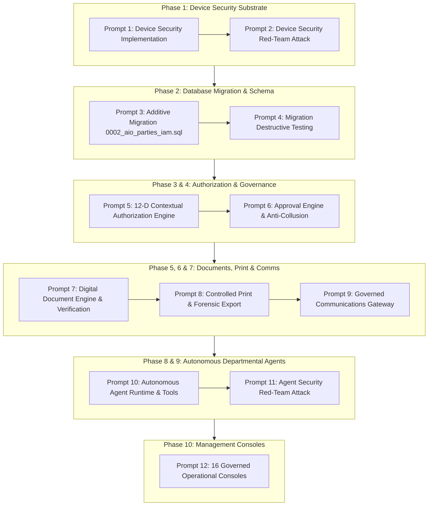

# STFL AIO — Master 12-Stage Implementation & Red-Team Pipeline

**System:** SohaelTasneem Foundation (STFL) Autonomous Enterprise Platform  
**Document Identity:** `STFL-DOC-2026-PIPE-V1`  
**Date:** 2026-10-15  
**Governing Authority:** `STFL_AIO_CONSTITUTION.md`  
**Status:** RATIFIED & FROZEN EXECUTION RUNBOOK

---

## Pipeline Overview

This document specifies the exact sequential execution order, prompt scopes, red-team attacks, and non-negotiable exit criteria for implementing the STFL AIO platform.

---

## Detailed Stage Runbook

### Prompt 1: Phase 1 — Device Security Implementation
* **Scope**: Build strictly the trusted-device/security substrate:
  * `DeviceIdentityProvider` abstraction.
  * AndroidKeyStore hardware-backed key generation.
  * Capability-based device attestation (StrongBox detection with software fallback).
  * Device registration, approval, suspension, and revocation lifecycle.
  * User, device, and rotating session family binding.
  * MFA step-up challenge triggers.
  * Screen classification: `PUBLIC`, `NORMAL`, `SENSITIVE`, `HIGHLY_SENSITIVE`.
  * `FLAG_SECURE` window management on sensitive screens.
  * Dynamic foreground moving canvas watermark overlay (`USER + DEVICE + TIMESTAMP`).
  * Structured security audit events.
  * Unit and integration test suites.
* **Hard Rule**: No business modules. No 16-console UI. Pure security substrate only.
* **Exit Gate**: Build passes; unit tests pass; `FLAG_SECURE` verified; device attestation payload tested.

---

### Prompt 2: Phase 1 — Security Red-Team Attack
* **Scope**: Hostile adversarial attack against the device security substrate built in Prompt 1.
* **Attack Scenarios**:
  1. Cloned installation identity attack.
  2. Rooted device / Magisk / emulator bypass attempt.
  3. Revoked device presenting valid refresh token.
  4. Expired session token replay.
  5. Stolen access JWT presented from unrecognized device ID.
  6. Account-to-device mismatch injection.
  7. Network traffic replay / MITM attempt.
  8. Direct API bypass attempting to access private endpoints without device registration.
  9. Modified APK signature spoofing.
  10. OS-level screenshot / screen recording attempt against `FLAG_SECURE`.
  11. Dynamic canvas watermark stripping / occlusion attack.
  12. Offline clock tampering / local replay abuse.
  13. Cryptographic algorithm downgrade / fallback manipulation.
  14. AI agent attempting to masquerade as an attested physical mobile device.
* **Hard Rule**: The agent must **not** fix anything initially. It must compile a formal, evidence-based Vulnerability & Threat Assessment Report first.
* **Exit Gate**: Vulnerability report ratified; identified vulnerabilities patched; re-tests confirm 100% defense.

---

### Prompt 3: Phase 2 — Additive Database Migration
* **Scope**: Implement `0002_aio_parties_iam.sql` additively, preserving baseline `0001_init.sql`:
  * Core IAM: `parties`, `party_relationships`, `iam_scopes`, `user_scopes`, `iam_console_policies`.
  * Governance: `approval_policies`, `approval_tickets`, `approval_decisions`.
  * Properties & Leases: `properties_v2`, `property_units`, `leases`, `unit_occupancies`.
  * Security & Comms: `device_identities`, `print_grants`, `print_logs`, `comms_templates`, `comms_messages`.
  * Agents & Proofs: `agent_registry`, `agent_tasks`, `field_proofs`.
  * User-Party Bridge: `ALTER TABLE users ADD COLUMN party_id REFERENCES parties(id)`.
* **Hard Rule**: Zero `DROP TABLE` or `DROP COLUMN`. Numerical monetary fields must use `NUMERIC(18,2)`. Wrapped in a single transaction.
* **Exit Gate**: Migration applies cleanly on PostgreSQL 16; zero regression in existing test suite.

---

### Prompt 4: Phase 2 — Migration Destructive-Test Prompt
* **Scope**: Assume the migration is malicious, interrupted, or partially corrupted. Stress-test resilience:
  1. **UP**: Apply migration `0002_aio_parties_iam.sql`.
  2. **DOWN**: Execute rollback script `0002_aio_parties_iam.down.sql`.
  3. **UP AGAIN**: Re-apply migration from scratch to verify absolute idempotency.
  4. **DATA INTEGRITY CHECK**: Verify baseline data in `users`, `programs`, and `properties` is 100% untouched.
  5. **CONCURRENCY TEST**: Execute parallel migration threads attempting simultaneous DDL execution.
  6. **CORRUPTION INJECTION TEST**: Simulate mid-transaction network disconnect, foreign-key constraint violations, invalid enum injection, and orphaned relationship records.
* **Hard Rule**: Migration must pass UP $\rightarrow$ DOWN $\rightarrow$ UP $\rightarrow$ CONCURRENCY before approval.
* **Exit Gate**: Zero orphaned records, zero lock deadlocks, zero baseline data corruption.

---

### Prompt 5: Phase 3 — 12-Dimensional Contextual Authorization Engine
* **Scope**: Build the runtime decision engine evaluating:
  $$\mathbf{ACTOR} \times \mathbf{CLASS} \times \mathbf{ROLE} \times \mathbf{UNIT} \times \mathbf{RESOURCE} \times \mathbf{ACTION} \times \mathbf{SCOPE} \times \mathbf{RISK} \times \mathbf{AMOUNT} \times \mathbf{POLICY} \times \mathbf{DEVICE\_STATE} \times \mathbf{SESSION}$$
  $$\Downarrow$$
  $$\mathbf{ALLOW} \quad / \quad \mathbf{DENY} \quad / \quad \mathbf{ESCALATE}$$
* **Hard Rule**: Server-authoritative only. Client-side logic in Android or Next.js is completely untrusted for authorization.
* **Exit Gate**: Integration tests verify that every permission check properly enforces scope boundaries, amount ceilings, and device attestation.

---

### Prompt 6: Phase 4 — Approval Engine & Anti-Collusion Verification
* **Scope**: Build the policy-driven approval engine:
  $$\mathbf{CREATE} \longrightarrow \mathbf{REVIEW} \longrightarrow \mathbf{APPROVE} \longrightarrow \mathbf{RELEASE/DISBURSE}$$
* **Anti-Collusion Invariant Matrix**:
  * Creator $=$ Approver $\implies$ **DENIED (403)**.
  * Creator $=$ Disburser $\implies$ **DENIED (403)**.
  * Approver $=$ Disburser $\implies$ **DENIED (403)**.
  * Agent $=$ Approver $\implies$ **DENIED (403)**.
  * Revoked Device $\implies$ **DENIED (403)**.
  * Out-of-Scope Approver $\implies$ **DENIED (403)**.
  * Insufficient Authority Level $\implies$ **DENIED (403)**.
* **Exit Gate**: Database trigger `trg_prevent_approval_collusion` tested; sequential, parallel, and dual-control workflows verified.

---

### Prompt 7: Phase 5 — Digital Document Engine & Public Verification
* **Scope**: Canonical document registry for `STFL-DOC-*`, `STFL-CER-*`, `STFL-LET-*`:
  * Immutable issued documents.
  * Versioning with `supersedes_uuid`.
  * Exact SHA-256 content byte hashing.
  * URL-safe verification slug (`verification_code`).
  * Public endpoint: `GET /api/v1/verify/:documentId` and `/v/:verificationCode`.
  * Minimalist public payload: zero PII, zero financial balances, zero internal notes.
* **Exit Gate**: Document tamper-detection tests pass; public verification returns verified authentic status without data leakage.

---

### Prompt 8: Phase 6 — Controlled Print & Forensic Export
* **Scope**: Print and PDF export governance:
  * Default: `PRINT = DENIED`, `EXPORT = DENIED`.
  * Dynamic One-Time Print Token (OTPT) valid for 60 seconds.
  * Server-side PDF compositing with diagonal visible watermark (`USER + DEVICE + TIMESTAMP + COPY_ID`).
  * Copy tracking: individual institutional copy IDs (`CP-000004`).
  * Immutable `print_logs` ledger.
  * Steganography explicitly bounded as secondary forensic assistance, not infallible proof.
* **Exit Gate**: Expired print tokens rejected; duplicate print tokens rejected; watermarked PDF rendering verified.

---

### Prompt 9: Phase 7 — Governed Communications Gateway
* **Scope**: Multi-channel outbound messaging engine (WhatsApp, Email, SMS, In-App):
  * Bilingual template enforcement (`STFL-TPL-MSG-*`).
  * Authoritative database field resolution (no hallucinated amounts or dates).
  * Recipient validation against verified Party contacts.
  * Cryptographic verification links embedded (`stflbd.app/v/{code}`).
  * Centralized communications audit ledger (`comms_messages`).
* **Hard Rule**: AI agents and field staff cannot send arbitrary un-templated messages.
* **Exit Gate**: Unapproved message drafts blocked; variable resolution verified against live DB; delivery audit logged.

---

### Prompt 10: Phase 8 — Autonomous Departmental Agent Runtime
* **Scope**: Agent Orchestrator for `STFL-AGT-FIN-001`, `STFL-AGT-PROP-001`, `STFL-AGT-MFI-001`, etc.:
  * Dedicated agent identity and credentials.
  * Tool allowlist with strict JSON parameter schemas.
  * Maximum authority bounded to Level 3. Level 4/5 actions automatically halt for human tickets.
  * Hourly and daily tool invocation budgets.
  * Action rate limiting.
  * Emergency kill switch integration.
  * Mandatory uncertainty escalation rule ($\text{Confidence} < 0.98 \implies \text{Escalate}$).
* **Exit Gate**: Tool sandboxes tested; self-execution of financial disbursement blocked; automated kill switch halts agent within 50ms.

---

### Prompt 11: Phase 9 — Agent Security Red-Team Attack
* **Scope**: Adversarial penetration testing of the agent runtime:
  1. Agent attempting to masquerade as a human user (`actor_type = 'user'`).
  2. Agent attempting tool call outside its approved allowlist.
  3. Agent attempting cross-unit tool execution (Finance Agent calling Property Lease tools).
  4. Agent attempting scope escape (accessing records outside assigned project/region).
  5. Agent attempting self-approval of a payment voucher.
  6. Agent attempting direct raw SQL execution against PostgreSQL.
  7. Agent attempting arbitrary un-templated WhatsApp message dispatch.
  8. Agent attempting unauthorized confidential document print grant.
  9. Agent subjected to prompt injection inside incoming field notes.
  10. Agent subjected to recursive task generation attack.
  11. Agent budget exhaustion behavior.
* **Hard Rule**: Vulnerability report produced first before any remediation.
* **Exit Gate**: 100% of agent privilege escalation and isolation attacks thwarted.

---

### Prompt 12: Phase 10 — The 16 Governed Management Consoles
* **Scope**: Build the 16 dedicated web consoles (Governance, Executive, Finance, Property, Microfinance, Workforce, E-Commerce, Projects, Assets, Documents, Comms, Security, Agents, Devices, IAM, System Admin):
  * Consuming shared IAM, authorization, scope, approval, audit, party, and relationship engines.
  * Role-based UI shaping with strict server-side policy gating.
  * Responsive, bilingual (Bangla Hind Siliguri + English Inter) design system.
* **Exit Gate**: Each console tested against its designated User Class; Super Admin confirmed blocked from operational finance/property mutations.
