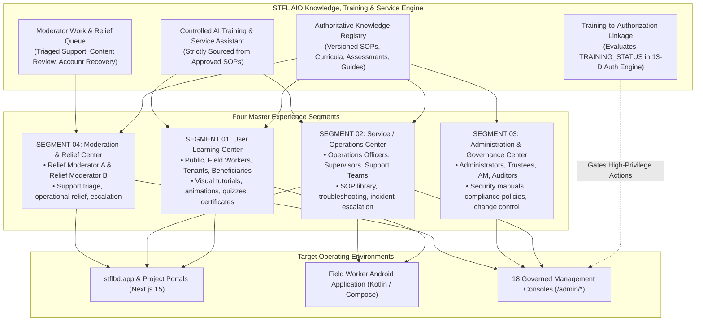
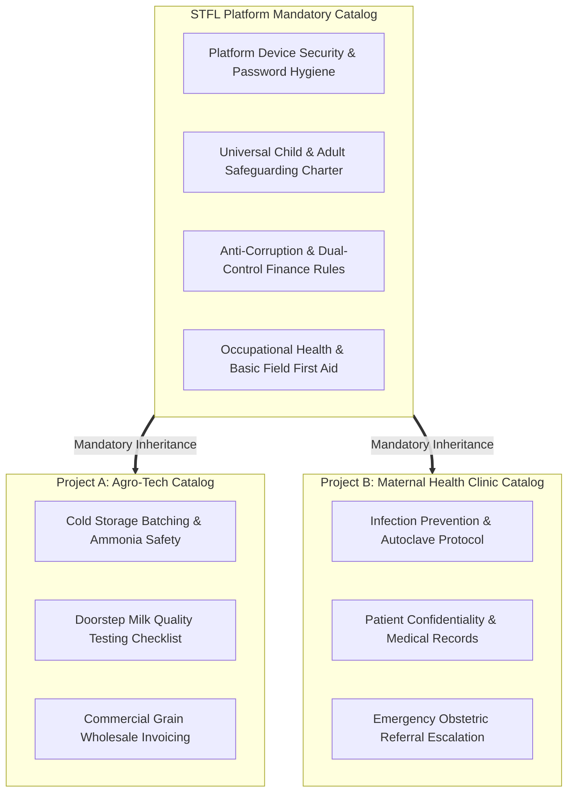

# STFL AIO — Knowledge, Training, Service & Moderation Ecosystem Architecture
**Document Identity:** `STFL-DOC-2026-KNOW-ARCH-V1`  
**Phase:** Prompt 12.5 Extension (Sections 63–82: Knowledge, Training, Service & Moderation)  
**Status:** SPECIFICATION ONLY — RATIFIED (READ-ONLY ARCHITECTURE PHASE)  
**Security Classification:** INTERNAL ENTERPRISE SPECIFICATION  
**Authoritative Precedent:** Bound by `STFL_AIO_CONSTITUTION.md` and `STFL_AIO_MULTI_PROJECT_ARCHITECTURE.md`

---

## 1. Architectural Mission & Non-Static Paradigm

In STFL AIO, **Knowledge, Training, Service Support, and Operational Moderation are not treated as passive static documentation folders or uncurated wikis**.

The platform elevates knowledge into a **first-class, active, governed enterprise ecosystem** supporting:
1. **Continuous Learning:** Self-paced, visual-first interactive education for field workers, public users, beneficiaries, and staff.
2. **Operational Training & Certification:** Mandatory competency verification gating access to high-privilege system operations.
3. **Operational Service Center:** Standard Operating Procedures (SOPs), incident troubleshooting, and runtime operational support.
4. **Administration & Governance Knowledge:** Controlled administration manuals, statutory compliance directives, and cryptographic vaults.
5. **Human Moderation & Administrative Relief:** Multi-tiered administrative relief (`MODERATOR_A`, `MODERATOR_B`) eliminating single points of failure without granting unconstrained superuser privileges.
6. **Live In-Workflow Contextual Training:** Real-time visual walkthroughs embedded directly into active operational tasks (e.g. lease execution, cash voucher capture).

---

## 2. The Four Experience Segments

### Segment 01: User Learning Center
- **Target Audience:** Public citizens, community volunteers, seasonal field workers, retail customers, microfinance borrowers, commercial lessees, and external project participants.
- **Capabilities:**
  - Pictorial, graphic-first visual guides (Bengali & English) designed for low-literacy or mobile-first environments.
  - Video walk-throughs and step-by-step interactive simulations of key user tasks.
  - Role-specific compliance and safety training modules (e.g., Agricultural Chemical Handling, Child Safeguarding, Cash Receipt Verification).
  - Gamified interactive quizzes, knowledge-check assessments, and verifiable digital completion certificates.
  - Transparent progress tracking tied to the user's permanent `parties` identity.

### Segment 02: Service / Operations Center
- **Target Audience:** Field supervisors, project managers, dispatch coordinators, property inspectors, and support personnel.
- **Capabilities:**
  - Canonical Standard Operating Procedure (SOP) Library with versioned revision histories.
  - Operational checklists for routine field missions (e.g. Tenancy Handover Checklist, Grain Quality Intake Checklist).
  - Diagnostic troubleshooting guides and service status dashboards.
  - Controlled AI-assisted troubleshooting grounded strictly in ratified SOP documents.
  - Incident handling and operational escalation procedures.

### Segment 03: Administration & Governance Center
- **Target Audience:** System Administrators (`CLASS_00`), Trustees (`CLASS_01`), Executive Directors (`CLASS_02`), Central Treasurers (`CLASS_03`), Compliance Officers (`CLASS_08`), and Internal Auditors.
- **Capabilities:**
  - Secure administration and cryptographic vault procedures (KeyStore management, device attestation protocols).
  - 13-Dimensional Contextual Authorization and policy override guidelines.
  - Dual-control approval and Anti-Collusion Separation of Duties manuals.
  - Statutory compliance compendiums (BLA 2006, Waqf Ordinance 1962, Income Tax Act 2023).
  - Platform change control, database migration governance, and audit review manuals.

### Segment 04: Moderation & Relief Center
- **Target Audience:** Designated operational moderators (`MODERATOR_A`, `MODERATOR_B`) providing business continuity and support relief.
- **Capabilities:**
  - Triage and management of user help requests, technical support tickets, and account recovery assistance.
  - Content review and moderation for training materials, FAQs, and public story submissions.
  - Execution of pre-authorized, non-destructive operational relief actions within strict scope boundaries.
  - Formal escalation routing to department heads, compliance counsel, or technical administrators.

---

## 3. Platform Core Knowledge vs. Project-Specific Training Containers

In alignment with the multi-project ecosystem:
1. **Platform Core Knowledge Substrates:**  
   Universal security policies, Anti-Money Laundering (AML) standards, Child Safeguarding charters, and constitutional platform rules are defined centrally by STFL HQ. **Every project inherits these mandatory modules automatically.**
2. **Project-Specific Knowledge Containers:**  
   Individual projects maintain dedicated training, SOP, and service catalogs (e.g., *Project A: Organic Dairy Cold-Chain SOPs*; *Project B: Clinical Ultrasound Sanitation Protocols*).
3. **The Non-Dilution Invariant:**  
   A project may add project-specific training and stricter operational prerequisites, but **CAN NEVER waive, hide, or delete mandatory platform compliance or safety modules**.

---

## 4. Inviolable Invariants for Knowledge & Moderation

The following four architectural rules are permanently ratified:

1. **Zero Silent Modification Invariant:**  
   Training lessons, SOP manuals, and policy articles are immutable once published. Updates create a new sequential version (`v1 ➔ v2`) with an explicit effective date and author/approver signature. Historical certifications remain linked to the exact version completed.
2. **Controlled AI Knowledge Grounding Invariant:**  
   AI Training and Service Assistants (`STFL-AGT-TRN-001`, `STFL-AGT-SRV-001`) must answer strictly and exclusively from ratified, approved knowledge sources. If source text is ambiguous or unverified, the assistant must **escalate to human moderators or flag the knowledge source for review**.
3. **No Unbounded Moderator Escalation Invariant:**  
   Moderators (`MODERATOR_A`, `MODERATOR_B`) provide administrative relief, but **never possess blanket superuser privileges**. They cannot disburse funds, alter database schemas, override statutory legal holds, or self-approve high-privilege operational actions.
4. **Training as Authorization Prerequisite:**  
   The Contextual Authorization Engine can enforce `TRAINING_STATUS == 'CERTIFIED'` as a mandatory prerequisite for granting write/execute access to hazardous or legally sensitive operations (e.g., medical dispensing, large procurement tendering).
