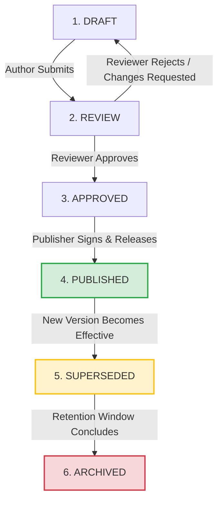

# STFL AIO — Knowledge Governance & Immutability Model

**System:** SohaelTasneem Foundation (STFL) Autonomous Enterprise Platform  
**Document Identity:** `STFL-DOC-2026-KNW-GOV-V1`  
**Date:** 2026-10-15  
**Status:** SPECIFICATION — RATIFIED (SECTIONS 71, 72, 79)  
**Security Level:** INTERNAL USE ONLY  

---

## 1. Executive Summary & Purpose

In an institution that directs humanitarian initiatives, social microfinance, commercial real estate, educational programs, and healthcare services across dozens of independent projects, operational knowledge is not merely informal documentation—it is regulatory and operational evidence. If a field officer or tenant follows an outdated, tampered, or unauthorized instruction, the foundation faces severe legal, financial, and ethical liability.

The **STFL Knowledge Governance & Immutability Model** enforces comprehensive lifecycle control, cryptographic versioning, multi-tiered approvals, and hierarchical multi-project inheritance across all SOPs, training courses, pictorial guides, and policy references.

Core Invariants:
1. **Immutability of Published Content**: Published material can **never** be edited in-place. Any modification necessitates authoring a new version, subjecting it to formal peer and compliance review, and obtaining cryptographic ratification.
2. **Tiered Approval Thresholds**: Highly sensitive domains (Legal, Compliance, Financial Ledgers, Security, Child Safeguarding) require mandatory multi-signature authorization prior to publication.
3. **Project Inheritance & Non-Erasure**: Individual projects may augment the knowledge catalogue with specialized workflows, but they **cannot** override, suppress, or delete mandatory platform-wide regulatory and security training.
4. **Complete Source Provenance**: Every operational article and training module links directly to its underlying statutory, board-approved, or policy contract via cryptographic SHA-256 hashes.

---

## 2. Six-Stage Knowledge Lifecycle State Machine (Section 79)

Every knowledge artifact (SOP, visual guide, course, FAQ, checklist) transitions through a deterministic six-stage lifecycle:



### 2.1 State Definitions
1. **DRAFT**: Content under development by an authorized author (Officer, Educator, or Subject Matter Expert). Invisible to operational field workers.
2. **REVIEW**: Formally locked for peer, technical, and pedagogical review. Reviewers can annotate, flag factual ambiguities, or request structural modifications.
3. **APPROVED**: Fully reviewed and validated. Awaiting designated departmental sign-off or scheduled release date.
4. **PUBLISHED**: The authoritative active version served to users and operational staff. Digitally signed, immutably recorded, and cited by AI assistants.
5. **SUPERSEDED**: Replaced by a newly published version (`version + 1`). Retained in read-only status for historical auditing and prior compliance verification.
6. **ARCHIVED**: Permanently retired content exceeding active regulatory retention windows (standard: 7 years). Offline storage with cryptographic receipt.

---

## 3. Tiered Approval Matrix & Governance Authorities

Approval requirements scale proportionally with the risk level of the knowledge domain:

| Knowledge Category | Risk Level | Author Role | Mandatory Reviewer | Final Ratification Authority |
|---|---|---|---|---|
| **General Learning / FAQs** | Low | Community Officer / Mod B | Senior Educator | Unit Head / Service Manager |
| **Operational SOPs** | Medium | Operations Lead | Unit Supervisor | Service Manager |
| **Financial Procedures** | High | Senior Finance Officer | Internal Auditor | Chief Financial Officer / Comptroller |
| **Security & IAM Protocols**| High | Security Engineer | Relief Moderator B | Chief Information Security Officer (CISO) |
| **Compliance, Legal & AML** | Critical | Compliance Officer | Legal Counsel | Governance Officer / Board Trustee |
| **Project-Specific Guides** | Medium | Project Lead | Project Coordinator | Project Director + Platform Mod |

### 3.1 Dual-Custody Approval for Critical Domains
For **Critical** and **High** risk categories:
- A single person cannot both author and approve content.
- Approval requires **two independent cryptographic signatures** (Dual-Custody Sign-off).
- Signatures are verified using Hardware Security Keys (FIDO2 / Tier 1 Attestation).

---

## 4. Multi-Project Knowledge Inheritance & Non-Erasure (Section 71)

The platform supports a federated catalog model across independent projects while enforcing institutional safeguards:

```mermaid
graph TD
    subgraph "STFL Global Platform Knowledge"
        CORE_SEC[Mandatory: Device Security & Password Hygiene]
        CORE_AML[Mandatory: Anti-Money Laundering & KYC]
        CORE_SAFE[Mandatory: Child & Beneficiary Safeguarding]
        CORE_AUDIT[Mandatory: Dual-Custody Financial Policy]
    end

    subgraph "Project A: Rural Healthcare Clinic"
        A_HLTH[Clinic Waste Disposal SOP]
        A_DRUG[Cold-Chain Drug Handling]
        A_CONS[Patient Privacy In-Field]
    end

    subgraph "Project B: Urban Vocational Training"
        B_WELD[Welding Safety & PPE Protocol]
        B_STIP[Stipend Disbursement Flow]
    end

    CORE_SEC & CORE_AML & CORE_SAFE & CORE_AUDIT ==>|MANDATORY INHERITANCE<br/>Cannot be suppressed or removed| Project A
    CORE_SEC & CORE_AML & CORE_SAFE & CORE_AUDIT ==>|MANDATORY INHERITANCE<br/>Cannot be suppressed or removed| Project B

    Project A --> A_HLTH & A_DRUG & A_CONS
    Project B --> B_WELD & B_STIP
```

### 4.1 Constitutional Non-Erasure Guarantee
- **Rule 1 (Catalogue Inheritance)**: Every newly initialized Project automatically inherits all courses and SOPs flagged `is_platform_mandatory = true`.
- **Rule 2 (No Silent Removal)**: Project administrators may add project-specific training modules, customize local language translations, or append local contextual examples. However, any attempt to delete, unpublish, or bypass a platform-mandatory course triggers an immediate `GOVERNANCE_VIOLATION_BLOCKED` error.
- **Rule 3 (Local Extension)**: Project modules must reference their platform parent. If the platform updates a core compliance policy, project extensions automatically receive an upstream dirty flag requiring localized re-validation.

---

## 5. Versioning Metadata & Immutability Controls (Section 72)

Every knowledge document must record 14 mandatory institutional metadata fields:

```typescript
interface GovernedKnowledgeItem {
  id: string;                      // UUID
  document_code: string;           // e.g. "SOP-PROP-001"
  version: number;                 // Integer: 1, 2, 3...
  title: string;                   // Document Title
  author_id: string;               // Verified User UUID
  reviewer_ids: string[];          // Array of Reviewer UUIDs
  approver_signatures: {           // Cryptographic signatures
    approver_id: string;
    role: string;
    signature_ecdsa: string;
    signed_at: string;
  }[];
  effective_date: string;          // ISO Date
  superseded_date?: string;        // ISO Date
  status: 'DRAFT' | 'REVIEW' | 'APPROVED' | 'PUBLISHED' | 'SUPERSEDED' | 'ARCHIVED';
  jurisdiction: string;            // e.g. "BD-DHAKA", "GLOBAL"
  project_id?: string;             // NULL if Global STFL
  applicable_roles: string[];      // Array of User Classes / Roles
  language: string;                // ISO 639-1 (e.g. "bn", "en")
  source_provenance_hash: string;  // SHA-256 hash of underlying legal/policy source
  payload_content_hash: string;    // SHA-256 hash of entire text/visual bundle
  revision_history: {
    version: number;
    changed_by: string;
    change_summary: string;
    timestamp: string;
  }[];
}
```

### 5.1 Tamper-Evident Hashing
Before publication, the system computes `payload_content_hash` across all text, image asset URLs, and assessment criteria. Any out-of-band database update will fail the integrity verification check when queried by the API Gateway or AI Assistant.

---

## 6. PostgreSQL Schema: Knowledge Governance & Version Ledger

```sql
-- Master Governed Knowledge Vault
CREATE TABLE IF NOT EXISTS knowledge_items (
    id                      UUID PRIMARY KEY DEFAULT gen_random_uuid(),
    document_code           TEXT NOT NULL,                 -- e.g. SOP-FIN-001
    version                 INTEGER NOT NULL DEFAULT 1,
    title                   TEXT NOT NULL,
    summary                 TEXT NOT NULL,
    category                TEXT NOT NULL CHECK (category IN (
                              'GENERAL_LEARNING', 'OPERATIONAL_SOP', 'FINANCIAL_POLICY',
                              'SECURITY_IAM', 'COMPLIANCE_LEGAL', 'PROJECT_SPECIFIC'
                            )),
    is_platform_mandatory   BOOLEAN NOT NULL DEFAULT FALSE,
    project_id              UUID REFERENCES projects(id) ON DELETE CASCADE,
    jurisdiction            TEXT NOT NULL DEFAULT 'GLOBAL',
    language                TEXT NOT NULL DEFAULT 'en',
    applicable_roles        JSONB NOT NULL DEFAULT '[]'::jsonb,
    content_payload_json    JSONB NOT NULL DEFAULT '{}'::jsonb,
    payload_content_hash    TEXT NOT NULL,
    source_provenance_hash  TEXT NOT NULL,
    status                  TEXT NOT NULL CHECK (status IN (
                              'DRAFT', 'UNDER_REVIEW', 'APPROVED', 'PUBLISHED', 'SUPERSEDED', 'ARCHIVED'
                            )) DEFAULT 'DRAFT',
    author_id               UUID NOT NULL REFERENCES users(id),
    effective_date          DATE,
    superseded_date         DATE,
    created_at              TIMESTAMPTZ NOT NULL DEFAULT now(),
    updated_at              TIMESTAMPTZ NOT NULL DEFAULT now(),
    CONSTRAINT unq_doc_code_version UNIQUE (document_code, version, language)
);

-- Cryptographic Approval Signatures
CREATE TABLE IF NOT EXISTS knowledge_approval_signatures (
    id                  UUID PRIMARY KEY DEFAULT gen_random_uuid(),
    knowledge_item_id   UUID NOT NULL REFERENCES knowledge_items(id) ON DELETE CASCADE,
    approver_id         UUID NOT NULL REFERENCES users(id),
    approver_role       TEXT NOT NULL,
    signature_ecdsa     TEXT NOT NULL,
    signed_payload_hash TEXT NOT NULL,
    signed_at           TIMESTAMPTZ NOT NULL DEFAULT now()
);

-- Revision Audit Ledger
CREATE TABLE IF NOT EXISTS knowledge_revision_ledger (
    id                  UUID PRIMARY KEY DEFAULT gen_random_uuid(),
    document_code       TEXT NOT NULL,
    from_version        INTEGER NOT NULL,
    to_version          INTEGER NOT NULL,
    changed_by          UUID NOT NULL REFERENCES users(id),
    change_summary      TEXT NOT NULL,
    diff_payload_json   JSONB NOT NULL DEFAULT '{}'::jsonb,
    created_at          TIMESTAMPTZ NOT NULL DEFAULT now()
);

CREATE INDEX IF NOT EXISTS idx_knw_lookup ON knowledge_items(document_code, status, is_platform_mandatory);
CREATE INDEX IF NOT EXISTS idx_knw_project ON knowledge_items(project_id, category);
```

---

## 7. Summary of Governance Guarantees

1. **Zero Silent Edits**: All operational and training documentation changes are logged, reviewed, and signed.
2. **Multi-Signature Protection**: High-risk financial, compliance, and security documentation cannot be ratified unilaterally.
3. **Institutional Integrity Across Projects**: Autonomous projects inherit essential compliance training without capability of silent suppression.
4. **Permanent Auditability**: Historical legal and operational states remain completely reproducible through immutable version history.
