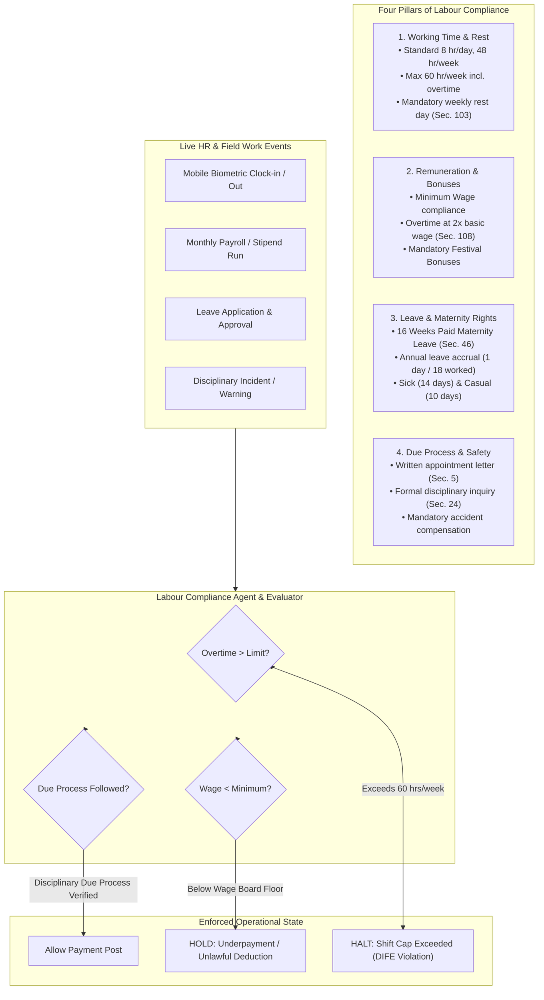

# STFL AIO — Labour & Employment Regulatory Compliance Model
**Document Identity:** `STFL-DOC-2026-CMP-LAB-V1`  
**Phase:** Prompt 12.5 Extension (Compliance, Regulatory & Legal Intelligence Layer)  
**Status:** SPECIFICATION ONLY — RATIFIED (READ-ONLY ARCHITECTURE PHASE)  
**Security Classification:** INTERNAL ENTERPRISE SPECIFICATION  
**Authoritative Precedent:** Extends `STFL_AIO_COMPLIANCE_ARCHITECTURE.md` (Bangladesh Labour Act 2006 & ILO Core Conventions)

---

## 1. Domain Purpose & Regulatory Jurisdiction

The **Labour & Employment Compliance Subsystem** continuously monitors, verifies, and enforces statutory worker protections, occupational health standards, and fair remuneration across all foundation staff, field agents, seasonal agricultural laborers, and clinic personnel.

It operates primarily under the jurisdiction of the **Bangladesh Labour Act 2006 (BLA, Act XLII of 2006)** (as amended in 2013 and 2018), the **Bangladesh Labour Rules 2015**, directives from the **Department of Inspection for Factories and Establishments (DIFE)**, and the **Eight Fundamental ILO Conventions**.



---

## 2. Core Statutory Labour Thresholds & Automated Detectors

| Operational Area | Statutory Baseline (BLA 2006) | Platform Automated Threshold Detector | Action on Breach |
|---|---|---|---|
| **Daily Work Hours** | 8 hours/day maximum (Sec. 100) | Triggers alert if field shift duration $> 8.0$ hours | Flags standard overtime calculation |
| **Weekly Work Hours** | 48 hours/week maximum regular (Sec. 102) | Triggers alert when cumulative weekly regular hours reach 48 | Routes subsequent hours to overtime rate |
| **Overtime Ceiling** | Max 12 hours overtime/week; Max 60 hrs total (Sec. 102) | Hard block when weekly cumulative hours reach 60.0 hours | **STATUTORY HOLD:** Worker barred from additional shift scheduling |
| **Overtime Rate** | Double ordinary basic rate of wages ($2.0\times$) (Sec. 108) | Payroll generator compares overtime hourly rate vs $2.0\times$ basic | **PAYROLL BLOCK:** Cannot generate voucher with $< 2.0\times$ rate |
| **Wage Payment Deadline** | Wages must be paid within 7 working days of period close (Sec. 121) | Alerts at Day 5; flags critical alert on Day 7 | **ESCALATION:** Central Finance notified of statutory wage arrears |
| **Maternity Benefit** | 8 weeks preceding and 8 weeks following delivery (16 weeks total) (Sec. 46) | Validates leave duration is exactly 112 consecutive days with full wages | **POLICY BLOCK:** Rejects maternity leave requests $< 16$ weeks |
| **Appointment Letter** | Mandatory written appointment letter and identity card (Sec. 5) | Onboarding cannot transition worker to `ACTIVE` without signed letter ID | **ONBOARDING HOLD:** Worker blocked from task dispatch |
| **Disciplinary Notice** | Minimum 7 days given to worker to explain charges in writing (Sec. 24) | System disables "Submit Termination" button until 7 full calendar days elapse | **DUE PROCESS LOCK:** Enforces statutory natural justice window |

---

## 3. Worker vs. Independent Contractor Classification Test

To eliminate legal liabilities regarding sham contracting or labor misclassification:
- When drafting an agreement in `CLASS_11` (External Party) or hiring field workers:
- The system evaluates the **Four-Factor Economic Reality Test**:
  1. *Behavioral Control:* Does STFL dictate exact working hours and daily instructions?
  2. *Financial Control:* Does the worker supply their own tools, or does STFL provide the device?
  3. *Exclusivity:* Is the worker barred from working for other entities?
  4. *Integral Nature:* Is the work a core continuous foundation function?
- If all 4 factors indicate direct employment, the engine **rejects an independent contractor agreement** and mandates a formal **Statutory Employment Contract (BLA Sec. 5)**.

---

## 4. Proposed Database Schema Specification

```sql
-- ---------------------------------------------------------------------------
-- 1. Labour Compliance Audits Table
-- ---------------------------------------------------------------------------
CREATE TABLE IF NOT EXISTS labour_compliance_records (
    id                   UUID PRIMARY KEY DEFAULT gen_random_uuid(),
    record_id            TEXT NOT NULL UNIQUE,          -- STFL-LBR-2026-000412
    worker_party_id      UUID NOT NULL REFERENCES parties(id) ON DELETE RESTRICT,
    project_id           UUID REFERENCES platform_projects(id) ON DELETE RESTRICT,
    audit_period_start   DATE NOT NULL,
    audit_period_end     DATE NOT NULL,
    
    -- Hours & Wage Telemetry
    regular_hours_worked NUMERIC(6, 2) NOT NULL DEFAULT 0.00,
    overtime_hours_worked NUMERIC(6, 2) NOT NULL DEFAULT 0.00,
    total_hours_worked   NUMERIC(6, 2) NOT NULL DEFAULT 0.00,
    hourly_basic_rate    NUMERIC(18, 2) NOT NULL,
    overtime_rate_applied NUMERIC(18, 2) NOT NULL,
    total_gross_wages    NUMERIC(18, 2) NOT NULL,
    statutory_deductions NUMERIC(18, 2) NOT NULL DEFAULT 0.00,
    net_wages_payable    NUMERIC(18, 2) NOT NULL,
    
    -- Statutory Flags
    is_overtime_capped   BOOLEAN NOT NULL DEFAULT FALSE,
    overtime_limit_exceeded BOOLEAN NOT NULL DEFAULT FALSE,
    minimum_wage_compliant BOOLEAN NOT NULL DEFAULT TRUE,
    appointment_letter_doc_id TEXT,                     -- STFL-DOC-*
    
    compliance_status    TEXT NOT NULL DEFAULT 'COMPLIANT' CHECK (compliance_status IN (
                           'COMPLIANT', 'OVERTIME_WARNING', 'STATUTORY_BREACH', 'UNDER_INQUIRY'
                         )),
    verified_by_party_id UUID REFERENCES parties(id),
    created_at           TIMESTAMPTZ NOT NULL DEFAULT now()
);

CREATE INDEX IF NOT EXISTS idx_labour_worker ON labour_compliance_records(worker_party_id, audit_period_start);
CREATE INDEX IF NOT EXISTS idx_labour_status ON labour_compliance_records(compliance_status);
```
