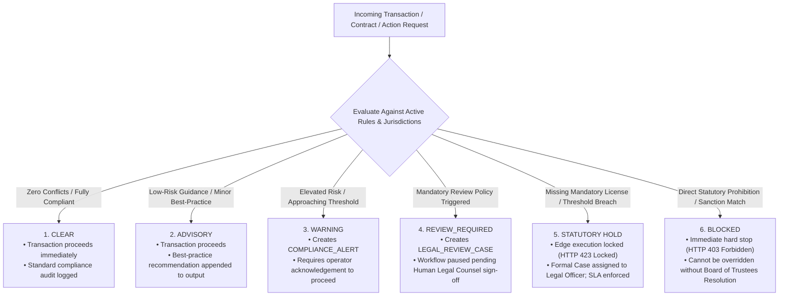
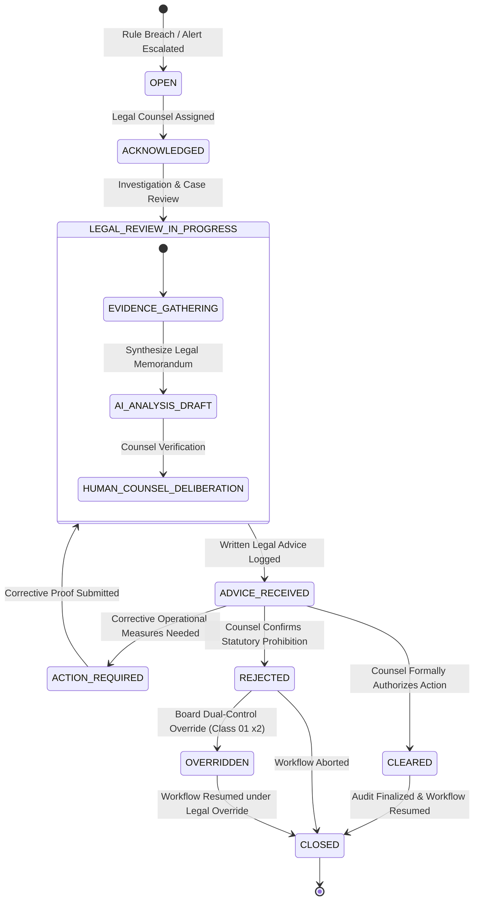

# STFL AIO — Legal Escalation, Alerts & Case Management Engine
**Document Identity:** `STFL-DOC-2026-CMP-ESC-V1`  
**Phase:** Prompt 12.5 Extension (Compliance, Regulatory & Legal Intelligence Layer)  
**Status:** SPECIFICATION ONLY — RATIFIED (READ-ONLY ARCHITECTURE PHASE)  
**Security Classification:** RESTRICTED ENTERPRISE SPECIFICATION  
**Authoritative Precedent:** Extends `STFL_APPROVAL_ENGINE.md` and `STFL_AIO_CONSTITUTION.md`

---

## 1. The Six Compliance Engine Decisions

Before any sensitive operational, financial, or property transaction is executed, the **Compliance Evaluation Engine** evaluates the 13 request dimensions against the active **Compliance Rule Registry** and returns one of six discrete decisions:



---

## 2. Hard Stop Conditions (Section 52 Invariant)

The engine automatically asserts a **`HOLD`** or **`BLOCKED`** state upon detecting any of the following 10 hard stop conditions:

1. **Statutory Prohibition:** Action directly prohibited by national statute (e.g. commercial sale of inalienable Waqf land without Ministry authorization).
2. **Expired Mandatory License:** Execution requires an active statutory license (e.g. MRA Microfinance License, Trade License, Fire Clearance) that is expired or suspended.
3. **Missing Statutory Approval:** Action requires prior government or regulatory sanction (e.g. NGO Affairs Bureau clearance for foreign donor grants).
4. **Restricted Fund Breach:** Attempt to disburse Zakat funds for unpermitted commercial overhead or non-Shariah purposes.
5. **Major Threshold Breach:** Procurement expenditure exceeding open-tendering statutory ceiling without competitive public tender.
6. **Labour Rights Violation:** Scheduled worker hours exceeding statutory weekly limits or below minimum statutory wage.
7. **Restricted Party / Sanctions Hit:** Counterparty party or director matches anti-terror/sanctions watchlists.
8. **Missing Mandatory Legal Documentation:** Real estate lease or commercial contract missing mandatory stamp duty or notarization.
9. **Conflict of Interest Detection:** Transaction parties share beneficial ownership with the approver (Anti-Collusion / SoD breach).
10. **Legal Hold Assertion:** Target property, bank account, or entity is subject to an active court order or pending dispute.

---

## 3. The 10-State Legal Review Case Machine

When an action triggers `REVIEW_REQUIRED`, `HOLD`, or `BLOCKED`, the platform instantiates a formal **`LEGAL_REVIEW_CASE`**:



---

## 4. Inviolable Legal Override Governance

The platform enforces a strict separation between automated detection and human legal authority:

```
┌────────────────────────────────────────────────────────────────────────┐
│                   LEGAL OVERRIDE GOVERNANCE RULES                      │
├────────────────────────────────────────────────────────────────────────┤
│ 1. AI AGENTS CANNOT OVERRIDE:                                          │
│    Under NO circumstance can an AI Agent (CLASS_10) waive a compliance │
│    alert, clear a legal hold, or approve an exception.                │
├────────────────────────────────────────────────────────────────────────┤
│ 2. AUTHORIZED HUMAN JURISDICTION:                                      │
│    • Minor Advisory / Warning: Can be cleared by Project Lead (Class 04)│
│    • Review Required / Statutory Hold: Requires In-House Legal Counsel │
│      (Class 08 / Legal Specialist) or Executive Director (Class 02).   │
│    • Blocked / Statutory Prohibition: Requires DUAL-CONTROL TRUSTEE    │
│      RESOLUTION (Class 01 x 2) accompanied by external Senior Advocate │
│      written legal opinion.                                            │
├────────────────────────────────────────────────────────────────────────┤
│ 3. MANDATORY OVERRIDE AUDITING:                                        │
│    Every override must document: Legal justification, legal opinion    │
│    reference, indemnification clause, approving party ID, hardware     │
│    device ID, and timestamp in enterprise_audit_logs.                  │
└────────────────────────────────────────────────────────────────────────┘
```

---

## 5. Proposed Database Schema Specification

```sql
-- ---------------------------------------------------------------------------
-- 1. Compliance Alerts Table
-- ---------------------------------------------------------------------------
CREATE TABLE IF NOT EXISTS compliance_alerts (
    id                   UUID PRIMARY KEY DEFAULT gen_random_uuid(),
    alert_id             TEXT NOT NULL UNIQUE,          -- STFL-ALT-2026-000412
    project_id           UUID REFERENCES platform_projects(id) ON DELETE RESTRICT,
    rule_id              UUID NOT NULL REFERENCES compliance_rules(id) ON DELETE RESTRICT,
    severity             TEXT NOT NULL CHECK (severity IN ('INFO', 'ADVISORY', 'WARNING', 'HOLD', 'CRITICAL')),
    target_resource_type TEXT NOT NULL,                 -- e.g. VOUCHER, LEASE, EMPLOYEE
    target_resource_id   TEXT NOT NULL,                 -- e.g. STFL-VCH-2026-00018
    trigger_action       TEXT NOT NULL,                 -- e.g. payment.disburse
    alert_title          TEXT NOT NULL,
    alert_details        TEXT NOT NULL,
    calculated_value     NUMERIC(18, 2),
    threshold_value      NUMERIC(18, 2),
    confidence_score     NUMERIC(5, 4) NOT NULL,
    status               TEXT NOT NULL DEFAULT 'OPEN' CHECK (status IN ('OPEN', 'ACKNOWLEDGED', 'RESOLVED', 'DISMISSED')),
    created_at           TIMESTAMPTZ NOT NULL DEFAULT now()
);

-- ---------------------------------------------------------------------------
-- 2. Formal Legal Review Cases Table
-- ---------------------------------------------------------------------------
CREATE TABLE IF NOT EXISTS legal_review_cases (
    id                   UUID PRIMARY KEY DEFAULT gen_random_uuid(),
    case_id              TEXT NOT NULL UNIQUE,          -- STFL-CAS-2026-000042
    project_id           UUID REFERENCES platform_projects(id) ON DELETE RESTRICT,
    rule_id              UUID NOT NULL REFERENCES compliance_rules(id) ON DELETE RESTRICT,
    alert_id             UUID REFERENCES compliance_alerts(id),
    
    -- Contextual Targets
    target_entity_type   TEXT NOT NULL,
    target_resource_id   TEXT NOT NULL,
    affected_party_id    UUID REFERENCES parties(id),
    
    -- Case Diagnostics & Findings
    case_summary         TEXT NOT NULL,
    statutory_citations  TEXT[] NOT NULL DEFAULT '{}',
    ai_risk_analysis     TEXT,
    confidence_score     NUMERIC(5, 4) NOT NULL,
    
    -- Operational Status & Deadlines
    status               TEXT NOT NULL DEFAULT 'OPEN' CHECK (status IN (
                           'OPEN', 'ACKNOWLEDGED', 'IN_PROGRESS', 'ADVICE_RECEIVED', 
                           'ACTION_REQUIRED', 'CLEARED', 'REJECTED', 'OVERRIDDEN', 'CLOSED'
                         )),
    assigned_counsel_party_id UUID REFERENCES parties(id),
    deadline             TIMESTAMPTZ NOT NULL,
    
    -- Resolution & Legal Opinions
    formal_advice_text   TEXT,
    external_opinion_doc_id TEXT,                       -- STFL-DOC-*
    is_overridden        BOOLEAN NOT NULL DEFAULT FALSE,
    override_reason      TEXT,
    overridden_by_party_id UUID REFERENCES parties(id),
    resolved_at          TIMESTAMPTZ,
    
    metadata             JSONB NOT NULL DEFAULT '{}'::jsonb,
    created_at           TIMESTAMPTZ NOT NULL DEFAULT now(),
    updated_at           TIMESTAMPTZ NOT NULL DEFAULT now()
);

-- ---------------------------------------------------------------------------
-- 3. Legal Review Case Events History (Immutable)
-- ---------------------------------------------------------------------------
CREATE TABLE IF NOT EXISTS legal_case_events (
    id                   UUID PRIMARY KEY DEFAULT gen_random_uuid(),
    case_id              UUID NOT NULL REFERENCES legal_review_cases(id) ON DELETE CASCADE,
    previous_state       TEXT NOT NULL,
    new_state            TEXT NOT NULL,
    actor_party_id       UUID NOT NULL REFERENCES parties(id),
    actor_type           TEXT NOT NULL CHECK (actor_type IN ('USER', 'AGENT')),
    event_notes          TEXT NOT NULL,
    document_evidence_id TEXT,
    created_at           TIMESTAMPTZ NOT NULL DEFAULT now()
);

CREATE INDEX IF NOT EXISTS idx_cmp_alerts_resource ON compliance_alerts(target_resource_type, target_resource_id);
CREATE INDEX IF NOT EXISTS idx_legal_cases_status ON legal_review_cases(status, deadline);
CREATE INDEX IF NOT EXISTS idx_legal_cases_proj ON legal_review_cases(project_id);
```
