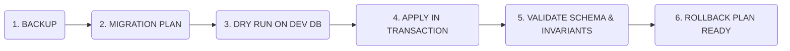

# STFL AIO — Database Migration & Schema Evolution Plan

**System:** SohaelTasneem Foundation (STFL) Autonomous Enterprise Platform  
**Document Identity:** `STFL-DOC-2026-MIG-V1`  
**Date:** 2026-10-15  
**Target Migration:** `0002_aio_core.sql`  
**Status:** MIGRATION PLAN SPECIFICATION — RATIFIED (PHASE 0)  
**Safety Level:** ZERO DOWNTIME / STRICTLY ADDITIVE

---

## 1. Migration Protocol & Safety Gates

To guarantee that no existing data is corrupted or lost, every database migration follows a strict 6-stage lifecycle:



### Safety Principles:
1. **Strictly Additive**: Zero `DROP TABLE`, zero `DROP COLUMN`, zero destructive type alterations.
2. **Idempotency**: All DDL commands use `CREATE TABLE IF NOT EXISTS`, `CREATE INDEX IF NOT EXISTS`, and `INSERT ... ON CONFLICT DO NOTHING`.
3. **Transaction Isolation**: The migration is wrapped in a single PostgreSQL transaction (`BEGIN ... COMMIT`). Any error immediately rolls back the transaction.
4. **Exact Monetary Storage**: Financial amounts use `NUMERIC(18, 2)` exclusively. `FLOAT` or `DOUBLE PRECISION` is prohibited.

---

## 2. Inventory of Baseline Tables vs. Additive Tables

```
[Baseline Migration: 0001_init.sql - PRESERVED & PROTECTED]
├── Identity: users, roles, permissions, role_permissions, user_roles, refresh_tokens
├── Public Content: programs, projects, news, events, gallery_items, pages, impact_metrics
├── Submissions: contact_submissions
└── Private: properties, private_documents, ledger_entries, maintenance_records, audit_logs
```
$$\Downarrow \text{ Additive Extension: } \mathbf{0002\_aio\_core.sql}$$
```
[Additive Schema Extensions: 0002_aio_core.sql]
├── 1. Device Security: device_identities, device_approvals
├── 2. Digital Documents: digital_documents, document_copies, print_grants, print_logs
├── 3. Communications: comms_templates, comms_messages
├── 4. Agent Orchestrator: agent_registry, agent_tasks, agent_audit
├── 5. Microfinance: microfinance_borrowers, microfinance_loans, microfinance_installments, microfinance_repayments
├── 6. HR & Workforce: hr_employees, hr_duty_logs, hr_leave_requests
└── 7. Field Evidence: field_proofs
```

---

## 3. Detailed DDL Specifications for `0002_aio_core.sql`

### 3.1 Device Identity & Hardware Attestation
```sql
CREATE TABLE IF NOT EXISTS device_identities (
    id                   UUID PRIMARY KEY DEFAULT gen_random_uuid(),
    device_id            TEXT NOT NULL UNIQUE,          -- STFL-DVC-8F31A2
    user_id              UUID NOT NULL REFERENCES users(id) ON DELETE CASCADE,
    device_installation_id TEXT NOT NULL,
    keystore_public_key  TEXT NOT NULL,
    hardware_backed      BOOLEAN NOT NULL DEFAULT FALSE,
    platform             TEXT NOT NULL DEFAULT 'android',
    os_version           INTEGER NOT NULL,
    device_model         TEXT NOT NULL,
    status               TEXT NOT NULL DEFAULT 'PENDING'
                         CHECK (status IN ('PENDING', 'APPROVED', 'ACTIVE', 'SUSPENDED', 'REVOKED')),
    risk_score           SMALLINT NOT NULL DEFAULT 0,
    last_seen_at         TIMESTAMPTZ,
    created_at           TIMESTAMPTZ NOT NULL DEFAULT now(),
    updated_at           TIMESTAMPTZ NOT NULL DEFAULT now()
);

CREATE INDEX IF NOT EXISTS idx_device_identities_user ON device_identities (user_id);
CREATE INDEX IF NOT EXISTS idx_device_identities_status ON device_identities (status);

CREATE TABLE IF NOT EXISTS device_approvals (
    id                   UUID PRIMARY KEY DEFAULT gen_random_uuid(),
    device_identity_id   UUID NOT NULL REFERENCES device_identities(id) ON DELETE CASCADE,
    decided_by           UUID REFERENCES users(id) ON DELETE SET NULL,
    decision             TEXT NOT NULL CHECK (decision IN ('APPROVE', 'REJECT', 'SUSPEND', 'REVOKE')),
    reason               TEXT NOT NULL,
    created_at           TIMESTAMPTZ NOT NULL DEFAULT now()
);
```

### 3.2 Digital Documents, Controlled Print & Copy Tracking
```sql
CREATE TABLE IF NOT EXISTS digital_documents (
    document_uuid        UUID PRIMARY KEY DEFAULT gen_random_uuid(),
    document_id          TEXT NOT NULL UNIQUE,          -- STFL-DOC-2026-000001-A7K9
    document_type        TEXT NOT NULL,                 -- certificate, letter, lease, voucher, notice
    document_category    TEXT NOT NULL,                 -- public, private, confidential, restricted
    title                TEXT NOT NULL,
    issuer               TEXT NOT NULL DEFAULT 'SohaelTasneem Foundation',
    issuer_user_id       UUID REFERENCES users(id) ON DELETE SET NULL,
    owner_entity_type    TEXT,                          -- user, property, project, borrower
    owner_entity_id      TEXT,
    serial_year          SMALLINT NOT NULL,
    serial_number        INTEGER NOT NULL,
    verification_code    TEXT NOT NULL UNIQUE,          -- URL-safe verification slug
    version              INTEGER NOT NULL DEFAULT 1,
    status               TEXT NOT NULL DEFAULT 'DRAFT'
                         CHECK (status IN (
                           'DRAFT', 'REVIEW', 'APPROVED', 'ISSUED', 
                           'ACTIVE', 'SUSPENDED', 'SUPERSEDED', 
                           'REVOKED', 'EXPIRED', 'VOID'
                         )),
    issued_at            TIMESTAMPTZ,
    effective_at         TIMESTAMPTZ,
    expires_at           TIMESTAMPTZ,
    storage_object_key   TEXT NOT NULL,                 -- /private/documents/... or /public/...
    mime_type            TEXT NOT NULL DEFAULT 'application/pdf',
    file_size            BIGINT NOT NULL,
    sha256               TEXT NOT NULL,                 -- SHA-256 hash of file content
    parent_document_uuid UUID REFERENCES digital_documents(document_uuid) ON DELETE SET NULL,
    supersedes_uuid      UUID REFERENCES digital_documents(document_uuid) ON DELETE SET NULL,
    created_at           TIMESTAMPTZ NOT NULL DEFAULT now(),
    updated_at           TIMESTAMPTZ NOT NULL DEFAULT now(),
    CONSTRAINT doc_serial_unique UNIQUE (document_type, serial_year, serial_number, version)
);

CREATE TABLE IF NOT EXISTS print_grants (
    id                   UUID PRIMARY KEY DEFAULT gen_random_uuid(),
    grant_token_hash     TEXT NOT NULL UNIQUE,
    document_uuid        UUID NOT NULL REFERENCES digital_documents(document_uuid) ON DELETE CASCADE,
    actor_id             UUID NOT NULL REFERENCES users(id) ON DELETE CASCADE,
    device_id            TEXT NOT NULL,
    purpose              TEXT NOT NULL,
    copy_sequence        INTEGER NOT NULL,
    expires_at           TIMESTAMPTZ NOT NULL,
    consumed_at          TIMESTAMPTZ,
    created_at           TIMESTAMPTZ NOT NULL DEFAULT now()
);

CREATE TABLE IF NOT EXISTS print_logs (
    id                   BIGSERIAL PRIMARY KEY,
    document_uuid        UUID NOT NULL REFERENCES digital_documents(document_uuid) ON DELETE CASCADE,
    copy_id              TEXT NOT NULL,                 -- CP-000004
    actor_id             UUID NOT NULL REFERENCES users(id) ON DELETE CASCADE,
    device_id            TEXT NOT NULL,
    grant_id             UUID REFERENCES print_grants(id) ON DELETE SET NULL,
    ip_hash              TEXT,
    document_hash        TEXT NOT NULL,
    watermark_profile    TEXT NOT NULL,
    created_at           TIMESTAMPTZ NOT NULL DEFAULT now()
);

CREATE INDEX IF NOT EXISTS idx_print_logs_doc ON print_logs (document_uuid);
CREATE INDEX IF NOT EXISTS idx_print_logs_actor ON print_logs (actor_id);
```

### 3.3 Governed Communications Gateway
```sql
CREATE TABLE IF NOT EXISTS comms_templates (
    id                   UUID PRIMARY KEY DEFAULT gen_random_uuid(),
    code                 TEXT NOT NULL UNIQUE,          -- STFL-TPL-MSG-RENT-DUE-V1
    channel              TEXT NOT NULL CHECK (channel IN ('whatsapp', 'email', 'sms', 'in_app')),
    title                TEXT NOT NULL,
    template_bn          TEXT NOT NULL,
    template_en          TEXT NOT NULL,
    variables            JSONB NOT NULL DEFAULT '[]'::jsonb,
    is_active            BOOLEAN NOT NULL DEFAULT TRUE,
    created_at           TIMESTAMPTZ NOT NULL DEFAULT now()
);

CREATE TABLE IF NOT EXISTS comms_messages (
    id                   UUID PRIMARY KEY DEFAULT gen_random_uuid(),
    message_id           TEXT NOT NULL UNIQUE,          -- STFL-MSG-2026-000024-A8P6
    template_code        TEXT NOT NULL REFERENCES comms_templates(code),
    channel              TEXT NOT NULL CHECK (channel IN ('whatsapp', 'email', 'sms', 'in_app')),
    recipient_identifier TEXT NOT NULL,                 -- Phone number or email
    entity_type          TEXT,                          -- borrower, tenancy, donor
    entity_id            TEXT,
    rendered_body        TEXT NOT NULL,
    verification_code    TEXT NOT NULL UNIQUE,          -- Public authenticity slug
    dispatched_by_agent  TEXT,                          -- STFL-AGT-FIN-001
    status               TEXT NOT NULL DEFAULT 'QUEUED'
                         CHECK (status IN ('QUEUED', 'SENT', 'DELIVERED', 'FAILED', 'REVOKED')),
    delivery_metadata    JSONB NOT NULL DEFAULT '{}'::jsonb,
    created_at           TIMESTAMPTZ NOT NULL DEFAULT now()
);

CREATE INDEX IF NOT EXISTS idx_comms_messages_entity ON comms_messages (entity_type, entity_id);
CREATE INDEX IF NOT EXISTS idx_comms_messages_verif ON comms_messages (verification_code);
```

### 3.4 Agent Orchestrator & Task Audit
```sql
CREATE TABLE IF NOT EXISTS agent_registry (
    agent_id             TEXT PRIMARY KEY,              -- STFL-AGT-FIN-001
    agent_type           TEXT NOT NULL,                 -- FINANCE, MICROFINANCE, etc.
    version              TEXT NOT NULL,
    status               TEXT NOT NULL DEFAULT 'ENABLED'
                         CHECK (status IN ('REGISTERED', 'ENABLED', 'RUNNING', 'PAUSED', 'DISABLED', 'RETIRED')),
    capabilities         JSONB NOT NULL DEFAULT '[]'::jsonb,
    max_risk_level       SMALLINT NOT NULL DEFAULT 3,
    created_at           TIMESTAMPTZ NOT NULL DEFAULT now(),
    updated_at           TIMESTAMPTZ NOT NULL DEFAULT now()
);

CREATE TABLE IF NOT EXISTS agent_tasks (
    task_uuid            UUID PRIMARY KEY DEFAULT gen_random_uuid(),
    task_id              TEXT NOT NULL UNIQUE,          -- STFL-TSK-2026-000492
    agent_id             TEXT NOT NULL REFERENCES agent_registry(agent_id),
    trigger_type         TEXT NOT NULL,
    authority_level      SMALLINT NOT NULL CHECK (authority_level BETWEEN 0 AND 5),
    input_payload        JSONB NOT NULL,
    plan_summary         TEXT,
    tool_invocations     JSONB NOT NULL DEFAULT '[]'::jsonb,
    risk_score           SMALLINT NOT NULL DEFAULT 1,
    approval_state       TEXT NOT NULL DEFAULT 'AUTOMATIC_POLICY'
                         CHECK (approval_state IN ('AUTOMATIC_POLICY', 'PENDING_HUMAN', 'APPROVED', 'REJECTED')),
    approved_by          UUID REFERENCES users(id) ON DELETE SET NULL,
    status               TEXT NOT NULL DEFAULT 'PENDING'
                         CHECK (status IN ('PENDING', 'RUNNING', 'COMPLETED', 'FAILED', 'ESCALATED')),
    error_message        TEXT,
    created_at           TIMESTAMPTZ NOT NULL DEFAULT now(),
    completed_at         TIMESTAMPTZ
);

CREATE INDEX IF NOT EXISTS idx_agent_tasks_agent ON agent_tasks (agent_id, status);
CREATE INDEX IF NOT EXISTS idx_agent_tasks_approval ON agent_tasks (approval_state) WHERE approval_state = 'PENDING_HUMAN';
```

### 3.5 Microfinance & Qard Hasan Schema
```sql
CREATE TABLE IF NOT EXISTS microfinance_borrowers (
    id                   UUID PRIMARY KEY DEFAULT gen_random_uuid(),
    borrower_code        TEXT NOT NULL UNIQUE,          -- STFL-BOR-2026-000124
    user_id              UUID REFERENCES users(id) ON DELETE SET NULL,
    full_name            TEXT NOT NULL,
    national_id_hash     TEXT NOT NULL,                 -- Hashed NID/SmartCard
    phone                TEXT NOT NULL,
    address              TEXT NOT NULL,
    economic_profile     JSONB NOT NULL DEFAULT '{}'::jsonb,
    status               TEXT NOT NULL DEFAULT 'ACTIVE'
                         CHECK (status IN ('ACTIVE', 'SUSPENDED', 'DEFAULTED', 'CLOSED')),
    created_at           TIMESTAMPTZ NOT NULL DEFAULT now(),
    updated_at           TIMESTAMPTZ NOT NULL DEFAULT now()
);

CREATE TABLE IF NOT EXISTS microfinance_loans (
    id                   UUID PRIMARY KEY DEFAULT gen_random_uuid(),
    loan_code            TEXT NOT NULL UNIQUE,          -- STFL-LON-2026-000089
    borrower_id          UUID NOT NULL REFERENCES microfinance_borrowers(id) ON DELETE RESTRICT,
    principal_amount     NUMERIC(18, 2) NOT NULL,
    service_charge       NUMERIC(18, 2) NOT NULL DEFAULT 0.00,
    total_repayable      NUMERIC(18, 2) NOT NULL,
    installment_count    INTEGER NOT NULL,
    cycle_type           TEXT NOT NULL CHECK (cycle_type IN ('DAILY', 'WEEKLY', 'MONTHLY')),
    disbursed_on         DATE,
    maturity_date        DATE NOT NULL,
    status               TEXT NOT NULL DEFAULT 'PENDING_APPROVAL'
                         CHECK (status IN ('PENDING_APPROVAL', 'ACTIVE', 'PAID_OFF', 'RESTRUCTURED', 'DEFAULTED')),
    approved_by          UUID REFERENCES users(id) ON DELETE SET NULL,
    created_at           TIMESTAMPTZ NOT NULL DEFAULT now(),
    CONSTRAINT loan_amounts_check CHECK (total_repayable >= principal_amount)
);

CREATE TABLE IF NOT EXISTS microfinance_installments (
    id                   UUID PRIMARY KEY DEFAULT gen_random_uuid(),
    loan_id              UUID NOT NULL REFERENCES microfinance_loans(id) ON DELETE CASCADE,
    sequence_no          INTEGER NOT NULL,
    due_date             DATE NOT NULL,
    expected_amount      NUMERIC(18, 2) NOT NULL,
    paid_amount          NUMERIC(18, 2) NOT NULL DEFAULT 0.00,
    status               TEXT NOT NULL DEFAULT 'UNPAID'
                         CHECK (status IN ('UNPAID', 'PARTIALLY_PAID', 'PAID', 'OVERDUE', 'FORGIVEN')),
    paid_on              DATE,
    created_at           TIMESTAMPTZ NOT NULL DEFAULT now(),
    CONSTRAINT installment_unique UNIQUE (loan_id, sequence_no)
);

CREATE TABLE IF NOT EXISTS microfinance_repayments (
    id                   UUID PRIMARY KEY DEFAULT gen_random_uuid(),
    receipt_code         TEXT NOT NULL UNIQUE,          -- STFL-RCP-2026-000492-R4Q9
    loan_id              UUID NOT NULL REFERENCES microfinance_loans(id) ON DELETE RESTRICT,
    installment_id       UUID REFERENCES microfinance_installments(id) ON DELETE SET NULL,
    amount_collected     NUMERIC(18, 2) NOT NULL,
    collected_by         UUID NOT NULL REFERENCES users(id),
    device_id            TEXT NOT NULL,
    proof_uuid           UUID,                          -- Links to field_proofs
    collected_at         TIMESTAMPTZ NOT NULL DEFAULT now()
);

CREATE INDEX IF NOT EXISTS idx_mf_loans_borrower ON microfinance_loans (borrower_id);
CREATE INDEX IF NOT EXISTS idx_mf_installments_due ON microfinance_installments (loan_id, due_date);
CREATE INDEX IF NOT EXISTS idx_mf_repayments_loan ON microfinance_repayments (loan_id);
```

### 3.6 HR, Field Workforce & Attendance
```sql
CREATE TABLE IF NOT EXISTS hr_employees (
    id                   UUID PRIMARY KEY DEFAULT gen_random_uuid(),
    employee_code        TEXT NOT NULL UNIQUE,          -- STFL-EMP-00042
    user_id              UUID NOT NULL UNIQUE REFERENCES users(id) ON DELETE CASCADE,
    department           TEXT NOT NULL,
    designation          TEXT NOT NULL,
    base_stipend         NUMERIC(18, 2) NOT NULL DEFAULT 0.00,
    duty_status          TEXT NOT NULL DEFAULT 'ACTIVE'
                         CHECK (duty_status IN ('ACTIVE', 'ON_LEAVE', 'SUSPENDED', 'TERMINATED')),
    created_at           TIMESTAMPTZ NOT NULL DEFAULT now()
);

CREATE TABLE IF NOT EXISTS hr_duty_logs (
    id                   UUID PRIMARY KEY DEFAULT gen_random_uuid(),
    employee_id          UUID NOT NULL REFERENCES hr_employees(id) ON DELETE CASCADE,
    device_id            TEXT NOT NULL,
    check_in_at          TIMESTAMPTZ NOT NULL,
    check_out_at         TIMESTAMPTZ,
    geo_point_in         JSONB,                         -- {"lat": 23.81, "lng": 90.41}
    geo_point_out        JSONB,
    verified_by_agent    BOOLEAN NOT NULL DEFAULT FALSE,
    created_at           TIMESTAMPTZ NOT NULL DEFAULT now()
);
```

### 3.7 Field Proofs Ledger
```sql
CREATE TABLE IF NOT EXISTS field_proofs (
    proof_uuid           UUID PRIMARY KEY DEFAULT gen_random_uuid(),
    proof_id             TEXT NOT NULL UNIQUE,          -- STFL-PRF-2026-000182
    task_uuid            UUID REFERENCES agent_tasks(task_uuid) ON DELETE SET NULL,
    actor_id             UUID NOT NULL REFERENCES users(id) ON DELETE CASCADE,
    device_id            TEXT NOT NULL,
    proof_type           TEXT NOT NULL CHECK (proof_type IN ('PHOTO', 'SIGNATURE', 'CASH_RECEIPT', 'METER_READING')),
    r2_storage_key       TEXT NOT NULL,                 -- /private/proofs/...
    sha256               TEXT NOT NULL,
    metadata             JSONB NOT NULL DEFAULT '{}'::jsonb,
    geo_point            JSONB,
    verification_state   TEXT NOT NULL DEFAULT 'VERIFIED'
                         CHECK (verification_state IN ('VERIFIED', 'FLAGGED', 'REJECTED')),
    created_at           TIMESTAMPTZ NOT NULL DEFAULT now()
);

CREATE INDEX IF NOT EXISTS idx_field_proofs_actor ON field_proofs (actor_id);
CREATE INDEX IF NOT EXISTS idx_field_proofs_task ON field_proofs (task_uuid);
```

---

## 4. Rollback Plan

If migration `0002_aio_core.sql` fails during execution:
1. Because the entire script runs inside a single `BEGIN ... COMMIT` block, any syntax error or constraint conflict automatically rolls back to the exact baseline state of `0001_init.sql`.
2. A companion rollback script `0002_aio_core.down.sql` will drop only the tables created in this migration in reverse dependency order, ensuring zero impact on the baseline tables (`users`, `properties`, `programs`, `ledger_entries`).
