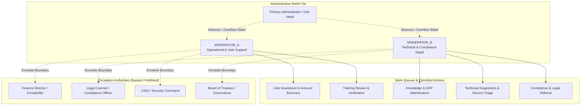

# STFL AIO — Moderation & Administrative Relief Model (Segment 04)

**System:** SohaelTasneem Foundation (STFL) Autonomous Enterprise Platform  
**Document Identity:** `STFL-DOC-2026-MOD-REL-V1`  
**Date:** 2026-10-15  
**Status:** SPECIFICATION — RATIFIED (SECTIONS 67, 68, 77, 78)  
**Security Level:** INTERNAL USE ONLY  

---

## 1. Executive Summary & Purpose

In large-scale enterprise foundations operating across diverse geographical units and project entities, administrative bottlenecks pose severe systemic risk. If a single System Administrator or Unit Head becomes unavailable (due to illness, travel, network outage, or workload saturation), vital operations can stall. Conversely, granting full super-administrator authority to deputy staff risks severe security violations, privilege leaks, and compliance compromises.

To eliminate the "Single Administrator Single Point of Failure (SPOF)" without diluting the platform's constitutional security perimeter, STFL AIO establishes the **Moderation & Administrative Relief Architecture (Segment 04)** featuring two strictly controlled, role-differentiated operational relief authorities:
- **`MODERATOR_A` (Operational & User Support Relief)**
- **`MODERATOR_B` (Technical, Knowledge & Escalation Relief)**

These roles provide high-availability continuity for operational queues while remaining constrained by:
1. **Zero Superadmin Authority**: Neither moderator inherits `CLASS_00` superadmin privileges or database-level root rights.
2. **Strict Separation of Duties**: Operational relief actions remain segregated across roles; no moderator may approve their own initiated requests or perform dual-custody tasks alone.
3. **13-Dimensional Contextual Authorization**: Every action undergoes the same hardware attestation, biometric verification, project boundary checks, and audit logging as senior executive actions.
4. **Deterministic Escalation Routing**: When requests exceed moderator boundaries, they are deterministically routed to designated departmental authorities (Finance, Legal, Compliance, Security, Governance).

---

## 2. Relief Role Differentiation: MODERATOR_A vs MODERATOR_B



### 2.1 Role Profiles & Permitted Scopes
| Dimension | `MODERATOR_A` (Operational / User Relief) | `MODERATOR_B` (Technical / Compliance Relief) | Primary Administrator (`CLASS_00`) |
|---|---|---|---|
| **Primary Domain** | User assistance, routine queues, onboarding | System triage, knowledge governance, audits | Foundational security & cryptographic trust |
| **User Support** | Password reset assist, device binding unlock | Advanced session audit, hardware token re-pairing | Disaster recovery override |
| **Knowledge/Training** | Review learner assessments, verify field quizzes | Review draft SOPs, curate visual guides | Ratify institutional policies |
| **Operational Actions**| Routine task reassignments, queue load-balancing | System health triage, batch retry execution | Global infrastructure modification |
| **Financial Authority**| Zero disbursement rights; can view invoice status | Zero ledger modification; can view audit trail | Zero disbursement without dual-custody |
| **Compliance Escalation**| Flag suspected identity fraud to Security | Refer regulatory ambiguity to Legal Counsel | Coordinate external statutory audits |
| **Device Attestation** | Enrolled Hardware Device required (Tier 2) | Enrolled Hardware Device required (Tier 2) | Hardware Security Key required (Tier 1) |

---

## 3. Constitutional Guardrails & Separation of Duties

### 3.1 The Zero Self-Approval Invariant
Under no circumstances may a relief moderator approve, authorize, or waive an action that they themselves initiated:
- If `MODERATOR_A` submits an account recovery ticket for a project manager, `MODERATOR_A` **cannot** sign the approval token; it must be countersigned by `MODERATOR_B` or a Unit Head.
- If `MODERATOR_B` authors a draft SOP revision, `MODERATOR_B` **cannot** publish it to production; publication requires approval from the Service Manager or Compliance Officer.

### 3.2 Prohibited Actions for Relief Moderators
Neither `MODERATOR_A` nor `MODERATOR_B` may ever:
1. Modify database tables directly (no SQL console access).
2. Override or delete cryptographic audit trail logs (`audit_logs`).
3. Alter cryptographic keys, master JWT signing certificates, or HSM configurations.
4. Execute financial disbursements or manual ledger credit/debit entries.
5. Create or elevate users into `CLASS_00` (Super Admin) or `CLASS_01` (Trustee).
6. Waive statutory compliance holds or silence legal freeze orders.
7. Bypass 13-D contextual authorization checks.

---

## 4. Controlled Moderator Work Queue Architecture

Work items routed to administrative relief are ingested into the unified `moderator_work_queue`:

### 4.1 Queue Item Classification & Routing
| Queue Item Type | Description | Primary Assignee | Fallback Assignee | SLA Target |
|---|---|---|---|---|
| `USER_HELP` | Public or project user onboarding, inquiry, portal bug | `MODERATOR_A` | `MODERATOR_B` | 2 Hours |
| `ACCOUNT_SUPPORT` | Biometric re-enrollment request, locked PIN reset | `MODERATOR_A` | Primary Admin | 1 Hour |
| `TRAINING_REVIEW` | Manual review of essay/practical field assessment | `MODERATOR_A` | Training Lead | 4 Hours |
| `DOCUMENT_SUPPORT` | Unindexed physical document scan, OCR failure | `MODERATOR_A` | Document Officer | 6 Hours |
| `CONTENT_REVIEW` | Review draft visual training guide or community FAQ | `MODERATOR_B` | Knowledge Curator | 8 Hours |
| `KNOWLEDGE_UPDATE` | Minor SOP typo fix, broken link, updated form link | `MODERATOR_B` | Service Manager | 12 Hours |
| `TECHNICAL_SUPPORT`| Printer driver failure, mobile app sync timeout | `MODERATOR_B` | IT Operations | 2 Hours |
| `COMPLIANCE_REFERRAL`| Suspected anti-money laundering or labour violation | `MODERATOR_B` | Legal / Compliance | 30 Minutes |
| `ESCALATION` | Deadlocked operational dispute or severe system error | `MODERATOR_B` | Executive Director | 15 Minutes |

### 4.2 Lifecycle State Machine
```
[SUBMITTED]
    │
    ▼
[CLASSIFIED] ──(Auto-categorized & Priority Assigned)
    │
    ▼
[ASSIGNED] ────(Locked to MODERATOR_A or MODERATOR_B)
    │
    ├─────────────────────────────┐
    ▼                             ▼
[IN_PROGRESS]                 [ESCALATED] ──(Dispatched to Dept Head)
    │                             │
    ├──────────────┐              ▼
    ▼              ▼         [ESCALATION_RESOLVED]
[RESOLVED]    [REJECTED]          │
    │              │              │
    └──────────────┴──────────────┘
                   │
                   ▼
               [CLOSED] ──(Audit Receipt Generated)
```

---

## 5. Deterministic Escalation Protocol (Section 78)

When an operational relief moderator encounters a request that exceeds their delegated authority threshold, they must execute the **RECEIVE ➔ CLASSIFY ➔ RESOLVE OR ESCALATE** protocol:

### 5.1 Escalation Target Directory
1. **Service Manager**: Operational bottlenecks, workflow deadlocks, inter-project coordination.
2. **Administrator (`CLASS_00`)**: Core system failure, hardware gateway offline, IAM boundary fault.
3. **Security Command (`CLASS_07`)**: Physical device loss, suspected brute force, token forgery attempt.
4. **Compliance Officer**: Statutory regulation breaches, licensing expiration, safeguarding flags.
5. **Legal Counsel**: Contract disputes, law enforcement inquiries, property land litigation.
6. **Finance Comptroller (`CLASS_06`)**: Discrepancies in accounts, payment rail errors, budget overruns.
7. **Project Manager**: Project-specific beneficiary challenges, community friction, supply shortages.
8. **Board of Trustees (`CLASS_01`)**: Constitutional policy changes, catastrophic emergencies.

### 5.2 Non-Bypass Enforcement
Moderators cannot "close" an escalated ticket until the target authority signs off. The API blocks any attempt by a moderator to mark an item `RESOLVED` while its state is `ESCALATED`.

---

## 6. PostgreSQL Schema: Moderation & Relief Engine

```sql
-- Controlled Moderator Work Queue
CREATE TABLE IF NOT EXISTS moderator_work_queue (
    id                  UUID PRIMARY KEY DEFAULT gen_random_uuid(),
    queue_number        TEXT NOT NULL UNIQUE,          -- e.g. MOD-Q-2026-00891
    item_type           TEXT NOT NULL CHECK (item_type IN (
                          'USER_HELP', 'TRAINING_REVIEW', 'CONTENT_REVIEW',
                          'ACCOUNT_SUPPORT', 'DOCUMENT_SUPPORT', 'TECHNICAL_SUPPORT',
                          'ESCALATION', 'COMPLIANCE_REFERRAL', 'KNOWLEDGE_UPDATE'
                        )),
    priority            TEXT NOT NULL CHECK (priority IN ('LOW', 'MEDIUM', 'HIGH', 'CRITICAL')),
    status              TEXT NOT NULL CHECK (status IN (
                          'SUBMITTED', 'CLASSIFIED', 'ASSIGNED', 'IN_PROGRESS',
                          'ESCALATED', 'RESOLVED', 'REJECTED', 'CLOSED'
                        )) DEFAULT 'SUBMITTED',
    title               TEXT NOT NULL,
    payload_json        JSONB NOT NULL DEFAULT '{}'::jsonb,
    requester_user_id   UUID REFERENCES users(id),
    requester_class     TEXT NOT NULL,
    project_id          UUID REFERENCES projects(id) ON DELETE SET NULL,
    assigned_moderator  UUID REFERENCES users(id),
    moderator_role      TEXT CHECK (moderator_role IN ('MODERATOR_A', 'MODERATOR_B', 'PRIMARY_ADMIN')),
    resolution_notes    TEXT,
    escalation_target   TEXT CHECK (escalation_target IN (
                          'SERVICE_MANAGER', 'ADMINISTRATOR', 'SECURITY',
                          'COMPLIANCE', 'LEGAL', 'FINANCE', 'PROJECT_MANAGER', 'GOVERNANCE'
                        )),
    escalation_reason   TEXT,
    escalated_by        UUID REFERENCES users(id),
    escalated_at        TIMESTAMPTZ,
    sla_expires_at      TIMESTAMPTZ NOT NULL,
    closed_at           TIMESTAMPTZ,
    audit_event_id      UUID,
    created_at          TIMESTAMPTZ NOT NULL DEFAULT now(),
    updated_at          TIMESTAMPTZ NOT NULL DEFAULT now()
);

-- Moderator Delegation & Session Ledger
CREATE TABLE IF NOT EXISTS moderator_delegation_ledger (
    id                  UUID PRIMARY KEY DEFAULT gen_random_uuid(),
    moderator_id        UUID NOT NULL REFERENCES users(id),
    designated_role     TEXT NOT NULL CHECK (designated_role IN ('MODERATOR_A', 'MODERATOR_B')),
    delegating_admin    UUID NOT NULL REFERENCES users(id),
    unit_scope          TEXT NOT NULL,                 -- Unit code or 'ALL'
    project_scope       UUID REFERENCES projects(id),  -- Project UUID or NULL for global
    starts_at           TIMESTAMPTZ NOT NULL DEFAULT now(),
    expires_at          TIMESTAMPTZ NOT NULL,          -- Maximum delegation window 7 days
    revoked_at          TIMESTAMPTZ,
    revocation_reason   TEXT,
    device_id           TEXT NOT NULL,
    ip_address          INET NOT NULL,
    created_at          TIMESTAMPTZ NOT NULL DEFAULT now()
);

CREATE INDEX IF NOT EXISTS idx_mod_queue_status ON moderator_work_queue(status, priority);
CREATE INDEX IF NOT EXISTS idx_mod_queue_assignee ON moderator_work_queue(assigned_moderator);
CREATE INDEX IF NOT EXISTS idx_mod_delegation_active ON moderator_delegation_ledger(moderator_id, designated_role) WHERE revoked_at IS NULL;
```

---

## 7. Summary of Architectural Guarantees

1. **Continuous Availability**: High-volume routine user needs and operational questions are resolved promptly by relief moderators without burdening core administrators.
2. **Strictly Capped Authority**: Neither `MODERATOR_A` nor `MODERATOR_B` can ever compromise system foundations, delete audits, or approve funds.
3. **Ironclad Separation of Duties**: No moderator approves their own action.
4. **Preserved Escalation Integrity**: Senior authority domains (Legal, Finance, Security) are strictly preserved via tamper-evident automated escalations.
