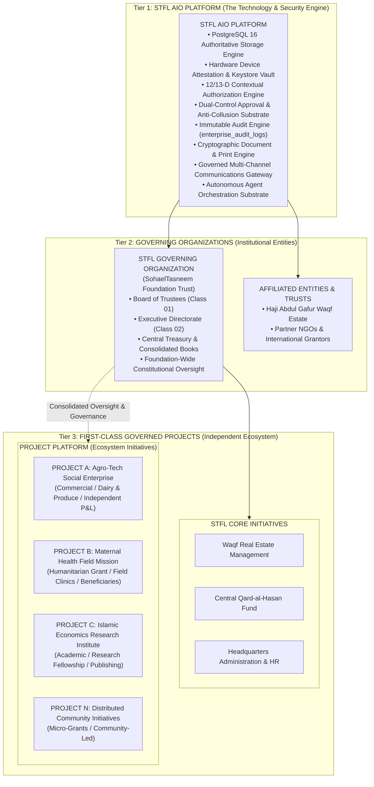
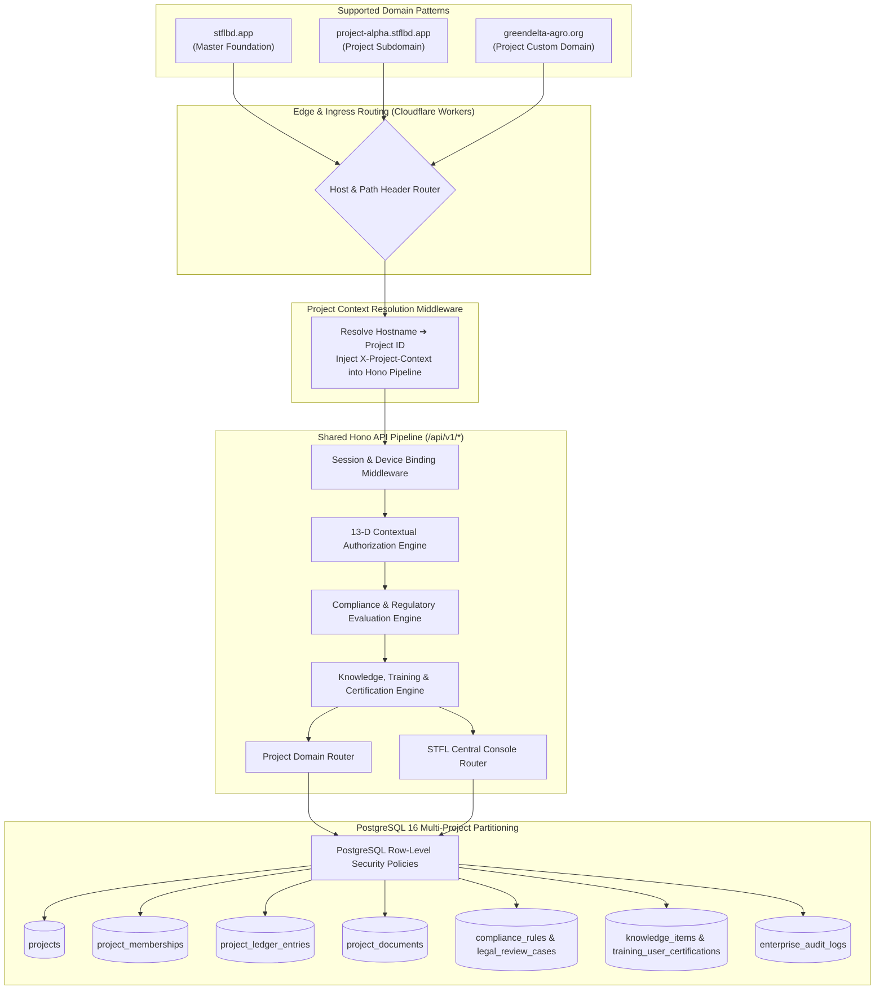

# STFL AIO — Multi-Project & Multi-Tenant Ecosystem Architecture
**Document Identity:** `STFL-DOC-2026-MP-ARCH-V1`  
**Phase:** Prompt 12.5 (Multi-Project Architecture & Feature Control Map)  
**Status:** SPECIFICATION ONLY — RATIFIED (READ-ONLY ARCHITECTURE PHASE)  
**Security Classification:** INTERNAL ENTERPRISE SPECIFICATION  
**Authoritative Precedent:** Strictly bound by `STFL_AIO_CONSTITUTION.md`

---

## 1. Architectural Paradigm & Fundamental Distinction

The SohaelTasneem Foundation (STFL) Autonomous Enterprise Platform must scale from managing foundation-direct initiatives (Waqf estates, direct humanitarian relief, central endowment) to hosting a vibrant, diverse ecosystem of **independent, governed projects, programs, academic initiatives, social enterprises, and field missions**.

To prevent architectural collapse, identity confusion, or security leaks, the platform formalizes a three-tier institutional topology:



### The Three Foundational Realities:
1. **STFL AIO is the PLATFORM:**  
   The platform provides the compute, cryptographic trust substrate, authoritative data store, authorization pipelines, and audit infrastructure. It is multi-tenant by design.
2. **STFL is the GOVERNING ORGANIZATION:**  
   STFL is the institutional anchor, moral custodian, legal entity, and parent holding governance rights, consolidated financial audit rights, and constitutional veto authority.
3. **A PROJECT is a FIRST-CLASS GOVERNED ENVIRONMENT:**  
   A project is an independent operational, financial, and digital realm running on the platform. It possesses its own stakeholders, its own dedicated chart of accounts, its own website, its own domain branding, its own automated agents, and its own operational workflows, all while remaining bound to platform security and STFL consolidated governance.

---

## 2. What a Project IS and IS NOT

| Architectural Concept | What a Project IS NOT | What a Project ACTUALLY IS |
|---|---|---|
| **vs. Unit** | A project is **not** merely a functional department (e.g. Finance, Property, HR). Units are functional competencies; a project can employ multiple functional skills. | A project is a **cross-functional, mission-oriented enterprise** possessing its own lifecycle, funding, assets, and operational scope. |
| **vs. Department** | A project is **not** a static organizational chart branch within foundation HQ. | An operational container that may involve external contractors, partner NGOs, independent banks, and specialized field teams that never touch HQ. |
| **vs. Role** | A project is **not** an RBAC role (`project_manager` or `project_officer`). | The **target context** within which specific roles are held and executed. |
| **vs. Scope** | A project is **not** merely a geographical coordinate or simple string tag. | A **first-class resource and governance domain** that possesses scopes beneath it (e.g., `Project A: Dhaka Region`, `Project A: Field Office 2`). |
| **vs. Program Record** | A project is **not** a flat CMS row in `0001_init.sql` with a title and summary. | A **complete governed ecosystem** with its own sub-ledger, documents, agents, approvals, and portals. |

---

## 3. Platform Invariants for Multi-Project Operation

The following 12 architectural invariants are permanently established and cannot be overridden by any project template or custom logic:

1. **Constitutional Uniformity Invariant:**  
   No project may alter, bypass, or replace the universal identity grammar, 10-dimensional audit logging, or hardware device security substrate.
2. **PostgreSQL Single-Source Invariant:**  
   All projects share the authoritative PostgreSQL 16 persistence engine. Project-level isolation is enforced via schema-level tenancy, Row-Level Security (RLS), and cryptographic foreign-key relationships. No external rogue databases are permitted.
3. **Financial Precision Invariant:**  
   All project-level accounting books (revenue, expense, vouchers, ledgers) must strictly enforce `NUMERIC(18, 2)`. Floating-point numbers are prohibited across all project code.
4. **Zero Cross-Project Data Leakage Invariant:**  
   A stakeholder or agent in Project A has zero implicit read or write access to Project B. Cross-project data access requires explicit multi-project membership or STFL consolidated oversight privileges.
5. **Double-Entry Consolidation Invariant:**  
   Every transaction in a project sub-ledger is fully balanced. Inter-project transactions must use dual-leg intercompany clearing accounts with mutual cryptographic sign-off.
6. **Agent Level 3 Authority Ceiling Invariant:**  
   Project-level AI agents (`CLASS_10`) cannot exceed Level 3 authority. Any irreversible project action, financial disbursement, or policy change requires physical human approval.
7. **Anti-Collusion Separation of Duties Invariant:**  
   Within any project, `creator != approver`, `creator != disburser`, and `approver != disburser`. Super Admin (`CLASS_00`) and AI Agents are constitutionally barred from self-approving disbursements.
8. **Forensic Document Watermarking Invariant:**  
   All project-generated documents inherit platform cryptographic hashing (`SHA-256`), institutional ID formatting, and copy-tracking forensics.
9. **Governed Communications Gateway Invariant:**  
   No project may deploy its own rogue Twilio or Meta WhatsApp integration. All communications must flow through the central gateway with anti-hallucination hash checking and template approval.
10. **Device Binding Invariant:**  
    Project staff accessing non-public project workspaces must bind their hardware devices (`STFL-DVC-*`) to their personal identity. A compromised device revokes access across all projects simultaneously.
11. **Public/Private Portal Isolation Invariant:**  
    Project public marketing websites (`projecta.org`) are strictly separated from project operational portals (`projecta.org/portal`) and STFL central administration (`stflbd.app/admin`).
12. **Immutable Archival Invariant:**  
    Terminating or archiving a project does not delete its audit trail, financial vouchers, or legal agreements. All records remain immutably archived for statutory compliance.

---

## 4. Shared Platform Substrates vs. Project-Isolated Substrates

```
┌────────────────────────────────────────────────────────────────────────┐
│                   SHARED GLOBAL PLATFORM SUBSTRATES                    │
├────────────────────────────────────────────────────────────────────────┤
│ • PostgreSQL 16 Authoritative Cluster & Encryption Keys                │
│ • Cloudflare Edge Network, DDoS Protection & TLS Certificates          │
│ • Hardware Attestation & Device Binding Vault (Android KeyStore)       │
│ • Universal Party Registry (parties table)                             │
│ • Central Authentication & Argon2id Password Verifier                  │
│ • 12/13-Dimensional Contextual Authorization Engine                    │
│ • Immutable 10-D Enterprise Audit Substrate (enterprise_audit_logs)    │
│ • Dual-Control Approval Engine & Anti-Collusion Verifier               │
│ • Compliance, Regulatory & Legal Intelligence Engine (Shared Service)  │
│   - Multi-Jurisdictional Intelligence & Statute Resolver               │
│   - Versioned Compliance Rule Registry (21 Domains)                    │
│   - Legal Hold & Statutory Escalation Substrate                        │
│ • Knowledge, Training, Service & Moderation Ecosystem (Shared Service) │
│   - Four Governed Experience Segments (Learn, Service, Admin, Relief)  │
│   - Pictorial / Visual-First Training Engine (11 Media Types)          │
│   - Mandatory Platform Compliance Training Inheritance & Non-Erasure   │
│   - Cryptographic Training Certification Authority (STFL-CER-*)        │
│   - Administrative Relief Engine (MODERATOR_A & MODERATOR_B)           │
│   - Controlled Moderator Work Queue & Deterministic Escalation         │
│ • Digital Document SHA-256 Hashing & Public Verification Gateway       │
│ • Governed Communications Outbound Dispatcher (SMS/WA/Email)           │
│ • Autonomous Agent Sandbox & Kill Switch Manager                       │
└───────────────────────────────────┬────────────────────────────────────┘
                                    │ Provides Trust & Security To
                                    ▼
┌────────────────────────────────────────────────────────────────────────┐
│                   PROJECT-ISOLATED / CONTEXTUAL REALMS                 │
├────────────────────────────────────────────────────────────────────────┤
│ • Project Entity & Operational Lifecycle State                         │
│ • Project Memberships & Project-Specific Roles                         │
│ • External Stakeholder Relationships & Guest Portals                   │
│ • Dedicated Project Chart of Accounts & Sub-Ledger Books               │
│ • Project Independent Budgets, Restricted Grants & Invoicing           │
│ • Project Public Websites, Custom Domains & Brand Profiles             │
│ • Project-Specific Business Workflows & Form Definitions               │
│ • Project-Bound Autonomous Agents & Constrained Tool Allowlists        │
│ • Project Document Archives & Custom Letterhead Templates              │
│ • Project Fixed Assets & Custody Registers                             │
│ • Project Scopes & Granular Resource Ownership                         │
│ • Project-Specific Covenants, Donor Conditions & Compliance Alerts     │
│ • Project Training Catalogues, Localized SOPs & Safety Certifications   │
└────────────────────────────────────────────────────────────────────────┘
```

---

## 5. Architectural Topology of the Multi-Project Ecosystem



---

## 6. Shared Compliance, Regulatory & Legal Intelligence Service

As formalized in `STFL_AIO_COMPLIANCE_ARCHITECTURE.md`, compliance intelligence operates as an authoritative platform-level shared service:
1. **Multi-Jurisdiction Resolver:** Resolves legal statutory coordinates across national, municipal, sector, and entity boundaries for all projects uniformly.
2. **Standardized Rule Engine:** Evaluates operational actions against statutory acts (e.g. Bangladesh Labour Act 2006, Waqf Ordinance 1962, Income Tax Act 2023, Public Procurement Rules 2008) before execution.
3. **Automated Statutory Holds:** Automatically locks non-compliant workflows at the edge, assigning formal `LEGAL_REVIEW_CASE` tickets to authorized human legal counsel.
4. **Project Stricter Rule Autonomy:** Individual projects can define stricter governance or donor compliance covenants, but are constitutionally barred from diluting or waiving baseline statutory or STFL platform controls.

---

## 7. Shared Knowledge, Training, Service & Moderation Ecosystem (Sections 63–82)

As formalized across the Knowledge & Training Suite (`STFL_AIO_KNOWLEDGE_ARCHITECTURE.md`, `STFL_AIO_TRAINING_ARCHITECTURE.md`, `STFL_AIO_SERVICE_CENTER_MODEL.md`, `STFL_AIO_MODERATOR_MODEL.md`, `STFL_AIO_TRAINING_CERTIFICATION_MODEL.md`, `STFL_AIO_KNOWLEDGE_GOVERNANCE_MODEL.md`, `STFL_AIO_PICTORIAL_TRAINING_MODEL.md`, `STFL_AIO_TRAINING_UX_MODEL.md`):

1. **Four Experience Segments:**
   - **Segment 01 (User Learning Center):** Interactive pictorial tutorials, step-by-step videos, and quizzes for public users, field staff, tenants, and beneficiaries.
   - **Segment 02 (Service & Operations Center):** Versioned SOP library, operational runbooks, incident management, service status, and grounded AI diagnostics.
   - **Segment 03 (Administration & Governance Center):** Core IAM procedures, security policies, compliance guidance, and statutory audit manuals.
   - **Segment 04 (Moderation & Relief Center):** Administrative relief tier featuring `MODERATOR_A` and `MODERATOR_B` operating controlled queues under capped authority.

2. **Project Training Inheritance & Non-Erasure Invariant:**
   - Projects maintain localized training catalogues (e.g. Field Safety, Beneficiary Enrollment, Agricultural Logistics).
   - All projects **must** inherit mandatory STFL platform compliance, safeguarding, and security courses.
   - Projects may augment training with project-specific curricula, but **cannot silently remove, suppress, or waive** mandatory platform compliance training.

3. **Training-to-Authorization Coupling:**
   - High-risk project operations (e.g. loan collection, cash disbursement, clinical pharmacy dispensing) evaluate `TRAINING_STATUS` in the 13-D Contextual Authorization Engine before permitting API execution.

4. **Zero Administrative Single Point of Failure:**
   - Primary administrators are relieved by `MODERATOR_A` (routine operational & user support) and `MODERATOR_B` (technical triage & knowledge curation), enforcing strict separation of duties and zero self-approval.

This multi-project architecture ensures infinite horizontal scalability for foundation initiatives while locking down absolute security, institutional provenance, statutory compliance, and financial integrity at the foundation core.
