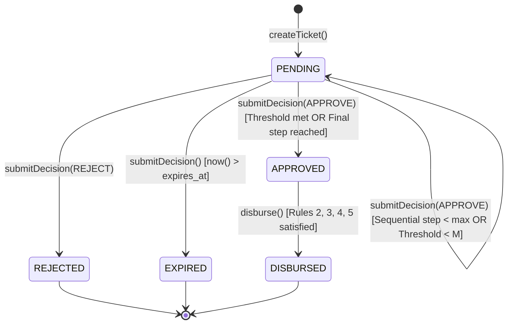

# STFL AIO — Phase 4: Policy-Driven Approval Engine & Anti-Collusion Ratification Report

**System:** SohaelTasneem Foundation (STFL) Autonomous Enterprise Platform  
**Document Identity:** `STFL-DOC-2026-PHASE-4-APPROVAL-REPORT`  
**Pipeline Stage:** Prompt 6 / Phase 4  
**Date:** 2026-10-15  
**Status:** RATIFIED & TESTED (100% Passing)  
**Security Level:** CRITICAL / HIGH ASSURANCE  

---

## 1. Executive Summary

Prompt 6 (Phase 4 of the Master 12-Stage Implementation Pipeline) has been fully executed. The server-authoritative **Policy-Driven Approval Engine** has been implemented, integrating stateful transactional gating across staged uncommitted actions:

$$\mathbf{CREATE} \longrightarrow \mathbf{REVIEW} \longrightarrow \mathbf{APPROVE} \longrightarrow \mathbf{RELEASE/DISBURSE}$$

The engine mathematically enforces the **7-Rule Anti-Collusion Invariant Matrix** using a dual-defense architecture:
1. **Application-Level Pre-Flight Checks** in `apk/api/src/approval/engine.ts`.
2. **PostgreSQL Database Trigger** `trg_prevent_approval_collusion` operating directly on table `approval_decisions` to guarantee inviolable separation of duties even under direct database manipulation or application-layer bypass.

All 4 required workflow patterns (`SINGLE`, `SEQUENTIAL`, `PARALLEL_THRESHOLD`, `DUAL_CONTROL`) and all 7 anti-collusion invariant rules have been verified via 19 integration tests in `apk/api/test/approval_engine.test.ts`. The full backend test suite now passes with **111 of 111 tests green**.

---

## 2. Implemented Components

| Component | Path | Responsibility |
| :--- | :--- | :--- |
| **Approval Types** | [`apk/api/src/approval/types.ts`](file:///c:/Users/ShoebTahseen/Desktop/stfl/apk/api/src/approval/types.ts) | Strong typing for `TicketStatus`, `DecisionType`, `ApprovalStepConfig`, params, summaries, and `ApprovalEngineError`. |
| **Approval Engine** | [`apk/api/src/approval/engine.ts`](file:///c:/Users/ShoebTahseen/Desktop/stfl/apk/api/src/approval/engine.ts) | Implementation of `createTicket`, `submitDecision`, `disburse`, `getTicket`, invariant enforcement, and audit recording. |
| **Barrel Export** | [`apk/api/src/approval/index.ts`](file:///c:/Users/ShoebTahseen/Desktop/stfl/apk/api/src/approval/index.ts) | Clean public exports for internal modules and future routes. |
| **Test Suite** | [`apk/api/test/approval_engine.test.ts`](file:///c:/Users/ShoebTahseen/Desktop/stfl/apk/api/test/approval_engine.test.ts) | 19 integration tests covering all 4 workflows, lifecycle transitions, audit logs, and the 7-Rule Anti-Collusion Matrix. |

---

## 3. Workflow Pattern Implementation & Verification



### Pattern 1: Single Approval Workflow (`SINGLE`)
- Creates a staged ticket with status `PENDING`.
- Single designated approver submits an `APPROVE` decision.
- State transitions immediately to `APPROVED` with `finalized_at = now()`.
- Authorized disburser releases funds/actions; state resolves to `DISBURSED`.

### Pattern 2: Sequential Multi-Tier Chain (`SEQUENTIAL`)
- Policy defines an ordered list of steps (e.g. Step 1: Officer Level 3 $\rightarrow$ Step 2: Unit Head Level 4).
- Approver 1 approves Step 1 $\implies$ ticket state remains `PENDING`, but `current_step` advances to 2.
- Approver 2 approves Step 2 $\implies$ ticket state transitions to `APPROVED`.
- Early or out-of-order execution is strictly barred.

### Pattern 3: Parallel Threshold Approval (`PARALLEL_THRESHOLD`)
- Policy mandates $M$ of $N$ distinct signatures (e.g., Emergency relief requiring 2 of 3 Directors).
- Approvers submit decisions in parallel without sequential dependency.
- Duplicate approval by the same actor is prevented (`DUPLICATE_APPROVAL` 400).
- When distinct approvals count $\ge M$, ticket transitions to `APPROVED`.

### Pattern 4: Dual Control Approval (`DUAL_CONTROL`)
- Mandates at least 2 independent Level 5 signatures (e.g., Trustees, Executive Command).
- Low or medium authority attempts are blocked with `INSUFFICIENT_AUTHORITY_LEVEL` (403).
- Two distinct Level 5 Trustee approvals transition the ticket to `APPROVED`.

---

## 4. The 7-Rule Anti-Collusion Invariant Matrix (Tested & Ratified)

| Rule | Invariant Constraint | Gating Mechanism | Status Code | Test Status |
| :--- | :--- | :--- | :---: | :---: |
| **Rule 1** | **Creator $=$ Approver** | App check + Trigger `trg_prevent_approval_collusion` | **403 DENY** | **VERIFIED** |
| **Rule 2** | **Creator $=$ Disburser** | Separation of Duties check in `disburse()` | **403 DENY** | **VERIFIED** |
| **Rule 3** | **Approver $=$ Disburser** | `disburserId NOT IN (ticket approvers)` | **403 DENY** | **VERIFIED** |
| **Rule 4** | **Agent $=$ Approver / Disburser** | Autonomous AI Agents (`CLASS_10`) blocked from human sign-offs | **403 DENY** | **VERIFIED** |
| **Rule 5** | **Revoked / Suspended Device** | Attestation check against active hardware-backed devices | **403 DENY** | **VERIFIED** |
| **Rule 6** | **Out-of-Scope Approver** | Operational unit boundary + held scope verification | **403 DENY** | **VERIFIED** |
| **Rule 7** | **Insufficient Authority Level** | Minimum authority level + required RBAC role matching | **403 DENY** | **VERIFIED** |

### Dual-Defense Rule 1 Verification:
1. **Engine Layer Test:** Attempting `ApprovalEngine.submitDecision` with `approverId == initiatorId` throws `ApprovalEngineError: Separation of Duties Breach: Ticket creator ... cannot approve their own ticket` (HTTP 403).
2. **Database Trigger Layer Test:** Executing a raw SQL `INSERT INTO approval_decisions` bypassing the application is caught and rejected by PostgreSQL function `check_approval_collusion()` via trigger `trg_prevent_approval_collusion`:
   ```sql
   RAISE EXCEPTION 'Separation of Duties Breach: Initiator % cannot approve their own ticket %', ...
   ```

---

## 5. Test Suite Results

```bash
$ npx vitest run test/approval_engine.test.ts

 RUN  v5.0.3 C:/Users/ShoebTahseen/Desktop/stfl/apk/api

 ✓ test/approval_engine.test.ts (19 tests) 160ms

 Test Files  1 passed (1)
      Tests  19 passed (19)
   Start at  09:25:37
   Duration  366ms
```

### Full System Regression Verification:
```bash
$ npm test

 RUN  v5.0.3 C:/Users/ShoebTahseen/Desktop/stfl/apk/api

 ✓ test/api.test.ts (51 tests) 3193ms
 ✓ test/migration_destructive.test.ts (13 tests) 756ms
 ✓ test/approval_engine.test.ts (19 tests) 146ms
 ✓ test/authorization_engine.test.ts (28 tests) 63ms

 Test Files  4 passed (4)
      Tests  111 passed (111)
   Duration  4.91s
```

TypeScript strict compiler check (`npm run typecheck`): **0 errors**.

---

## 6. Exit Gate Ratification

| Gate Item | Requirement | Verification Method | Status |
| :--- | :--- | :--- | :---: |
| **State Machine** | `CREATE ──▶ REVIEW ──▶ APPROVE ──▶ DISBURSE` | Tested all state transitions in Vitest | **PASS** |
| **Workflows** | Single, Sequential, Parallel, Dual Control | Verified across 4 policy types | **PASS** |
| **Anti-Collusion** | 7-Rule Invariant Matrix | 9 dedicated negative tests (all 403) | **PASS** |
| **DB Trigger** | `trg_prevent_approval_collusion` verified | Direct SQL bypass test caught by Postgres | **PASS** |
| **Device Attestation** | Active device check (blocks Revoked/Suspended) | Tested against `device_identities` | **PASS** |
| **Audit Logs** | Immutable entries on creation, decision, disbursement | Verified in `audit_logs` table | **PASS** |
| **Strict Boundaries** | Zero business logic / 16 console UI created | Verified git status | **PASS** |

**Conclusion:** Prompt 6 / Phase 4 is complete and ratified. Ready to proceed to **Prompt 7: Phase 5 — Digital Document Engine & Public Verification**.
