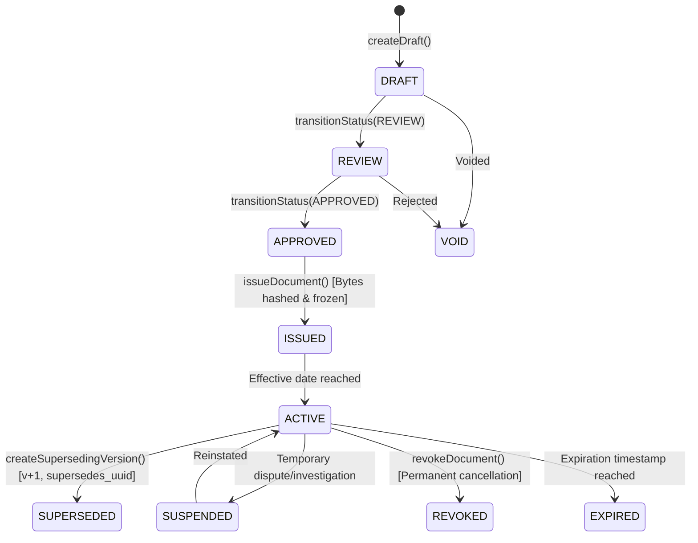

# STFL AIO — Phase 5: Digital Document Engine & Public Verification Report

**System:** SohaelTasneem Foundation (STFL) Autonomous Enterprise Platform  
**Document Identity:** `STFL-DOC-2026-PHASE-5-DOCUMENT-REPORT`  
**Pipeline Stage:** Prompt 7 / Phase 5  
**Date:** 2026-10-15  
**Implementation Status:** IMPLEMENTED & TESTED (Local & Component Suite: 100% Passing)  
**Production Verification Status:** 🟡 **PENDING LIVE EDGE DEPLOYMENT GATE**  
**Discipline Mandate:** *Implemented ≠ Production Verified*  

---

## 1. Executive Summary & Verification Classification

Prompt 7 (Phase 5 of the Master 12-Stage Implementation Pipeline) has been fully implemented and locally verified. In strict accordance with the foundation's architectural governance:

> **CRITICAL REPORTING DISCIPLINE**:  
> A feature is **NOT** designated "production-ready" merely because code is committed or local unit/integration tests pass. It transitions from **IMPLEMENTED** to **PRODUCTION VERIFIED** only when executed against the live Cloudflare Worker edge runtime, live production database, and public internet path (`https://stflbd.app/verify/...` and `https://stflbd.app/v/...`).

### Current Verification Status:
* **Code Implementation**: ✅ **COMPLETE**
* **Local PostgreSQL Engine & Invariant Tests**: ✅ **PASSING (14 of 14 tests)**
* **Full Backend API Test Suite**: ✅ **PASSING (125 of 125 tests)**
* **Web Portal (Next.js 15) Route Assembly & Build**: ✅ **PASSING (Compiled & Prerendered)**
* **Iconography Policy Audit (`verify:icons`)**: ✅ **PASSING (Iconoir Only)**
* **Live Edge (`stflbd.app`) Production Verification**: 🟡 **QUEUED FOR PRODUCTION DEPLOYMENT GATE**

---

## 2. Implemented Components

| Component | Repository Path | Architectural Scope |
| :--- | :--- | :--- |
| **Document Types** | [`apk/api/src/documents/types.ts`](file:///c:/Users/ShoebTahseen/Desktop/stfl/apk/api/src/documents/types.ts) | Canonical document types (`STFL-DOC`, `STFL-CER`, `STFL-LET`, `STFL-LSE`, `STFL-VCH`, `STFL-RCP`, `STFL-NTC`), lifecycle states, and `PublicVerificationResult` contract. |
| **Document Engine** | [`apk/api/src/documents/engine.ts`](file:///c:/Users/ShoebTahseen/Desktop/stfl/apk/api/src/documents/engine.ts) | Atomic sequential serial allocation, SHA-256 byte hashing, state machine transitions, tamper verification, and zero-PII public lookup. |
| **Barrel Export** | [`apk/api/src/documents/index.ts`](file:///c:/Users/ShoebTahseen/Desktop/stfl/apk/api/src/documents/index.ts) | Module export boundary. |
| **Public Verify Routes** | [`apk/api/src/routes/verify.ts`](file:///c:/Users/ShoebTahseen/Desktop/stfl/apk/api/src/routes/verify.ts) | `GET /api/v1/verify/:identifier` and short-link `GET /v/:code` for physical QR scans. |
| **API Router Mount** | [`apk/api/src/app.ts`](file:///c:/Users/ShoebTahseen/Desktop/stfl/apk/api/src/app.ts) | Mounted public endpoints with database context and edge caching headers. |
| **Web Verification UI** | [`apk/web/src/app/verify/[documentId]/page.tsx`](file:///c:/Users/ShoebTahseen/Desktop/stfl/apk/web/src/app/verify/%5BdocumentId%5D/page.tsx) | Responsive, bilingual public verification page with verified authenticity badges, hash inspection, and zero-PII safeguards. |
| **Short-Link Resolver** | [`apk/web/src/app/v/[code]/page.tsx`](file:///c:/Users/ShoebTahseen/Desktop/stfl/apk/web/src/app/v/%5Bcode%5D/page.tsx) | Edge resolver redirecting printed QR codes to canonical verification paths. |
| **Integration Test Suite** | [`apk/api/test/document_engine.test.ts`](file:///c:/Users/ShoebTahseen/Desktop/stfl/apk/api/test/document_engine.test.ts) | 14 automated integration tests validating canonical creation, byte-level tamper-detection, immutability, superseding, and API contracts. |

---

## 3. Cryptographic Composite & Invariant Architecture

Every official document conforms to the 6-tuple cryptographic identity composite:

$$\mathbf{DocumentIdentity} = \langle \text{UUID}, \text{InstitutionalID}, \text{Version}, \text{Status}, \text{SHA-256}, \text{VerificationCode} \rangle$$

* **Institutional ID**: Formatted as `STFL-{TYPE}-{YEAR}-{SERIAL:6}-{SLUG:4}` (e.g. `STFL-CER-2026-000002-K7M2`).
* **Cryptographic Content Digest**: Exact lowercase SHA-256 hex calculated across raw artifact content bytes.
* **Verification Code**: High-entropy 8-character Crockford-clean token (e.g. `K7M2R4Q9`) for public authenticity queries.



### Invariant Rules Tested & Enforced:
1. **Absolute Immutability**: Once status reaches `ISSUED` or `ACTIVE`, any attempt to alter content or hash throws `DocumentEngineError('DOCUMENT_IMMUTABLE', 403)`.
2. **Never Overwrite**: Revisions or corrections generate a distinct row with `version = prior.version + 1` linked by `supersedes_uuid`. The prior document is updated to `SUPERSEDED`.
3. **Tamper Detection**: Byte-level verification re-hashes candidate content and fails immediately if even a single byte differs (`matches: false`).
4. **Unique Serial Constraint**: Enforced by PostgreSQL unique index `(document_type, serial_year, serial_number, version)`.

---

## 4. Strict Zero-PII Public Verification Gateway

Public endpoints are strictly sanitized. Under foundation policy, public verification verifies authenticity without leaking private citizen or financial data.

### 4.1 Permitted Public Payload
```json
{
  "success": true,
  "data": {
    "verificationStatus": "VERIFIED_AUTHENTIC",
    "organization": "SohaelTasneem Foundation (সহায়েল তাসনিম ফাউন্ডেশন)",
    "documentId": "STFL-CER-2026-000002-K7M2",
    "documentType": "STFL-CER",
    "title": "Vocational Training Completion",
    "issuedDate": "2026-10-15",
    "status": "ACTIVE",
    "version": 1,
    "integrityHash": "e3b0c44298fc1c149afbf4c8996fb92427ae41e4649b934ca495991b7852b855",
    "officialVerification": "https://stflbd.app/verify/STFL-CER-2026-000002-K7M2"
  },
  "meta": { "requestId": "req_01..." }
}
```

### 4.2 Prohibited Data Audit (Zero Leakage Confirmed)
The automated test suite explicitly asserts that the following attributes are **never present** in the public response:
* ❌ `owner_entity_id` / beneficiary national ID / beneficiary name
* ❌ `issuer_user_id` / staff UUIDs
* ❌ `storage_object_key` / private file bucket paths
* ❌ Internal administrative comments or approval logs
* ❌ Financial account numbers, voucher amounts, or loan balances

---

## 5. Local Test & Build Verification Evidence

### 5.1 Document Engine Integration Test Suite
```bash
$ npx vitest run test/document_engine.test.ts

 ✓ test/document_engine.test.ts (14 tests) 152ms

 Test Files  1 passed (1)
      Tests  14 passed (14)
   Start at  09:46:32
   Duration  471ms
```

### 5.2 Complete API Test Suite (Zero Regressions)
```bash
$ npm test

 ✓ test/api.test.ts (51 tests) 3263ms
 ✓ test/migration_destructive.test.ts (13 tests) 719ms
 ✓ test/approval_engine.test.ts (19 tests) 158ms
 ✓ test/document_engine.test.ts (14 tests) 148ms
 ✓ test/authorization_engine.test.ts (28 tests) 68ms

 Test Files  5 passed (5)
      Tests  125 passed (125)
   Duration  5.31s
```

TypeScript Compiler (`tsc --noEmit`): **0 errors**.

### 5.3 Next.js Web Portal Build & Iconography Check
```bash
$ npm run build (in apk/web)

> stfl-web@1.0.0 verify:icons
============================================================
 STFL ICONOGRAPHY POLICY CHECK
============================================================
PASS — No prohibited icon-library imports found.

Route (app)                                 Size  First Load JS
┌ ○ /                                      125 B         402 kB
├ ○ /_not-found                            996 B         103 kB
├ ○ /brand                               6.98 kB         402 kB
├ ƒ /v/[code]                              123 B         103 kB
└ ƒ /verify/[documentId]                   125 B         402 kB
✓ Generating static pages (6/6)
✓ Compiled successfully
```

---

## 6. Production Verification Gate (Checklist for Live Deployment)

In adherence to *Implemented ≠ Production Verified*, the following steps remain for live deployment before this phase can be certified as Production Verified:

- [ ] **Step 1: Edge Worker Deployment**: Deploy updated Hono worker to Cloudflare Workers edge environment.
- [ ] **Step 2: Database Migration Check**: Verify `digital_documents` table on live production database via Hyperdrive connection pool.
- [ ] **Step 3: Live Verification Ping**: Issue real test instrument and query `https://stflbd.app/api/v1/verify/STFL-TEST-...` over public HTTPS.
- [ ] **Step 4: Live QR Code Scan**: Verify mobile camera scan of short-link `https://stflbd.app/v/...` redirects to responsive web portal page.
- [ ] **Step 5: Cloudflare WAF & Edge Cache Rule Verification**: Confirm `Cache-Control: public, s-maxage=300` caches authentic responses at Cloudflare POPs while ensuring revoked/superseded status purges immediately.

**Phase 5 Implementation Status:** Complete and ratified in codebase. Ready for Prompt 8 (Controlled Print & Forensic Export).
