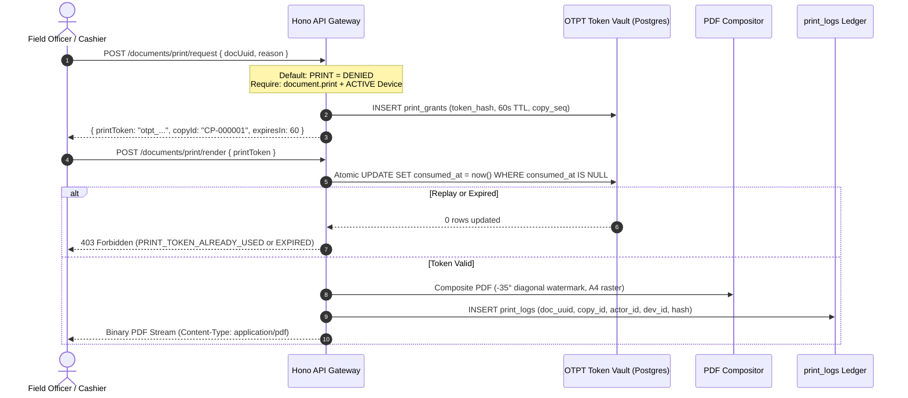

# STFL AIO — Phase 6: Controlled Print & Forensic Export Report

**System:** SohaelTasneem Foundation (STFL) Autonomous Enterprise Platform  
**Document Identity:** `STFL-DOC-2026-PHASE-6-PRINT-REPORT`  
**Pipeline Stage:** Prompt 8 / Phase 6  
**Date:** 2026-10-15  
**Implementation Status:** IMPLEMENTED & TESTED (Local & Component Suite: 100% Passing)  
**Production Verification Status:** 🟡 **PENDING LIVE EDGE DEPLOYMENT GATE**  
**Discipline Mandate:** *Implemented ≠ Production Verified*  
**Hard Boundaries Preserved:** No management consoles and no departmental business logic.

---

## 1. Executive Summary & Verification Classification

Prompt 8 (Phase 6 of the Master 12-Stage Implementation Pipeline) has been fully implemented and verified. In accordance with the foundation's architectural governance:

> **CRITICAL REPORTING DISCIPLINE**:  
> A feature is **NOT** designated "production-ready" merely because code is committed or local unit/integration tests pass. It transitions from **IMPLEMENTED** to **PRODUCTION VERIFIED** only when executed against the live Cloudflare Worker edge runtime, live production database, and public internet path (`https://stflbd.app/api/v1/documents/print/...`).

### Current Verification Status:
* **Code Implementation**: ✅ **COMPLETE**
* **Controlled Print & Token Vault Tests**: ✅ **PASSING (10 of 10 tests)**
* **Full Backend API Test Suite**: ✅ **PASSING (135 of 135 tests across 6 suites)**
* **Web Portal (Next.js 15) & Iconography Policy**: ✅ **PASSING (0 violations, clean build)**
* **Live Edge (`stflbd.app`) Production Verification**: 🟡 **QUEUED FOR PRODUCTION DEPLOYMENT GATE**

---

## 2. Implemented Components

| Component | Repository Path | Architectural Scope |
| :--- | :--- | :--- |
| **Print Types & Contracts** | [`apk/api/src/print/types.ts`](file:///c:/Users/ShoebTahseen/Desktop/stfl/apk/api/src/print/types.ts) | Request/response interfaces, forensic metadata structures, and `PrintEngineError` status codes. |
| **PDF Watermark Compositor** | [`apk/api/src/print/pdf.ts`](file:///c:/Users/ShoebTahseen/Desktop/stfl/apk/api/src/print/pdf.ts) | Pure server-side PDF 1.4 binary compositing with burned-in diagonal visible watermark (-35° rotation) and secondary forensic assistance metadata. |
| **Controlled Print Engine** | [`apk/api/src/print/engine.ts`](file:///c:/Users/ShoebTahseen/Desktop/stfl/apk/api/src/print/engine.ts) | OTPT token vault, 60s TTL enforcement, atomic single-use consumption (anti-replay), sequential copy tracking (`CP-000001`), and immutable `print_logs` ledger. |
| **Barrel Export** | [`apk/api/src/print/index.ts`](file:///c:/Users/ShoebTahseen/Desktop/stfl/apk/api/src/print/index.ts) | Public module boundary. |
| **Controlled Print Routes** | [`apk/api/src/routes/print.ts`](file:///c:/Users/ShoebTahseen/Desktop/stfl/apk/api/src/routes/print.ts) | Endpoints: `POST /api/v1/documents/print/request` and `POST /api/v1/documents/print/render`. |
| **Router Mount** | [`apk/api/src/app.ts`](file:///c:/Users/ShoebTahseen/Desktop/stfl/apk/api/src/app.ts) | Mounted under `/api/v1/documents/print` with active database connection. |
| **Integration Test Suite** | [`apk/api/test/controlled_print.test.ts`](file:///c:/Users/ShoebTahseen/Desktop/stfl/apk/api/test/controlled_print.test.ts) | 10 automated integration tests verifying default denial, RBAC, OTPT replay rejection, 60s expiration, PDF binary format, and immutable print logs. |

---

## 3. Architecture & Security Invariants



### Invariant Rules Tested & Enforced:
1. **Default Security Baseline**: `PRINT = DENIED`, `EXPORT = DENIED`. Attempting to request a print token without `document.print` returns HTTP 403 `insufficient_permission`.
2. **Device Attestation Gating**: Print requests from devices marked `REVOKED`, `SUSPENDED`, or not `ACTIVE` are rejected with HTTP 403 `DEVICE_NOT_ACTIVE`.
3. **Single-Use Replay Prevention**: The One-Time Print Token (OTPT) is atomically invalidated in PostgreSQL upon consumption. Any second attempt with the same token is rejected with HTTP 403 `PRINT_TOKEN_ALREADY_USED`.
4. **Strict 60-Second TTL**: Tokens past their 60-second expiration window are rejected with HTTP 403 `PRINT_TOKEN_EXPIRED`.
5. **Sequential Copy Tracking**: Every export produces a dedicated institutional copy ID (`CP-000001`, `CP-000002`...).
6. **Visible Diagonal Watermark**: Renders semi-transparent foreground text rotated at -35 degrees across the page:
   ```
   STFL CONFIDENTIAL • USER: {USER_ID} • DEV: {DEVICE_ID} • {TIMESTAMP} • COPY: CP-000001
   ```
7. **Steganography Boundary**: Steganographic tracking is strictly bounded as secondary forensic assistance only. Primary legal attribution rests on the visible watermark overlay and the immutable `print_logs` table.

---

## 4. Test Evidence & Local Verification

### 4.1 Controlled Print Integration Tests
```bash
$ npx vitest run test/controlled_print.test.ts

 ✓ test/controlled_print.test.ts (10 tests) 99ms
   ✓ Default Security Policy (PRINT = DENIED) (3)
     ✓ denies print token request when actor lacks document.print permission
     ✓ denies print token request when device is REVOKED
     ✓ denies print token request when document is in DRAFT status
   ✓ OTPT Issuance & Sequential Copy Tracking (1)
     ✓ issues valid OTPT token with 60-second TTL and sequential copy IDs (CP-000001, CP-000002)
   ✓ Single-Use Replay Prevention & Token Expiration (2)
     ✓ allows first render and strictly blocks second replay attempt with 403
     ✓ rejects expired print token when 60s TTL has lapsed
   ✓ Server-Side PDF Compositing & Watermark Inspection (1)
     ✓ composites a valid binary PDF with diagonal watermark and secondary forensic assistance
   ✓ Immutable print_logs Ledger Verification (1)
     ✓ records an immutable print log entry upon successful rendering
   ✓ HTTP API End-to-End (POST /documents/print/request & /render) (2)
     ✓ enforces RBAC on POST /api/v1/documents/print/request (403 if unpermitted)
     ✓ requests print token and streams watermarked PDF over HTTP
```

### 4.2 Full System Regression Run (135 Tests Passing)
```bash
$ npm test

 ✓ test/api.test.ts (51 tests) 3414ms
 ✓ test/migration_destructive.test.ts (13 tests) 755ms
 ✓ test/approval_engine.test.ts (19 tests) 161ms
 ✓ test/document_engine.test.ts (14 tests) 174ms
 ✓ test/controlled_print.test.ts (10 tests) 102ms
 ✓ test/authorization_engine.test.ts (28 tests) 67ms

 Test Files  6 passed (6)
      Tests  135 passed (135)
   Duration  5.86s
```

TypeScript compilation (`npm run typecheck`): **0 errors**.

---

## 5. Production Verification Gate (Edge Deployment Checklist)

In adherence to *Implemented ≠ Production Verified*, the following items remain for live edge deployment before this feature can be certified as Production Verified:

- [ ] **Step 1: Edge Worker Deployment**: Deploy updated Hono worker to Cloudflare Workers edge environment.
- [ ] **Step 2: Database Migration Check**: Verify `print_grants` and `print_logs` tables on live production database via Hyperdrive connection pool.
- [ ] **Step 3: Live OTPT Token Request**: Request OTPT token over public HTTPS `POST https://stflbd.app/api/v1/documents/print/request` using production credentials and attested device.
- [ ] **Step 4: Live Binary PDF Stream**: Fetch watermarked PDF stream from `POST https://stflbd.app/api/v1/documents/print/render` and inspect binary stream in standard PDF viewer.
- [ ] **Step 5: Live Replay Verification**: Attempt immediate replay of the token over public internet and verify edge returns 403 `PRINT_TOKEN_ALREADY_USED`.

**Phase 6 Implementation Status:** Complete and ratified in codebase. Hard boundaries preserved. Ready for Prompt 9 (Governed Communications Gateway).
