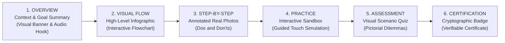

# STFL AIO — Graphical & Pictorial Training Engine Specification
**Document Identity:** `STFL-DOC-2026-TRN-PIC-V1`  
**Phase:** Prompt 12.5 Extension (Sections 63–82: Knowledge, Training, Service & Moderation)  
**Status:** SPECIFICATION ONLY — RATIFIED (READ-ONLY ARCHITECTURE PHASE)  
**Security Classification:** INTERNAL ENTERPRISE SPECIFICATION  
**Authoritative Precedent:** Extends `STFL_AIO_TRAINING_ARCHITECTURE.md`

---

## 1. Visual-First Pedagogical Philosophy

In the field environments of rural Bangladesh—whether flood relief centers in Sunamganj, agricultural cooperatives in Bogura, or microfinance doorstep visits in Rangpur—dense text-heavy training manuals fail. 

STFL AIO mandates a **Visual-First, Pictorial Instructional Model**. Every operational standard, safety measure, and administrative workflow is decomposed into visually intuitive, step-by-step graphic sequences that are immediately understandable regardless of literary fluency:



---

## 2. The 11 Visual Instructional Content Types

| Content Type | Technical Format | Primary Field Application | Accessibility / Offline Strategy |
|---|---|---|---|
| **1. IMAGE** | WebP / SVG (Optimized) | Annotated photos of authentic vs counterfeit receipts, crop pests. | High-DPI caching in local Android Room cache. |
| **2. DIAGRAM** | SVG Vector | Property cadastral survey chains, electrical distribution schematics. | Zoomable vector render with localized Bengali labels. |
| **3. FLOWCHART** | Interactive Mermaid / SVG | Decision trees for medical triage, financial voucher escalations. | Tap-to-expand node inspection on mobile screens. |
| **4. ANIMATION** | Lottie Vector JSON | Micro-animations showing correct QR-code scanning angle, cash counting. | Lightweight vector asset ($< 50\text{ KB}$), zero lag. |
| **5. VIDEO** | H.264 / AV1 ($< 15\text{ MB}$) | Short 60-second micro-demonstrations of patient intake or harvest sorting. | Compressed progressive download with offline store. |
| **6. SCREEN_WALKTHROUGH**| Web / Mobile Overlay | Animated finger pointers guiding the user through active UI screens. | Client-side coordinate mapping over actual UI components. |
| **7. INTERACTIVE_SIMULATION**| WebAssembly / React State | Sandbox simulation where workers practice handling disputed cash transactions. | Zero server writes; immediate local coaching feedback. |
| **8. CHECKLIST** | Jetpack Compose Reactive | Pre-departure field inventory checklists (First Aid kit, GPS, battery). | Tactile haptic feedback on completion. |
| **9. QUIZ** | JSON Scenario Tree | Visual dilemmas: *"Which receipt has the valid legal revenue stamp?"* | Randomized option order; visual explanations on mistakes. |
| **10. ASSESSMENT** | Timed Exam Engine | End-of-course formal evaluation requiring $\ge 80\%$ score. | Cryptographic completion signature. |
| **11. CERTIFICATE** | PDF & Digital Badge | Official verifiable credential (`STFL-CER-*`) with QR code. | Permanent cryptographic record in PostgreSQL. |

---

## 3. The 6-Stage Pedagogical Flow: Detailed Scenario

### Scenario: Training Field Workers on Doorstep Cash Collection (`CRS-MFI-02`)

1. **Stage 1: Overview:**  
   - Graphic: Illustrated field worker greeting a rural cooperative member.  
   - Audio prompt (Bengali): *"এই পাঠে আমরা শিখব কীভাবে নিরাপদে কিস্তির টাকা গ্রহণ করবেন এবং ডিজিটাল রশিদ প্রদান করবেন।"*
2. **Stage 2: Visual Flow:**  
   - An interactive 4-step diagram: `Check Member ID ➔ Receive Cash ➔ Tap 'Collect' ➔ Show Member the SMS Confirmation`.
3. **Stage 3: Step-by-Step Annotated Photographs:**  
   - Slide A: Photo of the member's QR card with a bright green focus box.  
   - Slide B: **DO:** Count cash in front of the member.  
   - Slide C: **DON'T (Red Cross):** Never accept cash without immediate app synchronization.
4. **Stage 4: Practice Simulation:**  
   - Mobile screen prompts: *"Practice collecting ৳ 1,500 from Demo Member Fatima Begum."* The worker taps through the simulated screen.
5. **Stage 5: Visual Assessment:**  
   - Screen shows two photos: (A) Cash handed over without receipt, (B) Worker scanning QR and member holding printed receipt.  
   - Question: *"কোন ছবিটি সঠিক ও নিরাপদ নিয়ম প্রদর্শন করে?"* (Worker taps B).
6. **Stage 6: Certification:**  
   - Congratulations banner: `STFL-CER-2026-000481` issued. Worker's profile status in `parties` updates to `CERTIFIED_CASH_COLLECTOR`.

---

## 4. Proposed Database Schema Specification

```sql
-- ---------------------------------------------------------------------------
-- Visual Training Modules Table
-- ---------------------------------------------------------------------------
CREATE TABLE IF NOT EXISTS visual_training_assets (
    id                   UUID PRIMARY KEY DEFAULT gen_random_uuid(),
    asset_code           TEXT NOT NULL UNIQUE,          -- AST-PIC-MFI-001
    lesson_id            UUID NOT NULL REFERENCES training_lessons(id) ON DELETE CASCADE,
    content_type         TEXT NOT NULL CHECK (content_type IN (
                           'IMAGE', 'DIAGRAM', 'FLOWCHART', 'ANIMATION', 'VIDEO', 
                           'SCREEN_WALKTHROUGH', 'INTERACTIVE_SIMULATION', 'CHECKLIST'
                         )),
    media_url            TEXT NOT NULL,
    media_hash           TEXT NOT NULL,                 -- SHA-256 of media asset
    caption_bn           TEXT NOT NULL,
    caption_en           TEXT NOT NULL,
    voiceover_audio_url  TEXT,                          -- Phonetic Bengali voice guide
    interaction_json     JSONB NOT NULL DEFAULT '{}'::jsonb, -- Hotspots, tap targets, quiz criteria
    sort_order           INTEGER NOT NULL DEFAULT 1,
    created_at           TIMESTAMPTZ NOT NULL DEFAULT now()
);

CREATE INDEX IF NOT EXISTS idx_visual_assets_lesson ON visual_training_assets(lesson_id, sort_order);
```
