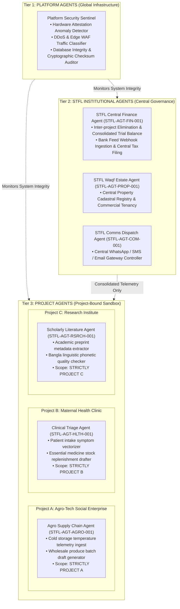
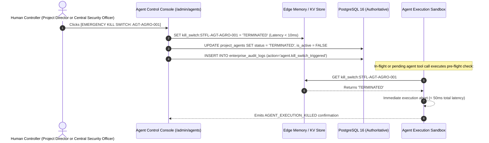

# STFL AIO — Project Agent Architecture & Autonomous Sandbox Model
**Document Identity:** `STFL-DOC-2026-PROJ-AGT-V1`  
**Phase:** Prompt 12.5 (Multi-Project Architecture & Feature Control Map)  
**Status:** SPECIFICATION ONLY — RATIFIED (READ-ONLY ARCHITECTURE PHASE)  
**Security Classification:** RESTRICTED ENTERPRISE SPECIFICATION  
**Authoritative Precedent:** Extends `STFL_AIO_AGENT_MODEL.md` and `STFL_AGENT_AUTHORIZATION_MODEL.md`

---

## 1. The Three-Tier Agent Hierarchy

STFL AIO organizes autonomous artificial intelligence agents into three strictly bounded institutional tiers:



---

## 2. Project Agent Isolation Invariants

To guarantee that an AI agent deployed in one project cannot compromise another initiative or foundation headquarters:

1. **Strict Context Enclosure:**  
   A Project Agent (`STFL-AGT-AGRO-001`) is issued an agent token cryptographically bound to `project_id = 'STFL-PRJ-2026-0001'`. Any attempt by this agent to query endpoints, read documents, or execute tools belonging to Project B or STFL Core returns an immediate `403 Forbidden` and raises an alarm.
2. **Constrained Tool Allowlists:**  
   Project agents are provisioned with an immutable JSON tool allowlist. They cannot dynamically request or discover new tools outside their explicit manifest.
3. **Budget & Rate Limit Quotas:**  
   Each project agent has two independent quota envelopes:
   - **Compute / Token Quota:** Maximum daily LLM tokens / execution cycles.
   - **Financial Value Quota:** Maximum cumulative transactional value of drafts generated per day.
4. **Universal Level 3 Ceiling:**  
   No project agent can execute a Level 4 (Human Approval) or Level 5 (Dual Control) action. Any action altering project policy, signing contracts, or disbursing funds generates a pending approval ticket for the human Project Director.
5. **The 0.9800 Confidence Floor:**  
   If an agent's evaluated confidence score for an operational task is `< 0.9800`, execution is suspended, and the task is escalated to human operators.

---

## 3. Dual-Control Emergency Kill Switch

Every project agent is bound to a sub-50ms cryptographic kill switch:



---

## 4. Proposed Database Schema Specification

```sql
-- ---------------------------------------------------------------------------
-- 1. Project Agents Registry Table
-- ---------------------------------------------------------------------------
CREATE TABLE IF NOT EXISTS project_agents (
    id                   UUID PRIMARY KEY DEFAULT gen_random_uuid(),
    agent_id             TEXT NOT NULL UNIQUE,          -- STFL-AGT-AGRO-001
    project_id           UUID NOT NULL REFERENCES platform_projects(id) ON DELETE CASCADE,
    agent_name           TEXT NOT NULL,
    agent_tier           TEXT NOT NULL CHECK (agent_tier IN ('PLATFORM', 'STFL_CORE', 'PROJECT_BOUND')),
    description          TEXT,
    
    -- Tool & Authority Constraints
    allowed_tools        JSONB NOT NULL DEFAULT '[]'::jsonb, -- e.g. ["cold_storage.read", "harvest.draft"]
    max_authority_level  INTEGER NOT NULL DEFAULT 3 CHECK (max_authority_level <= 3), -- Capped at Level 3
    min_confidence_floor NUMERIC(5, 4) NOT NULL DEFAULT 0.9800 CHECK (min_confidence_floor >= 0.9500),
    
    -- Budget & Rate Limits
    daily_token_limit    INTEGER NOT NULL DEFAULT 500000,
    daily_budget_limit   NUMERIC(18, 2) NOT NULL DEFAULT 0.00,
    rate_limit_per_min   INTEGER NOT NULL DEFAULT 60,
    
    -- Operational Status
    status               TEXT NOT NULL DEFAULT 'ACTIVE' CHECK (status IN (
                           'INITIALIZING', 'ACTIVE', 'PAUSED', 'SUSPENDED', 'TERMINATED'
                         )),
    is_active            BOOLEAN NOT NULL DEFAULT TRUE,
    kill_switch_active   BOOLEAN NOT NULL DEFAULT FALSE,
    killed_at            TIMESTAMPTZ,
    killed_by_party_id   UUID REFERENCES parties(id),
    
    created_at           TIMESTAMPTZ NOT NULL DEFAULT now(),
    updated_at           TIMESTAMPTZ NOT NULL DEFAULT now(),
    CONSTRAINT uq_proj_agent_id UNIQUE (project_id, agent_id)
);

-- ---------------------------------------------------------------------------
-- 2. Project Agent Execution Log (Immutable Audit)
-- ---------------------------------------------------------------------------
CREATE TABLE IF NOT EXISTS project_agent_executions (
    id                   UUID PRIMARY KEY DEFAULT gen_random_uuid(),
    execution_id         TEXT NOT NULL UNIQUE,          -- STFL-AGX-2026-000412
    agent_id             UUID NOT NULL REFERENCES project_agents(id) ON DELETE RESTRICT,
    project_id           UUID NOT NULL REFERENCES platform_projects(id) ON DELETE RESTRICT,
    tool_name            TEXT NOT NULL,
    input_payload_hash   TEXT NOT NULL,                 -- SHA-256 of inputs
    output_payload_hash  TEXT,                          -- SHA-256 of results
    confidence_score     NUMERIC(5, 4) NOT NULL,
    execution_duration_ms INTEGER NOT NULL,
    decision_outcome     TEXT NOT NULL CHECK (decision_outcome IN ('ALLOW', 'ESCALATE', 'DENIED', 'ERROR')),
    approval_ticket_id   TEXT,                          -- If escalated to human
    created_at           TIMESTAMPTZ NOT NULL DEFAULT now()
);

CREATE INDEX IF NOT EXISTS idx_proj_agents_proj ON project_agents(project_id, status);
CREATE INDEX IF NOT EXISTS idx_proj_agx_agent ON project_agent_executions(agent_id, created_at);
```
