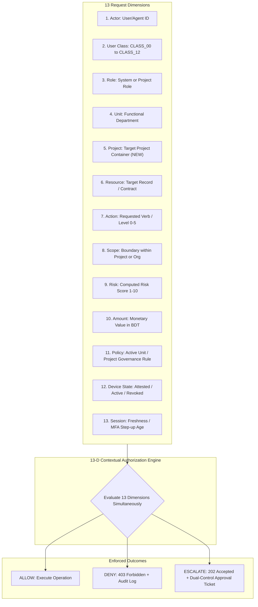

# STFL AIO — 13-Dimensional Contextual Authorization Engine Specification
**Document Identity:** `STFL-DOC-2026-PROJ-AUTHZ-V1`  
**Phase:** Prompt 12.5 (Multi-Project Architecture & Feature Control Map)  
**Status:** SPECIFICATION ONLY — RATIFIED (READ-ONLY ARCHITECTURE PHASE)  
**Security Classification:** RESTRICTED ENTERPRISE SPECIFICATION  
**Authoritative Precedent:** Extends `STFL_AUTHORIZATION_MODEL.md` (from 12 Dimensions to 13 Dimensions)

---

## 1. Architectural Evolution: Incorporating `PROJECT` Context

In `STFL_AUTHORIZATION_MODEL.md`, authorization was defined as a 12-dimensional vector:
$$\mathbf{Decision}_{12\text{-D}} = \mathcal{E}\left( \text{Actor}, \text{Class}, \text{Role}, \text{Unit}, \text{Resource}, \text{Action}, \text{Scope}, \text{Risk}, \text{Amount}, \text{Policy}, \text{DeviceState}, \text{Session} \right)$$

With the introduction of first-class multi-project environments, an urgent architectural decision must be formalized:

### The Architectural Question:
*Should `PROJECT` be modeled as:*
1. *Merely an operational Scope (`scope_type = 'PROJECT'`)?*
2. *A dedicated 13th Authorization Dimension?*
3. *A hybrid of both?*

### The Architectural Ruling: **Option 3 (A Dedicated 13th Dimension + Project-Subordinate Scopes)**

#### Architectural Justification:
- **Why Scope alone is insufficient:**  
  A `Scope` represents a spatial, organizational, or record-level boundary (e.g. `REGION-DHAKA-NORTH-02`). However, a Project is **not merely a boundary**—it possesses its own independent financial chart of accounts, independent workflow policies, custom project roles, independent autonomous agents, and dedicated approvers. Treating a project merely as a scope would force the authorization engine to flatten complex, project-specific governance into generic string tags.
- **Why a First-Class 13th Dimension is Mandatory:**  
  Elevating `Project` to a first-class dimension creates an explicit cryptographic tenant anchor in every request. The engine can immediately evaluate whether the caller's active project context matches the target resource's owning project before inspecting roles, scopes, or policies.
- **The Subordinate Scope Relationship:**  
  Beneath the `Project` dimension, granular `Scopes` continue to exist (e.g. `Project A / Zone 1`, `Project B / Clinical Phase`). Thus, **Project establishes the operational container, while Scope establishes the internal boundary within that container.**

---

## 2. The 13-Dimensional Evaluation Vector

$$\mathbf{AuthorizationDecision} = \mathcal{E}\left( \begin{array}{ccccccc}
\mathbf{Actor}, & \mathbf{Class}, & \mathbf{Role}, & \mathbf{Unit}, & \mathbf{Project}, & \mathbf{Resource}, & \mathbf{Action}, \\
\mathbf{Scope}, & \mathbf{Risk}, & \mathbf{Amount}, & \mathbf{Policy}, & \mathbf{DeviceState}, & \mathbf{Session}
\end{array} \right)$$



---

## 3. Dimensional Evaluation Rules & Project Cross-Reference

| # | Dimension | Evaluation Rule in Multi-Project Context |
|---|---|---|
| **1** | **Actor** | Verifies caller identity (`users.id` or `agents.id`). Agents cannot claim human identity (`actor_type = 'agent'`). |
| **2** | **Class** | Dictates global system boundary (`CLASS_00` to `CLASS_12`). Project roles cannot exceed the class authority ceiling. |
| **3** | **Role** | Evaluated in context: if `Project != NULL`, queries `project_roles`; if `Project == NULL`, queries global `roles`. |
| **4** | **Unit** | Functional competency (e.g. `FINANCE`, `PROPERTY`). Project actions must align with permitted functional units. |
| **5** | **Project** *(NEW)* | **Primary Container Check:** If `Resource.project_id != Context.project_id`, access is immediately **DENIED** unless the actor holds an explicit `CONSOLIDATED_OVERSIGHT` policy grant. |
| **6** | **Resource** | Validates target record provenance in PostgreSQL. Ensures foreign keys link back to the declared project. |
| **7** | **Action** | Maps to authority levels: Level 0 (Read) to Level 5 (Dual-Control Board Sign-Off). |
| **8** | **Scope** | Evaluates geographic or internal boundaries within the target project (e.g. `SCP-PROJ-A-DIST-01`). |
| **9** | **Risk** | Algorithmic risk score (1–10). Cross-project operations automatically incur base risk $\ge 7$. |
| **10** | **Amount** | Evaluates monetary transactions against **Project-Specific Budget Limits** and **Role Disbursement Ceilings**. |
| **11** | **Policy** | Evaluates specific project governance rules (stored in `project_workflow_policies`), overriding default defaults. |
| **12** | **Device State** | Requires `ACTIVE` hardware-attested Android KeyStore token for all non-public operational actions. |
| **13** | **Session** | Checks JWT age and MFA step-up. High-value disbursements require re-authentication within 15 minutes. |

---

## 4. Concrete Multi-Project Authorization Scenarios

### Scenario 1: Project Director Approving a Legitimate Project Expense
```text
Actor: STFL-PER-000042 (Dr. Kazi Rahman)
Class: CLASS_02 (Executive / Management)
Role: PROJECT_DIRECTOR
Unit: OPERATIONS
Project: STFL-PRJ-2026-0001 (Agro-Tech Social Enterprise)
Resource: STFL-VCH-2026-000412 (Seed Procurement Voucher)
Action: voucher.approve (Level 3 Authority)
Scope: SCP-PROJ-AGRO-DHAKA
Risk Score: 2 (Normal)
Amount: 35,000.00 BDT
Policy: POL-AGRO-VOUCHER-LIMIT (Director limit: 50,000 BDT)
Device State: ACTIVE (Attested Android Hardware)
Session: Valid Bearer JWT (Fresh: 8 minutes)

EVALUATION:
1. Actor active membership verified in Project STFL-PRJ-2026-0001 -> PASS
2. Target voucher belongs to Project STFL-PRJ-2026-0001 -> PASS (Project matches)
3. Role PROJECT_DIRECTOR has 'voucher.approve' permission -> PASS
4. Amount (35,000 BDT) is within policy limit (50,000 BDT) -> PASS
5. Device is ACTIVE and attested -> PASS

OUTCOME: ALLOW (Approve voucher, post to project sub-ledger, record in enterprise_audit_logs).
```

### Scenario 2: Project A Director Attempting to Access Project B Financials (Cross-Project Attack)
```text
Actor: STFL-PER-000042 (Dr. Kazi Rahman - Director of Project A)
Active Context: STFL-PRJ-2026-0001 (Project A)
Requested Resource: STFL-TXN-2026-000891 (Transaction belonging to Project B: Rural Health)
Action: financial.read
Project Dimension Check: Context (Project A) != Resource Owner (Project B)

EVALUATION:
1. Engine detects Project Context Mismatch: Context=STFL-PRJ-2026-0001 vs Resource=STFL-PRJ-2026-0002.
2. Actor lacks global CONSOLIDATED_OVERSIGHT permission.
3. Dimension 5 (Project) fails completely.

OUTCOME: DENY (HTTP 403 Forbidden. Emits security audit event 'security.cross_project_access_denied').
```

### Scenario 3: STFL Central Finance Officer Accessing Project Sub-Ledgers for Consolidation
```text
Actor: STFL-USR-00088 (Central Finance Specialist)
Class: CLASS_03 (Finance / Control)
Role: CENTRAL_TREASURY_ANALYST
Unit: FINANCE
Project: GLOBAL_CONSOLIDATED (Institutional STFL Context)
Resource: STFL-PRJ-2026-0001 (Project A Ledger Summary)
Action: consolidated_report.generate (Level 1 Authority)
Scope: ORGANIZATION_WIDE

EVALUATION:
1. Actor holds CLASS_03 with institutional scope 'ORGANIZATION_WIDE'.
2. Role possesses 'finance.consolidation.read' permission.
3. Action is non-destructive read aggregation.

OUTCOME: ALLOW (Generate consolidated balance sheet row, redact field-level PII, log audit event).
```

### Scenario 4: Project Autonomous Agent Attempting High-Value Disbursement
```text
Actor: STFL-AGT-AGRO-001 (Project A Procurement Agent)
Class: CLASS_10 (Autonomous AI Agent)
Role: PROJECT_PROCUREMENT_AGENT
Project: STFL-PRJ-2026-0001
Resource: STFL-TXN-2026-000955 (Fertilizer Supplier Payment)
Action: payment.disburse (Level 4 Authority)
Amount: 120,000.00 BDT

EVALUATION:
1. Actor is an Agent (CLASS_10).
2. Action 'payment.disburse' is Level 4 Authority.
3. Constitutional Invariant: Agents are strictly capped at Level 3. Level 4 actions require Human Approval.

OUTCOME: ESCALATE (HTTP 202 Accepted. Creates pending approval ticket TKT-APP-2026-00812 requiring
physical human sign-off from Project Director + Central Finance Officer).
```
