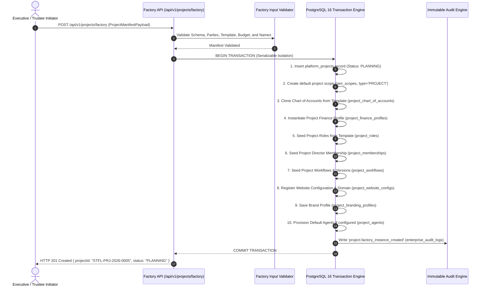

# STFL AIO — Project Creation Factory Specification
**Document Identity:** `STFL-DOC-2026-PROJ-FCT-V1`  
**Phase:** Prompt 12.5 (Multi-Project Architecture & Feature Control Map)  
**Status:** SPECIFICATION ONLY — RATIFIED (READ-ONLY ARCHITECTURE PHASE)  
**Security Classification:** INTERNAL ENTERPRISE SPECIFICATION  
**Authoritative Precedent:** Extends `STFL_AIO_PROJECT_MODEL.md` and `STFL_AIO_PROJECT_TEMPLATE_MODEL.md`

---

## 1. Architectural Concept: The Governed Factory Pattern

To prevent manual, error-prone database insertion or inconsistent tenancy provisioning, all new initiatives in STFL AIO must be instantiated through a formal **Project Creation Factory**. 

The factory transforms an authorized Project Creation Intent payload into a fully populated, cryptographically isolated, and operationally compliant project container.

> [!WARNING]
> **SPECIFICATION DIRECTIVE**  
> This document specifies the architectural contract and orchestration pipeline for the Project Factory. It **must not be implemented in code** during Prompt 12.5. Implementation is scheduled for dedicated subsequent phases.



---

## 2. Factory Manifest Input Specification

```json
{
  "$schema": "https://stflbd.app/schemas/v1/project-manifest.json",
  "projectCode": "AGRO_DAIRY_02",
  "name": {
    "bn": "হাজী গফুর ডেইরি ও এগ্রো এন্টারপ্রাইজ",
    "en": "Haji Gafur Dairy & Agro Enterprise"
  },
  "shortName": {
    "bn": "গফুর ডেইরি",
    "en": "Gafur Dairy"
  },
  "projectType": "SOCIAL_ENTERPRISE",
  "templateCode": "TPL_COMMERCIAL_ENTERPRISE",
  "organizationId": "d3b07384-d113-40e1-954d-1763133f9f82",
  "ownerPartyId": "a1b2c3d4-e5f6-4a5b-8c9d-0e1f2a3b4c5d",
  "projectManagerPartyId": "f7e8d9c0-b1a2-4c3d-5e6f-7a8b9c0d1e2f",
  "timeline": {
    "startDate": "2026-11-01",
    "endDate": "2029-10-31"
  },
  "finance": {
    "currency": "BDT",
    "initialBudgetLimit": 1500000.00,
    "restrictedFundType": "COMMERCIAL_EQUITY",
    "bankAccountInfo": {
      "bankName": "Islami Bank Bangladesh PLC",
      "accountTitle": "STFL Agro Project Account",
      "accountNumber": "20501234567890",
      "branchName": "Motijheel Branch"
    }
  },
  "branding": {
    "brandingMode": "PROJECT_BRANDED",
    "primaryColor": "#1E4D2B",
    "secondaryColor": "#D4AF37",
    "fontHeading": "Hind Siliguri",
    "fontBody": "Inter",
    "watermarkText": "GAFUR DAIRY — STFL GOVERNED"
  },
  "website": {
    "primaryDomain": "gafurdairy.com",
    "subdomainSlug": "dairy",
    "hasEcommerceStore": true,
    "hasFieldStories": true
  },
  "initialMembers": [
    {
      "partyId": "f7e8d9c0-b1a2-4c3d-5e6f-7a8b9c0d1e2f",
      "roleCode": "PROJECT_DIRECTOR",
      "membershipType": "DIRECT_HIRE"
    }
  ]
}
```

---

## 3. Atomic Provisioning Stages & Rollback Guarantees

1. **Schema & Party Verification:** Validates that `organizationId`, `ownerPartyId`, and `projectManagerPartyId` exist in `parties` and hold active status.
2. **Identifier Generation:** Reserves the next sequential institutional ID (e.g. `STFL-PRJ-2026-0005`) atomically.
3. **Template Hydration:** Loads the specified `templateCode` from `project_templates`. If the template is deprecated or inactive, the factory immediately aborts.
4. **All-or-Nothing Atomicity:** All insertions run inside a single PostgreSQL transaction with `SERIALIZABLE` isolation. Any constraint failure (e.g. duplicate project code or duplicate domain) triggers an instant rollback; no orphaned records can ever be left behind.
5. **Initial Lifecycle State:** The factory initializes new projects to `PLANNING` (or `PROPOSED`). No factory invocation can create a project directly in `ACTIVE` state without the formal governance approval gate (`T-02`).
