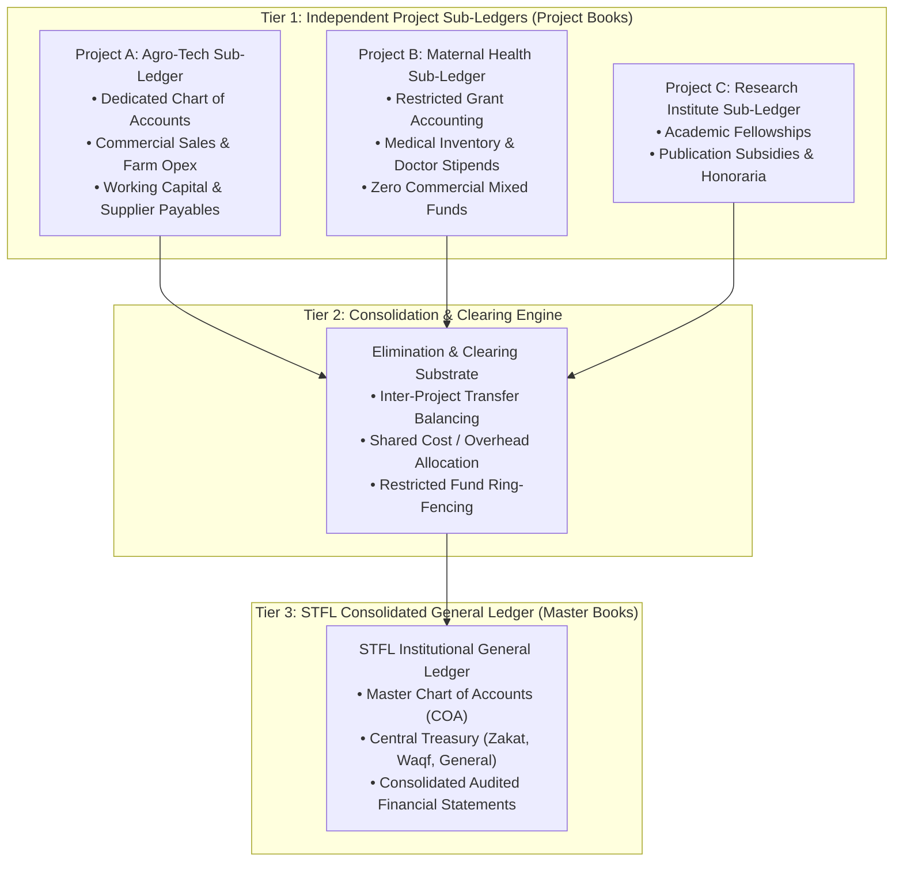

# STFL AIO — Project Finance & Consolidation Model Specification
**Document Identity:** `STFL-DOC-2026-PROJ-FIN-V1`  
**Phase:** Prompt 12.5 (Multi-Project Architecture & Feature Control Map)  
**Status:** SPECIFICATION ONLY — RATIFIED (READ-ONLY ARCHITECTURE PHASE)  
**Security Classification:** RESTRICTED ENTERPRISE SPECIFICATION  
**Authoritative Precedent:** Extends `STFL_AIO_CONSTITUTION.md` and `0001_init.sql`

---

## 1. Dual-Tier Accounting Philosophy: Sub-Ledgers & Central Consolidation

Every governed initiative within STFL AIO operates an independent, fully balanced **Project Sub-Ledger** that rolls up deterministically into the **STFL Consolidated General Ledger**.



### The Three Golden Rules of Project Finance:
1. **Mathematical Precision:** All monetary amounts, balances, exchange rates, and ledger entries must be stored and calculated using exact `NUMERIC(18, 2)` or `BigDecimal`. **Floating-point types (`FLOAT`, `DOUBLE PRECISION`) are constitutionally prohibited.**
2. **Double-Entry Equilibrium:** Every financial transaction must be recorded with balanced debits and credits:
   $$\sum \mathbf{Debits} \equiv \sum \mathbf{Credits}$$
3. **Restricted Fund Ring-Fencing:** Funds designated as **Zakat** or **Waqf Endowment** cannot be co-mingled, transferred, or cross-subsidized to fund commercial ventures or administrative overhead.

---

## 2. Project Chart of Accounts (COA) Architecture

Projects inherit a standardized 5-tier account hierarchy mapped back to the STFL Master Chart of Accounts:

```
STFL Master Account (Tier 1: Global Asset / Liability / Equity / Revenue / Expense)
   └── STFL Control Account (Tier 2: e.g. 11000 Cash & Bank, 21000 Trade Payables)
        └── Project Parent Account (Tier 3: e.g. 11100 Project A Operating Accounts)
             └── Project Detail Account (Tier 4: e.g. 11110 Project A Islami Bank A/C)
                  └── Project Cost Center / Sub-Code (Tier 5: e.g. Farm Unit 2 Seed Budget)
```

### Account Structure Specification:
| Account Code Pattern | Account Type | Project Local Usage | Consolidated Master Mapping |
|---|---|---|---|
| `10000-19999` | **ASSETS** | Project cash, local bank accounts, field petty cash, project inventory | Current / Fixed Assets |
| `20000-29999` | **LIABILITIES** | Supplier payables, contractor retention money, accrued field wages | Current Liabilities |
| `30000-39999` | **EQUITY / FUND BALANCE** | Project grant capital, retained earnings, donor endowments | Restricted / Unrestricted Net Assets |
| `40000-49999` | **REVENUE** | Commercial product sales, grant drawdowns, project donations | Programmatic / Operating Revenue |
| `50000-59999` | **EXPENSES** | Field logistics, medical supplies, farm equipment opex, stipends | Operating / Project Delivery Expenses |

---

## 3. Financial Isolation & Ring-Fencing Invariants

```
┌────────────────────────────────────────────────────────────────────────┐
│                   RESTRICTED FUND RING-FENCING RULES                   │
├────────────────────────────────────────────────────────────────────────┤
│ 1. ZAKAT ISOLATION:                                                    │
│    Zakat funds allocated to Project B (Humanitarian Aid) can NEVER be  │
│    borrowed by Project A (Agro-Tech Social Enterprise), even on a      │
│    temporary basis.                                                    │
├────────────────────────────────────────────────────────────────────────┤
│ 2. WAQF CAPITAL INTEGRITY:                                             │
│    Waqf corpus assets can generate revenue, but the underlying corpus  │
│    cannot be liquidated or pledged to secure external project debt.    │
├────────────────────────────────────────────────────────────────────────┤
│ 3. PROJECT-LOCAL VISIBILITY:                                           │
│    A Project Accountant in Project A cannot query bank balances,       │
│    vouchers, or supplier payables of Project B.                        │
├────────────────────────────────────────────────────────────────────────┤
│ 4. INTER-PROJECT SETTLEMENT:                                           │
│    If Project A sells organic produce to Project B's feeding clinic,   │
│    it must execute via formal Purchase Order ➔ Intercompany Clearing   │
│    Accounts (18100 Due from Project B / 28100 Due to Project A).       │
└────────────────────────────────────────────────────────────────────────┘
```

---

## 4. Anti-Collusion & Approval Separation of Duties (SoD)

Every project expenditure must strictly enforce the **Tripartite Separation of Duties**:

$$\text{Creator (Initiator)} \neq \text{Approver (Authorizer)} \neq \text{Disburser (Payer)}$$

| Transaction Threshold (BDT) | Initiator | Required Approver | Required Disburser | Governance Gate |
|---|---|---|---|---|
| **$\le$ ৳ 10,000** | Project Officer (`CLASS_04`) | Project Lead (`CLASS_04`) | Project Cashier (`CLASS_03`) | Standard Project Voucher |
| **৳ 10,001 – ৳ 50,000** | Project Lead (`CLASS_04`) | Project Director (`CLASS_02`) | Project Finance Officer (`CLASS_03`) | Dual-Signoff Voucher |
| **৳ 50,001 – ৳ 250,000** | Project Director (`CLASS_02`) | Central Finance Head (`CLASS_03`) | Central Treasurer (`CLASS_03`) | Institutional Finance Signoff |
| **> ৳ 250,000** | Project Director (`CLASS_02`) | Executive Director + Trustee (`CLASS_01`) | Central Treasurer (`CLASS_03`) | Board Dual-Control Approval |

* **Constitutional Rule:** AI Agents (`CLASS_10`) cannot act as Approver or Disburser under any circumstance.
* **Super Admin Guard:** Technical Super Admins (`CLASS_00`) are blocked from disbursing funds.

---

## 5. Consolidated Financial Reporting & Inter-Project Elimination

At the end of each accounting cycle (monthly/quarterly/annual):
1. **Trial Balance Consolidation:** The central platform aggregates trial balances from all active projects.
2. **Intercompany Elimination:** All inter-project receivable and payable accounts (`Due from Project X` vs `Due to Project Y`) are matched and eliminated:
   $$\text{Elimination Debit: Intercompany Payables} \quad \Longleftrightarrow \quad \text{Elimination Credit: Intercompany Receivables}$$
3. **Consolidated Financial Statements:** The engine produces:
   - Consolidated Statement of Financial Position (Balance Sheet)
   - Consolidated Statement of Activities (Income & Expenditure)
   - Fund Utilization Report (Zakat, Waqf, Grants, General Charity)
   - Project-by-Project Variance Analysis (Budget vs Actual)

---

## 6. Proposed Database Schema Specification

```sql
-- ---------------------------------------------------------------------------
-- 1. Project Financial Profiles
-- ---------------------------------------------------------------------------
CREATE TABLE IF NOT EXISTS project_finance_profiles (
    id                   UUID PRIMARY KEY DEFAULT gen_random_uuid(),
    project_id           UUID NOT NULL REFERENCES platform_projects(id) ON DELETE RESTRICT,
    currency_code        CHAR(3) NOT NULL DEFAULT 'BDT',
    fiscal_year_start    DATE NOT NULL,
    fiscal_year_end      DATE NOT NULL,
    total_budget_limit   NUMERIC(18, 2) NOT NULL DEFAULT 0.00,
    disbursement_ceiling NUMERIC(18, 2) NOT NULL DEFAULT 0.00,
    restricted_fund_type TEXT NOT NULL CHECK (restricted_fund_type IN (
                           'UNRESTRICTED', 'ZAKAT_RESTRICTED', 'WAQF_RESTRICTED', 
                           'DONOR_RESTRICTED_GRANT', 'COMMERCIAL_EQUITY'
                         )),
    bank_account_info    JSONB NOT NULL DEFAULT '{}'::jsonb,
    is_active            BOOLEAN NOT NULL DEFAULT TRUE,
    created_at           TIMESTAMPTZ NOT NULL DEFAULT now(),
    CONSTRAINT uq_proj_finance_profile UNIQUE (project_id)
);

-- ---------------------------------------------------------------------------
-- 2. Project Chart of Accounts
-- ---------------------------------------------------------------------------
CREATE TABLE IF NOT EXISTS project_chart_of_accounts (
    id                   UUID PRIMARY KEY DEFAULT gen_random_uuid(),
    project_id           UUID NOT NULL REFERENCES platform_projects(id) ON DELETE RESTRICT,
    account_code         TEXT NOT NULL,                 -- e.g. 11110
    account_name_bn      TEXT NOT NULL,
    account_name_en      TEXT NOT NULL,
    account_type         TEXT NOT NULL CHECK (account_type IN (
                           'ASSET', 'LIABILITY', 'EQUITY', 'REVENUE', 'EXPENSE'
                         )),
    parent_account_id    UUID REFERENCES project_chart_of_accounts(id) ON DELETE SET NULL,
    master_control_code  TEXT,                          -- Mapped STFL HQ account
    current_balance      NUMERIC(18, 2) NOT NULL DEFAULT 0.00,
    is_reconciled        BOOLEAN NOT NULL DEFAULT TRUE,
    created_at           TIMESTAMPTZ NOT NULL DEFAULT now(),
    CONSTRAINT uq_proj_account UNIQUE (project_id, account_code)
);

-- ---------------------------------------------------------------------------
-- 3. Project Vouchers & General Ledger
-- ---------------------------------------------------------------------------
CREATE TABLE IF NOT EXISTS project_vouchers (
    id                   UUID PRIMARY KEY DEFAULT gen_random_uuid(),
    voucher_id           TEXT NOT NULL UNIQUE,          -- STFL-VCH-2026-000412
    project_id           UUID NOT NULL REFERENCES platform_projects(id) ON DELETE RESTRICT,
    voucher_type         TEXT NOT NULL CHECK (voucher_type IN (
                           'PAYMENT', 'RECEIPT', 'JOURNAL', 'TRANSFER', 'CONTRA'
                         )),
    voucher_date         DATE NOT NULL,
    total_amount         NUMERIC(18, 2) NOT NULL,
    payee_party_id       UUID REFERENCES parties(id),
    status               TEXT NOT NULL DEFAULT 'DRAFT' CHECK (status IN (
                           'DRAFT', 'SUBMITTED', 'APPROVED', 'DISBURSED', 'CANCELLED', 'REJECTED'
                         )),
    creator_party_id     UUID NOT NULL REFERENCES parties(id),
    approver_party_id    UUID REFERENCES parties(id),
    disburser_party_id   UUID REFERENCES parties(id),
    source_document_id   TEXT,
    metadata             JSONB NOT NULL DEFAULT '{}'::jsonb,
    created_at           TIMESTAMPTZ NOT NULL DEFAULT now(),
    -- Enforce Anti-Collusion Constraint
    CONSTRAINT check_voucher_sod CHECK (
      (approver_party_id IS NULL OR creator_party_id <> approver_party_id) AND
      (disburser_party_id IS NULL OR creator_party_id <> disburser_party_id) AND
      (disburser_party_id IS NULL OR approver_party_id IS NULL OR approver_party_id <> disburser_party_id)
    )
);

CREATE TABLE IF NOT EXISTS project_ledger_entries (
    id                   UUID PRIMARY KEY DEFAULT gen_random_uuid(),
    project_id           UUID NOT NULL REFERENCES platform_projects(id) ON DELETE RESTRICT,
    voucher_id           UUID NOT NULL REFERENCES project_vouchers(id) ON DELETE RESTRICT,
    account_id           UUID NOT NULL REFERENCES project_chart_of_accounts(id) ON DELETE RESTRICT,
    entry_date           DATE NOT NULL,
    description          TEXT NOT NULL,
    debit_amount         NUMERIC(18, 2) NOT NULL DEFAULT 0.00,
    credit_amount        NUMERIC(18, 2) NOT NULL DEFAULT 0.00,
    currency             CHAR(3) NOT NULL DEFAULT 'BDT',
    created_at           TIMESTAMPTZ NOT NULL DEFAULT now(),
    CONSTRAINT check_entry_positive CHECK (debit_amount >= 0.00 AND credit_amount >= 0.00),
    CONSTRAINT check_entry_has_value CHECK (debit_amount > 0.00 OR credit_amount > 0.00)
);

CREATE INDEX IF NOT EXISTS idx_proj_vouchers_proj ON project_vouchers(project_id, status);
CREATE INDEX IF NOT EXISTS idx_proj_ledger_account ON project_ledger_entries(account_id, entry_date);
```
