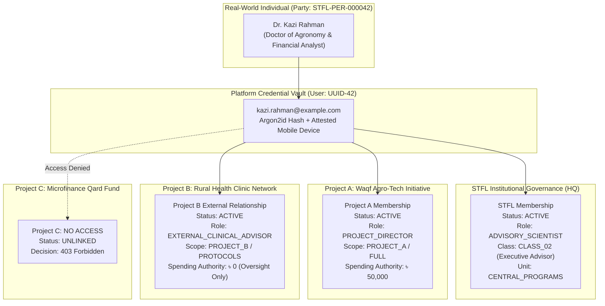

# STFL AIO — Project Identity, Membership & External Stakeholder Model
**Document Identity:** `STFL-DOC-2026-PROJ-IAM-V1`  
**Phase:** Prompt 12.5 (Multi-Project Architecture & Feature Control Map)  
**Status:** SPECIFICATION ONLY — RATIFIED (READ-ONLY ARCHITECTURE PHASE)  
**Security Classification:** INTERNAL ENTERPRISE SPECIFICATION  
**Authoritative Precedent:** Extends `STFL_PARTY_RELATIONSHIP_MODEL.md` and `STFL_IAM_ARCHITECTURE.md`

---

## 1. Ten Foundational Proofs of Identity Separation

To guarantee mathematical and architectural rigor, the platform establishes 10 strict non-equivalence assertions:

### Proof 1: $\text{PARTY} \neq \text{USER ACCOUNT}$
A **Party** (`parties`) represents a legal, natural, or collective entity in the real world (a human being, an NGO, a corporation, a Waqf estate). A **User Account** (`users`) is merely a set of authentication credentials (email/hash) enabling system access. A Party can exist without an account (e.g., a rural beneficiary, a minor, a deceased donor). A single Party can possess multiple credential sets (e.g., email-password for web, biometric token for mobile) or zero accounts.

### Proof 2: $\text{PARTY} \neq \text{PROJECT MEMBER}$
A Party is an enduring entity. A **Project Member** is an active, operational appointment of a Party to a specific Project container. When the project finishes, the Project Membership terminates; the Party remains unchanged.

### Proof 3: $\text{PROJECT MEMBER} \neq \text{STFL MEMBER}$
An individual can be an actively contracted software engineer or agronomist in **Project A** without having any employment contract, institutional standing, or membership in the **STFL Governing Organization**. Conversely, an STFL Trustee is an institutional board member but might have zero membership in Project A.

### Proof 4: $\text{PROJECT ROLE} \neq \text{STFL ROLE}$
An STFL institutional role (e.g. `EXECUTIVE_DIRECTOR` or `CENTRAL_TREASURER`) operates across foundation governance. A Project Role (e.g. `PROJECT_LEAD`, `FIELD_AGRONOMIST`, `COMMUNITY_LIAISON`) applies strictly within that project's operational and financial boundaries.

### Proof 5: $\text{PROJECT} \neq \text{UNIT}$
A **Unit** (e.g. `FINANCE`, `PROPERTY`, `WORKFORCE`) is an institutional center of competence and functional discipline. A **Project** is a mission-driven operational initiative that coordinates activities across multiple units (e.g., Project A has its own financial accounts, field workers, and assets).

### Proof 6: $\text{PROJECT} \neq \text{SCOPE}$
A **Project** is a first-class entity. A **Scope** (`iam_scopes`) defines access boundaries. While a project creates a default project scope (`scope_type = 'PROJECT'`), scopes also exist *inside* projects (e.g., `Region 1 of Project B`, `Restricted Research Phase of Project C`).

### Proof 7: $\text{PROJECT STAKEHOLDER} \neq \text{STFL EMPLOYEE}$
External participants (government inspectors, university researchers, independent auditors, donor representatives) are formal **Project Stakeholders**. They hold legal and operational relationships with the project, but have zero employment relationship with STFL.

### Proof 8: $\text{EXTERNAL PARTY} \neq \text{PUBLIC USER}$
A **Public User** (`CLASS_12`) has zero authenticated access beyond public websites and cryptographic document verification. An **External Party** (`CLASS_11`) is an authenticated, attested participant holding explicit relationships (e.g., a commercial lessee, a grant donor, an institutional vendor) with access to self-service portals.

### Proof 9: $\text{AGENT} \neq \text{HUMAN}$
An **Autonomous AI Agent** (`CLASS_10`, `actor_type = 'agent'`) is an automated software actor bound by tool allowlists, rate limits, and a strict Level 3 execution ceiling. An agent cannot hold legal accountability, approve dual-control transactions, or masquerade as a human user.

### Proof 10: $\text{DEVICE} \neq \text{USER}$
A **Device** (`devices`, `STFL-DVC-*`) is a hardware terminal (Android phone, secure desktop) bound cryptographically via KeyStore hardware attestation. A User can possess multiple registered devices; a shared field tablet can be bound to multiple operators under strict session switching. Compromising a device revokes that hardware key without destroying the user's identity.

---

## 2. STFL Institutional Membership vs. Project Membership



### Key Behavioral Rules:
1. **Contextual Independence:** A person's authority in Project A does not leak into Project B.
2. **Revocability:** Revoking Dr. Rahman's Project A directorship leaves his STFL advisory membership and Project B role completely intact.
3. **Time-Bound Validity:** Project memberships enforce `start_date` and `end_date`. Expired memberships automatically drop to `EXPIRED` status without manual administrative intervention.

---

## 3. External Stakeholders Model

External stakeholders participate in projects under governed, restricted conditions:

| Stakeholder Category | Primary Project Interaction | Permitted Access Scope | Required Attestation |
|---|---|---|---|
| **Donor / Grantor** | Monitor fund utilization, milestones, impact reports | Project Milestone & Financial Summary Portals | Magic-link / OTP + MFA |
| **Implementing Partner NGO** | Submit field verification data, distribution logs | Project Field Survey & Beneficiary Tools | Android KeyStore Device Binding |
| **Contractor / Consultant** | Submit deliverables, milestones, technical invoices | Project Deliverable Submission Console | Web Password + Authenticator MFA |
| **Independent Auditor** | Review sub-ledger vouchers, contracts, and approvals | Read-Only Project Sub-Ledger & Document Vault | Hardware Token / MFA |
| **Government Inspector** | Verify statutory filings, environmental compliance | Read-Only Compliance & Resolution Records | Time-bound verified guest token |
| **Commercial Vendor** | Submit bids, fulfill purchase orders, review receipts | E-Shop Vendor / Procurement Portal | Verified Vendor Account |

---

## 4. Multi-Context Authentication & Session Switching

```mermaid
sequenceDiagram
    autonumber
    actor User as User (kazi.rahman@example.com)
    participant Client as Web / Android Client
    participant Edge as Cloudflare Edge Gateway
    participant API as Hono Auth Service (/api/v1/auth)
    participant DB as PostgreSQL 16 (Authoritative)

    User->>Client: Enters credentials + Device Key
    Client->>Edge: POST /api/v1/auth/login
    Edge->>API: Forward login payload
    API->>DB: Verify credentials & attested device
    DB-->>API: User verified; Party ID: STFL-PER-000042
    
    API->>DB: Query active memberships & project roles
    DB-->>API: Returns: [STFL Core, Project A (Director), Project B (Advisor)]
    
    API-->>Client: Returns Primary Refresh Token + Available Contexts:
    Note over Client: UI presents Context Picker:<br/>1. STFL Core Administration<br/>2. Project A: Agro-Tech (Director)<br/>3. Project B: Health Clinic (Advisor)

    User->>Client: Selects [Project A: Agro-Tech]
    Client->>API: POST /api/v1/auth/switch-context { projectId: "PROJ-A" }
    API->>DB: Validate user active membership in Project A
    DB-->>API: Membership verified; Role: PROJECT_DIRECTOR
    API-->>Client: Issues Contextual Access JWT:<br/>{ sub: "usr_42", party: "STFL-PER-000042",<br/>  project: "STFL-PRJ-2026-0001", role: "PROJECT_DIRECTOR",<br/>  unit: "PROJECT_A", scope: "SCP-PROJ-A-GLOBAL" }
```

### Contextual Session Guarantee:
- The resulting JWT is cryptographically bound to that specific `project_id`.
- Every subsequent API call evaluates authorization within the selected project context.
- To perform actions in another project, the client must explicitly switch contexts, acquiring a new contextual JWT. Cross-project contamination is impossible.

---

## 5. Proposed PostgreSQL Schema Specification

```sql
-- ---------------------------------------------------------------------------
-- 1. Project Roles Table
-- ---------------------------------------------------------------------------
CREATE TABLE IF NOT EXISTS project_roles (
    id                   UUID PRIMARY KEY DEFAULT gen_random_uuid(),
    project_id           UUID NOT NULL REFERENCES platform_projects(id) ON DELETE CASCADE,
    role_code            TEXT NOT NULL,                 -- e.g. PROJECT_DIRECTOR, FIELD_LEAD
    name_bn              TEXT NOT NULL,
    name_en              TEXT NOT NULL,
    description          TEXT,
    is_admin             BOOLEAN NOT NULL DEFAULT FALSE,
    disbursement_limit   NUMERIC(18, 2) NOT NULL DEFAULT 0.00,
    permissions          JSONB NOT NULL DEFAULT '[]'::jsonb, -- e.g. ["budget.read", "voucher.create"]
    is_active            BOOLEAN NOT NULL DEFAULT TRUE,
    created_at           TIMESTAMPTZ NOT NULL DEFAULT now(),
    CONSTRAINT uq_project_role UNIQUE (project_id, role_code)
);

-- ---------------------------------------------------------------------------
-- 2. Project Memberships Table
-- ---------------------------------------------------------------------------
CREATE TABLE IF NOT EXISTS project_memberships (
    id                   UUID PRIMARY KEY DEFAULT gen_random_uuid(),
    project_id           UUID NOT NULL REFERENCES platform_projects(id) ON DELETE RESTRICT,
    party_id             UUID NOT NULL REFERENCES parties(id) ON DELETE RESTRICT,
    user_id              UUID REFERENCES users(id) ON DELETE SET NULL,
    project_role_id      UUID NOT NULL REFERENCES project_roles(id) ON DELETE RESTRICT,
    membership_type      TEXT NOT NULL CHECK (membership_type IN (
                           'STFL_SECONDEE', 'DIRECT_HIRE', 'CONTRACTOR', 
                           'VOLUNTEER', 'PARTNER_REPRESENTATIVE', 'INTERN'
                         )),
    start_date           DATE NOT NULL,
    end_date             DATE,
    status               TEXT NOT NULL DEFAULT 'ACTIVE' CHECK (status IN (
                           'PENDING', 'ACTIVE', 'SUSPENDED', 'TERMINATED', 'EXPIRED'
                         )),
    assigned_scope_id    TEXT,                          -- Project-local scope constraint
    created_by_party_id  UUID NOT NULL REFERENCES parties(id),
    metadata             JSONB NOT NULL DEFAULT '{}'::jsonb,
    created_at           TIMESTAMPTZ NOT NULL DEFAULT now(),
    updated_at           TIMESTAMPTZ NOT NULL DEFAULT now(),
    CONSTRAINT uq_project_party_membership UNIQUE (project_id, party_id)
);

-- ---------------------------------------------------------------------------
-- 3. Project External Stakeholders Table
-- ---------------------------------------------------------------------------
CREATE TABLE IF NOT EXISTS project_stakeholders (
    id                   UUID PRIMARY KEY DEFAULT gen_random_uuid(),
    project_id           UUID NOT NULL REFERENCES platform_projects(id) ON DELETE RESTRICT,
    party_id             UUID NOT NULL REFERENCES parties(id) ON DELETE RESTRICT,
    stakeholder_type     TEXT NOT NULL CHECK (stakeholder_type IN (
                           'DONOR', 'GRANTOR', 'IMPLEMENTING_PARTNER', 'CONTRACTOR', 
                           'CONSULTANT', 'GOVERNMENT_BODY', 'INDEPENDENT_AUDITOR', 
                           'COMMUNITY_LEADER', 'SUPPLIER', 'BENEFICIARY_REP'
                         )),
    contact_person_name  TEXT,
    contact_email        TEXT,
    contact_phone        TEXT,
    agreement_document_id TEXT,                         -- STFL-DOC-*
    access_portal_type   TEXT NOT NULL CHECK (access_portal_type IN (
                           'DONOR_PORTAL', 'PARTNER_PORTAL', 'AUDIT_VAULT', 'VENDOR_PORTAL', 'NONE'
                         )),
    status               TEXT NOT NULL DEFAULT 'ACTIVE' CHECK (status IN (
                           'ACTIVE', 'INACTIVE', 'SUSPENDED', 'TERMINATED'
                         )),
    metadata             JSONB NOT NULL DEFAULT '{}'::jsonb,
    created_at           TIMESTAMPTZ NOT NULL DEFAULT now()
);

CREATE INDEX IF NOT EXISTS idx_project_memberships_proj ON project_memberships(project_id, status);
CREATE INDEX IF NOT EXISTS idx_project_memberships_party ON project_memberships(party_id);
CREATE INDEX IF NOT EXISTS idx_project_stakeholders_proj ON project_stakeholders(project_id, stakeholder_type);
```
