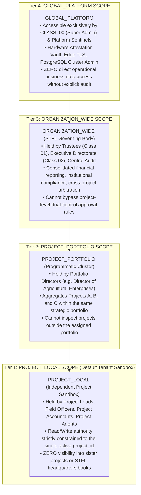

# STFL AIO — Project Isolation, Multi-Tenant Security & Scope Architecture
**Document Identity:** `STFL-DOC-2026-PROJ-ISO-V1`  
**Phase:** Prompt 12.5 (Multi-Project Architecture & Feature Control Map)  
**Status:** SPECIFICATION ONLY — RATIFIED (READ-ONLY ARCHITECTURE PHASE)  
**Security Classification:** RESTRICTED ENTERPRISE SPECIFICATION  
**Authoritative Precedent:** Extends `STFL_AIO_SECURITY_MODEL.md` and `STFL_SCOPE_MODEL.md`

---

## 1. The Four-Tier Scope Hierarchy

To cleanly segregate authority across multi-project environments, the platform organizes all resource access into four strictly evaluated scope tiers:



---

## 2. Hard Subsystem Isolation Rules

| Subsystem | Project A (e.g. Agro-Tech) | Project B (e.g. Maternal Health Clinic) | Cross-Project Breach Prevention Mechanism |
|---|---|---|---|
| **Transactional Data** | `project_id = 'PROJ_A'` | `project_id = 'PROJ_B'` | PostgreSQL Row-Level Security (RLS) + Foreign Key Enclosure |
| **Financial Sub-Ledger** | Agro Chart of Accounts & Bank A/C | Health Chart of Accounts & Bank A/C | Ring-fenced accounts; transactions must balance within local COA |
| **Digital Documents** | Agro Contracts & Cold Storage Receipts | Medical Certificates & Patient Intake Records | Cryptographic SHA-256 document IDs prefix-bound to project code |
| **Communications** | Agro Bulk SMS & Farmer Advisory WhatsApp | Health Clinic Appointment Reminders | Gateway evaluates `X-Project-Context`; templates bound to project |
| **Autonomous Agents** | `STFL-AGT-AGRO-001` | `STFL-AGT-HLTH-001` | Edge runtime aborts execution if agent calls foreign project tool |
| **Fixed Assets** | Tractors, Harvesters, Cold Units | Ultrasound Scanners, Ambulances | Asset custody registers enforce project asset custody IDs |
| **Edge Cache / CDN** | Cache-Control: `private, no-store` | Cache-Control: `private, no-store` | Dynamic Vary headers: `Vary: Authorization, X-Project-Context` |

---

## 3. Project Document Isolation & Forensic Integrity

Project documents inherit platform cryptographic provenance while remaining strictly partitioned:
1. **Institutional Identifier Binding:**  
   $$\text{Format: } \mathbf{STFL\text{-}[PROJECT\_CODE]\text{-}[DOC\_TYPE]\text{-}[YEAR]\text{-}[SEQUENCE]\text{-}[CHECKSUM]}$$  
   *Example:* `STFL-AGRO-LET-2026-000012-K9R2`
2. **Access Control:**  
   Documents flagged as `RESTRICTED` or `CONFIDENTIAL` are only readable by verified project members holding matching scopes. Public verification endpoints (`stflbd.app/verify/*`) display document authenticity, SHA-256 hash, and issue date, but **redact sensitive operational or personal details**.
3. **Forensic Watermarking:**  
   All generated views and exports stamp the active `project_id`, `copy_id`, requesting `user_id`, and hardware `device_id` into the background canvas.

---

## 4. Governed Communications Isolation

When a project initiates outbound communication (SMS, WhatsApp, Email):
1. **Template Whitelisting:** The message must match an approved template associated with that specific `project_id`.
2. **Anti-Hallucination Variable Hash:** The central gateway validates that template variables originate from verified database records (e.g. `{{amount}}` matches an approved voucher).
3. **Sender ID Segregation:**  
   - SMS Sender IDs can be configured as project-specific (e.g. `STFL-AGRO`) where authorized by BTRC.
   - WhatsApp Cloud API templates run under the verified STFL enterprise account with project-specific header branding.

---

## 5. PostgreSQL Row-Level Security (RLS) Specification

```sql
-- ---------------------------------------------------------------------------
-- Row-Level Security (RLS) Enforcement Pattern for Multi-Project Tenancy
-- ---------------------------------------------------------------------------

-- Enable RLS on core project tables
ALTER TABLE project_vouchers ENABLE ROW LEVEL SECURITY;
ALTER TABLE project_ledger_entries ENABLE ROW LEVEL SECURITY;
ALTER TABLE project_workflow_instances ENABLE ROW LEVEL SECURITY;

-- Project Local Isolation Policy:
-- Users can only read vouchers if their active session context matches the project_id,
-- OR if they possess the global 'ORGANIZATION_WIDE' oversight privilege.
CREATE POLICY rls_project_vouchers_isolation ON project_vouchers
    FOR ALL
    TO authenticated_users
    USING (
      project_id = current_setting('request.jwt.project_id', true)::uuid
      OR
      current_setting('request.jwt.scope', true) IN ('ORGANIZATION_WIDE', 'GLOBAL_PLATFORM')
    );

CREATE POLICY rls_project_ledger_isolation ON project_ledger_entries
    FOR ALL
    TO authenticated_users
    USING (
      project_id = current_setting('request.jwt.project_id', true)::uuid
      OR
      current_setting('request.jwt.scope', true) IN ('ORGANIZATION_WIDE', 'GLOBAL_PLATFORM')
    );
```
