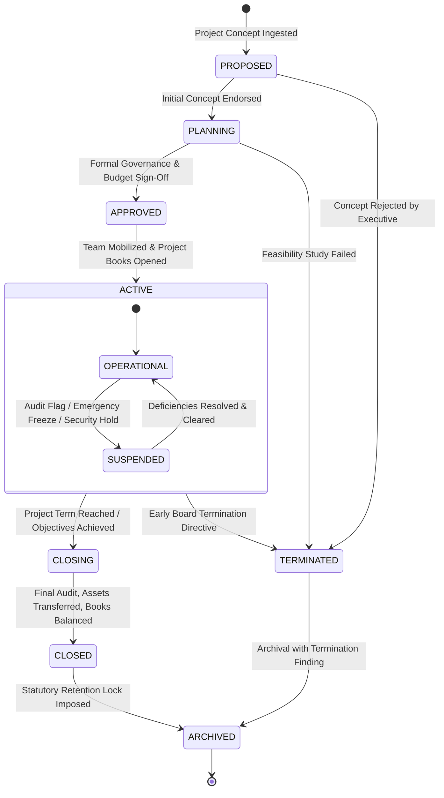

# STFL AIO — Project Operational Lifecycle & Archival Model
**Document Identity:** `STFL-DOC-2026-PROJ-LIFE-V1`  
**Phase:** Prompt 12.5 (Multi-Project Architecture & Feature Control Map)  
**Status:** SPECIFICATION ONLY — RATIFIED (READ-ONLY ARCHITECTURE PHASE)  
**Security Classification:** INTERNAL ENTERPRISE SPECIFICATION  
**Authoritative Precedent:** Extends `STFL_AIO_CONSTITUTION.md` and `STFL_APPROVAL_ENGINE.md`

---

## 1. The 9-Stage Governed Project Lifecycle

A project in STFL AIO is not a static database row; it is a living institutional initiative governed through nine formal lifecycle states:



---

## 2. Transition Governance & Approval Authority Gates

No project lifecycle transition may occur without verifiable human authority matching the requisite User Class:

| Transition | From State | To State | Mandatory Approver Authority | Governance Requirements & Verification Checks |
|---|---|---|---|---|
| **T-01** | `PROPOSED` | `PLANNING` | Executive Director (`CLASS_02`) | Feasibility review, sponsor party verified, project category assigned |
| **T-02** | `PLANNING` | `APPROVED` | Board of Trustees (`CLASS_01`) | Full budget approved, COA mapped, project lead assigned, compliance signed |
| **T-03** | `APPROVED` | `ACTIVE` | Central Treasurer (`CLASS_03`) | Working capital disbursed to project bank account, sub-ledger initialized |
| **T-04** | `ACTIVE` | `SUSPENDED` | Security Officer (`CLASS_08`) or Trustee | Suspends all outbound vouchers, halts project agents, notifies Director |
| **T-05** | `SUSPENDED`| `ACTIVE` | Trustee Dual-Control (`CLASS_01` x2) | Corrective audit report signed, compliance clearance issued |
| **T-06** | `ACTIVE` | `CLOSING` | Project Director (`CLASS_02`) | Notice of completion, operational intake halted, supplier invoices called |
| **T-07** | `CLOSING` | `CLOSED` | Central Finance Head (`CLASS_03`) | Zero un-reconciled ledger balance, asset inventory audited, final report filed |
| **T-08** | `CLOSED` | `ARCHIVED` | Records Officer (`CLASS_08`) | Cryptographic digest generated, data converted to read-only, retention locked |
| **T-09** | Any State | `TERMINATED` | Board Resolution (`CLASS_01`) | Immediate kill switch across all project agents, vouchers, and website domains |

---

## 3. Project Termination & Archival Protocol (Section 25 Deep-Dive)

When a project concludes or is terminated, it does not disappear. It undergoes a comprehensive, irreversible archival pipeline:

```
┌────────────────────────────────────────────────────────────────────────┐
│                   TEN-POINT PROJECT ARCHIVAL PROTOCOL                  │
├────────────────────────────────────────────────────────────────────────┤
│ 1. USERS & MEMBERSHIPS:                                                │
│    All active project_memberships transition to 'EXPIRED'. Members     │
│    retain read-only self-service access to past performance records    │
│    but lose all operational, drafting, and approval privileges.        │
├────────────────────────────────────────────────────────────────────────┤
│ 2. EXTERNAL STAKEHOLDERS:                                              │
│    Contractors and vendors receive final statement of accounts. Guest  │
│    portal access is locked after a 30-day settlement window.           │
├────────────────────────────────────────────────────────────────────────┤
│ 3. FINANCIAL SUB-LEDGER CLOSURE:                                       │
│    All pending vouchers are settled or voided. Any remaining cash is   │
│    transferred back to the STFL General Endowment or returned to the   │
│    original grantor. Final closing journal entries post to zero-out.   │
├────────────────────────────────────────────────────────────────────────┤
│ 4. FIXED ASSETS & INVENTORY:                                           │
│    Project assets (equipment, vehicles, unused inventory) are returned│
│    to STFL Central HQ custody or formally re-assigned under resolution.│
├────────────────────────────────────────────────────────────────────────┤
│ 5. AUTONOMOUS AGENTS:                                                  │
│    All project agents (STFL-AGT-*) transition to 'TERMINATED'. Compute │
│    quotas, tool credentials, and webhooks are permanently revoked.     │
├────────────────────────────────────────────────────────────────────────┤
│ 6. WEBSITES & DOMAINS:                                                 │
│    Custom domains render a permanent, clean static completion notice:  │
│    'This project has concluded. Historical records are archived with   │
│    the SohaelTasneem Foundation.' Subdomains redirect to stflbd.app.   │
├────────────────────────────────────────────────────────────────────────┤
│ 7. COMMUNICATIONS:                                                     │
│    All outbound dispatch queues for the project are permanently locked.│
├────────────────────────────────────────────────────────────────────────┤
│ 8. DIGITAL DOCUMENTS & VAULT:                                          │
│    All issued contracts, certificates, and letters are locked in read- │
│    only cold storage. Public cryptographic verification remains active.│
├────────────────────────────────────────────────────────────────────────┤
│ 9. AUDIT LOG RETENTION:                                                │
│    The complete enterprise_audit_logs trail for the project is frozen  │
│    and retained in perpetuity in compliance with trust law.            │
├────────────────────────────────────────────────────────────────────────┤
│ 10. LEGAL HOLD SUPPORT:                                                │
│     If litigation or statutory audit arises, a 'LEGAL_HOLD' flag can   │
│     be asserted, preventing any data archiving or lifecycle alteration.│
└────────────────────────────────────────────────────────────────────────┘
```

---

## 4. Proposed Database Schema Specification

```sql
-- ---------------------------------------------------------------------------
-- Project Lifecycle Transitions Table (Auditable Event Log)
-- ---------------------------------------------------------------------------
CREATE TABLE IF NOT EXISTS project_lifecycle_events (
    id                   UUID PRIMARY KEY DEFAULT gen_random_uuid(),
    project_id           UUID NOT NULL REFERENCES platform_projects(id) ON DELETE CASCADE,
    previous_state       TEXT NOT NULL,
    new_state            TEXT NOT NULL,
    transition_code      TEXT NOT NULL,                 -- e.g. T-01, T-02...
    authorizer_party_id  UUID NOT NULL REFERENCES parties(id),
    governance_doc_id    TEXT,                          -- Board resolution STFL-LET-*
    reason               TEXT NOT NULL,
    checklist_verification JSONB NOT NULL DEFAULT '{}'::jsonb,
    metadata             JSONB NOT NULL DEFAULT '{}'::jsonb,
    created_at           TIMESTAMPTZ NOT NULL DEFAULT now()
);

CREATE INDEX IF NOT EXISTS idx_proj_life_proj ON project_lifecycle_events(project_id, created_at);
```
