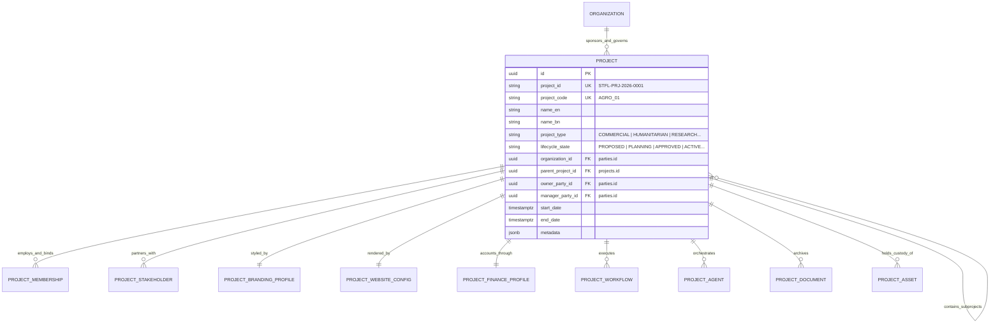

# STFL AIO — First-Class Project Entity Model
**Document Identity:** `STFL-DOC-2026-PROJ-MDL-V1`  
**Phase:** Prompt 12.5 (Multi-Project Architecture & Feature Control Map)  
**Status:** SPECIFICATION ONLY — RATIFIED (READ-ONLY ARCHITECTURE PHASE)  
**Security Classification:** INTERNAL ENTERPRISE SPECIFICATION  
**Authoritative Precedent:** Strictly additive to `0001_init.sql` and `0002_aio_parties_iam.sql`

---

## 1. Architectural Definition of the Project Entity

In STFL AIO, a **Project** is elevated from a simple CMS public record (as initially introduced in `0001_init.sql`) to a **First-Class Governed Institutional Container**. 

A Project encapsulates:
1. **Institutional Identity:** Unique institutional ID (`STFL-PRJ-YYYY-NNNN`), project code, bilingual naming, and legal provenance.
2. **Governance Anchor:** Owning organization, legal sponsor/owner party, and designated project director.
3. **Operational Context:** Independent operational lifecycle, temporal milestones, and risk profile.
4. **Subsystem Profiles:** Pointers to dedicated branding profiles, public website configurations, chart of accounts profiles, and custom workflow policies.
5. **Hierarchical Relationships:** Support for parent-child project relationships, programs, and portfolio groupings.



---

## 2. Configuration-Driven Project Taxonomy

To accommodate diverse foundation initiatives without hardcoding rigid table schemas, projects are categorized via an extensible taxonomy:

| Project Category | Canonical Code | Operational Focus | Typical Funding Model | Example Initiative |
|---|---|---|---|---|
| **Social Enterprise** | `SOCIAL_ENTERPRISE` | Commercial sustainability with charitable impact reinvestment | Revenue generation, social equity | Agro-Tech Organic Farming, Waqf Dairy |
| **Commercial Operation** | `COMMERCIAL` | Market-rate business venture for endowment generation | Working capital, customer sales | Waqf Commercial Tower & Shopping Complex |
| **Humanitarian Mission** | `HUMANITARIAN` | Direct relief, emergency aid, healthcare, disaster response | Zakat, Sadaqah, humanitarian grants | Flood Relief 2026, Rohingya Medical Clinic |
| **Field Program** | `FIELD_PROJECT` | Grassroots community development and localized execution | Foundation endowment, restricted donor funds | Rural Solar Water Wells, Orphan Sponsorship |
| **Academic & Research** | `RESEARCH` | Scholarly investigation, publications, economic analysis | Research grants, institutional fellowships | Islamic Social Finance Benchmark Study |
| **Institutional Grant** | `GRANT` | Multi-party donor funded program with external accountability | Institutional donor contracts (e.g. IDB, UN) | Sustainable Livelihoods Grant Program |
| **Public Agency** | `AGENCY` | Fiduciary representation, implementing partner execution | Retainer, management fees | Waqf Property Custodianship Agency |
| **Community Initiative** | `COMMUNITY_PROJECT`| Neighborhood-level participatory civic action | Crowdfunding, community contributions | Urban Clean Green Dhaka Initiative |
| **Digital Product** | `DIGITAL_PRODUCT` | Software, mobile apps, digital services, data platforms | Technology endowment, SaaS subscriptions | Aakutu Board Phonetic Suite, E-Shop Portal |
| **Internal Initiative** | `INTERNAL_INITIATIVE`| Platform improvements, corporate governance, HR upgrades | STFL Core Operating Budget | Platform 2.0 Modernization, Security Attestation |

---

## 3. Canonical Project Database Schema Specification

The following specification extends the existing schema in a strictly additive manner:

```sql
-- =============================================================================
-- STFL Multi-Project Architecture — Canonical Project Entity Specification
-- Strictly additive. Preserves all tables from 0001_init.sql and 0002_aio_parties_iam.sql.
-- =============================================================================

CREATE TABLE IF NOT EXISTS platform_projects (
    id                          UUID PRIMARY KEY DEFAULT gen_random_uuid(),
    project_id                  TEXT NOT NULL UNIQUE,          -- STFL-PRJ-2026-0001
    project_code                TEXT NOT NULL UNIQUE,          -- AGRO_TECH_01 (alphanumeric uppercase)
    
    -- Bilingual Nomenclature
    name_bn                     TEXT NOT NULL,
    name_en                     TEXT NOT NULL,
    short_name_bn               TEXT NOT NULL,
    short_name_en               TEXT NOT NULL,
    tagline_bn                  TEXT,
    tagline_en                  TEXT,
    description_bn              TEXT,
    description_en              TEXT,
    
    -- Classification & Taxonomy
    project_type                TEXT NOT NULL CHECK (project_type IN (
                                  'SOCIAL_ENTERPRISE', 'COMMERCIAL', 'HUMANITARIAN', 
                                  'FIELD_PROJECT', 'RESEARCH', 'GRANT', 'AGENCY', 
                                  'COMMUNITY_PROJECT', 'DIGITAL_PRODUCT', 
                                  'INTERNAL_INITIATIVE', 'OTHER'
                                )),
    
    -- Institutional Governance & Provenance
    organization_id             UUID NOT NULL REFERENCES parties(id) ON DELETE RESTRICT,
    parent_project_id           UUID REFERENCES platform_projects(id) ON DELETE SET NULL,
    portfolio_id                UUID,                          -- Future project_portfolios table
    owner_party_id              UUID NOT NULL REFERENCES parties(id) ON DELETE RESTRICT,
    project_manager_party_id    UUID NOT NULL REFERENCES parties(id) ON DELETE RESTRICT,
    
    -- Lifecycle & Timeline
    lifecycle_state             TEXT NOT NULL DEFAULT 'PROPOSED' CHECK (lifecycle_state IN (
                                  'PROPOSED', 'PLANNING', 'APPROVED', 'ACTIVE', 
                                  'SUSPENDED', 'CLOSING', 'CLOSED', 'ARCHIVED', 'TERMINATED'
                                )),
    start_date                  DATE,
    end_date                    DATE,
    CONSTRAINT check_project_dates CHECK (end_date IS NULL OR end_date >= start_date),
    
    -- Linked Subsystem Profiles (Foreign Keys to Dedicated Profile Tables)
    branding_profile_id         UUID,                          -- REFERENCES project_branding_profiles(id)
    website_config_id           UUID,                          -- REFERENCES project_website_configs(id)
    finance_profile_id          UUID,                          -- REFERENCES project_finance_profiles(id)
    workflow_profile_id         UUID,                          -- REFERENCES project_workflow_profiles(id)
    data_policy_id              UUID,                          -- REFERENCES project_data_policies(id)
    
    -- Operational Flags
    is_public                   BOOLEAN NOT NULL DEFAULT FALSE,
    requires_device_binding     BOOLEAN NOT NULL DEFAULT TRUE,
    allow_external_stakeholders BOOLEAN NOT NULL DEFAULT TRUE,
    
    -- Metadata & Auditing
    metadata                    JSONB NOT NULL DEFAULT '{}'::jsonb,
    created_at                  TIMESTAMPTZ NOT NULL DEFAULT now(),
    updated_at                  TIMESTAMPTZ NOT NULL DEFAULT now(),
    archived_at                 TIMESTAMPTZ
);

-- Essential Performance Indexes
CREATE INDEX IF NOT EXISTS idx_platform_projects_type ON platform_projects (project_type);
CREATE INDEX IF NOT EXISTS idx_platform_projects_state ON platform_projects (lifecycle_state);
CREATE INDEX IF NOT EXISTS idx_platform_projects_org ON platform_projects (organization_id);
CREATE INDEX IF NOT EXISTS idx_platform_projects_parent ON platform_projects (parent_project_id);
CREATE INDEX IF NOT EXISTS idx_platform_projects_manager ON platform_projects (project_manager_party_id);
```

---

## 4. Architectural Relationship with Existing `projects` Table

To maintain non-destructive compatibility with `0001_init.sql`:
- The existing `projects` table (which serves simple public CMS content linked to `programs`) remains completely intact.
- When `platform_projects` is introduced, an optional foreign key `platform_project_id` is linked to `projects` (`ALTER TABLE projects ADD COLUMN IF NOT EXISTS platform_project_id UUID REFERENCES platform_projects(id)`).
- This guarantees zero regressions for existing public website endpoints (`/api/v1/projects`) while enabling deep enterprise capabilities for newly governed platform initiatives.
