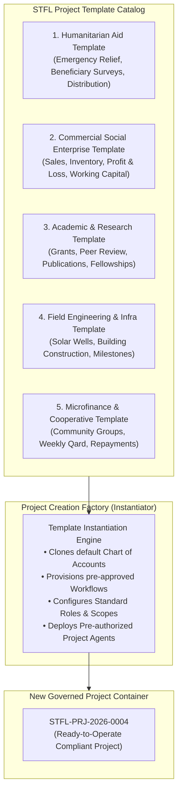

# STFL AIO — Project Archetype & Template System Specification
**Document Identity:** `STFL-DOC-2026-PROJ-TPL-V1`  
**Phase:** Prompt 12.5 (Multi-Project Architecture & Feature Control Map)  
**Status:** SPECIFICATION ONLY — RATIFIED (READ-ONLY ARCHITECTURE PHASE)  
**Security Classification:** INTERNAL ENTERPRISE SPECIFICATION  
**Authoritative Precedent:** Extends `STFL_AIO_CONSTITUTION.md`

---

## 1. Reusable Project Archetypes

To accelerate project spinning without sacrificing institutional governance, STFL AIO provides **Standardized Project Archetypes**. A template pre-packages proven configurations for roles, workflows, financial charts of accounts, documents, and agent configurations:



---

## 2. Six Canonical Archetype Profiles

### Archetype 1: Humanitarian Disaster Relief & Medical Mission (`TPL_HUMANITARIAN`)
- **Primary Modules:** Beneficiary Intake, Mobile Relief Distribution, Essential Medical Inventory.
- **Pre-Configured Roles:** Mission Director, Triage Doctor, Field Aid Worker, Relief Logistician.
- **Pre-Configured Workflows:** Emergency Relief Request ➔ Triage Verification ➔ Aid Distribution ➔ Photo/GPS Proof Capture.
- **Default COA:** Restricted Zakat Relief Fund, Medical Supplies Expense, Field Logistics Opex.
- **Bound Agents:** `STFL-AGT-MED-001` (Symptom intake assistant, Level 1), `STFL-AGT-AID-001` (Relief pack reconciliation, Level 2).

### Archetype 2: Commercial Social Enterprise (`TPL_COMMERCIAL_ENTERPRISE`)
- **Primary Modules:** E-Shop Product Catalog, Warehouse Inventory, Point of Sale (POS), Wholesale Invoicing.
- **Pre-Configured Roles:** Enterprise General Manager, Inventory Controller, Sales Officer, Procurement Lead.
- **Pre-Configured Workflows:** Purchase Order ➔ Goods Received Note ➔ Inventory Ledger Post ➔ Wholesale Invoice ➔ Cash Receipt.
- **Default COA:** Commercial Sales Revenue, Cost of Goods Sold (COGS), Warehouse Lease Opex, Customer Receivables.
- **Bound Agents:** `STFL-AGT-INV-001` (Reorder forecast agent, Level 2), `STFL-AGT-POS-001` (Daily batch reconciliation, Level 2).

### Archetype 3: Academic Research & Policy Institute (`TPL_RESEARCH_INSTITUTE`)
- **Primary Modules:** Research Grant Proposals, Fellowship Disbursements, Double-Blind Review, Digital Publishing.
- **Pre-Configured Roles:** Institute Director, Principal Investigator, Research Fellow, External Peer Reviewer.
- **Pre-Configured Workflows:** Paper Ingestion ➔ Reviewer Assignment ➔ Peer Review ➔ Editorial Decision ➔ Open-Access Publishing.
- **Default COA:** Research Grant Capital, Fellowship Stipends, Publication Subsidy Expense, Conference Travel.
- **Bound Agents:** `STFL-AGT-BIBL-001` (Literature citation verification, Level 1).

### Archetype 4: Field Infrastructure & Construction (`TPL_FIELD_INFRASTRUCTURE`)
- **Primary Modules:** Fixed Asset Register, Bill of Quantities (BOQ), Contractor Milestone Sign-off, Site Inspection.
- **Pre-Configured Roles:** Project Lead Engineer, Site Supervisor, Safety Inspector, Contractor Representative.
- **Pre-Configured Workflows:** Milestone Submission ➔ Site Photo/GPS Inspection ➔ Quality Sign-off ➔ Contractor Retention Release.
- **Default COA:** Capital Work-in-Progress (CWIP), Contractor Retention Payable, Structural Material Expense.
- **Bound Agents:** `STFL-AGT-ENG-001` (Satellite/GPS site audit comparator, Level 1).

### Archetype 5: Microfinance & Cooperative Qard (`TPL_MICROFINANCE_COOP`)
- **Primary Modules:** Cooperative Group Directory, Installment Schedules, Doorstep Cash Collection.
- **Pre-Configured Roles:** Microfinance Branch Manager, Field Credit Officer, Village Group Leader.
- **Pre-Configured Workflows:** Loan Application ➔ Group Guarantee Verification ➔ Dual-Signoff Approval ➔ Weekly Doorstep Collection.
- **Default COA:** Qard-al-Hasan Principal Receivable, Beneficiary Savings Liability, Provision for Distressed Loans.
- **Bound Agents:** `STFL-AGT-MF-001` (Repayment schedule generator, Level 2).

### Archetype 6: Institutional Grant Consortium (`TPL_GRANT_CONSORTIUM`)
- **Primary Modules:** Multi-Donor Milestones, Implementing Partner Sub-Grants, Formal Independent Audit Log.
- **Pre-Configured Roles:** Consortium Chief of Party, Compliance Officer, Partner Liaison, M&E Specialist.
- **Pre-Configured Workflows:** Partner Tranche Request ➔ M&E Verification ➔ Central Finance Sign-off ➔ Tranche Release.
- **Default COA:** Multilateral Grant Fund Restricted, Sub-Grantee Advances, Independent Audit Fees.

---

## 3. Template Safety & Constitutional Boundary

Templates are configuration bundles, **never** permission escalations:
1. **No Constitutional Override:** A template cannot declare `requires_device_binding: false` for operational roles, nor can it bypass the 13-dimensional authorization pipeline.
2. **Mandatory Auditing:** All actions performed within a template-generated project emit standard immutable records into `enterprise_audit_logs`.
3. **No Unbounded Agents:** No template can provision an agent with `max_authority_level > 3`.

---

## 4. Proposed Database Schema Specification

```sql
-- ---------------------------------------------------------------------------
-- Project Templates Catalog Table
-- ---------------------------------------------------------------------------
CREATE TABLE IF NOT EXISTS project_templates (
    id                   UUID PRIMARY KEY DEFAULT gen_random_uuid(),
    template_code        TEXT NOT NULL UNIQUE,          -- TPL_HUMANITARIAN, TPL_COMMERCIAL...
    name_bn              TEXT NOT NULL,
    name_en              TEXT NOT NULL,
    description          TEXT,
    project_type         TEXT NOT NULL,                 -- Matches platform_projects.project_type
    default_config_json  JSONB NOT NULL,                -- Contains default COA, roles, workflows, agent manifests
    is_active            BOOLEAN NOT NULL DEFAULT TRUE,
    created_at           TIMESTAMPTZ NOT NULL DEFAULT now()
);
```
