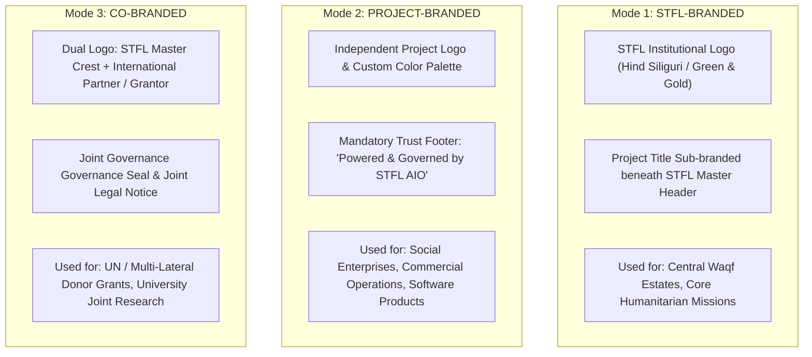
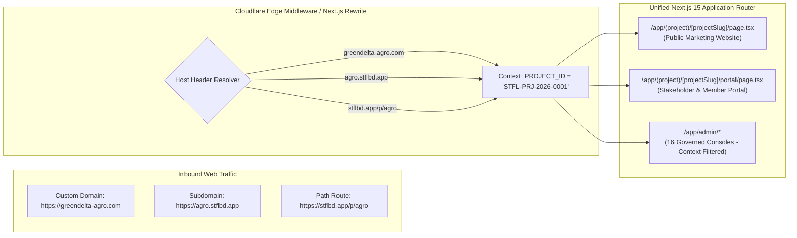

# STFL AIO — Project Website, Branding & Portal Model Specification
**Document Identity:** `STFL-DOC-2026-PROJ-WEB-V1`  
**Phase:** Prompt 12.5 (Multi-Project Architecture & Feature Control Map)  
**Status:** SPECIFICATION ONLY — RATIFIED (READ-ONLY ARCHITECTURE PHASE)  
**Security Classification:** INTERNAL ENTERPRISE SPECIFICATION  
**Authoritative Precedent:** Extends `STFL_AIO_BASELINE.md` (Next.js 15 Web Portal & Iconoir standards)

---

## 1. Master Brand vs. Project Brand Coexistence

STFL AIO supports three distinct institutional branding modes, ensuring projects can maintain distinct market presence, community resonance, or partner identity without diluting the SohaelTasneem Foundation's authoritative governance:



### Brand Safety Rules:
1. **Master Brand Invariance:** Project styling cannot overwrite global design tokens (`colors.brand`, `colors.trustee`, typography rules).
2. **Iconography Compliance:** All web interfaces, whether STFL core or project-branded, must strictly consume `iconoir-react` exclusively. No third-party icon libraries may be introduced.
3. **Mandatory Governance Footer:** Even completely independent project websites must render the cryptographic institutional trust mark:
   `"An initiative operated under the governance and audit of the SohaelTasneem Foundation (STFL)."`

---

## 2. Domain & Routing Topology

A project can be accessed through three flexible domain topologies managed dynamically via Cloudflare Workers and Next.js middleware:



---

## 3. The Four-Tier Portal Separation Architecture

To prevent accidental data exposure or privilege confusion, project web spaces are strictly compartmentalized:

```
┌────────────────────────────────────────────────────────────────────────┐
│ 1. PUBLIC MARKETING WEBSITE                                            │
│    URL: https://greendelta-agro.com/                                   │
│    Audience: General public, customers, beneficiaries, job seekers     │
│    Content: Story, mission, catalog, impact metrics, news, donation    │
│    Security: 100% public, static CDN cached, zero authenticated API    │
├────────────────────────────────────────────────────────────────────────┤
│ 2. STAKEHOLDER SELF-SERVICE PORTAL                                     │
│    URL: https://greendelta-agro.com/portal                             │
│    Audience: Project donors, commercial vendors, external partners     │
│    Content: Milestone tracker, purchase orders, payment receipts       │
│    Security: CLASS_11 authenticated, OTP / Magic-link, self-records    │
├────────────────────────────────────────────────────────────────────────┤
│ 3. PROJECT OPERATIONAL WORKSPACE (PROJECT CONSOLE)                     │
│    URL: https://greendelta-agro.com/workspace (or stflbd.app/workspace)│
│    Audience: Project Director, Field Lead, Project Accountant          │
│    Content: Project vouchers, field attendance, task management        │
│    Security: Attested Device, Project Context JWT, 13-D Authorization  │
├────────────────────────────────────────────────────────────────────────┤
│ 4. STFL CENTRAL ADMINISTRATION CONSOLES                                │
│    URL: https://stflbd.app/admin                                       │
│    Audience: Trustees (Class 01), Executive (Class 02), Central Audit  │
│    Content: 16 Governed Consoles, consolidated oversight, kill switch  │
│    Security: Hardware Device Required, Dual-Control, Central Vault     │
└────────────────────────────────────────────────────────────────────────┘
```

---

## 4. Proposed Database Schema Specification

```sql
-- ---------------------------------------------------------------------------
-- 1. Project Branding Profiles Table
-- ---------------------------------------------------------------------------
CREATE TABLE IF NOT EXISTS project_branding_profiles (
    id                   UUID PRIMARY KEY DEFAULT gen_random_uuid(),
    project_id           UUID NOT NULL REFERENCES platform_projects(id) ON DELETE CASCADE,
    branding_mode        TEXT NOT NULL CHECK (branding_mode IN ('STFL_BRANDED', 'PROJECT_BRANDED', 'CO_BRANDED')),
    logo_primary_url     TEXT NOT NULL,
    logo_dark_url        TEXT,
    logo_symbol_url      TEXT,
    favicon_url          TEXT,
    
    -- Design Tokens (Hex Strings)
    primary_color        VARCHAR(7) NOT NULL DEFAULT '#1E4D2B',   -- Primary Brand
    secondary_color      VARCHAR(7) NOT NULL DEFAULT '#D4AF37',   -- Accent
    neutral_dark_color   VARCHAR(7) NOT NULL DEFAULT '#1A1A1A',
    neutral_light_color  VARCHAR(7) NOT NULL DEFAULT '#F8F9FA',
    
    -- Typography Directives
    font_heading         TEXT NOT NULL DEFAULT 'Hind Siliguri',
    font_body            TEXT NOT NULL DEFAULT 'Inter',
    
    -- Letterhead & Document Stamping
    letterhead_template_id TEXT NOT NULL DEFAULT 'TPL-DEFAULT-LETTERHEAD',
    digital_stamp_url    TEXT,
    watermark_text       TEXT NOT NULL DEFAULT 'STFL GOVERNED INITIATIVE',
    
    metadata             JSONB NOT NULL DEFAULT '{}'::jsonb,
    created_at           TIMESTAMPTZ NOT NULL DEFAULT now(),
    updated_at           TIMESTAMPTZ NOT NULL DEFAULT now(),
    CONSTRAINT uq_proj_branding UNIQUE (project_id)
);

-- ---------------------------------------------------------------------------
-- 2. Project Website Configurations Table
-- ---------------------------------------------------------------------------
CREATE TABLE IF NOT EXISTS project_website_configs (
    id                   UUID PRIMARY KEY DEFAULT gen_random_uuid(),
    project_id           UUID NOT NULL REFERENCES platform_projects(id) ON DELETE CASCADE,
    primary_domain       TEXT UNIQUE,                   -- e.g. greendelta-agro.com
    subdomain_slug       TEXT UNIQUE,                   -- e.g. agro (agro.stflbd.app)
    custom_domains       TEXT[] NOT NULL DEFAULT '{}',
    ssl_status           TEXT NOT NULL DEFAULT 'ACTIVE' CHECK (ssl_status IN ('PENDING', 'ACTIVE', 'ERROR')),
    
    -- Enabled Public Sections (Feature Flags)
    has_public_website   BOOLEAN NOT NULL DEFAULT TRUE,
    has_donate_page      BOOLEAN NOT NULL DEFAULT FALSE,
    has_ecommerce_store  BOOLEAN NOT NULL DEFAULT FALSE,
    has_field_stories    BOOLEAN NOT NULL DEFAULT TRUE,
    has_impact_metrics   BOOLEAN NOT NULL DEFAULT TRUE,
    has_stakeholder_portal BOOLEAN NOT NULL DEFAULT TRUE,
    
    -- SEO & Social Graph Metadata
    meta_title_bn        TEXT,
    meta_title_en        TEXT,
    meta_description_bn  TEXT,
    meta_description_en  TEXT,
    og_image_url         TEXT,
    
    -- Contact & Social Channels
    contact_email        TEXT,
    contact_phone        TEXT,
    social_links_json    JSONB NOT NULL DEFAULT '{}'::jsonb,
    
    is_published         BOOLEAN NOT NULL DEFAULT FALSE,
    created_at           TIMESTAMPTZ NOT NULL DEFAULT now(),
    updated_at           TIMESTAMPTZ NOT NULL DEFAULT now(),
    CONSTRAINT uq_proj_website UNIQUE (project_id)
);

CREATE INDEX IF NOT EXISTS idx_proj_web_domain ON project_website_configs(primary_domain);
CREATE INDEX IF NOT EXISTS idx_proj_web_slug ON project_website_configs(subdomain_slug);
```
