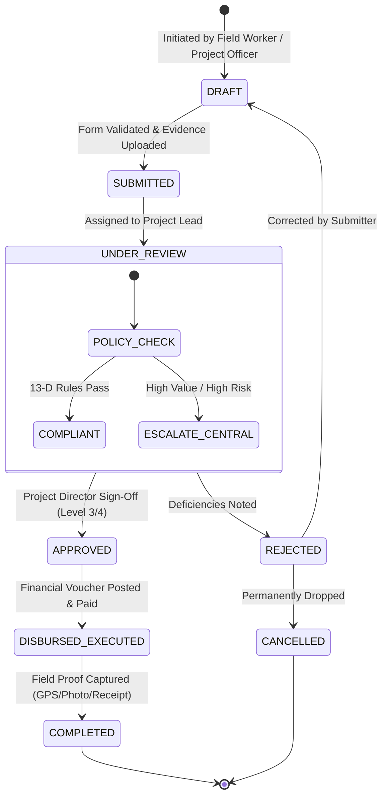

# STFL AIO — Project Workflow & Custom Business Logic Engine
**Document Identity:** `STFL-DOC-2026-PROJ-WF-V1`  
**Phase:** Prompt 12.5 (Multi-Project Architecture & Feature Control Map)  
**Status:** SPECIFICATION ONLY — RATIFIED (READ-ONLY ARCHITECTURE PHASE)  
**Security Classification:** INTERNAL ENTERPRISE SPECIFICATION  
**Authoritative Precedent:** Extends `STFL_APPROVAL_ENGINE.md` and `STFL_AIO_CONSTITUTION.md`

---

## 1. Modular Business Logic & Custom Project Workflows

Different projects require vastly different operational lifecycles:
- **Project A (Agro-Tech Enterprise):** Harvest Intake ➔ Quality Inspection ➔ Cold Storage Batching ➔ Wholesale Distribution ➔ Cash Reconciliation.
- **Project B (Maternal Health Mission):** Patient Intake ➔ Medical Triage ➔ Nutritional Aid Distribution ➔ Doctor Follow-up ➔ Impact Survey.
- **Project C (Research Institute):** Grant Proposal ➔ Ethics Review ➔ Field Data Collection ➔ Peer Review ➔ Open-Access Publishing ➔ Honorarium Disbursement.

Rather than hardcoding custom code into the platform core, STFL AIO establishes a **Declarative, Versioned Workflow Engine**.



---

## 2. Platform Safety Boundary: Inviolable Workflow Constraints

While projects enjoy broad flexibility in defining their operational steps, **no workflow configuration can bypass platform constitutional controls**:

1. **Anti-Collusion Invariant:** A workflow step cannot configure `creator_id == approver_id` or `approver_id == disburser_id`. The platform approval engine dynamically rejects self-approvals regardless of workflow JSON definitions.
2. **Agent Ceiling Invariant:** A workflow step cannot assign an automated action to an AI Agent (`CLASS_10`) if the action is categorized as Level 4 (Human Approval) or Level 5 (Dual Control).
3. **Audit Immutability Invariant:** Every workflow step transition writes an immutable record to `enterprise_audit_logs`. Workflows cannot disable auditing.
4. **Financial Constraint:** Any workflow step that triggers a monetary transaction must route to `project_vouchers` and strictly enforce `NUMERIC(18, 2)` double-entry balance.
5. **Hardware Security Constraint:** High-privilege transitions (approvals, disbursements, contract signing) require verified Android KeyStore device attestation.

---

## 3. Workflow Engine Components

```
┌────────────────────────────────────────────────────────────────────────┐
│                        WORKFLOW ENGINE ENTITIES                        │
├────────────────────────────────────────────────────────────────────────┤
│ 1. WORKFLOW DEFINITION (project_workflows):                            │
│    Metadata container for the business process (e.g. 'GRAIN_INTAKE').  │
├────────────────────────────────────────────────────────────────────────┤
│ 2. WORKFLOW VERSION (project_workflow_versions):                       │
│    Immutable, versioned snapshot (v1, v2) containing the state machine │
│    definition. In-flight instances stay pinned to their started version│
├────────────────────────────────────────────────────────────────────────┤
│ 3. WORKFLOW STEPS (project_workflow_steps):                            │
│    Individual operational states (e.g. 'QUALITY_CHECK', 'PAYMENT').    │
│    Specifies required inputs, allowed roles, and authority level.      │
├────────────────────────────────────────────────────────────────────────┤
│ 4. WORKFLOW TRANSITIONS (project_workflow_transitions):                │
│    Permitted paths between steps with conditional predicate logic      │
│    (e.g. 'IF amount > 50000 THEN require_trustee_approval').          │
├────────────────────────────────────────────────────────────────────────┤
│ 5. WORKFLOW INSTANCE (project_workflow_instances):                     │
│    Live runtime execution of a workflow tied to a specific resource    │
│    (e.g. Grain Batch #401), tracking current step and audit history.   │
└────────────────────────────────────────────────────────────────────────┘
```

---

## 4. Proposed Database Schema Specification

```sql
-- ---------------------------------------------------------------------------
-- 1. Project Workflows Definition
-- ---------------------------------------------------------------------------
CREATE TABLE IF NOT EXISTS project_workflows (
    id                   UUID PRIMARY KEY DEFAULT gen_random_uuid(),
    project_id           UUID NOT NULL REFERENCES platform_projects(id) ON DELETE CASCADE,
    workflow_code        TEXT NOT NULL,                 -- e.g. HARVEST_INTAKE, CLINIC_DISBURSEMENT
    name_bn              TEXT NOT NULL,
    name_en              TEXT NOT NULL,
    description          TEXT,
    target_entity_type   TEXT NOT NULL,                 -- e.g. VOUCHER, GRAIN_BATCH, CLINIC_PATIENT
    is_active            BOOLEAN NOT NULL DEFAULT TRUE,
    created_at           TIMESTAMPTZ NOT NULL DEFAULT now(),
    CONSTRAINT uq_proj_workflow UNIQUE (project_id, workflow_code)
);

-- ---------------------------------------------------------------------------
-- 2. Project Workflow Versions (Immutable Snapshots)
-- ---------------------------------------------------------------------------
CREATE TABLE IF NOT EXISTS project_workflow_versions (
    id                   UUID PRIMARY KEY DEFAULT gen_random_uuid(),
    workflow_id          UUID NOT NULL REFERENCES project_workflows(id) ON DELETE CASCADE,
    version_number       INTEGER NOT NULL,              -- 1, 2, 3...
    state_machine_json   JSONB NOT NULL,                -- Complete states, transitions, actions
    effective_from       TIMESTAMPTZ NOT NULL DEFAULT now(),
    effective_to         TIMESTAMPTZ,
    status               TEXT NOT NULL DEFAULT 'ACTIVE' CHECK (status IN ('DRAFT', 'ACTIVE', 'DEPRECATED')),
    approved_by_party_id UUID NOT NULL REFERENCES parties(id),
    created_at           TIMESTAMPTZ NOT NULL DEFAULT now(),
    CONSTRAINT uq_proj_wf_version UNIQUE (workflow_id, version_number)
);

-- ---------------------------------------------------------------------------
-- 3. Live Workflow Runtime Instances
-- ---------------------------------------------------------------------------
CREATE TABLE IF NOT EXISTS project_workflow_instances (
    id                   UUID PRIMARY KEY DEFAULT gen_random_uuid(),
    instance_id          TEXT NOT NULL UNIQUE,          -- STFL-WFI-2026-000042
    project_id           UUID NOT NULL REFERENCES platform_projects(id) ON DELETE RESTRICT,
    workflow_version_id  UUID NOT NULL REFERENCES project_workflow_versions(id) ON DELETE RESTRICT,
    target_resource_id   TEXT NOT NULL,                 -- e.g. STFL-AST-2026-00041
    current_state        TEXT NOT NULL,                 -- e.g. UNDER_REVIEW, APPROVED
    context_data_json    JSONB NOT NULL DEFAULT '{}'::jsonb,
    is_completed         BOOLEAN NOT NULL DEFAULT FALSE,
    is_terminated        BOOLEAN NOT NULL DEFAULT FALSE,
    initiated_by_party_id UUID NOT NULL REFERENCES parties(id),
    created_at           TIMESTAMPTZ NOT NULL DEFAULT now(),
    updated_at           TIMESTAMPTZ NOT NULL DEFAULT now()
);

-- ---------------------------------------------------------------------------
-- 4. Workflow Transition History (Audit Trail)
-- ---------------------------------------------------------------------------
CREATE TABLE IF NOT EXISTS project_workflow_history (
    id                   UUID PRIMARY KEY DEFAULT gen_random_uuid(),
    instance_id          UUID NOT NULL REFERENCES project_workflow_instances(id) ON DELETE CASCADE,
    from_state           TEXT NOT NULL,
    to_state             TEXT NOT NULL,
    actor_party_id       UUID NOT NULL REFERENCES parties(id),
    actor_type           TEXT NOT NULL CHECK (actor_type IN ('USER', 'AGENT')),
    action_taken         TEXT NOT NULL,
    comment              TEXT,
    metadata             JSONB NOT NULL DEFAULT '{}'::jsonb,
    transitioned_at      TIMESTAMPTZ NOT NULL DEFAULT now()
);

CREATE INDEX IF NOT EXISTS idx_proj_wf_inst_proj ON project_workflow_instances(project_id, is_completed);
CREATE INDEX IF NOT EXISTS idx_proj_wf_inst_res ON project_workflow_instances(target_resource_id);
CREATE INDEX IF NOT EXISTS idx_proj_wf_hist_inst ON project_workflow_history(instance_id);
```
