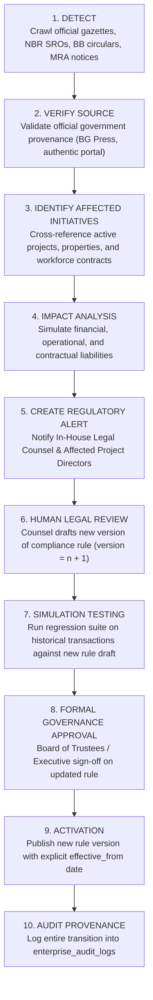

# STFL AIO — Regulatory Change Ingestion & Governance Model
**Document Identity:** `STFL-DOC-2026-CMP-CHG-V1`  
**Phase:** Prompt 12.5 Extension (Compliance, Regulatory & Legal Intelligence Layer)  
**Status:** SPECIFICATION ONLY — RATIFIED (READ-ONLY ARCHITECTURE PHASE)  
**Security Classification:** INTERNAL ENTERPRISE SPECIFICATION  
**Authoritative Precedent:** Extends `STFL_AIO_COMPLIANCE_ARCHITECTURE.md` and `STFL_AIO_DEVELOPMENT_DEPENDENCY_GRAPH.md`

---

## 1. Automated Detection without Autonomous Mutation

In high-stakes legal compliance, a critical architectural tension exists between **rapid awareness of legal changes** and **preventing rogue policy mutations**.

STFL AIO resolves this via the **Governed Ingestion Pipeline**:
- The platform's automated scanners actively monitor legal gazettes, regulator portals, and statutory SROs (Statutory Regulatory Orders).
- **Zero Silent Mutation Invariant:** No detected legal amendment, gazette notification, or circular can automatically mutate an active production compliance rule. All modifications require human legal verification, impact simulation, formal approval, and versioned promotion.



---

## 2. Dynamic Project Impact Analysis

When a new statutory directive is ingested (e.g. NBR issues SRO increasing withholding tax on commercial building rent from 5% to 7.5%):
1. **Target Identification:** The engine queries `platform_projects` and `property_compliance_profiles` where `tenure_type IN ('FREEHOLD', 'WAQF_LILLAH')` and active leases exist.
2. **Financial Exposure Modeling:** The engine calculates the aggregate BDT impact across all active leases.
3. **Automated Impact Matrix Generation:**
   ```json
   {
     "changeEventId": "REG-CHG-2026-0012",
     "statutorySource": "NBR SRO No. 182-Ain/2026/IncomeTax",
     "subject": "Withholding Tax on Commercial Tenancies",
     "previousRate": "5.00%",
     "newRate": "7.50%",
     "effectiveFrom": "2026-11-01",
     "impactAssessment": {
       "affectedProjectsCount": 3,
       "affectedTenanciesCount": 42,
       "annualCashFlowImpactBDT": 1850000.00,
       "requiredActions": [
         "Notify commercial tenants of revised deduction vouchers",
         "Update rent invoice calculation template"
       ]
     }
   }
   ```

---

## 3. Proposed Database Schema Specification

```sql
-- ---------------------------------------------------------------------------
-- 1. Regulatory Change Ingestion Events Table
-- ---------------------------------------------------------------------------
CREATE TABLE IF NOT EXISTS regulatory_change_events (
    id                   UUID PRIMARY KEY DEFAULT gen_random_uuid(),
    event_id             TEXT NOT NULL UNIQUE,          -- STFL-REG-2026-000012
    jurisdiction_id      UUID NOT NULL REFERENCES compliance_jurisdictions(id),
    title                TEXT NOT NULL,
    issuing_authority    TEXT NOT NULL,                 -- e.g. National Board of Revenue (NBR)
    statutory_reference  TEXT NOT NULL,                 -- SRO No. 182/2026
    official_gazette_url TEXT,
    publication_date     DATE NOT NULL,
    effective_date       DATE NOT NULL,
    raw_document_hash    TEXT NOT NULL,                 -- SHA-256 of official notification
    change_summary       TEXT NOT NULL,
    
    -- Processing Pipeline State
    status               TEXT NOT NULL DEFAULT 'DETECTED' CHECK (status IN (
                           'DETECTED', 'SOURCE_VERIFIED', 'IMPACT_EVALUATED', 
                           'UNDER_LEGAL_REVIEW', 'APPROVED_READY', 'ACTIVATED', 'REJECTED'
                         )),
    verified_by_party_id UUID REFERENCES parties(id),
    target_rule_code     TEXT,                          -- Mapped to compliance_rules.rule_code
    new_rule_version_id  UUID REFERENCES compliance_rules(id),
    created_at           TIMESTAMPTZ NOT NULL DEFAULT now()
);

-- ---------------------------------------------------------------------------
-- 2. Project Regulatory Impact Assessments Table
-- ---------------------------------------------------------------------------
CREATE TABLE IF NOT EXISTS regulatory_impact_assessments (
    id                   UUID PRIMARY KEY DEFAULT gen_random_uuid(),
    change_event_id      UUID NOT NULL REFERENCES regulatory_change_events(id) ON DELETE CASCADE,
    project_id           UUID NOT NULL REFERENCES platform_projects(id) ON DELETE CASCADE,
    impact_severity      TEXT NOT NULL CHECK (impact_severity IN ('NONE', 'LOW', 'MEDIUM', 'HIGH', 'CRITICAL')),
    financial_impact_est NUMERIC(18, 2) NOT NULL DEFAULT 0.00,
    operational_notes    TEXT NOT NULL,
    required_amendments  JSONB NOT NULL DEFAULT '[]'::jsonb,
    is_mitigated         BOOLEAN NOT NULL DEFAULT FALSE,
    mitigation_notes     TEXT,
    created_at           TIMESTAMPTZ NOT NULL DEFAULT now()
);

CREATE INDEX IF NOT EXISTS idx_reg_chg_status ON regulatory_change_events(status, effective_date);
CREATE INDEX IF NOT EXISTS idx_reg_impact_proj ON regulatory_impact_assessments(project_id, impact_severity);
```
