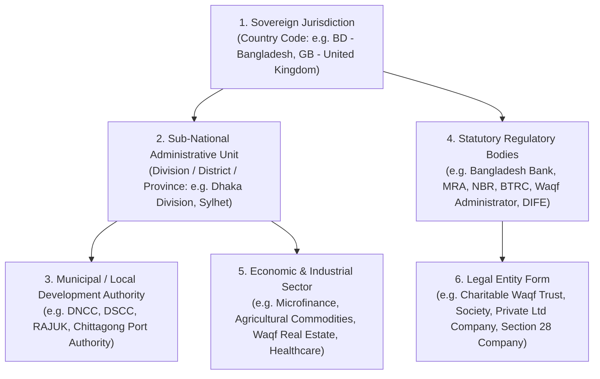
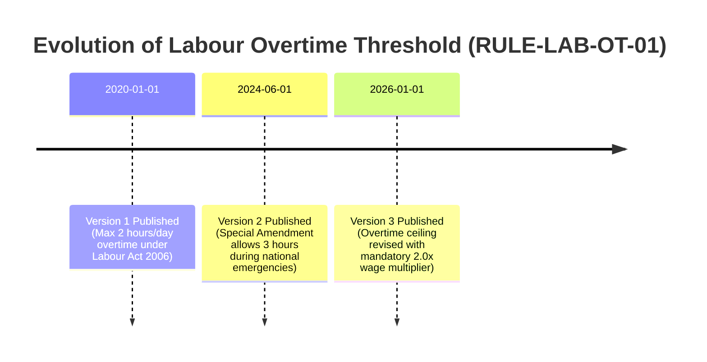

# STFL AIO — Compliance Rule Registry, Jurisdictions & Versioning Model
**Document Identity:** `STFL-DOC-2026-CMP-REG-V1`  
**Phase:** Prompt 12.5 Extension (Compliance, Regulatory & Legal Intelligence Layer)  
**Status:** SPECIFICATION ONLY — RATIFIED (READ-ONLY ARCHITECTURE PHASE)  
**Security Classification:** INTERNAL ENTERPRISE SPECIFICATION  
**Authoritative Precedent:** Extends `STFL_AIO_COMPLIANCE_ARCHITECTURE.md`

---

## 1. Multi-Dimensional Jurisdictional Intelligence

The platform rejects the simplistic assumption that one nation's laws apply uniformly across all operations. STFL AIO models legal jurisdiction as a multi-coordinate vector:

$$\mathbf{JurisdictionContext} = \left\langle \text{Country}, \text{SubDivision}, \text{Municipality}, \text{Regulator}, \text{EntityType}, \text{Industry}, \text{CrossBorder} \right\rangle$$



---

## 2. Universal Compliance Domain Taxonomy

Compliance rules are cataloged under 21 first-class domains:

| # | Compliance Domain | Canonical Code | Primary Regulatory Context | Representative Primary Legal Instruments |
|---|---|---|---|---|
| 01 | **Land & Real Property** | `LAND_PROPERTY` | Ownership, mutation, waqf deed, zoning | State Acquisition & Tenancy Act 1950, Waqf Ordinance 1962, Building Construction Act |
| 02 | **Lease & Tenancy** | `LEASE_TENANCY` | Commercial/residential leasing, evictions | Transfer of Property Act 1882, Premises Rent Control Act 1991 |
| 03 | **Labour & Employment** | `LABOUR_EMPLOYMENT`| Wages, working hours, safety, termination | Bangladesh Labour Act 2006 (Amended 2013/2018), Labour Rules 2015 |
| 04 | **Banking & Finance** | `FINANCE_BANKING` | Microfinance, interest-free Qard, lending | Microcredit Regulatory Authority Act 2006, Bank Company Act 1991 |
| 05 | **Taxation & Levies** | `TAXATION` | Corporate tax, VAT, withholding tax (AIT) | Income Tax Act 2023, Value Added Tax & Supplementary Duty Act 2012 |
| 06 | **Corporate Governance** | `CORPORATE` | Trust governance, board filings, statutory audits | Societies Registration Act 1860, Companies Act 1994, Trust Act 1882 |
| 07 | **Contracts & Commercial**| `CONTRACT` | Legality of consideration, indemnities, breach | Contract Act 1872, Sale of Goods Act 1930, Specific Relief Act |
| 08 | **Public Procurement** | `PROCUREMENT` | Fair bidding, vendor evaluation, limits | Public Procurement Act 2006 (PPA), Public Procurement Rules (PPR) |
| 09 | **Data Privacy & Records**| `DATA_PRIVACY` | PII protection, biometric data, consent | Cyber Security Act 2023, National Telecommunication Guidelines |
| 10 | **Cybersecurity & Cloud**| `CYBERSECURITY` | Cloud storage, cryptographic standards | National Cyber Security Policy, Bangladesh Bank ICT Guidelines |
| 11 | **Occupational Health/Safety**| `HEALTH_SAFETY` | Field worker safety, clinic sanitation | Factory Rules, Directorate of Inspection for Factories and Establishments (DIFE) |
| 12 | **Environmental Standards**| `ENVIRONMENT` | Waste disposal, agricultural pesticides | Bangladesh Environment Conservation Act 1995, Forest Act 1927 |
| 13 | **Immigration & Expatriates**| `IMMIGRATION` | Foreign volunteers, donor visas, work permits | Foreigners Act 1946, BIDA Work Permit Guidelines |
| 14 | **Licensing & Permits** | `LICENSING` | Trade licenses, fire safety, environmental clearance | City Corporation Trade Licensing Regulations, Fire Service Act |
| 15 | **Consumer Protection** | `CONSUMER` | E-Shop goods quality, pricing transparency | Consumer Rights Protection Act 2009 |
| 16 | **Anti-Fraud & Embezzlement**| `ANTI_FRAUD` | Dual-control disbursements, asset theft | Penal Code 1860, Prevention of Corruption Act 1947 |
| 17 | **Anti-Money Laundering** | `ANTI_CORRUPTION` | Politically exposed persons, suspicious funds | Money Laundering Prevention Act 2012, Anti-Terrorism Act 2009 |
| 18 | **Child & Adult Safeguarding**| `SAFEGUARDING` | Orphan welfare, protection against abuse | Children Act 2013, International Safeguarding Charters |
| 19 | **Institutional Grants** | `GRANTS` | Foreign donations, NGO Affairs Bureau clearance | Foreign Donations (Voluntary Activities) Regulation Act 2016 |
| 20 | **Funder Covenants** | `DONOR_REQUIREMENTS`| Specific restricted grant agreements | Bilateral Grant Agreements, Multilateral Bank Project Covenants |
| 21 | **Internal STFL Policy** | `INTERNAL_POLICY` | Constitution, Code of Conduct, Travel Policy | STFL Platform Constitution 2026, Foundation Trust Deed |

---

## 3. Strict Rule Versioning & Historical Evaluation Invariant

A fundamental legal reality is that **contracts and transactions must be judged by the law in force at the time the act occurred**.



### The Rule Versioning Invariant:
1. **Never Silently Overwrite:** Updating a compliance rule never mutates an existing row. It creates an explicit new `version` record with an effective start date (`effective_from`).
2. **Deterministic Time-Travel Evaluation:**  
   When auditing an expense voucher from `2024-08-15`, the engine evaluates:
   $$\mathbf{RulesEffectiveAt}(2024\text{-}08\text{-}15) \implies \text{Version 2}$$
   It **never** evaluates historical data against a future rule version.
3. **Formal Deprecation & Repeal:** When a statute or policy is repealed by parliament or the Board of Trustees, the rule's `status` transitions to `SUPERSEDED` or `REPEALED` with an exact `effective_until` timestamp.

---

## 4. Configurable Threshold Intelligence

Thresholds must be source-linked, numeric, and reviewable:

```json
{
  "ruleCode": "BD_PPR_QUOTATION_LIMIT",
  "thresholdType": "MONETARY_TRANSACTION",
  "currency": "BDT",
  "limitValue": 300000.00,
  "operator": "LESS_THAN_OR_EQUAL",
  "triggerAction": "procurement.request_for_quotation",
  "escalationIfExceeded": {
    "targetAction": "procurement.open_tender",
    "severity": "STATUTORY_HOLD",
    "requiredWorkflow": "OPEN_COMPETITIVE_TENDERING"
  },
  "sourceValidation": {
    "sourceType": "OFFICIAL_PRIMARY_SOURCE",
    "statute": "Public Procurement Rules 2008",
    "section": "Rule 69(1) - Request for Quotations Ceiling",
    "verifiedByLegalCounsel": true
  }
}
```

---

## 5. Proposed Database Schema Specification

```sql
-- ---------------------------------------------------------------------------
-- 1. Compliance Jurisdictions Table
-- ---------------------------------------------------------------------------
CREATE TABLE IF NOT EXISTS compliance_jurisdictions (
    id                   UUID PRIMARY KEY DEFAULT gen_random_uuid(),
    jurisdiction_code    TEXT NOT NULL UNIQUE,          -- e.g. JUR-BD-DHAKA-CENTRAL
    country_code         CHAR(2) NOT NULL DEFAULT 'BD', -- ISO 3166-1 alpha-2
    subdivision_name     TEXT,                          -- e.g. Dhaka Division
    municipality_name    TEXT,                          -- e.g. RAJUK / DNCC
    regulatory_body      TEXT NOT NULL,                 -- e.g. Bangladesh Bank, MRA, DIFE
    sector_code          TEXT NOT NULL,                 -- e.g. MICROFINANCE, WAQF_PROPERTY
    entity_type          TEXT NOT NULL,                 -- e.g. CHARITABLE_TRUST, SOCIETY
    metadata             JSONB NOT NULL DEFAULT '{}'::jsonb,
    is_active            BOOLEAN NOT NULL DEFAULT TRUE,
    created_at           TIMESTAMPTZ NOT NULL DEFAULT now()
);

-- ---------------------------------------------------------------------------
-- 2. Compliance Rule Registry (Immutable Versioned Rules)
-- ---------------------------------------------------------------------------
CREATE TABLE IF NOT EXISTS compliance_rules (
    id                   UUID PRIMARY KEY DEFAULT gen_random_uuid(),
    rule_id              TEXT NOT NULL,                 -- STFL-RL-LAND-001
    rule_code            TEXT NOT NULL,                 -- BD_WAQF_TRANSFER_RESTRICTION
    version              INTEGER NOT NULL DEFAULT 1,    -- Increments on amendment
    title_bn             TEXT NOT NULL,
    title_en             TEXT NOT NULL,
    domain               TEXT NOT NULL CHECK (domain IN (
                           'LAND_PROPERTY', 'LEASE_TENANCY', 'LABOUR_EMPLOYMENT', 'FINANCE_BANKING', 
                           'TAXATION', 'CORPORATE', 'CONTRACT', 'PROCUREMENT', 'DATA_PRIVACY', 
                           'CYBERSECURITY', 'HEALTH_SAFETY', 'ENVIRONMENT', 'IMMIGRATION', 
                           'LICENSING', 'CONSUMER', 'ANTI_FRAUD', 'ANTI_CORRUPTION', 
                           'SAFEGUARDING', 'GRANTS', 'DONOR_REQUIREMENTS', 'INTERNAL_POLICY'
                         )),
    jurisdiction_id      UUID NOT NULL REFERENCES compliance_jurisdictions(id) ON DELETE RESTRICT,
    authority_name       TEXT NOT NULL,                 -- e.g. Ministry of Land, NBR
    
    -- Provenance & Sources
    source_type          TEXT NOT NULL CHECK (source_type IN (
                           'OFFICIAL_PRIMARY_SOURCE', 'OFFICIAL_REGULATOR', 'COURT_JUDICIAL_SOURCE', 
                           'GOVERNMENT_GUIDANCE', 'RECOGNIZED_STANDARD', 'CONTRACTUAL_REQUIREMENT', 
                           'INTERNAL_POLICY', 'SECONDARY_LEGAL_SOURCE', 'AI_INFERRED_INTERPRETATION'
                         )),
    source_reference     TEXT NOT NULL,                 -- Act No. X of 2006, Section 4(2)
    official_gazette_ref TEXT,
    
    -- Temporal Boundaries
    effective_from       DATE NOT NULL,
    effective_until      DATE,
    
    -- Evaluation Rules & Thresholds
    applicability_json   JSONB NOT NULL DEFAULT '{}'::jsonb,
    threshold_json       JSONB NOT NULL DEFAULT '{}'::jsonb,
    severity             TEXT NOT NULL CHECK (severity IN (
                           'INFO', 'ADVISORY', 'WARNING', 'REVIEW_REQUIRED', 'STATUTORY_HOLD', 'CRITICAL_PROHIBITION'
                         )),
    required_action      TEXT NOT NULL CHECK (required_action IN (
                           'NOTIFY', 'DOCUMENT_REQUIRED', 'DUAL_LEGAL_REVIEW', 'ESCALATE_TRUSTEES', 'ABORT_IMMEDIATELY'
                         )),
    escalation_level     INTEGER NOT NULL DEFAULT 2 CHECK (escalation_level BETWEEN 1 AND 5),
    human_review_required BOOLEAN NOT NULL DEFAULT TRUE,
    
    -- Verification & Status
    status               TEXT NOT NULL DEFAULT 'ACTIVE' CHECK (status IN (
                           'DRAFT', 'ACTIVE', 'SUPERSEDED', 'REPEALED', 'UNDER_CHALLENGE'
                         )),
    superseded_by_id     UUID REFERENCES compliance_rules(id),
    confidence_score     NUMERIC(5, 4) NOT NULL DEFAULT 1.0000,
    last_verified_at     TIMESTAMPTZ NOT NULL DEFAULT now(),
    verified_by_party_id UUID NOT NULL REFERENCES parties(id),
    
    metadata             JSONB NOT NULL DEFAULT '{}'::jsonb,
    created_at           TIMESTAMPTZ NOT NULL DEFAULT now(),
    CONSTRAINT uq_rule_version UNIQUE (rule_id, version)
);

CREATE INDEX IF NOT EXISTS idx_compliance_rule_lookup ON compliance_rules(domain, status, effective_from, effective_until);
CREATE INDEX IF NOT EXISTS idx_compliance_rule_code ON compliance_rules(rule_code, version);
CREATE INDEX IF NOT EXISTS idx_compliance_rule_jurisdiction ON compliance_rules(jurisdiction_id);
```
