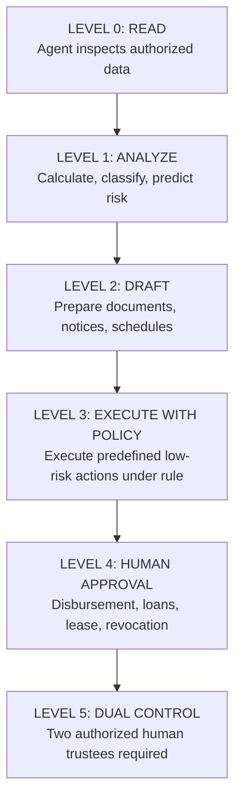
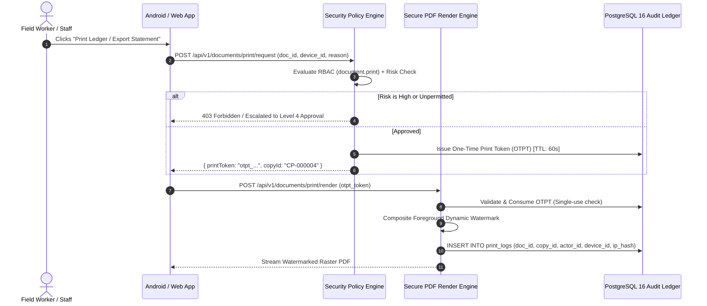
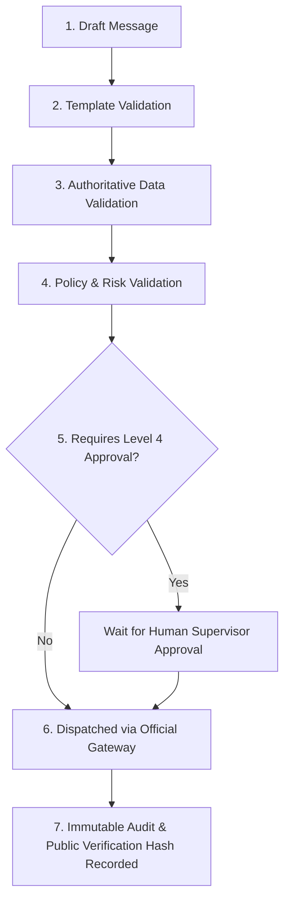
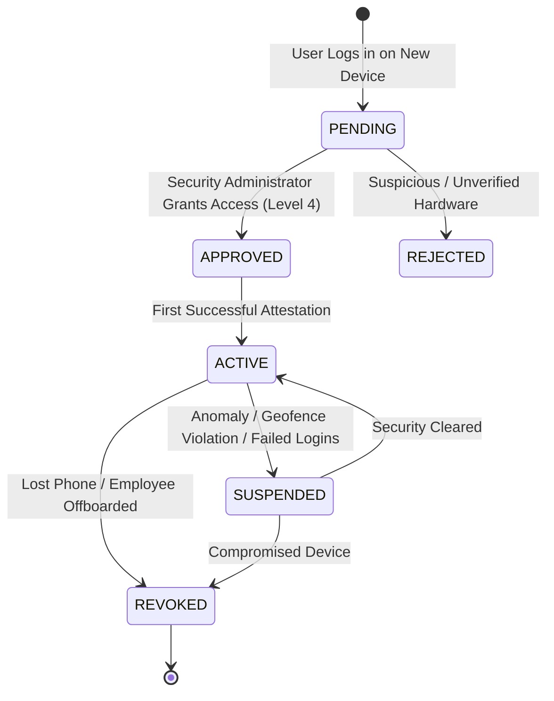

# STFL AIO — Security & Governance Model Specification

**System:** SohaelTasneem Foundation (STFL) Autonomous Enterprise Platform  
**Document Identity:** `STFL-DOC-2026-SEC-V1`  
**Date:** 2026-10-15  
**Status:** SECURITY MODEL SPECIFICATION — RATIFIED (PHASE 0)  
**Security Level:** RESTRICTED

---

## 1. Governance & Authority Classification

To enforce absolute institutional integrity, STFL divides all digital and agentic actions into six non-negotiable authority levels:



| Level | Classification | Permitted Actions | Approval Requirement |
|---|---|---|---|
| **LEVEL 0** | **READ** | Inspect read-only records scoped by RBAC (e.g. read active lease, check inventory balance). | None (Autonomous) |
| **LEVEL 1** | **ANALYZE** | Compute variance, score borrower credit, identify delinquent accounts, categorize expenses. | None (Autonomous) |
| **LEVEL 2** | **DRAFT** | Prepare uncommitted payment vouchers, draft WhatsApp notices, prepare rent invoices, draft reports. | None (Autonomous) |
| **LEVEL 3** | **EXECUTE WITH POLICY** | Assign field inspection task, update low-stock warning state, send pre-scheduled system reminder. | Autonomous within policy constraints |
| **LEVEL 4** | **HUMAN APPROVAL** | Financial disbursement, loan origination/approval, tenancy lease approval, document revocation, device activation, mass communications. | **Single Authorized Human Approver** |
| **LEVEL 5** | **DUAL CONTROL** | Modifying chart of accounts, emergency funds disbursement > 50,000 BDT, altering database access policies, permanent asset disposal. | **Two Independent Human Trustees** |

---

## 2. Security Pillar 1: Controlled Printing & Forensic Copy Tracking

Physical printouts and PDF exports of financial ledgers, tenant rosters, and microfinance records represent critical leak surfaces.



### 2.1 Default Policy
* **`PRINT = DENIED`** by default across all roles and clients.
* Printing requires the `document.print` permission and a verified, active device registration.

### 2.2 The One-Time Print Token (OTPT)
* Cryptographically random 256-bit token generated server-side.
* Lifetime: Exactly 60 seconds.
* Strictly single-use: Immediately invalidated in the database upon first render request.
* Strictly scoped: Bound to `document_id`, `actor_id`, `device_id`, and client IP hash.

### 2.3 Dynamic Foreground Watermark Specification
For any controlled or confidential document, the render engine burns a diagonal semi-transparent watermark pattern into the document layer:
```
STFL CONFIDENTIAL • USER: STFL-USR-00421 • DEV: STFL-DVC-8F31A2 • 2026-10-15 07:42:19 • COPY: CP-000004
```
* **Visual Density**: 12% alpha opacity, rotated at -35 degrees, repeated at 120pt intervals.
* **Copy Identity**: Every individual export or print produces a dedicated institutional copy ID (`CP-{SEQUENCE:6}`).

### 2.4 Invisible Steganographic Boundary & Forensic Integrity
* **Technical Stance**: Steganography is **never** treated as an infallible legal proof. Photocopiers, physical paper damage, low-resolution scanning, and document shredding destroy digital micro-steganography.
* **Implementation Boundary**: Any invisible tracking implemented will be treated as secondary forensic assistance only. Primary legal attribution rests on:
  1. The visible dynamic watermark overlay.
  2. The cryptographic copy ledger in `print_logs`.
  3. The authoritative audit trail in `audit_logs`.

---

## 3. Security Pillar 2: Governed Communications Gateway

Field staff must never send unauthorized promises, payment receipts, or threatening collection notices on behalf of the foundation.



### 3.1 Gateway Pipeline Rules
1. **Template Whitelisting**: Outbound messages on WhatsApp, Email, and SMS must conform to pre-approved, versioned bilingual templates (`STFL-TPL-MSG-{TYPE}-V{N}`).
2. **Authoritative Field Resolution**: Dynamic fields (`{{borrower_name}}`, `{{amount}}`, `{{due_date}}`, `{{property_code}}`) must be resolved directly against PostgreSQL authoritative tables by the backend. **Agents and field users cannot manually override numerical or financial variables.**
3. **Cryptographic Verification Reference**:
   * Official outbound messages contain an official verification URL:
     `https://stflbd.app/v/{verification_code}`
   * Resolving this URL on the public portal confirms:
     * Official issuer: SohaelTasneem Foundation.
     * Transaction context: Official receipt / notice reference.
     * Issuance timestamp.
     * Revocation status (ACTIVE, SUPERSEDED, or REVOKED).
     * **Data Privacy Gate**: The public verification endpoint reveals zero beneficiary PII, no private phone numbers, no bank account details, and no internal notes.

---

## 4. Security Pillar 3: Hardware-Backed Device Identity & Screen Security

Because field staff access sensitive records on mobile smartphones, physical device security is paramount.

### 4.1 DeviceIdentityProvider Subsystem Architecture
Rather than hardcoding a fragile identifier like IMEI (deprecated and restricted in modern Android), the system employs a multi-factor `DeviceIdentityProvider`:

```kotlin
// Conceptual Hardware Identity Composition in apk/security/
data class DeviceRegistrationPayload(
    val deviceInstallationId: String,       // Secure installation GUID
    val keyStorePublicKeyBlob: String,       // Hardware-backed ECDSA public key
    val keyStoreHardwareBacked: Boolean,     // True if StrongBox / TEE backed
    val mediaDrmWidevineId: String?,         // Hardware Widevine device identity
    val platformVersion: Int,                // Android SDK version
    val deviceModel: String                  // Manufacturer & Model label
)
```

### 4.2 Device Approval Lifecycle
Every device must be explicitly bound and approved before accessing non-public data:



### 4.3 Screen Classification & `FLAG_SECURE`
Screens in the STFL Android application are classified into four security tiers:

| Tier | Screen Class | Enforced Controls |
|---|---|---|
| **PUBLIC** | Splash, Explore, Public News, About, Public Stories | Standard rendering. Screenshots permitted. Full accessibility. |
| **NORMAL** | Volunteer profile, generic settings, public contact | Standard rendering. Normal clipboard access. |
| **SENSITIVE** | Property overview, employee duty log, project survey | Ephemeral session timeout (15 min). Masked sensitive fields. |
| **HIGHLY_SENSITIVE** | Microfinance borrower records, Cash collection screen, Financial ledger, Property tenancy deeds | **`FLAG_SECURE` ENFORCED** (OS blocks screenshots, screen recording, and recent-app previews). **Dynamic Canvas Watermark** active. Clipboard access blocked. |

### 4.4 Dynamic Foreground Canvas Watermark (Camera Protection)
On `HIGHLY_SENSITIVE` screens, to prevent a field worker or adversary from taking a physical photo of the screen with a secondary device:
* A subtle, moving composited canvas overlay renders:
  ```
  STFL-USR-00421 • STFL-DVC-8F31A2 • 2026-10-15 07:42:19
  ```
* **Design Guidelines**:
  * Rendered at 8% alpha opacity in neutral grey.
  * Translates position by 15 pixels every 30 seconds to prevent visual burn-in and combat camera framing.
  * Excludes full phone numbers, passwords, or beneficiary private details.
  * Does not interfere with button taps or touch target accessibility.

---

## 5. Field Proof Model

Ground operations (cash handoffs, physical inspections, aid distribution) generate an immutable `FieldProofObject`:

$$\mathbf{ProofHash} = \text{SHA-256}(\text{RawBytes} \parallel \text{TaskID} \parallel \text{ActorID} \parallel \text{DeviceID} \parallel \text{Timestamp})$$

* **Proof Schema Attributes**:
  * `proof_uuid`: Machine UUID.
  * `task_id`: Associated agent task.
  * `actor_id`: Field worker user ID.
  * `device_id`: Attested hardware device ID.
  * `created_at`: Millisecond timestamp.
  * `proof_type`: `PHOTO`, `CUSTOMER_SIGNATURE`, `CASH_RECEIPT`, `METER_READING`.
  * `storage_reference`: Private R2 key (`/private/proofs/...`).
  * `sha256`: Cryptographic hash of the proof payload.
  * `metadata`: JSON payload containing operational context.
  * `geo_point`: Lat/Long captured **only** when operationally required (e.g. disaster relief distribution, property inspection). Stored exclusively in the private schema; never revealed on public portals.
