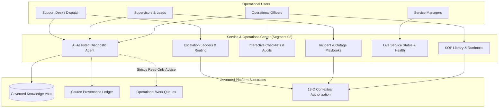

# STFL AIO — Service & Operations Center Model (Segment 02)

**System:** SohaelTasneem Foundation (STFL) Autonomous Enterprise Platform  
**Document Identity:** `STFL-DOC-2026-SRV-CTR-V1`  
**Date:** 2026-10-15  
**Status:** SPECIFICATION — RATIFIED (SECTIONS 65, 76)  
**Security Level:** INTERNAL USE ONLY  

---

## 1. Executive Summary & Purpose

Segment 02 of the STFL Knowledge, Training & Service Ecosystem establishes the authoritative **Service & Operations Center**. While Segment 01 focuses on educational pedagogy and external participant empowerment, Segment 02 provides active, mission-critical operational support for:
- Service managers and department heads
- Field supervisors and unit leads
- Operational and administrative officers
- Support desk personnel and system dispatchers
- Project-specific operational delivery teams

The Service & Operations Center transforms static documentation into an executable operational cockpit containing:
1. **Governed SOP Library**: Step-by-step Standard Operating Procedures linked to system workflows.
2. **Operational Manuals**: Institutional runbooks for multi-unit and cross-project operations.
3. **Incident Procedures & Playbooks**: Rapid-response protocols for operational, technical, and environmental failures.
4. **Escalation Ladders**: Deterministic escalation paths ensuring zero unmanaged blockers.
5. **Interactive Checklists**: Operational guardrails for pre-flight, daily closing, and audit reconciliation tasks.
6. **Live Service Status & Telemetry**: Real-time awareness of system health, project APIs, and operational bottlenecks.
7. **AI-Assisted Troubleshooting**: Provenance-grounded diagnostic assistance operating strictly within approved knowledge sources without hallucination or privilege escalation.

---

## 2. Core Service Capabilities & Architecture



---

## 3. SOP Library & Operational Runbook Engine

Standard Operating Procedures (SOPs) within STFL AIO are structured as active digital contracts rather than passive text files:

### 3.1 SOP Structure Specification
Every SOP document contains structured metadata and discrete execution steps:
- `sop_id`: Globally unique identifier (`SOP-{UNIT}-{CODE}-{VERSION}`).
- `title` & `summary`: Plain-language objective and operational scope.
- `applicable_roles`: Array of valid User Classes and System Roles (e.g. `[CLASS_04, CLASS_06, CLASS_07]`).
- `applicable_projects`: Scope boundary (`GLOBAL_STFL` or specific Project UUIDs).
- `prerequisites`: Required physical equipment, verified device attestation, and completed training certifications (`cert_code`).
- `steps`: Array of ordered procedural steps, each featuring:
  - Step index and title.
  - Required inputs and validation rules.
  - Linked platform actions (e.g. `api_endpoint: "/api/v1/finance/disburse"`).
  - Safety and compliance warnings.
  - Expected output / verification evidence.
- `escalation_trigger`: Boundary conditions requiring immediate supervisor escalation (e.g. discrepancy > 5,000 BDT).
- `provenance_hash`: SHA-256 hash linking the SOP to its ratified policy source.

### 3.2 Pre-Flight & Operational Checklists
Checklists enforce procedural completeness before sensitive actions can proceed:
- **Mandatory Daily Opening Checklist**: Cash drawer reconciliation, biometric terminal check, secure printer online verification.
- **Project Distribution Checklist**: Beneficiary identity verification, dual-custody parcel tally, temperature log check for medical supplies.
- **End-of-Day Ledger Checklist**: Unposted transaction sweep, cash deposit drop verification, supervisor cryptographic counter-signature.

---

## 4. Incident Management & Escalation Ladders

When operations encounter disruptions (network failure, equipment breakdown, beneficiary dispute, physical hazard), the Service Center provides deterministic resolution playbooks:

### 4.1 Incident Classification Matrix
| Severity Level | Definition | Response SLA | Minimum Handler | Escalation Target |
|---|---|---|---|---|
| **SEV-1 (Critical)** | Core service down, financial breach risk, life safety hazard | 15 Minutes | Super Admin / Security Lead | Board of Trustees, Executive Director |
| **SEV-2 (High)** | Major project workflow blocked, payment gateway failure, mass login failure | 1 Hour | Unit Head / Service Manager | IT Director, Compliance Head |
| **SEV-3 (Medium)** | Single-user device lockout, printer malfunction, non-critical data delay | 4 Hours | Relief Moderator / Ops Officer | Unit Supervisor |
| **SEV-4 (Low)** | Minor cosmetic UI issue, knowledge article typo, feature inquiry | 24 Hours | Support Desk / Moderator A | Knowledge Curator |

### 4.2 Deterministic Escalation Protocol
1. **Trigger**: An operational officer flags an issue in the Service Center or an automated monitor trips.
2. **Classification**: System matches incident attributes against the severity matrix.
3. **Queue Insertion**: Placed into the Moderator / Support Work Queue with SLA countdown timer.
4. **Relief Routing**: If unassigned after 50% SLA elapsed, automatically reassigned to `MODERATOR_A` or `MODERATOR_B`.
5. **Executive Escalation**: If SLA breaches, automatic push notification and SMS sent to the designated Unit Head and Governance Officer.

---

## 5. AI-Assisted Troubleshooting Engine (Section 76)

The platform incorporates an AI Operational Diagnostics Assistant embedded directly within the Service Center.

### 5.1 Constitutional Guardrails for AI Diagnostics
1. **Zero Hallucination / Approved Corpus Only**: The AI diagnostic agent **only** queries ratified, versioned, and active knowledge articles, SOPs, and system manuals in `knowledge_articles`. It cannot invent procedures or cite unverified external sources.
2. **Mandatory Source Provenance**: Every response emitted by the AI service assistant must cite:
   - Article UUID and version number.
   - Specific section and step index.
   - Effective date and ratification authority.
3. **No Autonomous Authority Escalation**: The AI assistant provides advice and diagnostic step recommendations; it **cannot** trigger state-altering transactions, grant temporary permissions, or bypass compliance holds.
4. **Outdated Knowledge Flagging**: If the AI detects that an operational question concerns a superseded SOP, an expiring regulatory rule, or an unindexed error code, it must:
   - Refuse to speculate.
   - Mark the query with status `ESCALATE_SOURCE_REVIEW`.
   - Dispatch a notification to the Knowledge Governance Officer.

### 5.2 Diagnostic Interaction Workflow
```
[Operational Officer in Field] ──> "Error 4021: Cash Drawer Lockout on POS Terminal #4"
                                            │
                                            ▼
                               [AI Service Assistant]
                                            │
                     ┌──────────────────────┴──────────────────────┐
                     ▼                                             ▼
          [Query Approved SOPs]                         [Verify Current Status]
                     │                                             │
                     └──────────────────────┬──────────────────────┘
                                            ▼
                           [Grounded Diagnostic Answer]
  "Step 1: Check hardware tamper seal on bottom of terminal.
   Step 2: Enter Supervisor Physical Override Key #2.
   Step 3: If code persists, terminal is in TAMPER_LOCK.
           Run SOP-SEC-TERM-09 (Section 4.2).
   Source: [SOP-SEC-TERM-09 v2.4 (Approved 2026-08-12)]"
```

---

## 6. Live Service Status & Operational Telemetry

The Service Center presents a consolidated operational dashboard tracking:
- **Core Infrastructure Health**: API Gateway latency, database replication lag, cryptographic attestation service availability.
- **Third-Party Rail Status**: bKash/Nagad payment gateway uptime, SMS/telephony aggregators, government NID verification portal status.
- **Project-Level Pipelines**: Active loan disbursement queues, hospital patient intake pipelines, agricultural dispatch batches.
- **Active Operational Alerts**: Weather hazard warnings for field zones, local regulatory inspection notices, scheduled maintenance windows.

---

## 7. PostgreSQL Schema: Service Knowledge & Incidents

```sql
-- Standard Operating Procedures (SOPs)
CREATE TABLE IF NOT EXISTS service_sops (
    id                  UUID PRIMARY KEY DEFAULT gen_random_uuid(),
    sop_code            TEXT NOT NULL UNIQUE,          -- e.g. SOP-FIN-DISB-01
    title               TEXT NOT NULL,
    summary             TEXT NOT NULL,
    version             INTEGER NOT NULL DEFAULT 1,
    unit_code           TEXT NOT NULL,                 -- e.g. FINANCE, PROPERTY, MICROFINANCE
    project_id          UUID REFERENCES projects(id) ON DELETE CASCADE, -- NULL if Global STFL
    required_cert_code  TEXT,                          -- Prerequisite certification if mandatory
    steps_json          JSONB NOT NULL DEFAULT '[]'::jsonb,
    prerequisites_json  JSONB NOT NULL DEFAULT '[]'::jsonb,
    escalation_json     JSONB NOT NULL DEFAULT '{}'::jsonb,
    status              TEXT NOT NULL CHECK (status IN ('DRAFT', 'UNDER_REVIEW', 'APPROVED', 'SUPERSEDED', 'ARCHIVED')),
    approved_by         UUID REFERENCES users(id),
    approved_at         TIMESTAMPTZ,
    effective_date      DATE NOT NULL DEFAULT CURRENT_DATE,
    superseded_date     DATE,
    provenance_hash     TEXT NOT NULL,
    created_at          TIMESTAMPTZ NOT NULL DEFAULT now(),
    updated_at          TIMESTAMPTZ NOT NULL DEFAULT now()
);

-- Operational Incidents & Service Tickets
CREATE TABLE IF NOT EXISTS service_incidents (
    id                  UUID PRIMARY KEY DEFAULT gen_random_uuid(),
    incident_number     TEXT NOT NULL UNIQUE,          -- e.g. INC-2026-00412
    title               TEXT NOT NULL,
    description         TEXT NOT NULL,
    severity            TEXT NOT NULL CHECK (severity IN ('SEV-1', 'SEV-2', 'SEV-3', 'SEV-4')),
    status              TEXT NOT NULL CHECK (status IN ('OPEN', 'INVESTIGATING', 'ESCALATED', 'RESOLVED', 'CLOSED')),
    reported_by         UUID NOT NULL REFERENCES users(id),
    assigned_to         UUID REFERENCES users(id),     -- Assigned Officer or Relief Moderator
    project_id          UUID REFERENCES projects(id),
    unit_code           TEXT NOT NULL,
    linked_sop_id       UUID REFERENCES service_sops(id),
    escalation_target   TEXT,                          -- e.g. UNIT_HEAD, SECURITY_LEAD, TRUSTEE
    resolution_summary  TEXT,
    resolved_at         TIMESTAMPTZ,
    sla_deadline        TIMESTAMPTZ NOT NULL,
    created_at          TIMESTAMPTZ NOT NULL DEFAULT now(),
    updated_at          TIMESTAMPTZ NOT NULL DEFAULT now()
);

CREATE INDEX IF NOT EXISTS idx_service_sops_code ON service_sops(sop_code, version);
CREATE INDEX IF NOT EXISTS idx_service_incidents_sev ON service_incidents(severity, status);
CREATE INDEX IF NOT EXISTS idx_service_incidents_assignee ON service_incidents(assigned_to);
```

---

## 8. Summary of Service Center Guarantees

1. **No Outdated Workflows**: Operators are never served superseded or draft SOPs.
2. **Full Provenance Transparency**: All operational troubleshooting suggestions trace back directly to ratified manuals.
3. **Automatic Relief Escalation**: System bottlenecks and unhandled tickets escalate automatically through deterministic ladders.
4. **Zero Administrative Single Point of Failure**: Operations continue uninterrupted via distributed procedural playbooks and monitored relief queues.
