# STFL AIO — Verification & Quality Assurance Test Plan

**System:** SohaelTasneem Foundation (STFL) Autonomous Enterprise Platform  
**Document Identity:** `STFL-DOC-2026-TEST-V1`  
**Date:** 2026-10-15  
**Status:** MASTER TEST PLAN — RATIFIED (PHASE 0)  
**Assurance Standard:** ZERO UNVERIFIED CLAIMS / 100% EVIDENCE BASED

---

## 1. Quality Gates & Release Criteria

No implementation phase may advance to the next phase without satisfying the 14 mandatory quality gates:

```mermaid
graph LR
    subgraph BuildAndCode ["Code & Static Gates"]
        G1[1. BUILD = PASS]
        G2[2. NO SECRET LEAKS]
        G3[3. NO DEV ENDPOINTS IN PROD]
    end

    subgraph AutomatedTesting ["Automated Verification Gates"]
        G4[4. UNIT TESTS = PASS]
        G5[5. INTEGRATION TESTS = PASS]
        G6[6. SECURITY TESTS = PASS]
        G7[7. API CONTRACT = VERIFIED]
        G8[8. ANDROID SUITE = VERIFIED]
        G9[9. WEB SUITE = VERIFIED]
    end

    subgraph DataAndSecurity ["Integrity & Governance Gates"]
        G10[10. DB MIGRATION = VERIFIED]
        G11[11. AUDIT TRAIL = VERIFIED]
        G12[12. RBAC ENFORCEMENT = VERIFIED]
        G13[13. NO DATA LOSS = PASS]
        G14[14. ROLLBACK PLAN = VERIFIED]
    end

    BuildAndCode --> AutomatedTesting --> DataAndSecurity
```



* **Reporting Standard**: Statuses are recorded strictly as `PASS`, `FAIL`, `BLOCKED`, or `NOT VERIFIED`. Never mark an unexercised scenario as `PASS`.

---

## 2. Test Execution Matrix: 21 Mandatory Scenarios

The test framework evaluates 21 end-to-end security, operational, and agentic workflows:

| # | Test Scenario Code | Scope | Target Invariant & Acceptance Criteria | Verification Tool / Suite |
|---|---|---|---|---|
| 1 | `TC-AUTH-01` | Normal Login | Valid credentials issue short-lived JWT + rotating refresh token. | `apk/api/test/api.test.ts` |
| 2 | `TC-DVC-01` | Unauthorized Device | New device fingerprint triggers `DEVICE_PENDING`; blocks private access. | Android `:security` + API |
| 3 | `TC-DVC-02` | Device Approval | Admin Level 4 approval transitions device to `ACTIVE`; unlocks sessions. | API Admin Test Suite |
| 4 | `TC-DVC-03` | Revoked Device | Device revocation immediately revokes all active refresh tokens and blocks subsequent requests. | API Security Harness |
| 5 | `TC-OFF-01` | Offline Field Operation | Mobile app stores cash collection / survey offline in Room cache when network is severed. | Android `:data` CacheStoreTest |
| 6 | `TC-SYNC-01` | Sync Reconciliation | Restored connection uploads offline operations; server reconciles ledger without balance errors. | Android `:data` SyncTest |
| 7 | `TC-IDEM-01` | Duplicate Submission | Re-submitting identical transaction UUID returns cached response without duplicate debit. | API Idempotency Suite |
| 8 | `TC-DOC-01` | Document Issuance | Document reaches `ISSUED`; content bytes are hashed and written to `digital_documents`. | API Document Suite |
| 9 | `TC-DOC-02` | Document Verification | Public endpoint `stflbd.app/verify/{id}` returns authentic status without exposing private PII. | Next.js E2E / Vitest |
| 10 | `TC-DOC-03` | Document Revocation | Revoking a document sets status `REVOKED`; public verification immediately displays revoked alert. | API Document Suite |
| 11 | `TC-PRT-01` | Print Authorization | User with `document.print` requests print; server issues 60-second OTPT. | API Print Engine Suite |
| 12 | `TC-PRT-02` | Expired Print Token | Submitting print token after 61 seconds produces `401 Token Expired`. | API Security Harness |
| 13 | `TC-PRT-03` | Duplicate Print Token | Re-using a consumed OTPT fails closed (`409 Token Consumed`). | API Security Harness |
| 14 | `TC-MSG-01` | Comms Template Validation | Message matching registered template passes gateway validation. | Communications Gateway Suite |
| 15 | `TC-MSG-02` | Unauthorized Message | Field worker attempting unapproved message draft is rejected by template engine. | Communications Gateway Suite |
| 16 | `TC-AGT-01` | Agent Tool Denial | Agent attempting tool call outside its approved capability list is immediately halted. | Agent Orchestrator Suite |
| 17 | `TC-AGT-02` | Human Approval Escalation | Agent generating loan disbursement creates Level 4 approval ticket and halts. | Agent Policy Suite |
| 18 | `TC-AGT-03` | Agent Uncertainty Handling | Agent with confidence < 0.98 halts and escalates rather than guessing. | Agent Orchestrator Suite |
| 19 | `TC-CON-01` | Database Concurrency | Concurrent repayment submissions against single loan handle row locking gracefully. | PostgreSQL Concurrency Test |
| 20 | `TC-AUD-01` | Audit Integrity | Every sensitive action writes actor, device, timestamp, and entity hash to `audit_logs`. | PostgreSQL Audit Test |
| 21 | `TC-BND-01` | Private/Public Boundary | Unauthenticated or public calls requesting `/private/*` return 401/403 with zero data leak. | API Perimeter Suite |

---

## 3. Automated Test Execution Commands

### 3.1 Android Test Suite
```powershell
# Run all unit tests across all 9 Android modules
cd apk
.\gradlew.bat test

# Run specific data repository and cache resilience tests
.\gradlew.bat :data:testDebugUnitTest

# Run development mock server contract suite
.\gradlew.bat :devmockserver:test
```

### 3.2 API & Backend Test Suite
```powershell
cd apk/api

# Type-check TypeScript codebase
npm run typecheck

# Execute Hono Vitest end-to-end integration test suite
npm run test
```

### 3.3 Web Portal Route & Build Suite
```powershell
cd apk/preview/web

# Verify Next.js 15 build, route generation, and TypeScript contracts
npm run build
```

---

## 4. Phase-by-Phase Verification Log

| Implementation Phase | Milestone Description | Prerequisite Gate | Status |
|---|---|---|---|
| **PHASE 0** | Discovery, Baseline Inventory & Master Architecture Specifications | Review of 6 Foundation Docs | **READY FOR REVIEW** |
| **PHASE 1** | Identity, Hardware Device Binding & Screen Security Subsystem | Phase 0 Ratification | PENDING |
| **PHASE 2** | Digital Document Identity, Dynamic Hashing & Public Verification | Phase 1 Gates Passed | PENDING |
| **PHASE 3** | Controlled Printing, OTPT Token Vault & Forensic Dynamic Watermarking | Phase 2 Gates Passed | PENDING |
| **PHASE 4** | Governed Communications Gateway (WhatsApp, Email, SMS) | Phase 3 Gates Passed | PENDING |
| **PHASE 5** | Agent Orchestrator Core, Tool Sandbox & Authority Evaluator | Phase 4 Gates Passed | PENDING |
| **PHASE 6** | Finance & Accounts Unit Integration | Phase 5 Gates Passed | PENDING |
| **PHASE 7** | Property, Rental & Waqf Lease Unit Integration | Phase 6 Gates Passed | PENDING |
| **PHASE 8** | Microfinance & Qard Hasan Unit Integration | Phase 7 Gates Passed | PENDING |
| **PHASE 9** | HR & Field Workforce Management Integration | Phase 8 Gates Passed | PENDING |
| **PHASE 10** | E-Commerce & Impact Shop Unit Integration | Phase 9 Gates Passed | PENDING |
| **PHASE 11** | Agency & Humanitarian Relief Unit Integration | Phase 10 Gates Passed | PENDING |
| **PHASE 12** | Admin, Governance & Fixed Asset Unit Integration | Phase 11 Gates Passed | PENDING |
| **PHASE 13** | Integrated Field Mobile Pilot & End-to-End Field Verification | Phase 12 Gates Passed | PENDING |
| **PHASE 14** | Production Hardening, Key Signing & Rollout | Phase 13 Gates Passed | PENDING |
